# Shopilot 设计文档

## 1. 元信息 / 变更记录

| 字段 | 值 |
| --- | --- |
| 状态 | 已批准 |
| 项目画像 | 生产产品（面向外部商户的多商户 SaaS）。本期只在本机跑通、没有生产环境，§21–§23 按场景级原因写 N/A，上线前由 deploy-pipeline 补齐 |
| Owner | 产品负责人：用户；实现：「Shopilot 实现」会话 |
| 评审人 | 用户 |
| 最后更新 | 2026-10-16 |
| 关联 | 交接 [implementation-handoff.md](implementation-handoff.md) · 角色 [roles.md](roles.md) · 逐按钮清单 [ui-interactions.md](ui-interactions.md) · 功能与接口对照 [ui-feasibility.md](ui-feasibility.md) · 5 条需求 [requirements-ui-impact.md](requirements-ui-impact.md) · 平台接口 [platform-api/](platform-api/README.md) · Quilt 项目「Shopilot」`924976f9-2aa2-4b5d-9671-fe0f6f7d6587` · 现网参考 `~/Documents/Projects/Bots/Obsbot`（docs/DESIGN.md §11–§12） · 契约 `src/contracts/`（zod） · 测试 [TEST.md](TEST.md) · 视觉 `brand/` |
| 链路层 | 部分 |

变更记录：

| 日期 | 版本 | 涉及 ID | 一句话 | 类型 |
| --- | --- | --- | --- | --- |
| 2026-10-16 | v1.13 | FLOW-FEISHU-CARD、REQ-FEISHU-005、API-MOCK-011 | 测试轮发现的两处修复：卡片里的中文消息不再挂平台机翻的译文；开发发件箱能显示测试卡片里上传的图片 | 缺陷修复 |
| 2026-10-16 | v1.13 | FLOW-FEISHU-SETUP、FLOW-FEISHU-CARD、FLOW-AI-DRAFT、FLOW-MOCK、REQ-FEISHU-001、REQ-FEISHU-002、REQ-FEISHU-003、REQ-FEISHU-004、REQ-FEISHU-005、REQ-FEISHU-006、REQ-MOCK-004、API-SET-017、API-SET-018、API-SET-019、API-SET-020、API-SET-021、API-SET-022、API-SET-023、API-SET-024、API-MOCK-011、ENT-FeishuIntegration、ENT-FeishuTarget、ENT-FeishuDelivery、INV-FEISHU-001、INV-FEISHU-002、ADR-015 | 新增飞书群推送：会话待认领或超时时往商户的飞书群发卡片，点卡片上的认领直达工作台 | 功能 |
| 2026-10-16 | v1.13 | REQ-MOCK-001、REQ-MOCK-002、REQ-MOCK-003 | 模拟平台的三条需求改成一句话，细则移到需求补充说明 | 文档 |
| 2026-10-16 | v1.13 | API-CONV-004 | 认领接口可以不带版本号，员工从飞书卡片进来看不到同事的会话时，靠它得知谁已认领 | 功能 |
| 2026-10-16 | v1.13 | REQ-AUTH-005 | 商户要求两步验证时，开启后回到原来要去的页面，不再一律回工作台 | 功能 |
| 2026-10-16 | v1.12 | FLOW-KB-INGEST | 入库补扫按资料最近一次更新计时，排队中改分类、站点或开关会重新计 10 分钟 | 文档 |
| 2026-10-15 | v1.12 | FLOW-KB-INGEST、FLOW-KB-MANAGE、FLOW-KB-TEST、FLOW-AI-DRAFT、API-KB-001、API-KB-005、API-KB-006、API-KB-007、API-KB-009、API-KB-010、API-KB-011、API-KB-012、API-MOCK-010、EVT:knowledge_updated、EVT:knowledge_reparsed、EVT:knowledge_category_created、EVT:knowledge_category_renamed、EVT:knowledge_category_deleted | 知识库按实现对齐：索引完成判定、补扫、检索报错也重试、测试问答的店铺与限流、依据怎么点开；三条链路已实现 | 文档 |
| 2026-10-15 | v1.11 | FLOW-KB-INGEST、FLOW-KB-MANAGE | 上传、维护资料的执行者与资料状态迁移的触发者补上组长，与 knowledge.manage 一致 | 文档 |
| 2026-10-15 | v1.11 | FLOW-KB-INGEST、FLOW-KB-MANAGE、FLOW-AI-DRAFT、REQ-KB-001、REQ-KB-002、REQ-KB-003、REQ-KB-004、REQ-KB-005、REQ-KB-006、REQ-AI-001、REQ-AI-002、REQ-AI-004、REQ-AI-005、RULE-KB-001、RULE-KB-002、RULE-KB-003、INV-KB-001、INV-KB-002、INV-KB-003、INV-AI-001、ADR-014 | 新增知识库：上传资料、分类、测试问答，AI 出稿先查资料并给客服看依据，补了链路总览 | 功能、文档 |

变更记录（旧格式）：

| 日期 | 版本 | 改动 | 作者 |
| --- | --- | --- | --- |
| 2026-10-11 | v0.1 | 初稿。范围按用户 10-11 两轮回答：Next.js 全栈新写、先模拟平台、邮箱 + 密码、DeepSeek、知识库（含 AI 核验）不做、飞书不接、规模 ≤ 50 商户、整个闭环做完一次交付 | 实现会话 |
| 2026-10-11 | v1.0 | 用户回复「可以做」确认设计；影子回复按推荐做法在会话里折叠只读显示给管理员、组长（REQ-AI-001、`API-CONV-002`、11.2、§19）；ADR-002 至 ADR-010、ADR-012 随设计确认改为 Accepted | 实现会话 |
| 2026-10-11 | v1.1 | §13 视觉来源更正：标志用 Quilt 设计系统 v5 的「叠信」（原型所用），不是旧品牌包 v2 | 实现会话 |
| 2026-10-11 | v1.2 | 按测试文档派生时发现的 16 处矛盾与空白修订：OAuth `state` 与授权链接同为 5 分钟；授权失败回授权页；物流异常工单按手动类推进；员工只能结束自己的会话；阶段判定补「只有已取消或 60 天前完成的订单」与「镜像未首次同步」；新增 `PAGE-ACCOUNT-SECURITY`（两步验证、本人设备、个人偏好）；接入时检查套餐店铺上限；删去不可达的「最后一位管理员」规则；补未定义行为（授权失效发送、模型转人工原因、员工指定负责人、重复邀请、多组长、沙箱凭证）、工单类型默认值、账单开票资料快照 | 实现会话 |
| 2026-10-12 | v1.3 | §19 两个 Gherkin 跟上 v1.2（阶段判定改为「镜像尚未同步」、安全策略页不含本人设备）；§14 `/errors/expired` 补 `invalid`（含重发后作废的旧链接） | 实现会话 |
| 2026-10-14 | v1.10 | 用户要求去掉侧栏底部的出稿用量卡（展开态卡片与收起态图标）：§13 侧栏说明删去该项；`API-NAV-001` 删去 `usage` 键，用量只在 `PAGE-BILLING` 查看与加购 | 实现会话 |
| 2026-10-14 | v1.9 | RUN-005 失败项回写：会话右栏 10 秒轮询（`API-CONV-003`，与 §19「10 秒内」一致）；删除买家数据不退回出稿用量，用量页单独注明被删部分（`API-BILL-001`）；售中提示词默认正文要求写明订单号 | 实现会话 |
| 2026-10-14 | v1.8 | 全面评审后的修复回写（评审与修复记录见 [review-2026-10-13.md](review-2026-10-13.md)）：工作台右栏改按工作台宽度收成抽屉（REQ-CONV-003、§19）；登录两步验证可改用备用码、开启时显示二维码（`API-AUTH-008`、`PAGE-LOGIN`、`PAGE-ACCOUNT-SECURITY`）；会话内开票只能选本买家的订单，服务端校验（`API-INV-002` 409）；开票图片发到聊天后作废待审草稿（11.2）；`API-NAV-001` 的需处理店数与 /shops 同口径；改角色不清空负责店铺（`API-TEAM-007`）；新增 404 页（`PAGE-NOT-FOUND`）；工作台与售后弹层的页态（`PAGE-WB`、`PAGE-WB-INVOICE`）；§28 登记 26 条待拍板的设计提案 | 实现会话 |
| 2026-10-13 | v1.7 | 用 OBSBOT 现网 token 只读联调真实 Shopee、TikTok 后回写：平台系统消息的归一规则（§9 发送方、消息类型）；Shopee 拉取的历史消息同样带平台译文（REQ-CONV-008、§9 译文来源）；§28 风险更新读接口实测结果 | 实现会话 |
| 2026-10-12 | v1.6 | RUN-002 失败项的修复回写：并发认领的败方按角色区分（组长以上刷新为只读，员工提示「X 已认领」并回列表，§19、`PAGE-WB`）；`API-AUTH-006` 加 `active.disconnectedShops`，已断开的店留在会话、订单的店铺筛选里；`API-TEAM-001` 的「在线」须有未过期的登录会话；auto 转人工的安抚句不更新 `last_agent_at`（不清零等待）；被限频的登录尝试不记失败、不计入锁定（`API-AUTH-002`）；`API-NAV-001` 补 `team`、`done` 计数与 `shopsAttention`，非管理员不返回 `usage` 键；工单详情的「处理申请」与平台事件来源（`PAGE-TICKET`）；工作台分组计数为 0 不显示数字（`PAGE-WB`） | 实现会话 |
| 2026-10-12 | v1.5 | RUN-001 失败项的修复回写：登录时拒绝被停用的成员（`API-AUTH-002` 403 `member_disabled`）；重置密码令牌区分 `used` / `expired` / `invalid`，成功后回登录页（`API-AUTH-005`）；`API-TEAM-001` 返回结构按实现写为 `members`、`invitations`、`stats`；TikTok `RETURN_OR_REFUND_REQUEST_SUCCESS` 改为「等待平台 · 退款中」，`_COMPLETE` 才解决（11.4）；删除买家数据时订单镜像去掉买家身份，返回补 `orders`（`API-SET-009`）；Shopee 平台译文只来自推送 code 10 的 `content.translation`（REQ-CONV-008）；模拟平台：退款批准后紧接着打款到 COMPLETE，重复授权不作废旧 token（`API-MOCK-002`、`API-MOCK-003`），新增模拟商户自有系统的推送接收端 `API-MOCK-009` | 实现会话 |
| 2026-10-12 | v1.4 | 实现中定下的细节回写：时区修改立即生效（REQ-SET-001）；`API-CONV-002` 补接待时限、可回复判定、历史段与按钮权限；`API-CONV-003` 只读订单镜像；`API-CONV-007` 加 `couponTitle`；模拟平台授权页按真实平台路径、表单 303 回跳、Shopee 主账号可逐店勾选（`API-MOCK-003`），新增故障注入 `API-MOCK-007` 与 AI 替身 `API-MOCK-008`，发件箱补退信与附件（`API-MOCK-006`）；数据字典补 `connect_draft.shop_ids`、`subscription.status`、`dev_ai_stub`；作废的平台类工单不再被平台事件重建（11.4）；`/errors/duplicate` 的工单字段；商品卡本期一律置灰；§28 记实现期决定与假设；搜索分买家、消息、订单、工单四组（`API-SEARCH-001`），消息正文加 pg_trgm 索引；看板比率样本下限 10；草稿采纳率分母去掉过期与被替代 | 实现会话 |

## L1. 链路总览

领域顺序：账号 → 接入 → 接待 → 知识库 → 售后 → 工单 → 运营 → 开发

### 角色：管理员

| 链路 | 名称 | 领域 | 状态 | 涉及需求 |
| --- | --- | --- | --- | --- |
| FLOW-SIGNUP | 注册商户 | 账号 | 已实现 | REQ-AUTH-001 |
| FLOW-TEAM | 管理团队 | 账号 | 已实现 | REQ-TEAM-001、REQ-TEAM-003、REQ-TEAM-004、REQ-TEAM-005、REQ-TEAM-006 |
| FLOW-SHOP-CONNECT | 接入店铺 | 接入 | 已实现 | REQ-SHOP-001、REQ-SHOP-002、REQ-SHOP-003、REQ-SHOP-004、REQ-SHOP-005、REQ-SHOP-011、REQ-SHOP-013 |
| FLOW-SHOP-MAINTAIN | 维护店铺 | 接入 | 已实现 | REQ-SHOP-006、REQ-SHOP-007、REQ-SHOP-008、REQ-SHOP-009、REQ-SHOP-010、REQ-SHOP-012 |
| FLOW-RECEPTION | 配置接待 | 接待 | 已实现 | REQ-RCP-001、REQ-RCP-002、REQ-RCP-003、REQ-RCP-004 |
| FLOW-KB-INGEST | 上传资料 | 知识库 | 已实现 | REQ-KB-001 |
| FLOW-KB-MANAGE | 维护资料 | 知识库 | 已实现 | REQ-KB-002、REQ-KB-003、REQ-KB-004 |
| FLOW-KB-TEST | 测试问答 | 知识库 | 已实现 | REQ-KB-005 |
| FLOW-BILLING | 用量与套餐 | 运营 | 已实现 | REQ-BILL-001、REQ-BILL-002、REQ-BILL-003、REQ-BILL-004、REQ-BILL-005 |
| FLOW-SETTINGS | 商户设置 | 运营 | 已实现 | REQ-SET-001、REQ-SET-002、REQ-SET-003、REQ-SET-004、REQ-SET-005、REQ-SET-006 |
| FLOW-FEISHU-SETUP | 配置飞书推送 | 运营 | 已实现 | REQ-FEISHU-001、REQ-FEISHU-002 |

### 角色：组长

| 链路 | 名称 | 领域 | 状态 | 涉及需求 |
| --- | --- | --- | --- | --- |
| FLOW-DASHBOARD | 查看看板 | 运营 | 已实现 | REQ-DASH-001 |

### 角色：员工

| 链路 | 名称 | 领域 | 状态 | 涉及需求 |
| --- | --- | --- | --- | --- |
| FLOW-INBOUND | 接收买家消息 | 接待 | 已实现 | REQ-CONV-001、REQ-CONV-006、REQ-CONV-007、REQ-CONV-010、REQ-CONV-011 |
| FLOW-AI-DRAFT | AI 出稿 | 接待 | 已实现 | REQ-AI-001、REQ-AI-002、REQ-AI-004、REQ-AI-005、REQ-KB-006 |
| FLOW-WB-HANDLE | 接待会话 | 接待 | 已实现 | REQ-CONV-002、REQ-CONV-003、REQ-CONV-004、REQ-CONV-005、REQ-CONV-008、REQ-CONV-009、REQ-AI-003 |
| FLOW-FEISHU-CARD | 飞书待认领卡 | 接待 | 已实现 | REQ-FEISHU-003、REQ-FEISHU-004、REQ-FEISHU-005、REQ-FEISHU-006 |
| FLOW-SEARCH | 全局搜索 | 接待 | 已实现 | REQ-SEARCH-001 |
| FLOW-ORDER | 订单与售后 | 售后 | 已实现 | REQ-ORD-001、REQ-ORD-002、REQ-ORD-003、REQ-ORD-004、REQ-ORD-005 |
| FLOW-INVOICE | 开票 | 售后 | 已实现 | REQ-ORD-006、REQ-AI-006 |
| FLOW-TICKET | 跟进工单 | 工单 | 已实现 | REQ-TKT-001、REQ-TKT-002、REQ-TKT-003、REQ-TKT-004、REQ-TKT-005 |
| FLOW-NOTIFY | 站内通知 | 运营 | 已实现 | REQ-NOTIF-001 |

### 角色：全部成员

| 链路 | 名称 | 领域 | 状态 | 涉及需求 |
| --- | --- | --- | --- | --- |
| FLOW-LOGIN | 登录与权限 | 账号 | 已实现 | REQ-AUTH-002、REQ-AUTH-003、REQ-AUTH-004、REQ-AUTH-005、REQ-AUTH-006、REQ-PERM-001、REQ-PERM-002 |

### 角色：受邀成员

| 链路 | 名称 | 领域 | 状态 | 涉及需求 |
| --- | --- | --- | --- | --- |
| FLOW-INVITE-ACCEPT | 接受邀请 | 账号 | 已实现 | REQ-TEAM-002 |

### 角色：开发者

| 链路 | 名称 | 领域 | 状态 | 涉及需求 |
| --- | --- | --- | --- | --- |
| FLOW-MOCK | 模拟平台与发件箱 | 开发 | 已实现 | REQ-MOCK-001、REQ-MOCK-002、REQ-MOCK-003、REQ-MOCK-004 |

界面外壳：Web｜src/components/shell/*.tsx、src/app/(app)/layout.tsx

## L2. 链路卡

> 图例：现状待确认 = 实现已定、文档未写，等你确认是否定稿；无用例 = 这一行还没有测试用例；分支未与用户逐类核对 = 所列步骤的分支由 Agent 按文档与代码预填，还没和你逐类问过

### FLOW-KB-INGEST · 上传资料

#### 概要

- **执行者**：管理员、组长（ROLE-Admin、ROLE-Lead）
- **触发**：在接待设置的知识库页拖入或选择文件（PAGE-RECEPTION-KB）
- **进入条件**：商户没在删除中的资料不足 500 份
- **结果**：资料解析入库后默认可被 AI 引用，列表显示「可用」
- **不管**：改分类、站点与开关，删除资料；把 PPT 转成 PDF

#### 主流程

1. S1 管理员拖入或选择多个文件，选一个分类与适用站点 〔界面：Web 上传弹窗｜src/app/(app)/reception/knowledge/upload-dialog.tsx〕
2. S2 逐个上传文件，服务端检查格式与大小（API-KB-002） 〔界面：Web 上传弹窗｜src/app/(app)/reception/knowledge/upload-dialog.tsx〕
3. S3 存原文件、建资料，列表出现「排队中」 〔界面：Web 知识库页｜src/app/(app)/reception/knowledge/knowledge-client.tsx〕
4. S4 后台确认商户有检索实例，没有就创建 〔无界面〕
5. S5 超过 10 MB 的 PDF 按页拆成多个条目 〔无界面〕
6. S6 每个条目上传到检索服务并等索引完成 〔无界面〕
7. S7 读回分块文字，资料变为可用 〔无界面〕
8. S8 列表显示可用，抽屉可看解析内容（API-KB-001、API-KB-004） 〔界面：Web 知识库页｜src/app/(app)/reception/knowledge/knowledge-client.tsx、src/app/(app)/reception/knowledge/document-drawer.tsx〕

#### 分支

> 分支未与用户逐类核对：S2–S7

##### S2 检查格式与大小

| 类型 | 分支 | 结果 | 依据 | 测试 |
| --- | --- | --- | --- | --- |
| 失败 | 文件超过 20 MB | 413 `/errors/too-large`〔提示：单个文件不能超过 20 MB〕 | `/errors/too-large`；API-KB-002 | TC-KB-002、TC-KB-003 |
| 失败 | PDF 以外的文件超过 4 MB | 413 `/errors/too-large`〔提示：PDF 以外的文件不能超过 4 MB〕 | `/errors/too-large`；API-KB-002 | TC-KB-002、TC-KB-003 |
| 失败 | 上传的是 PPT | 415 `/errors/unsupported-type`〔提示：请先把 PPT 导出为 PDF 再上传〕 | `/errors/unsupported-type`；API-KB-002 | TC-KB-002、TC-KB-003 |
| 失败 | 其他不支持的格式 | 415 `/errors/unsupported-type`〔提示：这种格式暂不支持〕 | `/errors/unsupported-type`；API-KB-002 | TC-KB-002、TC-KB-003 |
| 边界 | 一批里有文件被拒 | 其余文件照常上传，被拒的逐个写原因 | API-KB-002；场景「上传不支持或超限的文件被拒」 | TC-KB-003 |

##### S3 存原文件、建资料

| 类型 | 分支 | 结果 | 依据 | 测试 |
| --- | --- | --- | --- | --- |
| 失败 | 资料数已到上限 | 409 `/errors/not-allowed`〔提示：资料已满，请先删除不用的〕 | `/errors/not-allowed`；API-KB-002 | TC-KB-005 |
| 失败 | 内容与已有资料相同 | 409 `/errors/duplicate`〔提示：已有同样的文件〕 | `/errors/duplicate`；API-KB-002 | TC-KB-004 |
| 并发 | 选的分类刚被别人删除 | 422 `/errors/validation` | `/errors/validation`；竞态「删除分类时有资料正上传到它」 | 不测：本地造不出两个请求精确交错，见 TEST.md §2 |
| 并发 | 两次上传同时越过资料上限 | 后到的 409 `/errors/not-allowed` | 竞态「并发上传越过资料上限」；INV-KB-001 | 不测：代码仓测试 knowledge.test.ts 覆盖 |
| 并发 | 同一文件同时上传两次 | 后到的 409 `/errors/duplicate` | 竞态「同一内容同时上传两次」 | 不测：本地造不出两个请求精确交错，见 TEST.md §2 |
| 边界 | 排队中 10 分钟没有任何更新 | 每小时补扫时重新排入库 | §17 排队中且 10 分钟没有任何更新的重新排入库 | TC-KB-035 |

##### S4 确认检索实例

| 类型 | 分支 | 结果 | 依据 | 测试 |
| --- | --- | --- | --- | --- |
| 并发 | 同一商户两份资料同时触发建实例 | 只建一个实例 | 竞态「同商户并发创建检索实例」 | 不测：本地造不出两个任务精确交错，见 TEST.md §2 |
| 失败 | 账号的检索实例数已到上限 | 资料「失败」，原因写检索服务容量已满 | 迁移 ENT-KnowledgeDocument processing→failed；§17 到上限时新商户的资料入库失败并写原因 | 不测：检索替身没有实例数上限 |
| 边界 | 实例名的取法 | 取商户 ID 去掉连字符后的后 12 位，避开 uuid v7 的时间前缀 | 字段 knowledge_index.instance_name | 不测：实例名只在检索服务里可见，TC-KB-036 人工核对 |

##### S5 按页拆分

| 类型 | 分支 | 结果 | 依据 | 测试 |
| --- | --- | --- | --- | --- |
| 失败 | PDF 有一页超过 10 MB | 资料「失败」〔提示：第 N 页超过 10 MB，请压缩后重传〕 | 迁移 ENT-KnowledgeDocument processing→failed；场景「大 PDF 按页拆分入库」 | TC-KB-007 |
| 边界 | PDF 不超过 10 MB | 不拆，整份作为一个条目 | §17 超限的 PDF 按页拆成多个条目 | TC-KB-001 |

##### S6 上传并等索引

| 类型 | 分支 | 结果 | 依据 | 测试 |
| --- | --- | --- | --- | --- |
| 并发 | 入库途中资料被删除 | 入库停下，已上传的条目随删除清掉 | 竞态「删除与入库交错」；INV-KB-003 | 不测：代码仓测试 knowledge.test.ts 覆盖 |
| 失败 | 重传 2 次仍失败 | 资料「失败」，原因含检索服务给的错误 | 迁移 ENT-KnowledgeDocument processing→failed；场景「索引失败时删除后同名重传」；§15 单份资料入库 ≤ 20 分钟 | TC-KB-009 |
| 边界 | 索引报错或 15 分钟没完成 | 删除条目后同名重传，最多 2 次 | 场景「索引失败时删除后同名重传」；ADR-014 | TC-KB-008 |
| 边界 | 条目一直停在「处理中」 | 分块数大于 0 且连续两次查询不变即算完成 | 迁移 ENT-KnowledgeDocument processing→ready；ADR-014 | TC-KB-036 |
| 失败 | 解析中任务中断超过 25 分钟 | 补扫把资料标「失败」〔提示：入库任务中断，请重新解析〕 | 迁移 ENT-KnowledgeDocument processing→failed；§15 单份资料入库 ≤ 20 分钟 | TC-KB-035 |

##### S7 读回分块

| 类型 | 分支 | 结果 | 依据 | 测试 |
| --- | --- | --- | --- | --- |
| 边界 | 入库中管理员已关掉 AI 可用 | 解析完成后显示「已停用」，不被引用 | 字段 knowledge_document.ai_enabled；RULE-KB-001 | 无用例 |
| 边界 | 分块从哪里来 | 按条目分页读回检索服务的分块，与检索用的一致 | API-KB-004 | TC-KB-015 |

#### 待决策

无。

另见：§28 Cloudflare AI Search 是 2026-10-01 才 GA 的新产品

#### 关联

- **契约锚点**：API-KB-002；API-KB-001；API-KB-004；ENT-KnowledgeDocument；ENT-KnowledgePart；迁移 ENT-KnowledgeDocument [*]→queued；迁移 ENT-KnowledgeDocument processing→ready；ADR-014
- **上游**：—
- **下游**：FLOW-KB-MANAGE、FLOW-AI-DRAFT
- **守住的不变量**：INV-KB-001、INV-KB-003

| 步骤 | 位置 |
| --- | --- |
| S1 | `src/app/(app)/reception/knowledge/upload-dialog.tsx#UploadDialog` |
| S2–S3 | `src/app/(app)/reception/knowledge/upload-dialog.tsx#UploadDialog`；`src/server/knowledge/documents.ts#uploadDocument` |
| S4–S7 | `src/server/knowledge/ingest.ts#ingestDocument`；`src/server/knowledge/search-service.ts#KnowledgeSearchService` |
| S8 | `src/app/(app)/reception/knowledge/knowledge-client.tsx#KnowledgePage`；`src/app/(app)/reception/knowledge/document-drawer.tsx#DocumentDrawer` |

### FLOW-KB-MANAGE · 维护资料

#### 概要

- **执行者**：管理员、组长（ROLE-Admin、ROLE-Lead）
- **触发**：在知识库页打开资料抽屉或分类管理（PAGE-RECEPTION-KB）
- **进入条件**：资料已上传，没在删除中
- **结果**：分类、站点与 AI 可用按修改立即生效，删除的资料连同检索副本清掉
- **不管**：在线改资料内容；保留资料的历史版本

#### 主流程

1. S1 按分类、站点、状态筛选资料（API-KB-001） 〔界面：Web 知识库页｜src/app/(app)/reception/knowledge/knowledge-client.tsx〕
2. S2 打开资料抽屉，看原文件与解析内容（API-KB-003、API-KB-004） 〔界面：Web 资料抽屉｜src/app/(app)/reception/knowledge/document-drawer.tsx〕
3. S3 改分类、站点或 AI 可用开关（API-KB-005） 〔界面：Web 资料抽屉｜src/app/(app)/reception/knowledge/document-drawer.tsx〕
4. S4 点「重新解析」，资料重新入库（API-KB-006） 〔界面：Web 资料抽屉｜src/app/(app)/reception/knowledge/document-drawer.tsx〕
5. S5 点「删除」并确认，资料从列表消失（API-KB-007） 〔界面：Web 资料抽屉｜src/app/(app)/reception/knowledge/document-drawer.tsx〕
6. S6 后台删掉检索副本、原文件与记录 〔无界面〕
7. S7 在分类管理里新增或改名分类（API-KB-009、API-KB-010） 〔界面：Web 分类管理弹窗｜src/app/(app)/reception/knowledge/categories-dialog.tsx〕
8. S8 删除分类，其中资料归入「未分类」（API-KB-011） 〔界面：Web 分类管理弹窗｜src/app/(app)/reception/knowledge/categories-dialog.tsx〕

#### 分支

> 分支未与用户逐类核对：S1–S8

##### S1 筛选资料

| 类型 | 分支 | 结果 | 依据 | 测试 |
| --- | --- | --- | --- | --- |
| 边界 | 按某个具体站点筛选 | 同时列出适用全部站点的资料 | API-KB-001 | TC-KB-012 |
| 边界 | 站点筛选选「全部站点」 | 只列适用全部站点的资料 | API-KB-001 | TC-KB-012 |

##### S2 打开资料抽屉

| 类型 | 分支 | 结果 | 依据 | 测试 |
| --- | --- | --- | --- | --- |
| 失败 | 原文件在磁盘上已不存在 | 404 `/errors/not-found`〔提示：文件已不存在〕 | `/errors/not-found`；API-CONV-011 | 无用例 |
| 边界 | 原文件不是 PDF 或图片 | 不内嵌预览，只给下载 | API-CONV-011 | TC-KB-001 |
| 边界 | 资料还在解析或已失败 | 解析内容为空，显示状态与失败原因 | API-KB-004 | TC-KB-007、TC-KB-014 |

##### S3 改分类、站点或开关

| 类型 | 分支 | 结果 | 依据 | 测试 |
| --- | --- | --- | --- | --- |
| 并发 | 停用时正好有出稿在检索 | 这次出稿可能仍引用它，之后的不再引用 | 竞态「停用与出稿检索交错」 | 不测：本地造不出两个请求精确交错，见 TEST.md §2 |
| 失败 | 站点一个都没选 | 422 `/errors/validation`〔提示：至少选一个站点〕 | `/errors/validation`；API-KB-005 | TC-KB-012 |
| 边界 | 改了分类或站点 | 立即生效，不重新解析 | API-KB-005；RULE-KB-001 | TC-KB-010、TC-KB-012 |
| 边界 | 关掉 AI 可用 | 之后的出稿不再引用，已有草稿保留依据 | RULE-KB-001；字段 draft.citations | TC-KB-013 |

##### S4 重新解析

| 类型 | 分支 | 结果 | 依据 | 测试 |
| --- | --- | --- | --- | --- |
| 失败 | 资料正在排队或解析 | 409 `/errors/conflict`〔提示：这份资料正在解析，完成后再试〕 | `/errors/conflict`；竞态「资料解析中再点重新解析」 | TC-KB-014 |
| 边界 | 重新解析期间 | 旧副本先删掉，完成前不被引用 | 迁移 ENT-KnowledgeDocument ready→queued；RULE-KB-001 | TC-KB-015 |

##### S5 删除资料

| 类型 | 分支 | 结果 | 依据 | 测试 |
| --- | --- | --- | --- | --- |
| 并发 | 两人同时删除同一份资料 | 都提示已删除，只删一次 | 竞态「两人同时删除同一份资料」 | 不测：本地造不出两个请求精确交错，见 TEST.md §2 |
| 并发 | 删除时资料正在解析 | 入库停下，已上传的副本一并删掉 | 竞态「删除与入库交错」；INV-KB-003 | 不测：代码仓测试 knowledge.test.ts 覆盖 |

##### S6 后台删除副本

| 类型 | 分支 | 结果 | 依据 | 测试 |
| --- | --- | --- | --- | --- |
| 失败 | 删除检索副本失败 | 列表里已看不到，后台重试到删掉为止 | 迁移 ENT-KnowledgeDocument deleting→[*]；INV-KB-003 | 不测：检索替身删除不会失败 |
| 边界 | 删除成功后约 30 秒内仍查得到条目 | 以删除接口返回成功为准，照常删记录 | 迁移 ENT-KnowledgeDocument deleting→[*]；ADR-014 | TC-KB-036 |

##### S7 新增或改名分类

| 类型 | 分支 | 结果 | 依据 | 测试 |
| --- | --- | --- | --- | --- |
| 失败 | 分类名与已有分类相同 | 409 `/errors/duplicate`〔提示：已有同名分类〕 | `/errors/duplicate`；API-KB-009 | TC-KB-010 |
| 失败 | 分类已有 50 个 | 409 `/errors/not-allowed`〔提示：分类最多 50 个〕 | `/errors/not-allowed`；API-KB-009 | TC-KB-011 |
| 失败 | 改名「未分类」 | 409 `/errors/not-allowed` | `/errors/not-allowed`；API-KB-010 | TC-KB-010 |

##### S8 删除分类

| 类型 | 分支 | 结果 | 依据 | 测试 |
| --- | --- | --- | --- | --- |
| 失败 | 删除「未分类」 | 409 `/errors/not-allowed` | `/errors/not-allowed`；API-KB-011 | TC-KB-010 |
| 边界 | 删除还有资料的分类 | 资料归入「未分类」，不重新解析 | API-KB-011；场景「分类管理与改适用站点」 | TC-KB-010 |

#### 待决策

另见：无

#### 关联

- **契约锚点**：API-KB-001；API-KB-003；API-KB-004；API-KB-005；API-KB-006；API-KB-007；API-KB-009；API-KB-010；API-KB-011；API-CONV-011；ENT-KnowledgeCategory；迁移 ENT-KnowledgeDocument ready→deleting
- **上游**：FLOW-KB-INGEST
- **下游**：FLOW-AI-DRAFT
- **守住的不变量**：INV-KB-002、INV-KB-003

| 步骤 | 位置 |
| --- | --- |
| S1 | `src/app/(app)/reception/knowledge/knowledge-client.tsx#KnowledgePage` |
| S2–S5 | `src/app/(app)/reception/knowledge/document-drawer.tsx#DocumentDrawer`；`src/server/knowledge/documents.ts#updateDocument` |
| S6 | `src/server/knowledge/purge.ts#purgeDocument` |
| S7–S8 | `src/app/(app)/reception/knowledge/categories-dialog.tsx#CategoriesDialog`；`src/server/knowledge/categories.ts#deleteCategory` |

### FLOW-AI-DRAFT · AI 出稿

#### 概要

- **执行者**：系统出稿任务，替负责该店的员工准备回复（ROLE-Agent）
- **触发**：买家在 AI 接待中的会话里发来新消息
- **进入条件**：会话由 AI 接待，或影子模式下待认领
- **结果**：生成一份草稿，自动模式直接发出，客服能看到草稿依据的资料
- **不管**：客服怎么处置草稿；资料怎么上传与维护

#### 主流程

1. S1 买家消息入库后排出稿任务 〔无界面〕
2. S2 检查消息类型与转人工关键词 〔无界面〕
3. S3 预占 1 次出稿用量 〔无界面〕
4. S4 有可用资料时把买家问题改写成中文完整问题 〔无界面〕
5. S5a 用改写后的问题检索知识库 〔无界面〕
6. S5b 用买家原话检索知识库 〔无界面〕
7. S6 两路结果去重合并，取前 8 段编号 〔无界面〕
8. S7 带提示词、订单事实与资料片段请 DeepSeek 出稿 〔无界面〕
9. S8 按模式存草稿、存影子回复或直接发给买家 〔无界面〕
10. S9 员工在工作台看到草稿与「依据：《文件名》」（API-CONV-002） 〔界面：Web 工作台对话栏｜src/app/(app)/wb/composer.tsx、src/app/(app)/wb/wb-shared.tsx〕

#### 分支

> 分支未与用户逐类核对：S4–S9

##### S2 检查消息类型与关键词

| 类型 | 分支 | 结果 | 依据 | 测试 |
| --- | --- | --- | --- | --- |
| 失败 | 买家发的不是文字 | 转人工，原因「非文本消息」 | 迁移 ENT-Conversation bot→awaiting_human；场景「转人工条件」 | TC-AI-018 |
| 失败 | 消息命中转人工关键词 | 转人工，自动模式先发一句安抚 | 迁移 ENT-Conversation bot→awaiting_human；场景「转人工条件」 | TC-AI-015 |

##### S3 预占出稿用量

| 类型 | 分支 | 结果 | 依据 | 测试 |
| --- | --- | --- | --- | --- |
| 并发 | 额度临界时多条消息同时出稿 | 只出额度内的稿，其余转人工「用量上限」 | 竞态「额度临界时并发出稿」 | 无用例 |
| 失败 | 额度用尽且超量策略为停止 | 不出稿，转人工，原因「用量上限」 | 竞态「额度临界时并发出稿」；场景「额度用尽」 | TC-AI-021 |

##### S4 改写问题

| 类型 | 分支 | 结果 | 依据 | 测试 |
| --- | --- | --- | --- | --- |
| 失败 | 改写出错或超过 6 秒 | 只用买家原话检索一路 | §17 改写失败时只用买家原话检索；§15 改写 6 秒、检索每路 8 秒加纯向量重试 5 秒 | 不测：替身改写不会失败 |
| 边界 | 没有对该店站点可用的资料 | 跳过改写与检索，照旧出稿 | RULE-KB-001；场景「assist 模式出草稿」 | TC-AI-003 |

##### S5a 两路检索

| 类型 | 分支 | 结果 | 依据 | 测试 |
| --- | --- | --- | --- | --- |
| 失败 | 某路结果没有向量分、超过 8 秒或返回错误 | 这一路改用纯向量检索重试一次 | 场景「混合检索降级时改用纯向量重试」；§15 改写 6 秒、检索每路 8 秒加纯向量重试 5 秒 | TC-KB-028、TC-KB-029 |
| 失败 | 两路重试后都失败 | 不带资料出稿，不转人工，记降级 | RULE-KB-002；场景「检索失败时不带资料出稿」；§15 出稿超时转人工，检索超时只降级 | TC-KB-030 |
| 边界 | 命中已停用、站点不符或已删除的资料 | 从结果里丢掉这些分块 | RULE-KB-001；字段 knowledge_document.ai_enabled | TC-KB-026 |

##### S6 合并结果

| 类型 | 分支 | 结果 | 依据 | 测试 |
| --- | --- | --- | --- | --- |
| 边界 | 两路返回同一分块 | 只保留一次 | 字段 draft.retrieval | TC-KB-017 |

##### S7 请 DeepSeek 出稿

| 类型 | 分支 | 结果 | 依据 | 测试 |
| --- | --- | --- | --- | --- |
| 失败 | 模型返回的不是合法 JSON | 转人工，原因「模型出错」，退回用量 | 场景「模型输出不合法时转人工」；迁移 ENT-Conversation bot→awaiting_human | TC-AI-008 |
| 失败 | 模型 25 秒内没返回 | 转人工，原因「模型超时」，退回用量 | 迁移 ENT-Conversation bot→awaiting_human；§15 出稿超时转人工，检索超时只降级 | TC-AI-009 |
| 失败 | 模型要求转人工 | 转人工，原因取模型给的，自动模式发它的安抚句 | 字段 conversation.handoff_reason；迁移 ENT-Conversation bot→awaiting_human | TC-AI-019 |
| 失败 | 置信度低于阈值 | 转人工，原因「置信度低于阈值」 | 迁移 ENT-Draft [*]→generated；场景「转人工条件」 | TC-AI-016、TC-AI-017 |
| 边界 | 模型判定资料不足 | 不论阈值一律转人工，原因记「置信度低于阈值」 | RULE-KB-003；场景「资料不足时转人工」 | TC-KB-027 |
| 边界 | 模型给的编号不在检索结果里 | 忽略该编号，不显示为依据 | 字段 draft.citations | 不测：单元测试 retrieve.test.ts 覆盖 |

##### S8 按模式存草稿或发送

| 类型 | 分支 | 结果 | 依据 | 测试 |
| --- | --- | --- | --- | --- |
| 并发 | 出稿期间买家又发了消息 | 旧草稿作废，按最新消息重新出稿 | 竞态「草稿生成期间买家又发消息」 | TC-AI-012 |
| 失败 | 自动模式发送失败 | 草稿记失败，转人工「发送失败」 | 迁移 ENT-Draft generated→failed | TC-AI-020 |
| 边界 | 影子模式 | 存影子回复不发送，只给管理员和组长看 | 迁移 ENT-Draft [*]→shadow | TC-AI-005 |
| 边界 | 影子模式下模型判定资料不足 | 照常存影子回复，不显示「资料不足」标记 | 迁移 ENT-Draft [*]→shadow；字段 draft.insufficient | TC-KB-031 |
| 边界 | 自动模式且置信度达标 | 直接发给买家，依据不随消息发出 | 迁移 ENT-Conversation bot→bot；INV-AI-001 | TC-AI-007 |

##### S9 员工看到草稿与依据

| 类型 | 分支 | 结果 | 依据 | 测试 |
| --- | --- | --- | --- | --- |
| 边界 | 管理员或组长点依据里的文件名 | 新标签打开知识库页的资料抽屉 | API-CONV-002；API-KB-003 | TC-KB-024 |
| 边界 | 员工看依据 | 只显示文件名，不能点开 | API-CONV-011；字段 draft.citations | TC-KB-024 |
| 边界 | 依据的资料之后被删除 | 所有人只看到文件名，不能点开 | 字段 draft.citations；API-CONV-002 | TC-KB-025 |
| 边界 | 草稿 24 小时未处置 | 草稿过期，不再显示 | 迁移 ENT-Draft generated→expired | TC-AI-013 |

#### 待决策

无。

另见：§28 Cloudflare AI Search 是 2026-10-01 才 GA 的新产品；§28 重排模型对泰语、马来语打分接近 0

#### 关联

- **契约锚点**：API-CONV-002；ENT-Draft；迁移 ENT-Draft [*]→generated；ADR-014；RULE-KB-001；RULE-KB-002；RULE-KB-003
- **上游**：FLOW-INBOUND、FLOW-KB-INGEST、FLOW-KB-MANAGE
- **下游**：FLOW-WB-HANDLE、FLOW-FEISHU-CARD
- **守住的不变量**：INV-KB-002、INV-AI-001

| 步骤 | 位置 |
| --- | --- |
| S1 | `src/server/conversations/ingest.ts#enqueueDraft` |
| S2–S3 | `src/server/ai/draft.ts#generateDraft`；`src/server/conversations/hours.ts#hitKeyword`；`src/server/billing/usage.ts#reserveDraft` |
| S4–S6 | `src/server/knowledge/retrieve.ts#retrieveForDraft` |
| S7–S8 | `src/server/ai/draft.ts#generateDraft`；`src/server/ai/client.ts#chat`；`src/server/ai/draft.ts#handoff` |
| S9 | `src/app/(app)/wb/composer.tsx#DraftCard`；`src/app/(app)/wb/wb-shared.tsx#Citations` |

### FLOW-FEISHU-CARD · 飞书待认领卡

#### 概要

- **执行者**：系统推送任务；点卡认领的是成员（ROLE-Agent）
- **触发**：会话进入待认领，或待认领超过提醒时长
- **进入条件**：商户连了飞书，这类推送开着，店铺有群可发
- **结果**：飞书群收到卡片，成员点「认领」即在工作台认领这个会话
- **不管**：卡片状态更新、私聊、@人、飞书登录、在飞书里回复买家

#### 主流程

1. S1 会话进入待认领时写投递记录并排推送任务 〔无界面〕
2. S2 推送任务核对会话仍在本段待认领 〔无界面〕
3. S3 读本段最近 5 条消息，补中文译文，上传图片 〔无界面〕
4. S4 请 DeepSeek 写一两句总结 〔无界面〕
5. S5 按接法把卡片发到店铺对应的群 〔无界面〕
6. S6 成员在飞书群里点卡片上的「认领」 〔无界面〕
7. S7 没登录时先登录，登录后回到卡片链接 〔界面：Web 登录页｜src/app/(auth)/login/login-form.tsx〕
8. S8 当前商户不是卡片所属商户时自动切换（API-AUTH-007） 〔界面：Web 工作台对话栏｜src/app/(app)/wb/card-landing.tsx〕
9. S9 带版本认领并提示「已认领」（API-CONV-004） 〔界面：Web 工作台对话栏｜src/app/(app)/wb/card-landing.tsx、src/app/(app)/wb/conversation-pane.tsx〕

#### 分支

> 分支未与用户逐类核对：S1–S9

##### S1 写投递记录

| 类型 | 分支 | 结果 | 依据 | 测试 |
| --- | --- | --- | --- | --- |
| 边界 | 店铺未开 AI 或影子模式的新会话段 | 推待认领卡，卡上不写转人工原因 | 迁移 ENT-Conversation [*]→awaiting_human；迁移 ENT-FeishuDelivery [*]→queued | TC-FEISHU-005 |
| 边界 | AI 转人工 | 推待认领卡，卡上写转人工原因 | 迁移 ENT-Conversation bot→awaiting_human；迁移 ENT-FeishuDelivery [*]→queued | TC-FEISHU-007 |
| 边界 | 处理人被停用，会话退回待认领 | 推待认领卡，本段推过就不再推 | 迁移 ENT-Conversation human→awaiting_human；INV-FEISHU-001 | 无用例 |
| 边界 | 本段已推过同一种卡 | 不再写记录，不再推 | 竞态「同一段两次触发同种卡」；INV-FEISHU-001 | TC-FEISHU-006 |
| 边界 | 店铺没指定群，也没有默认群 | 不推 | API-SET-022；字段 feishu_target.shop_id | TC-FEISHU-008 |
| 边界 | 商户没连飞书，或这类推送关着 | 不推 | API-SET-019；字段 feishu_integration.notify_unclaimed | TC-FEISHU-008 |
| 边界 | 待认领超过提醒时长 | 再推一张超时卡，每段只推一次 | 场景「待认领超时推超时卡」；迁移 ENT-FeishuDelivery [*]→queued | TC-FEISHU-009 |
| 边界 | 提醒时长设为不提醒 | 不推超时卡 | 字段 reception_settings.unclaimed_remind_minutes | 无用例 |

##### S2 核对会话

| 类型 | 分支 | 结果 | 依据 | 测试 |
| --- | --- | --- | --- | --- |
| 并发 | 发卡前会话已被认领、结束或开了新段 | 记跳过，不发 | 竞态「卡片排队时会话被认领」；迁移 ENT-FeishuDelivery queued→skipped | 不测：本地造不出排队与认领精确交错 |
| 并发 | 发卡前商户断开了飞书 | 记跳过，不发 | 竞态「断开飞书时有卡片在排队」；迁移 ENT-FeishuDelivery queued→skipped | 不测：本地造不出排队与断开精确交错 |

##### S3 构卡内容

| 类型 | 分支 | 结果 | 依据 | 测试 |
| --- | --- | --- | --- | --- |
| 边界 | 系统事件、平台自动消息、发送失败的消息 | 不进卡片 | 场景「卡片只放有意义的消息」 | TC-FEISHU-010 |
| 边界 | 外语消息，库里没有译文 | 构卡时现译，6 秒没译完只放原文 | §15 AI 总结与补译文并行，各 ≤ 6 秒 | TC-FEISHU-005 |
| 边界 | 应用接法下的买家图片 | 上传到飞书，卡里显示缩略图，最多 3 张 | 场景「卡片里的图片」；字段 feishu_integration.method | TC-FEISHU-010 |
| 失败 | 图片上传失败，或用群自定义机器人 | 显示图片占位与「在 Shopilot 查看」链接 | 场景「卡片里的图片」；§15 每张图片上传 ≤ 12 秒 | TC-FEISHU-010 |
| 边界 | 视频、表情、商品卡、订单卡 | 显示中文占位，订单带单号与状态 | 场景「卡片只放有意义的消息」 | TC-FEISHU-010 |

##### S4 写总结

| 类型 | 分支 | 结果 | 依据 | 测试 |
| --- | --- | --- | --- | --- |
| 失败 | 总结出错或超过 6 秒 | 不显示总结，照常发卡 | §15 AI 总结与补译文并行，各 ≤ 6 秒 | 不测：AI 替身的总结不会失败 |
| 边界 | AI 替身模式 | 总结是固定文案 | API-MOCK-008 | TC-FEISHU-005 |

##### S5 发卡片

| 类型 | 分支 | 结果 | 依据 | 测试 |
| --- | --- | --- | --- | --- |
| 失败 | 连不上飞书、超时或被限流 | 退避重试，共 6 次仍失败记失败与原因 | 迁移 ENT-FeishuDelivery queued→queued；§15 连不上、超时、限流时退避重试 5 次 | 不测：发送替身不出网，代码仓 feishu.test.ts 覆盖 |
| 失败 | 应用凭证失效 | 记失败，设置页显示凭证已失效 | 迁移 ENT-FeishuDelivery queued→failed；字段 feishu_integration.status；§15 凭证、权限、机器人不在群里、签名错误直接记失败 | 不测：替身凭证不会失效，代码仓 feishu.test.ts 覆盖 |
| 失败 | 机器人不在群里或签名不对 | 不重试，记失败，设置页显示原因 | 迁移 ENT-FeishuDelivery queued→failed；§15 凭证、权限、机器人不在群里、签名错误直接记失败 | TC-FEISHU-003 |

##### S7 登录

| 类型 | 分支 | 结果 | 依据 | 测试 |
| --- | --- | --- | --- | --- |
| 边界 | 商户要求两步验证而本人没开 | 先在账号安全页开启，开好回到卡片链接 | `/errors/two-factor-required`；API-AUTH-008 | TC-FEISHU-014 |
| 边界 | 本人开了两步验证 | 输验证码后回到卡片链接 | API-AUTH-008 | TC-FEISHU-014 |

##### S8 切换商户

| 类型 | 分支 | 结果 | 依据 | 测试 |
| --- | --- | --- | --- | --- |
| 失败 | 本人不是卡片所属商户的启用成员 | 403 `/errors/forbidden`〔提示：看不到这个会话〕 | `/errors/forbidden`；API-AUTH-007 | TC-FEISHU-015 |
| 边界 | 本人是该商户的启用成员 | 自动切换并提示已切换，再接着认领 | API-AUTH-007 | TC-FEISHU-015 |

##### S9 认领

| 类型 | 分支 | 结果 | 依据 | 测试 |
| --- | --- | --- | --- | --- |
| 并发 | 点认领前同事已认领 | 409 `/errors/conflict`〔提示：已由 X 认领〕 | 竞态「从卡片认领时同事刚认领」；API-CONV-004 | TC-FEISHU-012 |
| 边界 | 员工看不到同事处理中的会话 | 不带版本认领，靠冲突结果显示谁已认领 | `/errors/conflict`；API-CONV-004 | TC-FEISHU-012 |
| 失败 | 会话不在本人负责的店 | 404 `/errors/not-found`〔提示：找不到或已删除〕 | `/errors/not-found`；API-CONV-002 | TC-FEISHU-012 |
| 边界 | 本人已认领 | 直接打开，不再认领 | API-CONV-004 | TC-FEISHU-011 |
| 边界 | 会话已结束 | 只提示会话已经结束 | 迁移 ENT-Conversation awaiting_human→closed「resolve」 | TC-FEISHU-012 |
| 边界 | 刷新落地页 | 不重复认领，认领参数已从地址去掉 | API-CONV-004 | TC-FEISHU-011 |

#### 待决策

无。

另见：§7 飞书推送（本组表结构待签字；§28 真实飞书只做过只读校验

#### 关联

- **契约锚点**：API-SET-017；API-SET-024；API-CONV-004；API-AUTH-007；ENT-FeishuDelivery；ENT-FeishuTarget；迁移 ENT-FeishuDelivery [*]→queued；迁移 ENT-FeishuDelivery queued→sent；ADR-015
- **上游**：FLOW-INBOUND、FLOW-AI-DRAFT、FLOW-FEISHU-SETUP、FLOW-TEAM
- **下游**：FLOW-WB-HANDLE
- **守住的不变量**：INV-FEISHU-001、INV-FEISHU-002

| 步骤 | 位置 |
| --- | --- |
| S1 | `src/server/feishu/deliver.ts#queueFeishuCard`；`src/server/conversations/ingest.ts#runFollowUp`；`src/server/ai/draft.ts#handoff`；`src/server/conversations/jobs.ts#remindUnclaimed`；`src/server/team/service.ts#disableMember` |
| S2 | `src/server/feishu/deliver.ts#deliverFeishuCard` |
| S3–S4 | `src/server/feishu/content.ts#cardContent`；`src/server/feishu/card.ts#conversationCard` |
| S5 | `src/server/feishu/deliver.ts#sendCard`；`src/server/feishu/client.ts#liveFeishu` |
| S7 | `src/app/(auth)/login/login-form.tsx#LoginForm`；`src/app/(app)/account/security/account-security-client.tsx#SetupSteps` |
| S8–S9 | `src/app/(app)/wb/card-landing.tsx#CardLanding` |

## L3. 业务规则

### RULE-KB-001 · 只有可用资料能被检索引用

适用链路：FLOW-AI-DRAFT、FLOW-KB-TEST

| 解析状态 | AI 可用 | 适用站点 | 结果 |
| --- | --- | --- | --- |
| 解析完成 | 开 | 含「全部」或该店站点 | 可以采用并引用 |

表外组合一律从检索结果里丢掉；测试问答没选店铺时不看站点。

出处：字段 knowledge_document.ai_enabled；字段 knowledge_document.markets；迁移 ENT-KnowledgeDocument processing→ready；API-KB-005

### RULE-KB-002 · 检索失败时不带资料出稿

适用链路：FLOW-AI-DRAFT、FLOW-KB-TEST

- IF 两路检索在纯向量重试后都失败
- THEN 不带资料继续出稿，不因此转人工，记一次检索降级

出处：场景「检索失败时不带资料出稿」；ADR-014

### RULE-KB-003 · 资料不足时一律转人工

适用链路：FLOW-AI-DRAFT、FLOW-KB-TEST

- IF 模型判定订单事实与资料都不足以回答
- THEN 不论商户阈值设多少，一律转人工，原因记「置信度低于阈值」

出处：字段 draft.insufficient；场景「资料不足时转人工」

## L4. 不变量

| ID | 不变量 | 由什么保证 | 验证 |
| --- | --- | --- | --- |
| INV-KB-001 | 一个商户没在删除中的资料不超过 500 份 | 竞态「并发上传越过资料上限」；API-KB-002 | TC-KB-005 |
| INV-KB-002 | 出稿与测试问答只引用解析完成、AI 可用开着且站点相符的资料 | RULE-KB-001；字段 knowledge_document.ai_enabled | TC-KB-012、TC-KB-013、TC-KB-026 |
| INV-KB-003 | 资料记录删掉之前，它在检索服务里的条目已全部删除 | 迁移 ENT-KnowledgeDocument deleting→[*] | TC-KB-016 |
| INV-AI-001 | 依据只存在草稿的引用里，系统不把它拼进发给买家的正文 | 字段 draft.citations；API-CONV-002 | TC-KB-024 |
| INV-FEISHU-001 | 同一会话段的同一种卡最多一条投递记录，最多推一次 | 竞态「同一段两次触发同种卡」；字段 feishu_delivery.segment_id | TC-FEISHU-006 |
| INV-FEISHU-002 | 飞书 App Secret、机器人地址与签名密钥只以密文存库，接口不返回 | 字段 feishu_integration.app_secret_enc；字段 feishu_target.webhook_enc；API-SET-017 | TC-FEISHU-001、TC-FEISHU-003 |

## 2. 背景 / 目标 / 非目标

- 背景：OBSBOT 的 11 家店（Shopee 6、TikTok Shop 5）在单商户系统 Obsbot v2 上做客服，会话收发、认领、订单侧栏、开票、AI 草稿都已验证（`Shopilot 产品梳理 2026-10-08.md`）。用户 10-09 定方向：把它扩展成给所有跨境卖家用的多商户 SaaS。两个平台都不给服务商聊天接口（Shopee 公告 1026；TikTok 客服 scope 门槛 1000 卖家），所以商户要自建平台应用，把凭证交给 Shopilot。Quilt 原型 73 屏已画完，是界面与交互的唯一依据。
- 目标：
  - G1 商户自助注册，管理员按向导接入 Shopee / TikTok 店铺。
  - G2 一线客服在一个工作台处理全部店铺、两个平台的买家会话，AI 按店铺接待模式起草或代发。
  - G3 会话内能查订单、取消订单、处理退货与取消申请、开票。
  - G4 带平台截止时间或要等某一方的事项建成工单，按截止时间跟到结束。
  - G5 管理员、组长、员工三种角色按 [roles.md](roles.md) 在服务端强制鉴权，组长与员工按负责店铺收窄。
  - G6 看板、用量、审计日志能看到上面每一步的结果。
  - G7 商户上传自己的产品与政策资料，AI 出稿时检索并引用它们，客服在草稿下方看到依据。
  - G8 会话待认领时把卡片推到商户的飞书群，成员点卡片上的「认领」即可接手。
- 非目标：
  - 知识库一期只做资料上传、分类、检索、出稿引用与测试问答（用户 10-15 定）。以下仍不做：经验卡、更新审核与版本回滚、AI 回复核验（需求 2）、产品目录与按产品过滤、知识缺口看板、工作台「标记为知识」「标记知识缺口」、飞书问答。
  - 对话助手 `/assistant`（排在闭环之后）。
  - 真实平台接口：本期适配器只连模拟平台（ADR-004）。
  - 飞书：一期只做群推送（待认领卡、超时卡，只发卡片、不接卡片回调，用户 10-15 定）；飞书登录、成员同步、私聊、@人、卡片回调、卡片状态更新与草稿卡仍不做。
  - 真实支付与真实发信：付款走模拟支付，邮件写进发件箱（`/dev/outbox`）。
  - Shopilot 运营后台、远程协助的服务方处理端、销售线索的跟进端。
  - 部署上线、英文界面、OBSBOT 从 Obsbot v2 迁入。
  - 主动联系买家（TikTok Create Conversation、重新打开已结束会话并发消息）：产品规则，永久不做。
  - Shopee 店的 auto 模式：Shopee Platform Partner Rules 第 5 条禁止 chatbot replies，评审前不开放。
  - 发视频、Shopee 会话发卡片与优惠券、Shopee 退货协商（offer）：接口没有或未证实（[ui-feasibility.md](ui-feasibility.md)「未画的」）。

规模画像（用户 10-11 选定）：

| 维度 | 估算 | 依据 / 假设 |
| --- | --- | --- |
| 用户量 | ≤ 50 商户；每商户 ≤ 20 店、≤ 30 成员；全站 ≤ 1,000 店、≤ 1,500 账号；同时在线客服峰值 ≤ 300 | 用户选定；在线峰值按每商户 6 人假设。商户 > 100 或在线 > 300 时重估（改推送式刷新，见 ADR-007） |
| 请求量 | 入站消息日均 ≤ 2 万条，峰值 10 条/秒；工作台轮询读峰值约 120 次/秒（300 人 ×（列表 1/10 秒 + 详情 1/4 秒 + 导航摘要 1/30 秒））；写操作峰值 ≤ 20 次/秒；知识检索每份草稿 2 次，日均 ≤ 1.1 万次 | OBSBOT 11 店近 90 天约每天 60 个会话、600 条消息，放大约 33 倍；日入站 > 20 万条时重估；检索次数按草稿上限（每年 200 万份）推算 |
| 数据量 | 12 个月：消息 ≤ 730 万行、会话 ≤ 73 万、草稿 ≤ 200 万、订单镜像 ≤ 730 万、工单 ≤ 20 万、审计日志 ≤ 1,500 万；知识库每商户 ≤ 500 份资料，全站原文件约 10 GB、分块约 50 万行 | 按日入站 2 万条、每会话 10 条消息、每会话 ≤ 3 份草稿、每店每天 ≤ 20 单假设；商户按保存期限（180 天 / 1 年 / 2 年）每日清理；知识库按每商户平均 100 份、每份 2 MB、100 个分块假设，原文件全站 > 50 GB 时重估存放方式 |
| 分布与形态 | 单区域、单机部署（位置待定）；买家与商户在东南亚，无 CDN 需求 | 页面需登录、资源量小；商户跨大洲后重估 |

## 3. 成功指标 / 验收阈值

本期不上线，下表是上线后的目标；本期验收以 [TEST.md](TEST.md) 全部 P0 用例通过为准（见 §19）。

| 指标 | 定义 | 当前 | 目标 | 由哪些事件算 |
| --- | --- | --- | --- | --- |
| 接入完成率 | 30 天内完成接入的商户 / 开始接入的商户 | —（未上线） | ≥ 70% | `EVT:connect_started`、`EVT:shop_connected` |
| 人工首响中位时长 | 会话段内首条买家消息到首条人工回复的中位数，只算工作时间内 | Obsbot v2 未统计 | ≤ 15 分钟 | `EVT:conversation_opened`、`EVT:agent_reply_sent` |
| 草稿采纳率 | assist 草稿中（原样发送 + 改后发送）/（原样发送 + 改后发送 + 忽略）；过期、被替代不进分母 | Obsbot v2 3 张中 1 张 | ≥ 40% | `EVT:draft_disposed` |
| 工单按时完成率 | 在 due_at 前解决的工单 / 已解决工单 | — | ≥ 90% | `EVT:ticket_resolved` |
| 角色分权有效 | 被服务端拒绝的越权请求中，前端本应隐藏入口的次数（前后端口径不一致） | — | 0 | `EVT:permission_denied` |

## 4. 术语表 / 统一语言

| 术语 | 定义 | 代码/字段标识 | 对应实体 |
| --- | --- | --- | --- |
| 账号 | 一个可登录的邮箱身份，可属于多个商户 | `user` | `ENT-User` |
| 商户 | Shopilot 的租户，一家卖家公司；所有业务数据都归属一个商户 | `merchant` | `ENT-Merchant` |
| 成员 | 账号在某个商户里的身份：角色、负责店铺、启用状态 | `membership` | `ENT-Membership` |
| 角色 | 管理员 / 组长 / 员工 | `role` = `admin` / `lead` / `agent` | `ROLE-Admin` / `ROLE-Lead` / `ROLE-Agent` |
| 账号所有者 | 注册商户的那位管理员；是管理员身上的属性，不是第四种角色 | `merchant.owner_user_id` | `ENT-Merchant` |
| 负责店铺 | 组长、员工可见与可操作的店铺集合；管理员隐含全部店铺 | `membership_shop` | `ENT-MembershipShop` |
| 邀请 | 以某角色和负责店铺邀请某邮箱加入商户的记录 | `invitation` | `ENT-Invitation` |
| 平台应用 | 商户自建的 Shopee Seller In-house 应用或 TikTok 自研应用（Custom app）及其凭证 | `platform_app` | `ENT-PlatformApp` |
| 店铺 | 经平台应用授权接入的一家 Shopee / TikTok 店 | `shop` | `ENT-Shop` |
| 接入草稿 | 接入向导的进度（清单勾选、当前步骤、AI 初始方式） | `connect_draft` | `ENT-ConnectDraft` |
| 能力表 | 店铺能否收发聊天、查订单、看收件人、选商品等，UI 只读它决定显隐 | `shop.capabilities` | `ENT-Shop` |
| 入站事件 | 平台推送（Shopee push）或 webhook（TikTok）的一条原始记录 | `inbound_event` | `ENT-InboundEvent` |
| 会话 | 一家店与一个买家之间的聊天 | `conversation` | `ENT-Conversation` |
| 会话段 | 会话里从买家开口到结束的一段，阶段与统计按段计 | `segment` | `ENT-Segment` |
| 接待状态 | 会话当前由谁接待：AI（`bot`）、待认领（`awaiting_human`）、人工（`human`）、已结束（`closed`） | `conversation.handling_state` | `ENT-Conversation` |
| 认领 | 成员把待认领会话变成自己处理中 | `claim` | `ENT-Conversation` |
| 转交 / 改派 | 处理人把自己的会话交给同事叫转交；组长、管理员把别人的会话交给他人叫改派。两者同一个接口 | `assign` | `ENT-Conversation` |
| 结束 | 处理人把会话段结束 | `resolve` | `ENT-Conversation` |
| 接待模式 | 店铺在工作时间内 / 外各一个：`off` 不出稿、`shadow` 出稿不显示不发送、`assist` 出草稿由人确认、`auto` AI 直接发送 | `reception_mode` | `ENT-ShopReception` |
| 草稿 | AI 为一条买家消息生成的回复 | `draft` | `ENT-Draft` |
| 草稿处置 | 原样发送 `sent` / 改后发送 `edited_sent` / 忽略 `ignored` | `draft.status` | `ENT-Draft` |
| 出稿 | 一次草稿生成，计 1 次用量（含影子） | `usage.drafts_used` | `ENT-UsagePeriod` |
| 转人工 | AI 不再接待，会话进入待认领；原因见 `handoff_reason` | `handoff` | `ENT-Conversation` |
| 阶段 | 会话段的售前 / 售中 / 售后 / 未确认 | `segment.stage` = `presale` / `insale` / `aftersale` / `unknown` | `ENT-Segment` |
| 订单镜像 | Shopilot 按店同步的订单副本 | `order` | `ENT-Order` |
| 售后单 | 平台上的退货退款单或取消申请的镜像 | `after_sale`（`kind` = `return` / `cancel`） | `ENT-AfterSale` |
| 工单 | 带截止时间、或做完动作还要等某一方的事项 | `ticket` | `ENT-Ticket` |
| 时限 / 时限来源 | 工单截止时间；来源 `platform`（读平台截止字段）或 `merchant`（商户规则） | `ticket.due_at` / `ticket.due_source` | `ENT-Ticket` |
| 发票 | 开给买家的 Invoice 或 Receipt | `invoice`（`kind` = `invoice` / `receipt`） | `ENT-Invoice` |
| 账单 | Shopilot 向商户收费的记录；与「发票」区分 | `billing_statement` | `ENT-BillingStatement` |
| 快捷回复 | 商户维护的常用回复，带阶段标签 | `quick_reply` | `ENT-QuickReply` |
| 知识库 | 商户上传的产品与政策资料；AI 出稿前检索它，引用其中的片段 | `knowledge` | `ENT-KnowledgeDocument` |
| 资料 | 知识库里的一份上传文件及其解析结果 | `knowledge_document` | `ENT-KnowledgeDocument` |
| 资料分类 | 商户自定义的资料分组，每份资料一个分类；内置「未分类」 | `knowledge_category` | `ENT-KnowledgeCategory` |
| 适用站点 | 资料适用的站点：全部站点，或 MY、TH、VN、PH、SG、ID 中的若干个 | `knowledge_document.markets` | `ENT-KnowledgeDocument` |
| AI 可用 | 资料能否被出稿与测试问答引用的开关，默认开 | `knowledge_document.ai_enabled` | `ENT-KnowledgeDocument` |
| 检索服务实例 | 每个商户在 Cloudflare AI Search 上的一个实例，存该商户全部资料的检索副本 | `knowledge_index` | `ENT-KnowledgeIndex` |
| 检索条目 | 资料上传到检索服务的一份；超过 10 MB 的 PDF 按页拆成多份 | `knowledge_part` | `ENT-KnowledgePart` |
| 分块 | 检索服务从条目切出的一段文字，检索按分块返回 | `knowledge_chunk` | `ENT-KnowledgeChunk` |
| 检索快照 | 一次出稿的改写问题、两路检索结果、分数与耗时，存在草稿上 | `draft.retrieval` | `ENT-Draft` |
| 检索降级 | 两路检索都失败或超时，改为不带资料出稿 | `draft.retrieval.degraded` | `ENT-Draft` |
| 依据 | 模型声明用到的资料，显示在草稿下方，只给成员看，买家看不到 | `draft.citations` | `ENT-Draft` |
| 资料不足 | 模型判定订单事实与资料片段都不足以回答买家的问题 | `draft.insufficient` | `ENT-Draft` |
| 测试问答 | 管理员在知识库页提问，查看 AI 用出稿同一条链路给出的回答、引用与检索明细 | — | — |
| 审计日志 | 所有写操作与系统动作的追加记录，也是埋点事件的落点 | `audit_log` | `ENT-AuditLog` |
| 通知 | 发给某个成员的站内消息 | `notification` | `ENT-Notification` |
| 发件箱 | 本期代替真实发信：Shopilot 要发的邮件写在这里，开发页可看 | `email_outbox` | `ENT-EmailOutbox` |
| 飞书群推送 | 会话待认领或待认领超时时，往商户的飞书群发一张卡片；只发卡片，不接卡片回调 | `feishu` | `ENT-FeishuIntegration` |
| 接法 | 商户连接飞书的方式：飞书应用（`app`，填 App ID 与 App Secret）或群自定义机器人（`webhook`，每个群填地址与签名密钥） | `feishu_integration.method` | `ENT-FeishuIntegration` |
| 默认群 / 店铺群 | 卡片发往的飞书群：店铺另指定了群就发店铺群，否则发默认群，都没有就不发 | `feishu_target` | `ENT-FeishuTarget` |
| 待认领卡 / 超时卡 | 会话进入待认领时的橙色卡；待认领超过提醒时长时的红色卡 | `feishu_delivery.kind` = `unclaimed` / `overdue` | `ENT-FeishuDelivery` |
| 投递记录 | 每张飞书卡片的发送记录：目标群、状态、重试次数、失败原因；同一会话段同一种卡只有一条 | `feishu_delivery` | `ENT-FeishuDelivery` |
| 发送替身 | `FEISHU_MODE=stub` 时不连飞书，卡片只记进投递记录，开发发件箱可看 | `FEISHU_MODE` | `ENT-FeishuDelivery` |
| 模拟平台 | 本仓库内实现的 Shopee / TikTok 接口子集，路径、字段、签名照官方文档 | `mock` | `ENT-Mock*` |
| 模拟器 | 模拟平台的开发页，扮演买家与平台推进订单、售后 | `/mock/simulator` | `ENT-Mock*` |
| 请求关联 ID | 一次请求在前端、API、后台任务、日志之间共用的 ID | `request_id`（header `X-Request-Id`） | 全部 |

## 5. 功能清单与需求 ID

优先级：P0 = 闭环必需；P1 = 原型里有、本期一并交付，但排在 P0 全部通过之后。

| ID | 功能 | 对应目标 | 优先级 |
| --- | --- | --- | --- |
| REQ-AUTH-001 | 注册商户：邮箱、密码、姓名、商户名、时区 → 建账号、商户、管理员成员（所有者）并登录，进入接入向导；验证邮件写发件箱，不阻塞使用 | G1 | P0 |
| REQ-AUTH-002 | 登录与退出：邮箱 + 密码；会话 7 天滑动、可吊销；同一邮箱连续输错 10 次锁 15 分钟；每次登录写登录记录 | G5 | P0 |
| REQ-AUTH-003 | 忘记密码 / 修改密码：发 30 分钟一次性链接（发件箱），设新密码后吊销其他会话 | G5 | P1 |
| REQ-AUTH-004 | 多商户：一个账号可属多个商户，账号弹层切换当前商户，切换后按该商户的店铺与权限重新加载 | G5 | P0 |
| REQ-AUTH-005 | 两步验证：个人开启或关闭，商户可要求成员开启 | G5 | P1 |
| REQ-AUTH-006 | 登录会话管理：在账号安全页查看本人设备、退出某设备、退出其他设备；商户策略设会话时长（8 小时 / 12 小时 / 24 小时 / 7 天）与 IP 白名单 | G5 | P1 |
| REQ-TEAM-001 | 邀请成员：多个邮箱、角色、负责店铺 → 每人一条 7 天有效链接（可复制，同时写发件箱）；重发（旧链接作废）、撤销 | G5 | P0 |
| REQ-TEAM-002 | 接受邀请：新邮箱设姓名与密码后加入；已有账号登录后加入；过期、撤销、已用的链接给出原因 | G5 | P0 |
| REQ-TEAM-003 | 改角色、分配负责店铺，立即生效；所有者不能改角色、不能停用 | G5 | P0 |
| REQ-TEAM-004 | 停用成员：立即吊销其会话；其处理中的会话退回待认领；其名下未结工单退回该店组长待指派；重新启用恢复原负责店铺 | G5 | P0 |
| REQ-TEAM-005 | 成员列表：角色、负责店铺、状态、本周人工处理量；权限表展示 roles.md 同一张表 | G5 | P0 |
| REQ-TEAM-006 | 登录记录：按结果与时间筛选、导出 CSV；管理员给成员发重置密码链接 | G5 | P1 |
| REQ-PERM-001 | 服务端按 roles.md 权限表与负责店铺强制鉴权；前端用同一张表隐藏导航、按钮，进入无权页面显示「这个页面只对 X 开放」 | G5 | P0 |
| REQ-PERM-002 | 商户隔离：任何读写都不跨商户；跨商户访问一律按 404 处理 | G5 | P0 |
| REQ-SHOP-001 | 接入向导：选择平台 → 准备清单（5 项，勾选进度存草稿）→ 应用凭证 → 授权店铺 → 检查并完成；每步可「保存草稿」 | G1 | P0 |
| REQ-SHOP-002 | Shopee 凭证：录入 Live Partner ID / Partner Key（Push Key、Key 到期日选填）→ 依次用各区域主机签名调 `get_shops_by_partner` 识别区域，只有沙箱通过时提示换 Live 且不能继续授权；读回调配置，空或已是 Shopilot 时直接写回调并订阅 code 10、3、4、29、30、1、2、12、28，指向别处时须商户勾选确认 | G1 | P0 |
| REQ-SHOP-003 | TikTok 凭证：录入 App Key / App Secret，生成带 `shop_region` 的授权链接；Secret 在第一次换 token 时校验 | G1 | P0 |
| REQ-SHOP-004 | 授权店铺：Shopee 主账号授权一次接入多店（回调只带 `shop_id` 时提示用了子账号或单店授权）；TikTok 按站点授权，换 token 后取已授权店铺与 cipher；授权链接 5 分钟有效；接入后店铺数超过套餐上限时拒绝并提示升级 | G1 | P0 |
| REQ-SHOP-005 | 检查并完成：逐店检查能否收发聊天、查订单、收件人是否打码，不可用时写原因与处理入口；选 AI 初始方式（shadow 默认 / off）；完成后开始接收推送并后台回补 | G1 | P0 |
| REQ-SHOP-006 | 店铺列表与详情抽屉：平台、站点、授权到期、平台口径客服指标（不跨平台合并）、接待模式、最近入站、7 天零入站、需处理项 | G1 | P0 |
| REQ-SHOP-007 | 检查连接：按店调店铺信息、会话列表、订单列表，核对推送配置，逐项给原因与处理入口 | G1 | P1 |
| REQ-SHOP-008 | 更新应用密钥：先用新密钥调验证接口，通过才替换，失败保留旧密钥 | G1 | P1 |
| REQ-SHOP-009 | 续期授权：生成授权链接，回调换 token 覆盖该店旧 token | G1 | P0 |
| REQ-SHOP-010 | 断开店铺：删除 token 与定时任务，按勾选保留或删除历史数据；TikTok 店先关坐席接单；Shopee 另给撤销授权链接 | G1 | P1 |
| REQ-SHOP-011 | 预约远程协助：记录协助单（平台、卡住的步骤、时段、联系方式），站内提示已提交 | G1 | P1 |
| REQ-SHOP-012 | 授权维护：token 到期前自动刷新；刷新失败或平台推送取消授权时店铺转「授权失效」并通知管理员；授权 30 天内到期时提醒（见 11.6 `refresh_failed` / `deauthorized`） | G1 | P0 |
| REQ-SHOP-013 | 历史回补：接入后按店串行回补会话约 90 天、订单 180 天；回补会话以已结束入库、无处理人、不出稿、不计统计（无对外 API，见 12.1 末条、内部任务 `shop.backfill`） | G1 | P1 |
| REQ-CONV-001 | 入站：校验平台签名，按事件 ID 幂等落库后 2 秒内应答；后台异步建会话与消息；未知店铺、本方出站回声、达人会话按规则忽略或只记录 | G2 | P0 |
| REQ-CONV-002 | 会话列表：分组待认领 / AI 草稿 / 我处理中 / 已结束，组长以上另有「同事处理中」；按平台、店铺筛选；买家再回复置顶并显示已等时长，超接待时限标警示；行上显示未结工单徽标 | G2 | P0 |
| REQ-CONV-003 | 会话详情：时间线（文字、图片、订单卡、商品卡、退货卡、物流卡、优惠券卡、译文与译文来源、系统事件）；右栏买家与订单、工单小节；工作台宽度放不下「会话列表 + 400px 对话栏 + 右栏」时右栏收成抽屉，对话栏最小 400px | G2 | P0 |
| REQ-CONV-004 | 认领（原子，先到先得）、转交 / 改派（可勾选关联工单一并转交）、结束（TikTok 同步结束会话）；员工只能转交、结束自己的会话 | G2 | P0 |
| REQ-CONV-005 | 发送：文字、图片（幂等 `client_request_id`）；TikTok 会话另可发订单卡、物流卡、退货退款卡、优惠券卡；商品卡按能力表置灰；文字上限两个平台都按 2,000 字（TikTok 官方文档；Shopee 文档不公开，沿用 Obsbot v2 现网口径） | G2 | P0 |
| REQ-CONV-006 | 已结束会话收到买家消息时开新会话段，按当时接待模式进入 AI 或待认领，并置顶 | G2 | P0 |
| REQ-CONV-007 | 阶段：按订单与售后状态自动判定（规则见 §11 下「阶段判定」）；人工改判只改当前段并留痕；下一段重新自动判定 | G2 | P0 |
| REQ-CONV-008 | 翻译：Shopee 消息显示平台译文（推送与拉取的文字消息都带 `content.translation`）；TikTok 买家消息由 Shopilot 译成商户语言；发送前可选译成买家语言，时间线同时显示原文与译文 | G2 | P1 |
| REQ-CONV-009 | 快捷回复：弹层按阶段筛选、点选插入输入框；管理员在「语气与提示词」页维护 | G2 | P1 |
| REQ-CONV-010 | 待认领提醒：待认领超过商户设定分钟数（5 / 10 / 15 / 不提醒），站内通知负责该店的组长一次（无对外 API，见 11.1 文末内部任务 `unclaimed.remind`） | G2 | P1 |
| REQ-CONV-011 | 空闲结束：会话 72 小时无新消息自动结束本段（无对外 API，见 11.1 `idle_close`） | G2 | P0 |
| REQ-AI-001 | 按店铺与工作时间内外的接待模式出稿 | G2 | P0 |
| REQ-AI-002 | 出稿输入含最近 20 条对话、订单事实、提示词、护栏与检索到的资料 | G2 | P0 |
| REQ-AI-003 | 草稿处置：原样发送、改后发送、忽略；24 小时未处置过期；新买家消息到达时旧草稿作废并重新出稿；发送失败转人工 | G2 | P0 |
| REQ-AI-004 | 命中转人工条件时把会话交给人工，auto 模式先发安抚句 | G2 | P0 |
| REQ-AI-005 | 每份草稿计 1 次出稿用量，额度用尽时按超量策略处理 | G6 | P0 |
| REQ-AI-006 | 从对话提取开票字段：大模型从当前会话抽取抬头、地址、邮箱、税号 | G3 | P1 |
| REQ-ORD-001 | 订单镜像：按店增量同步、手动「立即同步」；会话右栏显示买家近 180 天订单、金额、状态、最晚发货、物流轨迹、售后子状态 | G3 | P0 |
| REQ-ORD-002 | 取消订单：仅发货前，原因选「买家要求」，结果写回订单与会话时间线 | G3 | P0 |
| REQ-ORD-003 | 订单与开票页：按平台、状态、店铺筛选；详情抽屉；售后待处理（来自工单）；导出 CSV | G3 | P0 |
| REQ-ORD-004 | 处理买家取消申请：Shopee 同意 / 拒绝（订单须 IN_CANCEL）；TikTok 同意 / 拒绝取消；成功后关联工单改已解决 | G3 | P0 |
| REQ-ORD-005 | 处理退货申请：TikTok 同意退货、拒绝（原因取平台列表）、收货后同意退款、拒收；Shopee 同意退款（仅退款类）、发起争议（REQUESTED / PROCESSING）；成功后推进关联工单 | G3 | P0 |
| REQ-ORD-006 | 开票：Invoice / Receipt 两种模板与编号前缀，订单预填；生成 PDF 与图片 → 图片经聊天发出 → 邮件写发件箱；发票记录、下载 PDF、重发邮件；每一路发送结果如实记录 | G3 | P0 |
| REQ-TKT-001 | 平台售后自动建单与推进：退货退款、取消申请、物流异常；时限读平台截止字段；平台类工单状态只随平台事件变化 | G4 | P0 |
| REQ-TKT-002 | 手动建单：7 类（退货退款、取消申请、开票、物流异常、缺货 / 到货跟进、跨班交接、内部确认）；按 return_sn、cancel_id 或「订单号 + 类型」去重；默认负责人与商户时限按类型配置 | G4 | P0 |
| REQ-TKT-003 | 工单列表、看板、详情：筛选、我的 / 全部、时间线、备注、手动类改状态、改派、作废、改单张时限、导出 CSV | G4 | P0 |
| REQ-TKT-004 | 到期与超时：到期前按阈值提醒负责人一次；超时标记并通知；已解决 N 天后自动关闭（无对外 API，见 11.4 `auto_close` 与文末 `ticket.scan`） | G4 | P0 |
| REQ-TKT-005 | 跨班交接：工作时间结束时扫描「我处理中、最后一条是买家消息、已超接待时限」的会话自动建单给店铺组长（无对外 API，见 11.4 `create`、内部任务 `handover.scan`） | G4 | P1 |
| REQ-RCP-001 | 店铺模式：每店工作时间内 / 外各选 off、shadow、assist、auto；Shopee 店 auto 置灰并说明待评审；TikTok 店设为 off 时同步关闭坐席接单 | G2 | P0 |
| REQ-RCP-002 | 工作时间与转人工：时区（商户级）、周排班、节假日、转人工关键词（≤ 30 个）、置信度阈值、待认领提醒 | G2 | P0 |
| REQ-RCP-003 | 语气与提示词：品牌语气、三个阶段的提示词正文，保存保留最近 10 个版本、可恢复默认；护栏锁定不可改；未确认阶段用固定正文 | G2 | P0 |
| REQ-RCP-004 | 工单类型与时限：每类的自动建单开关、商户时限、默认负责人、提醒阈值；全局「已解决 N 天后自动关闭」；只影响之后新建的工单 | G4 | P0 |
| REQ-KB-001 | 上传资料：选分类与站点后批量上传，后台解析入库 | G7 | P0 |
| REQ-KB-002 | 查看资料：看原文件、解析内容、处理状态与失败原因 | G7 | P0 |
| REQ-KB-003 | 分类与站点：商户自定义分类，资料可改分类与适用站点 | G7 | P0 |
| REQ-KB-004 | 资料开关与删除：随时停用或重新解析，删除时清掉检索副本 | G7 | P0 |
| REQ-KB-005 | 测试问答：按出稿同一链路回答，显示引用与检索明细 | G7 | P0 |
| REQ-KB-006 | 出稿检索：出稿前检索资料，草稿下方给客服显示依据 | G7 | P0 |
| REQ-DASH-001 | 看板：会话段数、AI 独立解决、人工首响、转人工原因、草稿处置、按人统计、工单区；平台口径单列不合并；组长只看负责店铺；时间范围与导出 | G6 | P0 |
| REQ-BILL-001 | 用量：本期出稿（按日、按店、按模式堆叠）、额度与剩余、AI 独立解决段、账单列表 | G6 | P0 |
| REQ-BILL-002 | 套餐：全部套餐、月付 / 年付、改套餐（仅所有者；店铺数超新套餐上限时不可降级）、联系销售（记线索） | G6 | P1 |
| REQ-BILL-003 | 加购出稿包：模拟支付成功后当期额度立即增加，生成账单 | G6 | P1 |
| REQ-BILL-004 | 超量策略（停止出稿 / 继续并计超量）与用量提醒（阈值、接收人、站内 / 邮件） | G6 | P0 |
| REQ-BILL-005 | 付款方式与自动续费（仅所有者，模拟卡）；开票资料 | G6 | P1 |
| REQ-SET-001 | 商户资料：名称、时区、账单邮箱（校验格式）；时区修改立即生效，影响此后的接待时间判断与看板分日，页面保存前提示 | G6 | P0 |
| REQ-SET-002 | 通知规则：9 类事件 × 站内 / 邮件；个人桌面通知与提示音 | G6 | P1 |
| REQ-SET-003 | 安全策略页：管理员两步验证、全员两步验证、会话时长、IP 限制（本人设备与两步验证在账号安全页，见 REQ-AUTH-005、REQ-AUTH-006） | G5 | P1 |
| REQ-SET-004 | 数据与隐私：保存期限（180 天 / 1 年 / 2 年）每日清理；按平台 + 买家 ID 删除买家数据（会话、消息、草稿、发票删除，订单镜像去掉买家身份，不可恢复）；全量导出（打包后发 24 小时下载链接） | G6 | P1 |
| REQ-SET-005 | 审计日志：按操作人、模块、时间筛选，导出 CSV | G6 | P0 |
| REQ-SET-006 | 转让所有权（对方须为已启用且开了两步验证的管理员，对方确认后生效）；删除商户（输入名称确认，30 天内所有者可撤销） | G6 | P1 |
| REQ-NOTIF-001 | 站内通知：列表、按类型筛选、未读数、全部已读；事件按通知规则投递，同一事件 10 分钟内不重复 | G6 | P0 |
| REQ-FEISHU-001 | 连接飞书：选飞书应用或群自定义机器人，凭证加密保存 | G8 | P1 |
| REQ-FEISHU-002 | 设默认群与店铺群，开关两类推送，发测试卡片，可断开 | G8 | P1 |
| REQ-FEISHU-003 | 会话进入待认领时，往店铺对应的群推一张待认领卡 | G8 | P1 |
| REQ-FEISHU-004 | 待认领超过提醒时长时，再推一张超时卡 | G8 | P1 |
| REQ-FEISHU-005 | 卡片带 AI 总结、最近对话、图片与认领按钮 | G8 | P1 |
| REQ-FEISHU-006 | 点卡片上的「认领」：登录、切到卡片所属商户后认领 | G8 | P1 |
| REQ-SEARCH-001 | 全局搜索：买家名、订单号、工单号、消息文本；结果按当前成员可见范围过滤 | G2 | P1 |
| REQ-MOCK-001 | 模拟平台：按官方文档实现 Shopee 与 TikTok 的接口子集 | G1 | P0 |
| REQ-MOCK-002 | 模拟器：扮演买家与平台，按平台格式向 Shopilot 推送 | G2 | P0 |
| REQ-MOCK-003 | 发件箱：开发页列出 Shopilot 发出的邮件，可打开其中链接 | G5 | P0 |
| REQ-MOCK-004 | 飞书发送替身：本机不连飞书，开发发件箱可看发出的卡片 | G8 | P1 |

需求补充说明（一句话需求的细则与「无对外 API」标注）：

- REQ-AI-001：off 不出稿，会话直接待认领
- REQ-AI-001：shadow 出稿不发送、员工看不到，影子回复在会话里折叠只读给管理员、组长
- REQ-AI-001：assist 草稿显示在工作台；auto 直接发送，只对 TikTok 店开放
- REQ-AI-001：无对外 API，见 11.1 `open`、11.2 `create` 与 `create_shadow`、12.2、12.3，模式由 `API-RCP-002` 设置
- REQ-AI-002：输入还含品牌语气，DeepSeek 输出 JSON 的字段见 12.8「出稿检索规则」
- REQ-AI-002：无对外 API，见 12.2、12.8
- REQ-AI-004：转人工条件是命中关键词、置信度低于阈值、非文本消息、模型出错或超时、发送失败、买家要求人工、用量上限
- REQ-AI-004：无对外 API，见 11.1 `handoff`、12.3
- REQ-AI-005：影子回复同样计 1 次；跨过提醒阈值按渠道提醒一次
- REQ-AI-005：超量策略为「停止」时跳过出稿，转人工原因记「用量上限」
- REQ-AI-005：无对外 API，见 11.2 `create` 守卫与 §16「额度临界时并发出稿」，策略由 `API-BILL-005` 设置
- REQ-KB-006：无对外 API，见 12.8，依据经 `API-CONV-002` 返回工作台
- REQ-AUTH-005：用验证器 App 的 6 位验证码（TOTP），登录时也可改用开启时保存的备用码
- REQ-AUTH-005：商户策略要求管理员或全员开启时，未开启者登录后只能先去开启，开好回到原来要去的页面
- REQ-FEISHU-003：不论接待模式，进入待认领都推，含 AI 转人工、不出稿或影子模式的新会话段、处理人被停用
- REQ-FEISHU-003：同一会话段的同一种卡只推一次（INV-FEISHU-001）
- REQ-FEISHU-003：无对外 API，见 11.1、11.15、12.9 与内部任务 `feishu.send`
- REQ-FEISHU-004：商户把待认领提醒设为「不提醒」时不推超时卡，见 11.1 文末 `unclaimed.remind`
- REQ-FEISHU-005：构卡规则见 12.9；店铺未开 AI 或影子模式的新会话段，卡上不写转人工原因
- REQ-FEISHU-006：落地地址与各种情况的处理见 §13 卡片落地
- REQ-MOCK-001：路径、字段、签名照官方文档，接口清单见 §8.11 模拟平台接口
- REQ-MOCK-001：种子数据全部是假值，只在 `MOCK_PLATFORM=1` 时挂载
- REQ-MOCK-002：选店铺与买家，以买家身份发文字、图片、订单卡、商品卡，下单、推进订单、申请取消与退货、寄回
- REQ-MOCK-002：页面显示卖家发出的消息与卡片，每个动作按平台格式向 Shopilot 回调地址发推送
- REQ-MOCK-003：邮件含邀请、重置密码、发票与各类提醒
- REQ-MOCK-004：发送替身的约定见 §17 飞书接口与卡片，发件箱见 `API-MOCK-011`

## 6. 总体架构

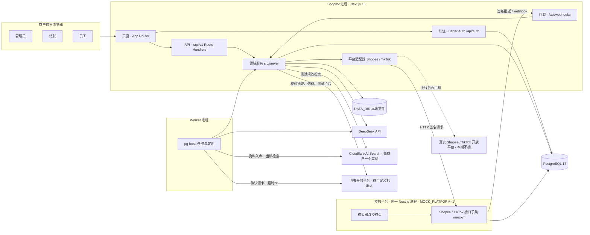

- 前端「我调谁」：页面只调 `/api/v1/*`、`/api/auth/*`；不直接调平台、不直连数据库。
- 后端「谁调我」：浏览器（成员会话 cookie）、平台回调（签名，§10 免列）、Worker（进程内调用领域服务，不走 HTTP）。
- 模拟平台与 Shopilot 同进程部署只为本机方便；它与 Shopilot 之间只经 HTTP 与签名回调交互，与真实平台一样，不共享领域代码（ADR-004）。
- 外部依赖与 §17 一一对应：DeepSeek、Cloudflare AI Search、飞书开放平台与群自定义机器人、平台开放接口（本期为模拟平台）、PostgreSQL、本地文件。邮件本期不出进程（写 `email_outbox`）。

## 7. 数据模型 / 领域实体

所有业务表都带 `merchant_id`，读写一律经带商户上下文的仓储函数（ADR-003）。字段完整定义以 §9 数据字典为准，ER 只列关键字段。账号、会话、密码凭据、两步验证的表由 Better Auth 管理（ADR-005），本节只画与业务相关的字段。

实体清单：

| ID | 实体 | 说明 |
| --- | --- | --- |
| `ENT-User` | 账号 | Better Auth `user` + `account`（密码哈希）+ `two_factor` |
| `ENT-Session` | 登录会话 | Better Auth `session`，加 `active_merchant_id` |
| `ENT-Merchant` | 商户 | 含所有者、时区、安全与数据策略、删除状态 |
| `ENT-Membership` | 成员 | 账号 × 商户 × 角色 × 状态 |
| `ENT-MembershipShop` | 负责店铺 | 成员 × 店铺 |
| `ENT-Invitation` | 邀请 | 链接令牌只存哈希 |
| `ENT-LoginEvent` | 登录记录 | 成功与失败都记 |
| `ENT-OwnershipTransfer` | 所有权转让 | 待对方确认 |
| `ENT-PlatformApp` | 平台应用 | 每商户每平台一个；密钥加密存储、只写不读 |
| `ENT-ConnectDraft` | 接入草稿 | 每商户每平台一个 |
| `ENT-Shop` | 店铺 | token 加密存储；能力表；授权到期 |
| `ENT-ShopReception` | 店铺接待模式 | 工作时间内 / 外两个模式 |
| `ENT-AssistRequest` | 远程协助单 | 只记录 |
| `ENT-InboundEvent` | 入站事件 | 幂等键 + 原始载荷 |
| `ENT-Conversation` | 会话 | 接待状态、处理人、版本号 |
| `ENT-Segment` | 会话段 | 阶段、统计口径 |
| `ENT-Message` | 消息 | 进出两向、类型、译文 |
| `ENT-Draft` | 草稿 | 模式、置信度、处置 |
| `ENT-File` | 文件 | 图片、发票 PDF / PNG、导出包、知识库原文件，存 DATA_DIR |
| `ENT-Order` | 订单镜像 | 平台原始状态 + 归一状态组 |
| `ENT-AfterSale` | 售后单镜像 | 退货退款 / 取消申请 |
| `ENT-Invoice` | 发票 | 两路发送状态 |
| `ENT-Ticket` | 工单 | 状态、等待对象、时限 |
| `ENT-TicketEvent` | 工单时间线 | 平台事件、人工操作、备注 |
| `ENT-ReceptionSettings` | 接待设置 | 商户级：排班、关键词、阈值、提醒、品牌语气 |
| `ENT-PromptTemplate` | 阶段提示词 | 商户 × 阶段，保留 10 个版本 |
| `ENT-QuickReply` | 快捷回复 | 商户级 |
| `ENT-KnowledgeIndex` | 检索服务实例 | 每商户一个，首次入库时创建 |
| `ENT-KnowledgeCategory` | 资料分类 | 商户级；内置「未分类」 |
| `ENT-KnowledgeDocument` | 资料 | 处理状态、AI 可用、适用站点、原文件 |
| `ENT-KnowledgePart` | 检索条目 | 资料在检索服务里的一份副本 |
| `ENT-KnowledgeChunk` | 分块 | 检索服务切出的文字，供「解析内容」与检索明细 |
| `ENT-TicketTypeConfig` | 工单类型配置 | 商户 × 类型 |
| `ENT-Subscription` | 订阅 | 套餐、周期、自动续费、模拟付款方式 |
| `ENT-UsagePeriod` | 用量周期 | 当期出稿数、额度、提醒记录 |
| `ENT-BillingStatement` | 账单 | 套餐费、加购 |
| `ENT-Notification` | 站内通知 | 收件成员、去重键、已读 |
| `ENT-NotificationRule` | 通知规则 | 商户 × 事件 × 渠道 |
| `ENT-AuditLog` | 审计日志 | 也是埋点事件落点 |
| `ENT-EmailOutbox` | 发件箱 | 本期不真实发信 |
| `ENT-FeishuIntegration` | 飞书接入 | 每商户一个：接法、应用凭证（加密）、校验状态、两个推送开关 |
| `ENT-FeishuTarget` | 飞书推送目标 | 默认群或某店的群；应用接法存群 ID，自定义机器人存地址与签名密钥（加密） |
| `ENT-FeishuDelivery` | 飞书投递记录 | 一张卡片的发送记录，同一会话段同一种卡一条 |
| `ENT-ExportJob` | 导出任务 | 数据全量导出 |
| `ENT-SalesLead` | 销售线索 | 只记录 |
| `ENT-Mock*` | 模拟平台表 | `mock_` 前缀，见本节末 |

租户与账号：

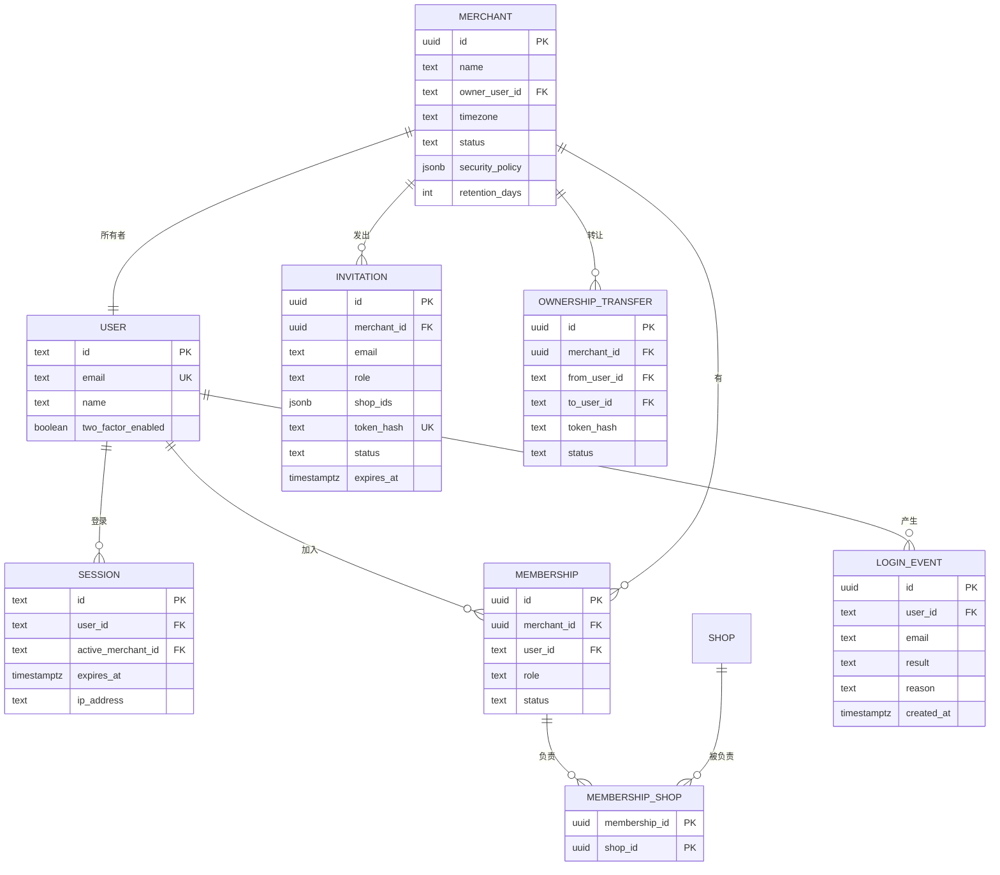

平台接入与入站：

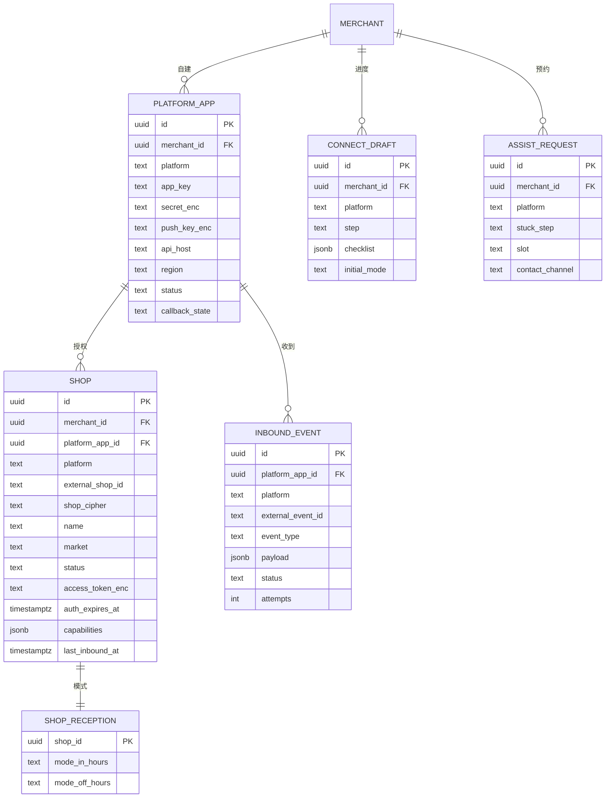

会话、消息、草稿：

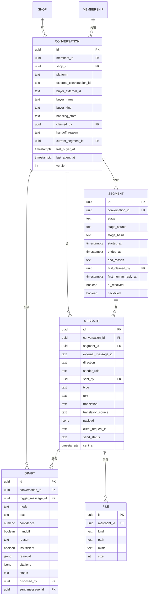

订单、售后、发票、工单：

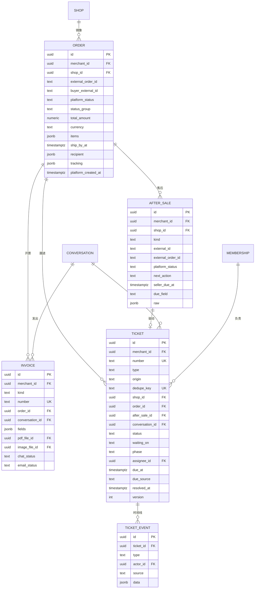

配置、计量、运营：

```mermaid
erDiagram
  MERCHANT ||--|| RECEPTION_SETTINGS : "接待"
  MERCHANT ||--o{ PROMPT_TEMPLATE : "提示词"
  MERCHANT ||--o{ QUICK_REPLY : "快捷回复"
  MERCHANT ||--o{ TICKET_TYPE_CONFIG : "工单配置"
  MERCHANT ||--|| SUBSCRIPTION : "订阅"
  MERCHANT ||--o{ USAGE_PERIOD : "用量"
  MERCHANT ||--o{ BILLING_STATEMENT : "账单"
  MEMBERSHIP ||--o{ NOTIFICATION : "收到"
  MERCHANT ||--o{ NOTIFICATION_RULE : "规则"
  MERCHANT ||--o{ AUDIT_LOG : "留痕"
  MERCHANT ||--o{ EMAIL_OUTBOX : "发信"
  MERCHANT ||--o{ EXPORT_JOB : "导出"
  RECEPTION_SETTINGS {
    uuid merchant_id PK
    jsonb schedule
    jsonb holidays
    jsonb handoff_keywords
    numeric confidence_threshold
    int unclaimed_remind_minutes
    int response_sla_minutes
    text brand_voice
  }
  PROMPT_TEMPLATE {
    uuid merchant_id PK
    text stage PK
    text text
    jsonb versions
  }
  QUICK_REPLY {
    uuid id PK
    uuid merchant_id FK
    text title
    text stage
    text text
  }
  TICKET_TYPE_CONFIG {
    uuid merchant_id PK
    text type PK
    boolean auto_create
    jsonb merchant_due
    text default_assignee
    jsonb remind
  }
  SUBSCRIPTION {
    uuid merchant_id PK
    text plan_code
    text cycle
    text pending_cycle
    timestamptz period_start
    timestamptz period_end
    boolean auto_renew
    jsonb payment_method
    text overage_policy
    jsonb alert_config
  }
  USAGE_PERIOD {
    uuid id PK
    uuid merchant_id FK
    timestamptz period_start
    int drafts_used
    int quota
    int topup_quota
    jsonb alerts_sent
  }
  BILLING_STATEMENT {
    uuid id PK
    uuid merchant_id FK
    text kind
    numeric amount
    text currency
    text status
  }
  NOTIFICATION {
    uuid id PK
    uuid membership_id FK
    text type
    text title
    text link
    text dedupe_key
    timestamptz read_at
  }
  NOTIFICATION_RULE {
    uuid merchant_id PK
    text event PK
    boolean in_app
    boolean email
  }
  AUDIT_LOG {
    uuid id PK
    uuid merchant_id FK
    uuid actor_membership_id FK
    text actor_source
    text module
    text action
    text target_type
    text target_id
    text summary
    jsonb data
    text request_id
  }
  EMAIL_OUTBOX {
    uuid id PK
    uuid merchant_id FK
    text to_email
    text template
    text subject
    text body
    text status
  }
  EXPORT_JOB {
    uuid id PK
    uuid merchant_id FK
    text status
    uuid file_id FK
    timestamptz expires_at
  }
```

知识库（本组表结构待签字：上线后再改要做数据迁移）：

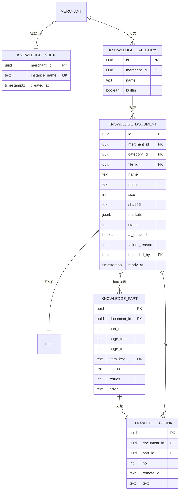

飞书推送（本组表结构待签字：上线后再改要做数据迁移）：

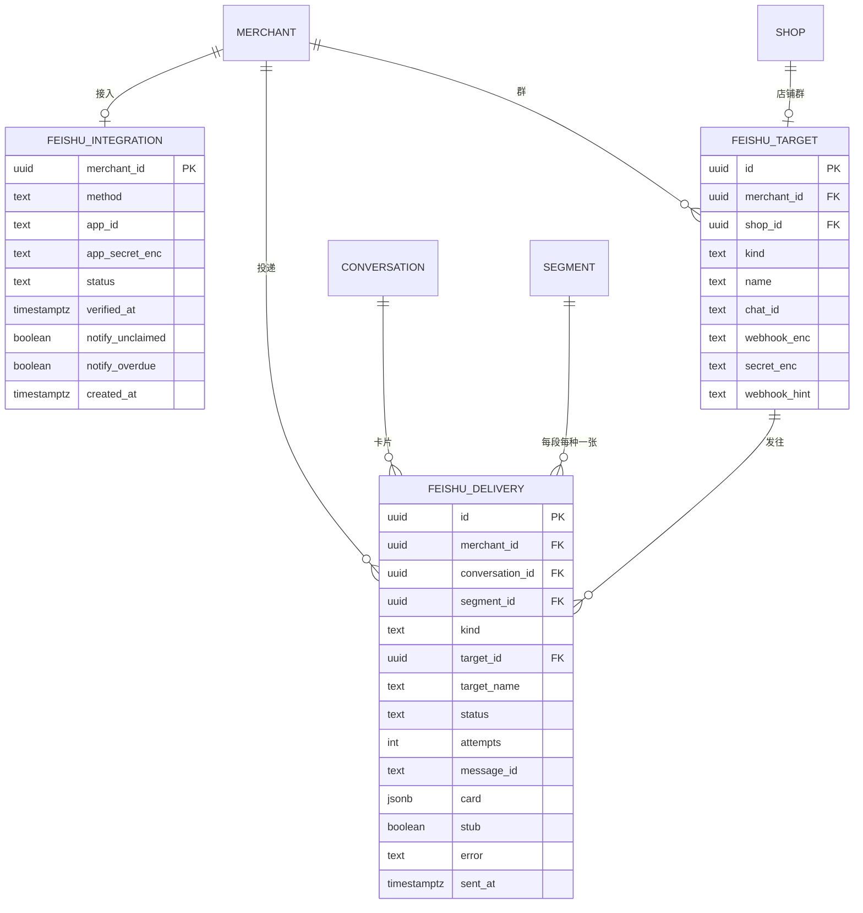

- 默认群每商户最多一个（`shop_id` 为空），每家店最多一个店铺群；`(segment_id, kind)` 在 `segment_id` 非空时唯一（INV-FEISHU-001）。
- 投递记录随会话、会话段删除（数据保存期限清理、删除买家数据）；目标群删掉后投递记录保留，`target_id` 置空，群名留在 `target_name`。

模拟平台（`mock_` 前缀，只服务 §8「模拟平台接口」与模拟器；Shopilot 业务代码不得直接读写这些表，只能经 HTTP）：

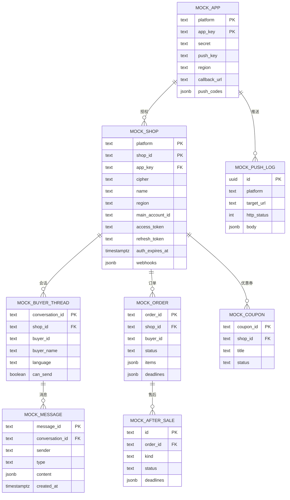

## 8. 接口契约 (API-first)

契约的单一事实源是 `src/contracts/*.ts` 里的 zod schema：前端与后端引用同一份 schema 推导类型、做运行时校验（ADR-002、§24）。本节给每个端点的摘要；字段定义见 §9，权限见 §10，错误类型见 §14。

通用约定：

- 基础路径 `/api/v1`；认证端点由 Better Auth 挂在 `/api/auth/*`；平台回调在 `/api/webhooks/*`；模拟平台在 `/mock/*` 与 `/api/mock/*`。
- 鉴权：成员会话 cookie（`HttpOnly; SameSite=Lax`，生产 `Secure`）。当前商户取自会话的 `active_merchant_id`，请求不带商户 ID；路径里的资源 ID 不属于当前商户时一律返回 404（REQ-PERM-002）。
- 请求与响应都是 JSON（UTF-8），时间为 ISO 8601 带时区，金额为字符串小数 + `currency`。
- 列表默认游标分页：`?cursor=<opaque>&limit=<1..100，默认 30>`，响应 `{ items, nextCursor }`。
- 带 `?format=csv` 的列表端点返回 `text/csv; charset=utf-8`（带 BOM），最多 10,000 行，超出返回 422 `/errors/validation` 提示缩小范围。
- 幂等：发送消息用 body 里的 `clientRequestId`；其余标「幂等键」的写端点接受 header `Idempotency-Key`（24 小时内同键同参返回首次结果，同键异参返回 422）。状态迁移类写端点带 `version` 时做乐观并发，不一致返回 409 `/errors/conflict` 并附当前状态。
- 缓存：全部 `/api/v1` 响应 `Cache-Control: no-store`（租户数据、实时性要求高、需登录）。前端用 TanStack Query，轮询间隔见 §15，写成功后按 §16 失效相应查询。
- 超时与重试：前端读请求超时 15 秒、自动重试 1 次；写请求超时 30 秒、不自动重试（带 `clientRequestId` / `Idempotency-Key` 的由用户点「重试」时复用同一个键）。
- 每个响应带 `X-Request-Id`；错误体是 RFC 9457 problem+json（§14）。
- 通用错误：所有 `/api/v1` 端点都可能返回 401 `/errors/unauthenticated`、403 `/errors/forbidden`、404 `/errors/not-found`、422 `/errors/validation`、429 `/errors/rate-limited`、500 `/errors/internal`；下表「特有错误」只列额外的。

演进与弃用：

- 版本方案：路径主版本 `/api/v1`；契约文件随代码同仓，按 SemVer 记在 `src/contracts/VERSION`。当前 1.0.0（未发布）。
- 弃用期：上线后 ≥ 90 天；兼容承诺对象：Shopilot Web 前端（同仓同发布）；本期无第三方调用方。
- 当前 deprecated 清单：无。

### 8.1 认证与账号

| ID | 方法 路径 | 实现 | 请求 | 响应 | 特有错误 | 幂等 / 缓存 |
| --- | --- | --- | --- | --- | --- | --- |
| `API-AUTH-001` | `POST /api/v1/signup` | REQ-AUTH-001 | `{ email, password(≥10 位), name, merchantName, timezone }` | 201 `{ user, merchant, membership }`，设会话 cookie | 409 `/errors/duplicate`（邮箱已注册，提示去登录） | 无；同邮箱并发由唯一约束兜底 |
| `API-AUTH-002` | `POST /api/auth/sign-in/email` | REQ-AUTH-002、REQ-AUTH-005 | `{ email, password, rememberMe }` | 200 `{ user }` 设 cookie；开了两步验证时 200 `{ twoFactorRedirect: true }` | 401 `/errors/invalid-login`；423 `/errors/locked`（附 `retryAfter`）；403 `/errors/ip-blocked`；403 `/errors/forbidden`（`code: member_disabled`，账号在所有商户都已停用）；后两种拦截都删掉刚建的会话并记一条失败登录（`ip_blocked` / `disabled`）；429 `/errors/rate-limited`（同 IP 每分钟 30 次，被限频的尝试不校验密码，不记失败、不计入锁定） | 不重试 |
| `API-AUTH-003` | `POST /api/auth/sign-out` | REQ-AUTH-002 | — | 200 | — | 天然幂等 |
| `API-AUTH-004` | `POST /api/v1/password/forgot` | REQ-AUTH-003 | `{ email }` | 202（无论邮箱是否存在，防枚举）；存在时写发件箱 | — | 同邮箱 60 秒内只发一封 |
| `API-AUTH-005` | `POST /api/v1/password/reset` | REQ-AUTH-003 | `{ token, newPassword }` | 200；吊销该账号其他会话；页面随后回 `/login` 并提示密码已重置 | 410 `/errors/expired`（`code: used` 已用过、`expired` 超过 30 分钟、`invalid` 令牌不存在） | 令牌一次性；用过的令牌另记 30 天，用来区分 `used` 与 `invalid` |
| `API-AUTH-006` | `GET /api/v1/me` | REQ-AUTH-004、REQ-PERM-001 | — | `{ user, memberships[{ merchantId, merchantName, role, shopCount }], active: { merchantId, merchantName, timezone, membershipId, role, isOwner, shopIds, shops[{ id, name, platform, market }], disconnectedShops[{ id, name, platform, market }]（已断开的店，只用于会话、订单列表的店铺筛选）, permissions[] }, preferences, twoFactorRequired }` | — | no-store |
| `API-AUTH-007` | `POST /api/v1/me/active-merchant` | REQ-AUTH-004 | `{ merchantId }` | 200 同 `API-AUTH-006` | 403 `/errors/forbidden`（不是该商户启用成员） | 幂等 |
| `API-AUTH-008` | `POST /api/auth/two-factor/{enable,verify-totp,verify-backup-code,disable}` | REQ-AUTH-005 | Better Auth 两步验证插件原样（`password`、`code`）；登录的两步验证步骤可改用备用码（`verify-backup-code`，每个备用码只能用一次） | `enable` 返回 `totpURI` 与备用码，页面用 `totpURI` 显示二维码，密钥作手动输入的备选 | 401 `/errors/invalid-login`（验证码或备用码错） | 不重试 |
| `API-AUTH-009` | `GET /api/v1/me/sessions` | REQ-AUTH-006 | — | `{ items[{ id, ipAddress, userAgent, createdAt, lastActiveAt, current }] }` | — | no-store |
| `API-AUTH-010` | `POST /api/v1/me/sessions/revoke` | REQ-AUTH-006 | `{ sessionId }` 或 `{ others: true }` | 200 `{ revoked }` | — | 幂等 |
| `API-AUTH-011` | `PUT /api/v1/me/preferences` | REQ-SET-002 | `{ desktopNotify, sound }` | 200 | — | 幂等 |

### 8.2 团队与成员

| ID | 方法 路径 | 实现 | 请求 | 响应 | 特有错误 | 幂等 / 缓存 |
| --- | --- | --- | --- | --- | --- | --- |
| `API-TEAM-001` | `GET /api/v1/members` | REQ-TEAM-005 | `?role=&status=active\|disabled\|invited&period=week\|last_week\|30d` | `{ members[{ membershipId, userId, name, email, role, isOwner, status, shopIds, twoFactorEnabled, lastSeenAt, online, handled{ segments, transferred, firstReplyMedianSec } }], invitations[{ id, email, role, shopIds, status, expiresAt, invitedByName, createdAt }], stats{ onlineCount, activeCount, disabledCount, firstReplyMedianSec, longestWaitingSec, periodStart }, seats{ used, limit }, recent[] }`；列表「状态」列显示在线或最近活跃时间，已停用的显示「已停用」；`online` = 有未过期的登录会话且 `lastSeenAt` 在 5 分钟内 | — | no-store |
| `API-TEAM-002` | `POST /api/v1/invitations` | REQ-TEAM-001 | `{ emails[1..20], role, shopIds[] }` | 201 `{ items[{ id, email, link, expiresAt }] }`；写发件箱 | 409 `/errors/duplicate`（已是成员 `code: already_member`；已有待接受邀请 `code: already_invited`，逐个邮箱列出）；409 `/errors/not-allowed`（席位超套餐上限） | 幂等键 |
| `API-TEAM-003` | `POST /api/v1/invitations/{id}/resend` | REQ-TEAM-001 | — | 200 `{ link, expiresAt }`；旧令牌作废 | 409 `/errors/conflict`（已接受） | 幂等键 |
| `API-TEAM-004` | `POST /api/v1/invitations/{id}/revoke` | REQ-TEAM-001 | — | 200 | — | 幂等（已撤销再撤销返回 200） |
| `API-TEAM-005` | `GET /api/v1/invitations/by-token/{token}` | REQ-TEAM-002 | 公开端点 | `{ merchantName, inviterName, email, role, shopNames, accountExists }` | 410 `/errors/expired`（附 `code: expired\|revoked\|used\|invalid`） | no-store |
| `API-TEAM-006` | `POST /api/v1/invitations/accept` | REQ-TEAM-002 | `{ token, name?, password? }`（账号不存在时必填）；账号已存在时须已登录且邮箱一致 | 200 `{ membership }`，设会话并把当前商户切到该商户 | 410 `/errors/expired`；403 `/errors/forbidden`（登录邮箱与邀请不一致） | 令牌一次性 |
| `API-TEAM-007` | `PATCH /api/v1/members/{id}` | REQ-TEAM-003 | `{ role?, shopIds? }`；只传 `role` 时不改负责店铺（改成管理员再改回员工，原负责店铺仍在） | 200 成员 | 409 `/errors/not-allowed`（所有者不能改角色） | 幂等 |
| `API-TEAM-008` | `POST /api/v1/members/{id}/disable` | REQ-TEAM-004 | — | 200 `{ releasedConversations, returnedTickets }` | 409 `/errors/not-allowed`（所有者、本人） | 幂等 |
| `API-TEAM-009` | `POST /api/v1/members/{id}/enable` | REQ-TEAM-004 | — | 200 | 409 `/errors/not-allowed`（席位已满） | 幂等 |
| `API-TEAM-010` | `POST /api/v1/members/{id}/reset-password` | REQ-TEAM-006 | — | 202；写发件箱 | — | 60 秒内同成员只发一封 |
| `API-TEAM-011` | `GET /api/v1/login-events` | REQ-TEAM-006 | `?result=success\|failure&from=&to=&format=csv` | `{ items[{ email, name?, result, reason, ip, userAgent, createdAt }] }` | — | no-store |
| `API-TEAM-012` | `GET /api/v1/members/options` | REQ-CONV-004、REQ-TKT-002 | `?shopId=` | `{ items[{ membershipId, name, role }] }`：负责该店的启用组长、员工 + 全部启用管理员 | — | no-store |

### 8.3 店铺与接入

| ID | 方法 路径 | 实现 | 请求 | 响应 | 特有错误 | 幂等 / 缓存 |
| --- | --- | --- | --- | --- | --- | --- |
| `API-SHOP-001` | `GET /api/v1/connect/drafts/{platform}` | REQ-SHOP-001 | `platform` = `shopee\|tiktok` | `{ step, checklist{1..5: boolean}, initialMode, app?{ status, region, callbackState } }` | — | no-store |
| `API-SHOP-002` | `PUT /api/v1/connect/drafts/{platform}` | REQ-SHOP-001 | `{ step?, checklist?, initialMode? }` | 200 草稿 | — | 幂等 |
| `API-SHOP-003` | `PUT /api/v1/platform-apps/{platform}` | REQ-SHOP-002、REQ-SHOP-003 | Shopee `{ partnerId, partnerKey, pushKey?, keyExpiresAt?, overwriteCallback? }`；TikTok `{ appKey, appSecret }` | 200 `{ status, region, sandboxOnly, callbackState: set\|already_ours\|other_needs_confirm, callbackCurrent? }`；密钥字段只写不读 | 422 `/errors/platform-credentials`（附各区域尝试结果）；409 `/errors/callback-occupied`（回调指向别处且未确认） | 幂等（同参重复保存结果相同） |
| `API-SHOP-004` | `POST /api/v1/platform-apps/{platform}/auth-url` | REQ-SHOP-004、REQ-SHOP-009 | `{ shopRegion?(TikTok 必填), shopId?(续期) }` | 200 `{ url, expiresAt(5 分钟) }` | 409 `/errors/not-allowed`（应用未校验） | 每次新 `state` |
| `API-SHOP-005` | `GET /api/v1/oauth/{platform}/callback` | REQ-SHOP-004、REQ-SHOP-009 | 平台重定向：Shopee `?code&shop_id\|main_account_id&state`；TikTok `?code&state` | 成功 302 到 `/shops/connect/{platform}/probe`；失败 302 回 `/shops/connect/{platform}/auth?result=error&reason=` | 以 302 + `reason` 表达：`state_invalid`（含过期）、`secret_or_redirect_mismatch`、`sub_account`、`denied`、`shop_limit`、`platform_error` | `state` 一次性；同 code 重放返回首次结果 |
| `API-SHOP-006` | `GET /api/v1/connect/{platform}/probe` | REQ-SHOP-005 | — | `{ shops[{ shopId, name, market, chat{ ok, reason? }, orders{ ok, reason? }, pii{ masked }, backfill{ state, conversations, orders } }] }` | — | no-store；首次调用触发检查，其后读缓存结果 60 秒 |
| `API-SHOP-007` | `POST /api/v1/connect/{platform}/complete` | REQ-SHOP-005 | `{ initialMode: shadow\|off }` | 200 `{ shops }`；本次接入店铺写入接待模式、开始接收推送、排回补任务 | 409 `/errors/not-allowed`（没有已授权店铺） | 幂等 |
| `API-SHOP-008` | `GET /api/v1/shops` | REQ-SHOP-006 | `?platform=&status=attention\|ok&period=7d\|30d\|this_month\|last_month` | `{ items[{ id, platform, name, market, status, authExpiresAt, modes, lastInboundAt, zeroInbound7d, metrics{ platformLabel, responseRate, target?, ... }, issues[] }], summary }` | — | no-store |
| `API-SHOP-009` | `GET /api/v1/shops/{id}` | REQ-SHOP-006 | — | 店铺详情 + 能力表 + 连接事件（最近 20 条） | — | no-store |
| `API-SHOP-010` | `POST /api/v1/shops/diagnose` | REQ-SHOP-007 | `{ shopIds? }`（空 = 全部可见店铺） | 200 `{ results[{ shopId, checks[{ key, ok, reason?, fixLink? }] }] }` | — | 只读，可重试 |
| `API-SHOP-011` | `POST /api/v1/platform-apps/{platform}/rotate` | REQ-SHOP-008 | Shopee `{ partnerKey, pushKey? }`；TikTok `{ appSecret }` | 200；验证通过才替换 | 422 `/errors/platform-credentials`（旧密钥保留） | 幂等键 |
| `API-SHOP-012` | `POST /api/v1/shops/{id}/disconnect` | REQ-SHOP-010 | `{ keepHistory: boolean }` | 200 | — | 幂等 |
| `API-SHOP-013` | `POST /api/v1/shops/{id}/cancel-auth-url` | REQ-SHOP-010 | — | 200 `{ url, expiresAt }`（仅 Shopee） | 409 `/errors/not-allowed`（TikTok 无撤销接口） | — |
| `API-SHOP-014` | `POST /api/v1/assist-requests` | REQ-SHOP-011 | `{ platform, stuckStep, slot, contactChannel, contact, note? }` | 201 | — | 幂等键 |

### 8.4 平台回调（入站）

| ID | 方法 路径 | 实现 | 请求 | 响应 | 特有错误 | 幂等 / 缓存 |
| --- | --- | --- | --- | --- | --- | --- |
| `API-HOOK-001` | `POST /api/webhooks/shopee/{appId}` | REQ-CONV-001、REQ-TKT-001、REQ-SHOP-012 | Shopee 推送原文：`{ code, shop_id, timestamp, data }`；header `Authorization` = HMAC-SHA256(Push Key 或 Partner Key, `<回调 URL>\|<原始 body>`) | 200 空体，2 秒内 | 401 `/errors/signature`（不落库） | 幂等键 = `code + shop_id + data 的稳定摘要`（code 10 用 `message_id`） |
| `API-HOOK-002` | `POST /api/webhooks/tiktok/{appId}` | REQ-CONV-001、REQ-TKT-001、REQ-SHOP-012 | TikTok webhook 原文：`{ type, tts_notification_id, shop_id, timestamp, data }`；header `Authorization` = HMAC-SHA256(App Secret, `app_key + 原始 body`) | 200 空体，2 秒内 | 401 `/errors/signature` | 幂等键 = `tts_notification_id` |

处理的事件：Shopee code 10（聊天）、3（订单状态，含 IN_CANCEL）、4（运单号）、29（退货）、30（包裹履约，异常值建物流异常工单）、1 / 2（授权、取消授权）、12（授权一周内到期）、28（店铺处罚，进连接事件）；TikTok type 1（订单状态）、6（取消授权）、7（授权即将到期）、11（取消状态）、12（退货状态）、13（新会话）、14（新消息）。其余事件记 `ignored`。

### 8.5 会话与工作台

| ID | 方法 路径 | 实现 | 请求 | 响应 | 特有错误 | 幂等 / 缓存 |
| --- | --- | --- | --- | --- | --- | --- |
| `API-CONV-001` | `GET /api/v1/conversations` | REQ-CONV-002 | `?view=queue\|ai\|mine\|team\|done&platform=&shopId=&cursor=`（`ai` = AI 接待中：assist 待审草稿与 auto 回复中的会话） | `{ items[{ id, shop{ id, name, platform, market }, buyerName, preview, lastMessageAt, waitingSinceSec, pinned, overdue, handlingState, claimedBy?, draftPending, stage, openTickets[{ number, type, dueAt }] }], counts{ queue, ai, mine, team, done }, nextCursor }` | — | no-store；前端 10 秒轮询 |
| `API-CONV-002` | `GET /api/v1/conversations/{id}` | REQ-CONV-003 | `?before=<messageId>`（向前翻页，每页 50） | `{ conversation{ ..., version, waitingSinceSec, responseSlaMinutes, overdue, canReply, replyBlockedReason }, segment{ stage, stageSource, stageBasis }, messages[]（含 sender_role = system 的系统事件）, hasMore, draft?{ id, text, confidence, reason, mode, createdAt, insufficient, citations[{ documentId, name, available }] }, shadowDrafts?[{ id, text, confidence, triggerMessageId, createdAt, insufficient, citations[] }]（只返回给管理员、组长；`citations` 是依据，`available = false` 表示资料已删除）, capabilities{ cards[], productCard{ enabled, reason? }, coupons, endSession, maxTextLength }, events[], openTickets[], history[{ stage, startedAt, endedAt, endReason, claimedBy, messages }], permissions{ canClaim, canSend, canTransfer, canClose, canChangeStage, canIgnoreDraft } }`；`canReply = false` 的三种原因：达人会话、店铺授权失效、买家最后发言超过 7 天 | — | no-store；前端 4 秒轮询 |
| `API-CONV-003` | `GET /api/v1/conversations/{id}/buyer` | REQ-ORD-001、REQ-CONV-003 | — | `{ buyer{ name, externalId, language }, orders[{ id, externalOrderId, status, statusGroup, total, currency, items, shipByAt, tracking?, recipient?, afterSales[{ kind, platformStatus, sellerDueAt, open }] }], totals{ count180d, amount180d, currency }, piiMasked, syncedAt }`；只读订单镜像，不实时调平台（镜像由推送、每小时 `order.sync` 与 `API-ORD-003` 手动同步保持新鲜） | — | no-store；前端 10 秒轮询（订单推送到达后 10 秒内显示，见 §19） |
| `API-CONV-004` | `POST /api/v1/conversations/{id}/claim` | REQ-CONV-004、REQ-FEISHU-006 | `{ version? }`：带了只在版本一致时认领；不带不比对版本，飞书卡片落地时用 | 200 会话 | 409 `/errors/conflict`（已被他人认领，附 `claimedBy`；员工看不到同事处理中的会话时同样返回它） | 重复认领本人已认领的会话返回 200 |
| `API-CONV-005` | `POST /api/v1/conversations/{id}/assign` | REQ-CONV-004 | `{ toMembershipId, withTickets: boolean, version }` | 200 会话 | 409 `/errors/conflict`；422（目标不负责该店或已停用） | 目标已是处理人返回 200 |
| `API-CONV-006` | `POST /api/v1/conversations/{id}/close` | REQ-CONV-004 | `{ reason?, version }` | 200 会话；TikTok 结束会话失败只记录，不阻断 | 409 `/errors/conflict` | 已结束再结束返回 200 |
| `API-CONV-007` | `POST /api/v1/conversations/{id}/messages` | REQ-CONV-005、REQ-AI-003、REQ-CONV-008 | `{ clientRequestId, type: text\|image\|order_card\|logistics_card\|return_card\|coupon_card, text?, fileId?, orderId?, packageId?, skuId?, couponId?, couponTitle?（只用于时间线显示）, translateTo?, draftId?, disposition?: sent\|edited_sent }`；待认领会话发送 = 先认领再发送 | 201 `{ message{ id, sendStatus } }` | 409 `/errors/conflict`（会话已被他人认领或已结束）；409 `/errors/not-allowed`（能力表不支持该类型、买家 7 天外不可发、店铺授权失效 `code: shop_auth_expired`）；502 `/errors/platform`；504 `/errors/platform-timeout` | `clientRequestId` 幂等：同键返回首次结果 |
| `API-CONV-008` | `POST /api/v1/conversations/{id}/drafts/{draftId}/ignore` | REQ-AI-003 | — | 200 | 409 `/errors/conflict`（草稿已处置或过期） | 已忽略再忽略返回 200 |
| `API-CONV-009` | `PATCH /api/v1/conversations/{id}/segment` | REQ-CONV-007 | `{ stage: presale\|insale\|aftersale\|unknown }` | 200 段 | — | 幂等 |
| `API-CONV-010` | `POST /api/v1/files` | REQ-CONV-005 | multipart `file`（JPG / PNG / WebP，≤ 10 MB） | 201 `{ id, url, width, height }` | 413 `/errors/too-large`；415 `/errors/unsupported-type` | — |
| `API-CONV-011` | `GET /api/v1/files/{id}` | REQ-CONV-005、REQ-ORD-006、REQ-SET-004、REQ-KB-002 | — | 文件流；按所属对象鉴权（知识库原文件要求 `knowledge.manage`）；PDF 与图片 `inline`，其余 `attachment` | — | `private, max-age=300` |
| `API-CONV-012` | `POST /api/v1/translate` | REQ-CONV-008 | `{ text, target: ms\|en\|th\|vi\|id\|tl\|zh }` | 200 `{ text }` | 502 / 504 `/errors/ai-unavailable` | 可重试 |
| `API-CONV-013` | `GET /api/v1/shops/{id}/coupons` | REQ-CONV-005 | — | `{ items[{ couponId, title, discount, endsAt }] }`（只返回可在聊天发送的券） | 409 `/errors/not-allowed`（Shopee 店） | no-store |
| `API-CONV-014` | `GET /api/v1/quick-replies` | REQ-CONV-009 | `?stage=` | `{ items[{ id, title, stage, text }] }` | — | no-store |
| `API-CONV-015` | `POST /api/v1/conversations/{id}/messages/{messageId}/retry` | REQ-CONV-005、REQ-AI-003 | — | 200 `{ message }` | 409 `/errors/conflict`（不是 failed） | 只对 `send_status=failed` 生效 |

### 8.6 订单、售后、发票

| ID | 方法 路径 | 实现 | 请求 | 响应 | 特有错误 | 幂等 / 缓存 |
| --- | --- | --- | --- | --- | --- | --- |
| `API-ORD-001` | `GET /api/v1/orders` | REQ-ORD-003 | `?platform=&statusGroup=&shopId=&q=&cursor=&format=csv` | `{ items[{ id, shop, externalOrderId, buyerName, statusGroup, platformStatus, total, currency, shipByAt, createdAt, openTicket? }], afterSalesPending[], syncState[{ shopId, lastSyncAt, pushOk }] }` | — | no-store |
| `API-ORD-002` | `GET /api/v1/orders/{id}` | REQ-ORD-003 | — | 订单详情 + 售后单 + 关联工单 + 发票 | — | no-store |
| `API-ORD-003` | `POST /api/v1/orders/sync` | REQ-ORD-001 | `{ shopId? }` | 202 `{ jobIds }` | 429（同店 60 秒内重复） | 幂等（排队中的同店任务不重复排） |
| `API-ORD-004` | `POST /api/v1/orders/{id}/cancel` | REQ-ORD-002 | `{ reason: buyer_request, conversationId? }` | 200 订单（状态取平台返回后刷新）；审计 `EVT:order_cancelled` | 409 `/errors/not-allowed`（已发货或状态不允许）；502 / 504 平台错误 | 幂等键（必填） |
| `API-ORD-005` | `GET /api/v1/after-sales/{id}` | REQ-ORD-004、REQ-ORD-005 | — | `{ kind, platformStatus, nextAction, sellerDueAt, dueField, reason, amount, evidence[], ticket? }` | — | no-store |
| `API-ORD-006` | `POST /api/v1/after-sales/{id}/cancellation-decision` | REQ-ORD-004 | `{ decision: accept\|reject, reason? }` | 200 售后单 + 工单；审计 `EVT:aftersale_decided` | 409 `/errors/not-allowed`（不在可处理状态）；502 / 504 | 幂等键（必填） |
| `API-ORD-007` | `POST /api/v1/after-sales/{id}/return-decision` | REQ-ORD-005 | `{ decision: approve_return\|reject_return\|approve_received\|reject_received\|confirm_refund\|dispute, reasonCode?, comment? }` | 200 售后单 + 工单 | 409 `/errors/not-allowed`（平台与状态不支持该动作）；502 / 504 | 幂等键（必填），同时作为 TikTok `idempotency_key` |
| `API-ORD-008` | `GET /api/v1/after-sales/{id}/reject-reasons` | REQ-ORD-005 | — | `{ items[{ code, text }] }`（TikTok Get Reject Reasons） | 409（Shopee） | no-store |
| `API-INV-001` | `POST /api/v1/invoices/extract` | REQ-AI-006 | `{ conversationId, orderId? }` | 200 `{ fields{ buyerName?, address?, email?, taxId? }, confidence }`；不计出稿 | 502 / 504 `/errors/ai-unavailable` | 可重试 |
| `API-INV-002` | `POST /api/v1/invoices` | REQ-ORD-006 | `{ kind, conversationId?, orderId, fields{ buyerName, address, email?, taxId?, items[{ name, qty, unitPrice }], currency, notes? }, sendToChat, sendEmail }` | 201 `{ invoice{ id, number, chatStatus, emailStatus, pdfUrl, imageUrl } }` | 409 `/errors/not-allowed`（没有会话却要求发聊天）；409 `/errors/conflict`（带 `conversationId` 时订单不属于该会话的买家：同店且 `order.buyer_external_id = conversation.buyer_external_id` 才算） | 幂等键（必填） |
| `API-INV-003` | `GET /api/v1/invoices` | REQ-ORD-006 | `?kind=&cursor=` | `{ items[{ id, number, kind, buyerName, orderId, amount, currency, chatStatus, emailStatus, createdAt, ticket? }] }` | — | no-store |
| `API-INV-004` | `GET /api/v1/invoices/{id}/pdf` | REQ-ORD-006 | — | `application/pdf` | — | `private, max-age=300` |
| `API-INV-005` | `POST /api/v1/invoices/{id}/resend-email` | REQ-ORD-006 | `{ email? }` | 200 发票 | 409 `/errors/not-allowed`（没有邮箱） | 幂等键 |

### 8.7 工单

| ID | 方法 路径 | 实现 | 请求 | 响应 | 特有错误 | 幂等 / 缓存 |
| --- | --- | --- | --- | --- | --- | --- |
| `API-TKT-001` | `GET /api/v1/tickets` | REQ-TKT-003 | `?type=&status=&platform=&scope=mine\|all&view=list\|board&format=csv&cursor=` | list：`{ items[{ id, number, type, origin, status, waitingOn, phase, platformStatus, shop, buyerName, orderId, assignee, dueAt, dueSource, overdue, remainingSec, updatedAt }], stats{ open, due6h, overdue, resolvedThisWeek, resolveMedianSec }, byType[], platformFeed[] }`；board：`{ columns{ open, in_progress, waiting, resolved_today } }` | — | no-store |
| `API-TKT-002` | `GET /api/v1/tickets/{id}` | REQ-TKT-003 | — | `{ ticket{ ..., version, manualStatusAllowed, phases[], nextActions[] }, events[], links{ conversationId?, orderId?, afterSaleId? } }` | — | no-store |
| `API-TKT-003` | `POST /api/v1/tickets` | REQ-TKT-002 | `{ type, shopId, orderId?, afterSaleId?, conversationId?, assigneeId?, dueAt?(仅商户时限类可改), note? }` | 201 工单 | 409 `/errors/duplicate`（附 `existingTicketId`、`number`）；403 `/errors/forbidden`（员工指定他人为负责人，`code: assignee_not_allowed`） | 去重键即幂等 |
| `API-TKT-004` | `POST /api/v1/tickets/{id}/status` | REQ-TKT-003 | `{ status: in_progress\|waiting\|resolved, waitingOn?: buyer\|platform\|internal, version }` | 200 工单 | 409 `/errors/not-allowed`（平台类工单、非法迁移）；409 `/errors/conflict`（版本） | 目标状态相同返回 200 |
| `API-TKT-005` | `POST /api/v1/tickets/{id}/assign` | REQ-TKT-003 | `{ assigneeId }` | 200 工单 | 422（目标不负责该店） | 幂等 |
| `API-TKT-006` | `POST /api/v1/tickets/{id}/notes` | REQ-TKT-003 | `{ text(1..2000) }` | 201 事件 | — | 幂等键 |
| `API-TKT-007` | `POST /api/v1/tickets/{id}/void` | REQ-TKT-003 | `{ reason }` | 200 工单 | 409 `/errors/not-allowed`（已解决 / 已关闭） | 已作废返回 200 |
| `API-TKT-008` | `PATCH /api/v1/tickets/{id}/due` | REQ-TKT-003 | `{ dueAt }` | 200 工单 | 409 `/errors/not-allowed`（时限来源为平台） | 幂等 |

### 8.8 接待设置

| ID | 方法 路径 | 实现 | 请求 | 响应 | 特有错误 | 幂等 / 缓存 |
| --- | --- | --- | --- | --- | --- | --- |
| `API-RCP-001` | `GET /api/v1/reception` | REQ-RCP-001、REQ-RCP-002、REQ-RCP-003 | — | `{ shops[{ shopId, name, platform, market, modeInHours, modeOffHours, autoAllowed, autoBlockedReason? }], hours{ timezone, schedule, holidays }, handoff{ keywords, confidenceThreshold, unclaimedRemindMinutes, responseSlaMinutes }, prompts{ brandVoice, stages{ presale, insale, aftersale }{ text, isDefault, versions[] }, unknownStageText, guardrails } }` | — | no-store |
| `API-RCP-002` | `PUT /api/v1/reception/modes` | REQ-RCP-001 | `{ shops[{ shopId, modeInHours, modeOffHours }] }` | 200 | 409 `/errors/not-allowed`（Shopee 店选 auto） | 幂等 |
| `API-RCP-003` | `PUT /api/v1/reception/hours` | REQ-RCP-002 | `{ timezone, schedule{ mon..sun: { on, start, end } }, holidays[date], keywords[≤30], confidenceThreshold(0.5..0.95), unclaimedRemindMinutes: 5\|10\|15\|null, responseSlaMinutes }` | 200 | — | 幂等 |
| `API-RCP-004` | `PUT /api/v1/reception/prompts` | REQ-RCP-003 | `{ brandVoice?, stages?{ presale?, insale?, aftersale? } }`（每段 ≤ 6,000 字） | 200 | — | 幂等 |
| `API-RCP-005` | `POST /api/v1/reception/prompts/{stage}/reset` | REQ-RCP-003 | — | 200 | — | 幂等 |
| `API-RCP-006` | `GET /api/v1/reception/ticket-types` | REQ-RCP-004 | — | `{ types[{ type, trigger, dueSourceLabel, autoCreate, merchantDue, defaultAssignee, remind, platformDriven }], autoCloseDays, numberPrefix }` | — | no-store |
| `API-RCP-007` | `PUT /api/v1/reception/ticket-types` | REQ-RCP-004 | `{ types[{ type, autoCreate?, merchantDue?, defaultAssignee?, remind? }], autoCloseDays: 3\|7\|14\|null }` | 200 | 409 `/errors/not-allowed`（改平台类时限） | 幂等 |
| `API-RCP-008` | `POST /api/v1/quick-replies` | REQ-CONV-009 | `{ title, stage, text(≤2000) }` | 201 | — | 幂等键 |
| `API-RCP-009` | `PATCH /api/v1/quick-replies/{id}` | REQ-CONV-009 | `{ title?, stage?, text? }` | 200 | — | 幂等 |
| `API-RCP-010` | `DELETE /api/v1/quick-replies/{id}` | REQ-CONV-009 | — | 204 | — | 幂等 |
| `API-KB-001` | `GET /api/v1/knowledge/documents` | REQ-KB-002、REQ-KB-003 | `?categoryId=&market=ALL\|MY\|TH\|VN\|PH\|SG\|ID&status=queued\|processing\|ready\|failed&aiEnabled=&q=&cursor=`（`q` 按文件名包含匹配；`market` 选具体站点时也列出适用全部站点的资料，选 `ALL` 只列适用全部站点的资料） | `{ items[{ id, name, mime, size, categoryId, markets[], status, aiEnabled, failureReason?, partsCount, chunksCount, uploadedByName, createdAt, readyAt? }], counts{ total, limit }, nextCursor }`；`limit` 为 500 | — | no-store；有排队或解析中的资料时前端 5 秒轮询 |
| `API-KB-002` | `POST /api/v1/knowledge/documents` | REQ-KB-001 | multipart：`file`（一次一个文件，前端逐个上传并逐个显示结果）、`categoryId?`（默认「未分类」）、`markets[]`（默认 `ALL`） | 201 `{ document }`（`status = queued`），排 `knowledge.ingest`；审计 `EVT:knowledge_uploaded` | 413 `/errors/too-large`（`code: file_limit` 超过 20 MB；`code: retrieval_limit` PDF 以外超过 4 MB）；415 `/errors/unsupported-type`（`code: ppt_export_pdf` 为 PPT，提示先导出为 PDF）；409 `/errors/not-allowed`（`code: document_quota`，已有 500 份）；409 `/errors/duplicate`（内容与已有资料相同，附 `existingId`、`existingName`）；422 `/errors/validation`（分类不存在、站点为空） | 幂等键；同内容由唯一约束兜底 |
| `API-KB-003` | `GET /api/v1/knowledge/documents/{id}` | REQ-KB-002 | — | `{ document, fileUrl, parts[{ partNo, pageFrom?, pageTo?, status, retries, error? }] }`；`fileUrl` 指向 `API-CONV-011` | — | no-store |
| `API-KB-004` | `GET /api/v1/knowledge/documents/{id}/chunks` | REQ-KB-002 | `?cursor=`（每页 50） | `{ items[{ no, partNo, text }], nextCursor }`；资料不是 `ready` 时为空列表 | — | no-store |
| `API-KB-005` | `PATCH /api/v1/knowledge/documents/{id}` | REQ-KB-003、REQ-KB-004 | `{ categoryId?, markets?, aiEnabled? }` | 200 `{ document }`；立即生效，不重新解析，不改检索服务里的副本；审计 `EVT:knowledge_updated` | 422 `/errors/validation`（分类不存在、站点为空、`ALL` 与具体站点同选） | 幂等 |
| `API-KB-006` | `POST /api/v1/knowledge/documents/{id}/reparse` | REQ-KB-004 | — | 202 `{ document }`（`status = queued`），排 `knowledge.ingest`：先删旧检索副本再重传；审计 `EVT:knowledge_reparsed` | 409 `/errors/conflict`（`code: processing`，正在排队或解析） | 只从 `ready`、`failed` 发起，状态守卫防重复 |
| `API-KB-007` | `DELETE /api/v1/knowledge/documents/{id}` | REQ-KB-004 | — | 204；资料立即从列表消失（`status = deleting`），由 `knowledge.purge` 删检索副本、原文件与记录；审计 `EVT:knowledge_deleted` | — | 幂等（删除中或已删除返回 204；ID 不存在或属于别的商户时同样 204，不做任何改动，与已删除不可区分） |
| `API-KB-008` | `GET /api/v1/knowledge/categories` | REQ-KB-003 | — | `{ items[{ id, name, builtin, documentCount }] }`，内置「未分类」排第一 | — | no-store |
| `API-KB-009` | `POST /api/v1/knowledge/categories` | REQ-KB-003 | `{ name }`（1..20 字） | 201 分类；审计 `EVT:knowledge_category_created` | 409 `/errors/duplicate`（同名）；409 `/errors/not-allowed`（`code: category_quota`，已有 50 个） | 幂等键 |
| `API-KB-010` | `PATCH /api/v1/knowledge/categories/{id}` | REQ-KB-003 | `{ name }` | 200 分类；审计 `EVT:knowledge_category_renamed` | 409 `/errors/duplicate`；409 `/errors/not-allowed`（`code: builtin`，「未分类」不能改名） | 幂等 |
| `API-KB-011` | `DELETE /api/v1/knowledge/categories/{id}` | REQ-KB-003 | — | 200 `{ movedDocuments }`，其中资料改归「未分类」，不重新解析；审计 `EVT:knowledge_category_deleted` | 409 `/errors/not-allowed`（`code: builtin`，「未分类」不能删） | 重复删除返回 404 |
| `API-KB-012` | `POST /api/v1/knowledge/test` | REQ-KB-005 | `{ question, shopId? }`（问题 1..500 字，任意语言） | 200 `{ answer, confidence, insufficient, wouldHandoff, handoffReason?, sources[{ n, documentId, name, snippet, fileUrl }], retrieval{ rewrittenQuery, routes[{ kind: rewritten\|original, mode: hybrid\|vector_only, latencyMs, error?, chunks[{ documentId, name, chunkNo, text, score, scoreDetails }] }], merged[{ n, documentId, chunkNo }], degraded, degradedReason? }, latencyMs }`；走 12.8 同一条链路，不存草稿、不计出稿用量；没有可用资料时不改写、不检索，`retrieval` 为 null | 404 `/errors/not-found`（`shopId` 不是本人可见、未断开的店铺）；502 `/errors/ai-unavailable`（出稿那次 DeepSeek 调用失败或超时）；429 `/errors/rate-limited`（每商户每分钟 20 次，计数在 Web 进程内存里） | 不幂等；前端超时 60 秒，不自动重试 |

### 8.9 看板、用量与套餐

| ID | 方法 路径 | 实现 | 请求 | 响应 | 特有错误 | 幂等 / 缓存 |
| --- | --- | --- | --- | --- | --- | --- |
| `API-DASH-001` | `GET /api/v1/dashboard` | REQ-DASH-001 | `?range=7d\|this_month\|last_month\|90d&format=csv` | `{ kpis{ segments, aiResolved, firstReplyMedianSec, handoffRate }, trend[], handoffReasons[], drafts{ generated, sent, editedSent, ignored, expired, adoptionRate }, people[{ name, segments, firstReplyMedianSec, ticketsOnTimeRate }], tickets{ open, onTimeRate, resolveMedianSec, platformAutoHandled, byType[] }, platformMetrics[{ shopId, platform, label, value, target? }] }` | — | no-store |
| `API-BILL-001` | `GET /api/v1/billing` | REQ-BILL-001 | `?daily=7d\|period&shopsMonth=YYYY-MM&statements=3m\|12m` | `{ plan, period{ start, end }, usage{ used, quota, topup, remaining, byMode{ auto, assist, shadow } }, daily[], byShop[], aiResolvedSegments, overage{ policy, budget }, alerts, statements[], paymentMethod?, autoRenew, invoiceInfo }`；`usage.used` 是计费口径，删除买家数据（`API-SET-009`）不退回，`byMode` 按现存草稿统计，二者差额在页面上单独注明 | — | no-store |
| `API-BILL-002` | `GET /api/v1/billing/plans` | REQ-BILL-002 | — | `{ items[{ code, name, monthlyPrice, yearlyPrice, draftQuota, shopLimit, seatLimit }], current, downgradeBlockedReason? }` | — | no-store |
| `API-BILL-003` | `POST /api/v1/billing/plan` | REQ-BILL-002 | `{ planCode, cycle: monthly\|yearly }` | 200 订阅（升级立即生效；降级与改年付下周期生效） | 403 `/errors/owner-only`；409 `/errors/not-allowed`（店铺数超上限）；402 `/errors/payment-failed` | 幂等键 |
| `API-BILL-004` | `POST /api/v1/billing/topups` | REQ-BILL-003 | `{ pack: p1000\|p5000\|p20000 }` | 201 `{ statement, usage }` | 402 `/errors/payment-failed`（模拟卡设为失败卡时） | 幂等键（必填） |
| `API-BILL-005` | `PUT /api/v1/billing/overage` | REQ-BILL-004 | `{ policy: stop\|continue, budget? }` | 200 | — | 幂等 |
| `API-BILL-006` | `PUT /api/v1/billing/alerts` | REQ-BILL-004 | `{ thresholds[50..100], recipients[membershipId], email, inApp }` | 200 | — | 幂等 |
| `API-BILL-007` | `PUT /api/v1/billing/payment` | REQ-BILL-005 | `{ autoRenew?, card?{ number(模拟), expiry } }`（只存品牌与后 4 位） | 200 | 403 `/errors/owner-only`；422（卡号格式） | 幂等 |
| `API-BILL-008` | `PUT /api/v1/billing/invoice-info` | REQ-BILL-005 | `{ companyName, taxId?, address, email }` | 200 | — | 幂等 |
| `API-BILL-009` | `POST /api/v1/billing/sales-leads` | REQ-BILL-002 | `{ contactName, contact, note? }` | 201 | — | 幂等键 |

### 8.10 商户设置、通知、搜索

| ID | 方法 路径 | 实现 | 请求 | 响应 | 特有错误 | 幂等 / 缓存 |
| --- | --- | --- | --- | --- | --- | --- |
| `API-SET-001` | `GET /api/v1/merchant` | REQ-SET-001 | — | `{ id, name, timezone, language, billingEmail, owner, createdAt, status, deletion? }` | — | no-store |
| `API-SET-002` | `PUT /api/v1/merchant` | REQ-SET-001 | `{ name?, timezone?, billingEmail? }` | 200 | — | 幂等 |
| `API-SET-003` | `GET /api/v1/notification-rules` | REQ-SET-002 | — | `{ rules[{ event, inApp, email }] }` | — | no-store |
| `API-SET-004` | `PUT /api/v1/notification-rules` | REQ-SET-002 | `{ rules[{ event, inApp, email }] }` | 200 | — | 幂等 |
| `API-SET-005` | `GET /api/v1/security-policy` | REQ-SET-003 | — | `{ requireTwoFactorAdmins, requireTwoFactorAll, sessionMaxHours, ipAllowlist[], ipRestrictionOn }` | — | no-store |
| `API-SET-006` | `PUT /api/v1/security-policy` | REQ-SET-003、REQ-AUTH-006 | 同上 | 200 | 422（当前请求 IP 不在新白名单内，防止把自己锁在外面） | 幂等 |
| `API-SET-007` | `GET /api/v1/data-policy` | REQ-SET-004 | — | `{ retentionDays, lastPurgeAt, exports[] }` | — | no-store |
| `API-SET-008` | `PUT /api/v1/data-policy` | REQ-SET-004 | `{ retentionDays: 180\|365\|730 }` | 200 | — | 幂等 |
| `API-SET-009` | `POST /api/v1/data/erasures` | REQ-SET-004 | `{ platform, buyerExternalId, confirm: true }` | 200 `{ conversations, messages, drafts, invoices, orders }`（前四项是删除计数；`orders` 是去掉买家身份的订单镜像数：买家名、收件信息、买家 ID 置空，订单与售后记录保留，关联工单的买家名同样置空；找不到该买家时全为 0） | — | 幂等（再删返回 0）；之后平台上该订单再变化时，订单同步会重新带回平台给的买家信息 |
| `API-SET-010` | `POST /api/v1/data/exports` | REQ-SET-004 | — | 202 `{ exportJobId }` | 409（已有进行中的导出） | 幂等 |
| `API-SET-011` | `GET /api/v1/data/exports` | REQ-SET-004 | — | `{ items[{ id, status, createdAt, expiresAt, downloadUrl? }] }` | — | no-store |
| `API-SET-012` | `GET /api/v1/audit-logs` | REQ-SET-005 | `?actor=&module=&range=7d\|30d\|90d&format=csv&cursor=` | `{ items[{ createdAt, actorName, actorSource, module, action, summary, targetType, targetId }] }` | — | no-store |
| `API-SET-013` | `POST /api/v1/merchant/ownership-transfers` | REQ-SET-006 | `{ toMembershipId }` | 201；写发件箱给对方 | 403 `/errors/owner-only`；409 `/errors/not-allowed`（对方不是启用管理员或未开两步验证） | 幂等键 |
| `API-SET-014` | `POST /api/v1/ownership-transfers/accept` | REQ-SET-006 | `{ token }`（须以受让人登录） | 200 | 410 `/errors/expired` | 令牌一次性 |
| `API-SET-015` | `POST /api/v1/merchant/deletion` | REQ-SET-006 | `{ confirmName }` | 200 `{ purgeAt }` | 403 `/errors/owner-only`；422（名称不一致） | 幂等 |
| `API-SET-016` | `POST /api/v1/merchant/deletion/cancel` | REQ-SET-006 | — | 200 | 403 `/errors/owner-only`；409（不在待删除） | 幂等 |
| `API-SET-017` | `GET /api/v1/feishu` | REQ-FEISHU-001、REQ-FEISHU-002 | — | `{ mode: stub\|live, connection?{ method: app\|webhook, appId, status: verified\|invalid, verifiedAt }, notifyUnclaimed, notifyOverdue, defaultTarget?, shops[{ id, name, platform, market, target? }], lastFailure? }`；目标为 `{ id, kind, name, chatId?, webhookHint? }`，不含任何密钥；`shops` 只列没断开的店；`lastFailure` 是近 7 天、且在本次接入之后最新一次失败的投递 `{ at, targetName, kind, error }` | — | no-store |
| `API-SET-018` | `PUT /api/v1/feishu` | REQ-FEISHU-001 | `{ method: app, appId(cli_ 开头), appSecret? }` 或 `{ method: webhook }`；同一 App ID 已保存过时可不填 Secret | 200 同 `API-SET-017`；应用接法先换一次 tenant_access_token 校验；换接法或换应用时清掉全部群设置；审计 `EVT:feishu_connected` | 422 `/errors/platform-credentials`（`extra.feishuCode`，飞书没通过凭证）；422 `/errors/validation`（App ID 格式、没填 Secret）；502 `/errors/platform`、504 `/errors/platform-timeout`（飞书出错或 10 秒没响应） | 幂等 |
| `API-SET-019` | `PATCH /api/v1/feishu` | REQ-FEISHU-002 | `{ notifyUnclaimed?, notifyOverdue? }`（至少一项） | 200 同 `API-SET-017`；审计 `EVT:feishu_toggles_updated` | 409 `/errors/not-allowed`（`code: feishu_not_connected`，还没连飞书） | 幂等 |
| `API-SET-020` | `DELETE /api/v1/feishu` | REQ-FEISHU-002 | — | 200 同 `API-SET-017`；删除接入与全部群设置，排队中的卡片随后记跳过；审计 `EVT:feishu_disconnected` | — | 幂等（没连时也 200） |
| `API-SET-021` | `GET /api/v1/feishu/chats` | REQ-FEISHU-002 | — | `{ chats[{ chatId, name }] }`：应用机器人所在的群，翻页取全 | 409 `/errors/not-allowed`（`code: feishu_not_connected` 或 `feishu_not_app`，群自定义机器人接法不列群）；422 `/errors/platform-credentials`（凭证已失效，接入随之标为失效）；502 `/errors/platform`；504 `/errors/platform-timeout` | no-store |
| `API-SET-022` | `POST /api/v1/feishu/targets` | REQ-FEISHU-002 | `{ shopId: uuid\|null, chatId? }`（应用接法）或 `{ shopId, name, webhookUrl?, secret? }`（自定义机器人，修改时地址与密钥不填则沿用）；`shopId` 为空即默认群 | 200 同 `API-SET-017`；同一范围已有群时替换；应用接法按飞书返回的群列表校验并取群名；审计 `EVT:feishu_target_saved` | 422 `/errors/validation`（机器人不在这个群里、地址不是飞书或 Lark 的机器人地址、缺群名、地址或签名密钥）；404 `/errors/not-found`（店铺不属于本商户）；409 `/errors/not-allowed`（还没连飞书） | 幂等 |
| `API-SET-023` | `DELETE /api/v1/feishu/targets/{id}` | REQ-FEISHU-002 | — | 200 同 `API-SET-017`；默认群被清除，或店铺改回跟随默认群；审计 `EVT:feishu_target_removed` | 404 `/errors/not-found` | 重复删除返回 404 |
| `API-SET-024` | `POST /api/v1/feishu/targets/{id}/test` | REQ-FEISHU-002 | — | 200 `{ ok, stub, imageUpload: ok\|failed\|skipped, imageError? }`：同步发一张测试卡片并记一行投递记录（`kind = test`）；应用接法先上传一张测试图片，失败只写进卡片与 `imageError`；审计 `EVT:feishu_test_sent` | 422 `/errors/platform-credentials`；502 `/errors/platform`（签名不对、机器人不在群里等，`detail` 带飞书的原因）；504 `/errors/platform-timeout`；404 `/errors/not-found` | 不重试；前端超时 40 秒 |
| `API-NOTIF-001` | `GET /api/v1/notifications` | REQ-NOTIF-001 | `?type=all\|conversation\|ticket\|shop\|usage&cursor=` | `{ items[{ id, type, title, body, link, createdAt, readAt }], unread }` | — | no-store |
| `API-NOTIF-002` | `POST /api/v1/notifications/read` | REQ-NOTIF-001 | `{ ids[] }` 或 `{ all: true }` | 200 `{ unread }` | — | 幂等 |
| `API-NAV-001` | `GET /api/v1/nav-summary` | REQ-CONV-002、REQ-TKT-004、REQ-NOTIF-001 | — | `{ counts{ queue, ai, mine, team, done }（team 只对能看同事处理中的角色计数，其余为 0）, ticketsBadge(6 小时内到期 + 已超时), shopsAttention（需处理的店数，仅管理员，与 `/shops` 的「需处理」同一判定）, unreadNotifications }` | — | no-store；前端 30 秒轮询 |
| `API-SEARCH-001` | `GET /api/v1/search` | REQ-SEARCH-001 | `?q=(≥2 字)&type=all\|buyer\|message\|order\|ticket` | `{ conversations[{ ..., match: buyer\|message }], orders[], tickets[], counts{ buyers, messages, orders, tickets } }`；买家、消息、订单、工单每组最多 20 条，按可见范围过滤；消息正文按 ILIKE 匹配，靠 `message.text` 的 pg_trgm GIN 索引 | 422 `/errors/validation`（去空格后不足 2 字） | no-store |

### 8.11 模拟平台接口（只在 `MOCK_PLATFORM=1` 时挂载）

模拟平台按官方文档实现下列接口子集：路径、参数名、响应外层结构（Shopee `{ request_id, error, message, response }`；TikTok `{ code, message, request_id, data }`）、签名校验算法与真实平台一致（签名算法见 Obsbot v2 `backend/app/channels/signing.py`）。主机前缀：Shopee `{BASE}/mock/shopee`，TikTok 接口 `{BASE}/mock/tiktok/open-api`，TikTok 授权 `{BASE}/mock/tiktok/auth`。它不在 §10 权限矩阵里，鉴权就是各平台的签名与 token。

| ID | 方法 路径 | 实现 | 内容 |
| --- | --- | --- | --- |
| `API-MOCK-001` | Shopee `/api/v2/...` | REQ-MOCK-001 | `public/get_shops_by_partner`、`shop/auth_partner`（授权页）、`shop/cancel_auth_partner`、`auth/token/get`、`auth/access_token/get`、`push/get_app_push_config`、`push/set_app_push_config`、`shop/get_shop_info`、`sellerchat/get_conversation_list`、`sellerchat/get_one_conversation`、`sellerchat/get_message`、`sellerchat/get_unread_conversation_count`、`sellerchat/send_message`、`sellerchat/upload_image`、`order/get_order_list`、`order/get_order_detail`、`order/cancel_order`、`order/handle_buyer_cancellation`、`logistics/get_tracking_info`、`returns/get_return_list`、`returns/get_return_detail`、`returns/confirm`、`returns/dispute`、`account_health/get_shop_performance` |
| `API-MOCK-002` | TikTok `/...` | REQ-MOCK-001 | `open/authorize`（授权页）、`api/v2/token/get`、`api/v2/token/refresh`、`authorization/202309/shops`、`customer_service/202309/conversations`、`customer_service/202309/conversations/{id}/messages`（GET）、`customer_service/202606/conversations/{id}/messages`（POST 发送）、`customer_service/202309/images/upload`、`customer_service/202605/conversations/{id}/sessions/{sid}/end`、`customer_service/202309/agents/settings`（GET / PUT）、`customer_service/202407/performance`、`order/202309/orders/search`、`order/202507/orders`、`fulfillment/202309/orders/{id}/tracking`、`return_refund/202602/cancellations`（卖家取消订单）、`return_refund/202602/cancellations/search`、`return_refund/202309/cancellations/{id}/approve`、`return_refund/202309/cancellations/{id}/reject`、`return_refund/202602/returns/search`、`return_refund/202309/returns/{id}/approve`、`return_refund/202606/returns/{id}/reject`、`return_refund/202309/returns/{id}/records`、`return_refund/202309/reject_reasons`、`promotion/202406/coupons/search`、`event/202309/webhooks`（GET / PUT）；退货或退款批准到 `RETURN_OR_REFUND_REQUEST_SUCCESS` 后，模拟平台紧接着打款转 `_COMPLETE`，两次状态各推一次 webhook 12 |
| `API-MOCK-003` | `GET /mock/shopee/{region}/api/v2/shop/auth_partner`、`GET /mock/shopee/{region}/api/v2/shop/cancel_auth_partner`、`GET /mock/tiktok/auth/open/authorize`；提交 `POST /mock/auth-submit/{shopee-authorize\|shopee-cancel\|tiktok-authorize}` | REQ-MOCK-001 | 模拟平台授权页，路径与真实平台相同：列出该应用可授权的店（Shopee 主账号下多店，可逐店取消勾选；TikTok 按 `shop_region`），点「授权」后 303 整页跳回 `API-SHOP-005` 并带 code；可选「模拟子账号授权」「模拟拒绝」（Shopee 回跳 `?error=access_denied`，TikTok `?error=auth_denied&state`）；授权链接时间戳超过 5 分钟拒绝打开；对已授权的店再授权只更新授权时间，旧 token 在 Shopilot 用新 code 换 token 时才作废 |
| `API-MOCK-004` | `POST /api/mock/sim/{action}` | REQ-MOCK-002 | 模拟器动作：`buyer_message`、`buyer_image`、`buyer_order_card`、`buyer_product_card`、`create_order`、`advance_order`（UNPAID → … → COMPLETED / 各平台枚举）、`request_cancel`、`request_return`、`buyer_ship_return`、`platform_arbitrate`、`expire_auth`、`deauthorize`、`create_buyer`（新买家，首条消息后会话才出现）、`resend_push`；每个动作改模拟数据并按平台格式签名推送到已配置回调 |
| `API-MOCK-005` | `GET /api/mock/sim/state` | REQ-MOCK-002 | 模拟器读数：店铺、买家会话（含卖家发出的消息与卡片）、订单、售后单、推送日志 |
| `API-MOCK-006` | `GET /api/dev/outbox`、`POST /api/dev/outbox/{id}/bounce`、`GET /api/dev/outbox/{id}/attachments/{fileId}` | REQ-MOCK-003 | 发件箱列表与正文（`?to=` 按收件人筛选）、标记退信（发票邮件转 11.9 bounce）、下载附件；只在 `MOCK_PLATFORM=1` 时可用 |
| `API-MOCK-007` | `GET/PUT /api/mock/sim/faults` | REQ-MOCK-002 | 故障注入：`{ platform, shopId, category: send_message\|order_read\|after_sale_write, mode: once\|sticky\|off, kind: error\|timeout }`；error 返回平台 5xx（Shopee `error_server`、TikTok 36009003），timeout 延迟 12 秒后照常响应 |
| `API-MOCK-008` | `GET/PUT /api/dev/ai-stub` | REQ-MOCK-002 | AI 替身（`AI_MODE=stub`）：`next: normal\|low_confidence\|handoff\|invalid_json\|timeout\|insufficient`、`sticky`（否则用一次回到 normal）；请求带资料片段时 normal 回复在 `used_sources` 里引用第 1 段，`insufficient` 返回 `insufficient = true`、`confidence 0.9`；改写请求一律返回买家原话、不受 `next` 影响、不记入 `lastRequest`；GET 另返回各选项的回复 JSON 与 `lastRequest`（最近一次出稿请求的 system 与 messages） |
| `API-MOCK-009` | `POST /mock/erp/{path}` | REQ-MOCK-001 | 模拟商户自有系统的推送接收端，任何请求都回 200；把模拟应用的回调改到「别处」时用它，平台发的测试推送才能通过 |
| `API-MOCK-010` | `GET/PUT /api/dev/knowledge-stub` | REQ-MOCK-002 | 检索替身（`KNOWLEDGE_MODE=stub`）：`next: normal\|no_vector\|timeout\|error\|ingest_error`、`sticky`（否则用一次回到 normal）；替身入库把文本类资料按 1,500 字切块，其余格式生成一段「替身解析：<文件名>」，检索按关键词重合打分并给出向量分；GET 另返回最近 6 次检索请求（`lastQuery`，含实例名、查询文字与检索方式） |
| `API-MOCK-011` | `GET /api/dev/feishu`；页面 `/dev/outbox?tab=feishu` | REQ-MOCK-004 | 飞书投递记录（最近 100 条，最多 500）：卡种、状态、目标群、尝试次数、`message_id`、是否替身、失败原因与卡片 JSON；替身上传的图片 key 带着原图地址（上传的是图片字节时带 data URL），接口另返回 `images{ key: url }` 供页面显示；只在 `MOCK_PLATFORM=1` 时可用 |

## 9. 数据字典

约定：API 名为 camelCase，DB 名为 snake_case，一一对应，下表只在两者不同时都写出。主键一律 `id`（uuid v7；Better Auth 表为 text）。每张业务表都有 `merchant_id uuid not null`、`created_at timestamptz not null default now()`、`updated_at timestamptz`，下表不重复列。时间一律存 UTC，按商户时区展示与切日。枚举只增不改义；前端遇到未知枚举值显示「未知（原值）」且不崩溃。PII 级别：高 = 姓名、邮箱、地址、电话、税号；中 = 买家平台 ID、IP、聊天正文；— = 无。

### 9.1 租户与账号

| 字段 | API 名 | DB 名 | 类型 | 必填 | 枚举/约束 | 单位/精度 | PII |
| --- | --- | --- | --- | --- | --- | --- | --- |
| 账号邮箱 | `email` | `user.email` | text | 是 | 小写化后唯一 | — | 高 |
| 账号姓名 | `name` | `user.name` | text | 是 | 1..60 字 | — | 高 |
| 密码 | `password` | `account.password` | text | 是 | 仅写；≥ 10 位；存 scrypt 哈希（Better Auth 默认） | — | 高 |
| 两步验证已开 | `twoFactorEnabled` | `user.two_factor_enabled` | boolean | 是 | 默认 false | — | — |
| 当前商户 | — | `session.active_merchant_id` | uuid | 否 | 须为该账号启用成员所属商户 | — | — |
| 会话过期 | `expiresAt` | `session.expires_at` | timestamptz | 是 | 7 天滑动（每 24 小时续期）；另受商户 `sessionMaxHours` 约束 | — | — |
| 商户名 | `name` | `merchant.name` | text | 是 | 1..80 字 | — | — |
| 商户时区 | `timezone` | `merchant.timezone` | text | 是 | IANA 名，限 `Asia/Kuala_Lumpur`、`Asia/Bangkok`、`Asia/Ho_Chi_Minh`、`Asia/Manila`、`Asia/Singapore`、`Asia/Shanghai`、`Asia/Jakarta` | — | — |
| 商户语言 | `language` | `merchant.language` | enum | 是 | `zh-CN`（本期唯一值） | — | — |
| 账单邮箱 | `billingEmail` | `merchant.billing_email` | text | 否 | 邮箱格式 | — | 高 |
| 所有者 | `owner` | `merchant.owner_user_id` | text | 是 | 必须是该商户启用的管理员 | — | — |
| 商户状态 | `status` | `merchant.status` | enum | 是 | `active` / `pending_deletion` / `deleted` | — | — |
| 计划清除时间 | `purgeAt` | `merchant.purge_at` | timestamptz | 否 | `pending_deletion` 时 = 申请时间 + 30 天 | — | — |
| 安全策略 | `securityPolicy` | `merchant.security_policy` | jsonb | 是 | `{ requireTwoFactorAdmins: bool, requireTwoFactorAll: bool, sessionMaxHours: 8\|12\|24\|168, ipRestrictionOn: bool, ipAllowlist: cidr[] ≤ 50 }`，默认 `{false,false,168,false,[]}` | 小时 | — |
| 保存期限 | `retentionDays` | `merchant.retention_days` | int | 是 | 180 / 365 / 730，默认 365 | 天 | — |
| 角色 | `role` | `membership.role` | enum | 是 | `admin` / `lead` / `agent` | — | — |
| 成员状态 | `status` | `membership.status` | enum | 是 | `active` / `disabled` | — | — |
| 个人偏好 | `preferences` | `membership.preferences` | jsonb | 是 | `{ desktopNotify: bool, sound: bool }` | — | — |
| 负责店铺 | `shopIds` | `membership_shop(membership_id, shop_id)` | uuid[] | 否 | 管理员不存（隐含全部）；组长、员工 ≥ 0 家 | — | — |
| 邀请邮箱 | `email` | `invitation.email` | text | 是 | 小写化 | — | 高 |
| 邀请状态 | `status` | `invitation.status` | enum | 是 | `pending` / `accepted` / `revoked` / `expired` | — | — |
| 邀请令牌 | `link` 中的 token | `invitation.token_hash` | text | 是 | 32 字节随机，库里只存 SHA-256 | — | — |
| 邀请到期 | `expiresAt` | `invitation.expires_at` | timestamptz | 是 | 发出或重发时间 + 7 天 | — | — |
| 登录结果 | `result` | `login_event.result` | enum | 是 | `success` / `failure` | — | — |
| 登录失败原因 | `reason` | `login_event.reason` | enum | 否 | `bad_password` / `unknown_email` / `locked` / `ip_blocked` / `disabled` / `two_factor_failed` | — | — |
| 登录 IP | `ip` | `login_event.ip` | inet | 是 | — | — | 中 |
| 转让状态 | `status` | `ownership_transfer.status` | enum | 是 | `pending` / `accepted` / `cancelled` / `expired`（7 天） | — | — |

### 9.2 平台接入

| 字段 | API 名 | DB 名 | 类型 | 必填 | 枚举/约束 | 单位/精度 | PII |
| --- | --- | --- | --- | --- | --- | --- | --- |
| 平台 | `platform` | `*.platform` | enum | 是 | `shopee` / `tiktok` | — | — |
| 应用标识 | `partnerId` / `appKey` | `platform_app.app_key` | text | 是 | Shopee 为数字串；TikTok 为字母数字；同商户同平台唯一 | — | — |
| 应用密钥 | 只写 | `platform_app.secret_enc` | bytea | 是 | AES-256-GCM 加密，密钥来自环境变量 `APP_ENCRYPTION_KEY`；任何 API 都不返回明文或片段 | — | — |
| Push Key | 只写 | `platform_app.push_key_enc` | bytea | 否 | 同上；Shopee 验推送签名优先用它，没有时用 Partner Key | — | — |
| 密钥到期日 | `keyExpiresAt` | `platform_app.key_expires_at` | date | 否 | 商户手填，Shopee 开放接口查不到 | — | — |
| 接口主机 | — | `platform_app.api_host` | text | 是 | 校验时识别出的主机；本期为模拟平台地址 | — | — |
| 区域 | `region` | `platform_app.region` | enum | 否 | Shopee `cn` / `sg` / `br` / `sandbox`；TikTok `global` | — | — |
| 应用状态 | `status` | `platform_app.status` | enum | 是 | `unverified` / `verified` / `invalid` | — | — |
| 回调状态 | `callbackState` | `platform_app.callback_state` | enum | 是 | `unset` / `set` / `already_ours` / `other_needs_confirm` / `failed` | — | — |
| 接入步骤 | `step` | `connect_draft.step` | enum | 是 | `platform` / `guide` / `credentials` / `auth` / `probe` / `done` | — | — |
| 清单勾选 | `checklist` | `connect_draft.checklist` | jsonb | 是 | `{ "1".."5": bool }` | — | — |
| AI 初始方式 | `initialMode` | `connect_draft.initial_mode` | enum | 是 | `shadow`（默认）/ `off` | — | — |
| 本次接入的店 | — | `connect_draft.shop_ids` | jsonb | 是 | 授权回调写入、完成接入时清空；`API-SHOP-007` 只处理这些店 | — | — |
| 平台店铺 ID | `externalShopId` | `shop.external_shop_id` | text | 是 | 同平台应用内唯一 | — | — |
| TikTok cipher | — | `shop.shop_cipher` | text | 否 | TikTok 店必填 | — | — |
| 站点 | `market` | `shop.market` | enum | 是 | `MY` / `TH` / `VN` / `PH` / `SG` / `ID` / `TW` / `BR` / `OTHER` | — | — |
| 店铺状态 | `status` | `shop.status` | enum | 是 | `connected` / `auth_expired` / `disconnected` | — | — |
| 访问令牌 | 只内部 | `shop.access_token_enc` / `refresh_token_enc` | bytea | 是 | 加密同上 | — | — |
| 访问令牌到期 | — | `shop.access_expires_at` | timestamptz | 是 | Shopee 约 4 小时；TikTok 约 7 天 | — | — |
| 授权到期 | `authExpiresAt` | `shop.auth_expires_at` | timestamptz | 是 | Shopee `expire_time`；TikTok `refresh_token_expire_in` | — | — |
| 能力表 | `capabilities` | `shop.capabilities` | jsonb | 是 | `{ chat: bool, chatReason?, orders: bool, piiMasked: bool, productScope: bool, cards: string[], coupons: bool, endSession: bool, maxTextLength: 2000 }` | — | — |
| 最近入站 | `lastInboundAt` | `shop.last_inbound_at` | timestamptz | 否 | — | — | — |
| 回补状态 | `backfill` | `shop.backfill` | jsonb | 是 | `{ state: pending\|running\|done\|failed, conversations: int, orders: int, error? }` | — | — |
| 接待模式 | `modeInHours` / `modeOffHours` | `shop_reception.mode_in_hours` / `mode_off_hours` | enum | 是 | `off` / `shadow` / `assist` / `auto`；Shopee 店不得为 `auto` | — | — |
| 协助单联系方式 | `contact` | `assist_request.contact` | text | 是 | — | — | 高 |
| 入站事件幂等键 | — | `inbound_event.external_event_id` | text | 是 | 与 `platform_app_id` 联合唯一，规则见 `API-HOOK-001`、`API-HOOK-002` | — | — |
| 入站事件类型 | — | `inbound_event.event_type` | text | 是 | `shopee:10`、`tiktok:14` 等「平台:代码」 | — | — |
| 入站事件状态 | — | `inbound_event.status` | enum | 是 | `queued` / `processing` / `done` / `ignored` / `failed` | — | — |
| 入站重试次数 | — | `inbound_event.attempts` | int | 是 | 0..3 | 次 | — |

### 9.3 会话

| 字段 | API 名 | DB 名 | 类型 | 必填 | 枚举/约束 | 单位/精度 | PII |
| --- | --- | --- | --- | --- | --- | --- | --- |
| 平台会话 ID | — | `conversation.external_conversation_id` | text | 是 | 店铺内唯一 | — | — |
| 买家平台 ID | `buyer.externalId` | `conversation.buyer_external_id` | text | 是 | Shopee `from_id`；TikTok 订单侧 `user_id` | — | 中 |
| 买家显示名 | `buyerName` | `conversation.buyer_name` | text | 是 | Shopee `from_user_name`；TikTok `sender.nickname` | — | 高 |
| 买家类型 | — | `conversation.buyer_kind` | enum | 是 | `buyer` / `affiliate`（Shopee `business_type=11`，只记录不出稿） | — | — |
| 买家语言 | `buyer.language` | `conversation.buyer_language` | text | 否 | BCP 47 主语言码，最近一条买家消息检测得出 | — | — |
| 接待状态 | `handlingState` | `conversation.handling_state` | enum | 是 | `bot` / `awaiting_human` / `human` / `closed` | — | — |
| 处理人 | `claimedBy` | `conversation.claimed_by` | uuid | 否 | `human` 时必有；membership ID | — | — |
| 转人工原因 | `handoffReason` | `conversation.handoff_reason` | enum | 否 | `shop_off` / `shadow` / `keyword` / `low_confidence` / `non_text` / `model_error` / `timeout` / `send_failed` / `human_request` / `policy` / `quota` / `manual` / `platform_human`；模型要求转人工时取模型给的 `reason`（`human_request` / `policy` / `keyword` / `low_confidence`），其他取值记 `policy` | — | — |
| 买家最后发言 | — | `conversation.last_buyer_at` | timestamptz | 否 | — | — | — |
| 本方最后发言 | — | `conversation.last_agent_at` | timestamptz | 否 | 人工或 AI 发出；auto 转人工时的安抚句不更新（买家仍在等人工） | — | — |
| 置顶 | `pinned` | 派生 | boolean | 是 | `handling_state ∈ {awaiting_human, human}` 且 `last_buyer_at > last_agent_at`（或无 `last_agent_at`） | — | — |
| 已等时长 | `waitingSinceSec` | 派生 | int | 否 | 置顶时 = now − 最早一条未回复的买家消息时间 | 秒 | — |
| 超接待时限 | `overdue` | 派生 | boolean | 是 | `waitingSinceSec > responseSlaMinutes × 60` 且在工作时间内 | — | — |
| 版本 | `version` | `conversation.version` | int | 是 | 每次状态或处理人变化 +1 | — | — |
| 阶段 | `stage` | `segment.stage` | enum | 是 | `presale` / `insale` / `aftersale` / `unknown` | — | — |
| 阶段来源 | `stageSource` | `segment.stage_source` | enum | 是 | `auto` / `manual` / `keyword` | — | — |
| 阶段依据 | `stageBasis` | `segment.stage_basis` | text | 否 | 如「订单 2510086T3QK1NB SHIPPED」 | — | — |
| 段结束原因 | — | `segment.end_reason` | enum | 否 | `resolved` / `idle` / `backfill` / `shop_disconnected` | — | — |
| AI 独立解决 | — | `segment.ai_resolved` | boolean | 是 | 段结束时：没有人工消息、没有转人工、至少一条 AI 发出的消息 | — | — |
| 回补段 | — | `segment.backfilled` | boolean | 是 | 回补入库的段为 true，不进任何统计 | — | — |
| 消息方向 | `direction` | `message.direction` | enum | 是 | `in` / `out` | — | — |
| 发送方 | `senderRole` | `message.sender_role` | enum | 是 | `buyer` / `agent` / `ai` / `platform_human`（卖家后台直接回复）/ `platform_bot` / `system`；平台系统消息不管发送方字段是谁都记 `system`，不算买家发言、不触发出稿、不改处理状态：Shopee `notification`、`bundle_message`、`chatbot_msg`、`live_agent_transfer`，TikTok `NOTIFICATION`、`OTHER`、`ALLOCATED_SERVICE`、`BUYER_ENTER_FROM_TRANSFER`、`USER_ENTER_FROM_*`、`GOODS_CARD`、`SESSION_CLOSE`（原始类型存 `payload.platformType`） | — | — |
| 消息类型 | `type` | `message.type` | enum | 是 | `text` / `image` / `order_card` / `product_card` / `return_card` / `logistics_card` / `coupon_card` / `sticker` / `video` / `other`；Shopee 原始类型归一：`faq_liveagent` → text，`image_with_text` → image（附文字），`variation_card` / `item_list` / `bundle_deal` / `add_on_deal` → product_card，`voucher` → coupon_card，`logistics_card`、`return_refund_card` → 对应卡片 | — | — |
| 正文 | `text` | `message.text` | text | 否 | ≤ 2,000 字（出站） | — | 中 |
| 译文 | `translation` | `message.translation` | text | 否 | — | — | 中 |
| 译文来源 | `translationSource` | `message.translation_source` | enum | 否 | `platform`（Shopee 文字消息的 `content.translation.text`，推送 code 10 与 `get_message` 拉取都带，与原文相同时不存）/ `shopilot` | — | — |
| 出站原文 | `originalText` | `message.original_text` | text | 否 | 发送前译成买家语言时保存客服写的原文 | — | 中 |
| 卡片载荷 | `payload` | `message.payload` | jsonb | 否 | 订单卡 `{ orderId }`、物流卡 `{ orderId, packageId? }`、退货卡 `{ orderId, skuId }`、券 `{ couponId }`、图片 `{ fileId?, url, width, height }` | — | — |
| 客户端请求 ID | `clientRequestId` | `message.client_request_id` | text | 否 | 出站必填；`(conversation_id, client_request_id)` 唯一 | — | — |
| 发送状态 | `sendStatus` | `message.send_status` | enum | 否 | 出站：`sending` / `sent` / `failed`；入站为 null | — | — |
| 发送失败原因 | `sendError` | `message.send_error` | text | 否 | 平台错误码 + 中文说明 | — | — |
| 草稿模式 | `mode` | `draft.mode` | enum | 是 | `shadow` / `assist` / `auto` | — | — |
| 置信度 | `confidence` | `draft.confidence` | numeric(3,2) | 是 | 0.00..1.00 | — | — |
| 草稿状态 | `status` | `draft.status` | enum | 是 | `generated` / `shadow` / `sent` / `edited_sent` / `ignored` / `failed` / `expired` / `superseded` | — | — |
| 编辑距离 | — | `draft.edit_distance` | int | 否 | `edited_sent` 时原稿与发出文本的字符级编辑距离 | 字符 | — |
| 模型 | — | `draft.model` | text | 是 | 如 `deepseek-flash` | — | — |
| 耗时 | — | `draft.latency_ms` | int | 是 | — | 毫秒 | — |
| 资料不足 | `insufficient` | `draft.insufficient` | boolean | 是 | 默认 false；模型判定订单事实与资料片段都不足以回答时为 true，此时一律转人工（RULE-KB-003） | — | — |
| 检索快照 | — | `draft.retrieval` | jsonb | 否 | 商户有对该店可用的资料时写入：`{ rewrittenQuery, routes[{ kind, mode, latencyMs, error?, hits[{ chunkId, documentId, score }] }], merged[{ n, chunkId, documentId }], degraded, degradedReason?, latencyMs }`；只存分块 ID 与分数，不存正文 | — | — |
| 依据 | `citations` | `draft.citations` | jsonb | 否 | 模型声明用到的资料 `[{ n, documentId, name }]`，只收 `merged` 里有的编号；`name` 是出稿时的文件名快照；只返回给成员，不随消息发给买家 | — | — |
| 文件类别 | — | `file.kind` | enum | 是 | `chat_image` / `invoice_pdf` / `invoice_png` / `export_zip` / `knowledge_source`（知识库原文件） | — | — |

### 9.4 订单、售后、发票、工单

| 字段 | API 名 | DB 名 | 类型 | 必填 | 枚举/约束 | 单位/精度 | PII |
| --- | --- | --- | --- | --- | --- | --- | --- |
| 平台订单号 | `externalOrderId` | `order.external_order_id` | text | 是 | 店铺内唯一 | — | — |
| 平台订单状态 | `platformStatus` | `order.platform_status` | text | 是 | 平台原值。Shopee：UNPAID、READY_TO_SHIP、PROCESSED、RETRY_SHIP、SHIPPED、TO_CONFIRM_RECEIVE、IN_CANCEL、CANCELLED、TO_RETURN、COMPLETED；TikTok：UNPAID、ON_HOLD、AWAITING_SHIPMENT、PARTIALLY_SHIPPING、AWAITING_COLLECTION、IN_TRANSIT、DELIVERED、COMPLETED、CANCELLED | — | — |
| 归一状态组 | `statusGroup` | `order.status_group` | enum | 是 | `unpaid` / `to_ship` / `shipped` / `delivered` / `completed` / `cancelled` / `in_cancel` / `returning`；映射表在 `src/server/orders/status.ts`，与订单页筛选「待发货 / 待揽收 / 运输中 / 已送达 / 已完成 / 已取消 / 退货 / 退款」一一对应 | — | — |
| 订单金额 | `total` | `order.total_amount` | numeric(14,2) | 是 | ≥ 0 | 订单币种，2 位小数 | — |
| 币种 | `currency` | `order.currency` | text | 是 | ISO 4217 | — | — |
| 商品行 | `items` | `order.items` | jsonb | 是 | `[{ name, sku, productId, qty, unitPrice }]` | — | — |
| 最晚发货 | `shipByAt` | `order.ship_by_at` | timestamptz | 否 | Shopee `ship_by_date`；TikTok `rts_sla_time` | — | — |
| 收件人 | `recipient` | `order.recipient` | jsonb | 否 | `{ name, phone, address, masked: bool }`；平台打码就原样存打码值 | — | 高 |
| 物流 | `tracking` | `order.tracking` | jsonb | 否 | `{ trackingNo, carrier, events[{ at, text }] }` | — | — |
| 平台截止字段 | — | `order.deadlines` | jsonb | 否 | TikTok `shipping_due_time` / `collection_due_time` / `delivery_due_time` / `delivery_sla_time` / `cancel_order_sla_time` | — | — |
| 售后类别 | `kind` | `after_sale.kind` | enum | 是 | `return` / `cancel` | — | — |
| 售后单号 | `externalId` | `after_sale.external_id` | text | 是 | Shopee `return_sn`、取消申请用订单号；TikTok `return_id` / `cancel_id` | — | — |
| 售后平台状态 | `platformStatus` | `after_sale.platform_status` | text | 是 | 平台原值。Shopee 退货 7 值：REQUESTED、ACCEPTED、CANCELLED、JUDGING、CLOSED、PROCESSING、SELLER_DISPUTE；TikTok 退货 `return_status`、取消 `cancel_status` 原值 | — | — |
| 下一步动作 | `nextAction` | `after_sale.next_action` | text | 否 | TikTok `seller_next_action_response[].action`；Shopee 由状态推出 | — | — |
| 卖家截止 | `sellerDueAt` | `after_sale.seller_due_at` | timestamptz | 否 | 来源字段记在 `due_field` | — | — |
| 截止字段名 | `dueField` | `after_sale.due_field` | text | 否 | 如 `due_date`、`return_seller_due_date`、`seller_evidence_deadline`、`seller_next_action_response.deadline`、`merchant_24h` | — | — |
| 发票类型 | `kind` | `invoice.kind` | enum | 是 | `invoice` / `receipt` | — | — |
| 发票号 | `number` | `invoice.number` | text | 是 | 商户内唯一；`INV-YYYY-NNNNNN` / `RCT-YYYY-NNNNNN`，按商户、类型、年份连续 | — | — |
| 发票字段 | `fields` | `invoice.fields` | jsonb | 是 | `{ buyerName, address, email?, taxId?, items[{ name, qty, unitPrice }], currency, subtotal, tax, total, notes? }`，金额 2 位小数 | 币种 | 高 |
| 聊天发送状态 | `chatStatus` | `invoice.chat_status` | enum | 是 | `skipped` / `pending` / `sent` / `failed` | — | — |
| 邮件发送状态 | `emailStatus` | `invoice.email_status` | enum | 是 | `skipped` / `pending` / `sent` / `failed` / `bounced` | — | — |
| 工单号 | `number` | `ticket.number` | text | 是 | 商户内连续，`T-1001` 起 | — | — |
| 工单类型 | `type` | `ticket.type` | enum | 是 | `return_refund` / `cancel_request` / `logistics` / `invoice` / `stock` / `handover` / `internal` | — | — |
| 来源 | `origin` | `ticket.origin` | enum | 是 | `platform`（平台事件建）/ `manual` / `rule`（跨班交接、发信退回） | — | — |
| 平台驱动 | `platformDriven` | 派生 | boolean | 是 | `type ∈ {return_refund, cancel_request}` 且关联售后单；为 true 时状态只随平台事件变化。物流异常即使由平台事件建单也按手动类推进 | — | — |
| 去重键 | — | `ticket.dedupe_key` | text | 是 | `return:<return_sn>` / `cancel:<cancel_id>` / `<type>:<order_id>`；无订单的手动类为 `<type>:manual:<uuid>`；`(merchant_id, dedupe_key)` 在未结工单上唯一 | — | — |
| 工单状态 | `status` | `ticket.status` | enum | 是 | `open` / `in_progress` / `waiting` / `resolved` / `closed` / `void` | — | — |
| 等待对象 | `waitingOn` | `ticket.waiting_on` | enum | 否 | `status = waiting` 时必填：`buyer` / `platform` / `internal` | — | — |
| 阶段标签 | `phase` | `ticket.phase` | text | 否 | 平台类工单的人话阶段，如「待审核」「等买家寄回」「待验货」「退款完成」 | — | — |
| 时限 | `dueAt` | `ticket.due_at` | timestamptz | 否 | — | — | — |
| 时限来源 | `dueSource` | `ticket.due_source` | enum | 否 | `platform` / `merchant` | — | — |
| 超时 | `overdue` | 派生 | boolean | 是 | `now > due_at` 且 `status ∉ {resolved, closed, void}`；是标记不是状态 | — | — |
| 已发提醒 | — | `ticket.reminders_sent` | jsonb | 是 | `["remind", "overdue"]`，同一阈值只发一次 | — | — |
| 时间线类型 | `type` | `ticket_event.type` | enum | 是 | `created` / `status` / `assign` / `note` / `platform_event` / `due_change` / `action` / `void` | — | — |
| 时间线来源 | `source` | `ticket_event.source` | enum | 是 | `page` / `system` / `webhook` | — | — |

### 9.5 配置、计量、运营

新商户的工单类型默认值（`src/server/merchants/defaults.ts`，取自原型 `/reception/tickets` 的演示值，商户可改）：

| 类型 | 自动建单 | 商户时限 | 默认负责人 | 提醒 |
| --- | --- | --- | --- | --- |
| 退货退款 `return_refund` | 开 | 以平台为准 | 会话认领人 | 平台截止前 6 小时 |
| 取消申请 `cancel_request` | 开 | 24 小时（Shopee 无截止字段时），且不晚于最晚发货 | 会话认领人 | 截止前 6 小时 |
| 物流异常 `logistics` | 开 | 24 小时（平台无截止字段时） | 店铺组长 | 截止前 6 小时 |
| 开票 `invoice` | 开（发信退回） | 2 个工作日 | 建单人 | 剩 20% |
| 缺货 / 到货跟进 `stock` | 关 | 3 天 | 建单人 | 剩 20% |
| 跨班交接 `handover` | 开 | 下个工作时段开始后 60 分钟 | 店铺组长 | 剩 20% |
| 内部确认 `internal` | 关 | 1 个工作日 | 建单人 | 剩 20% |

| 字段 | API 名 | DB 名 | 类型 | 必填 | 枚举/约束 | 单位/精度 | PII |
| --- | --- | --- | --- | --- | --- | --- | --- |
| 周排班 | `schedule` | `reception_settings.schedule` | jsonb | 是 | `{ mon..sun: { on: bool, start: "HH:mm", end: "HH:mm" } }`，默认周一至周五 09:00–18:00 | 商户时区 | — |
| 节假日 | `holidays` | `reception_settings.holidays` | jsonb | 是 | `date[]`，≤ 60 个 | — | — |
| 转人工关键词 | `keywords` | `reception_settings.handoff_keywords` | jsonb | 是 | ≤ 30 个，每个 1..40 字，大小写不敏感包含匹配；默认 `转人工、投诉、退款、人工客服、refund、complaint、human` | — | — |
| 置信度阈值 | `confidenceThreshold` | `reception_settings.confidence_threshold` | numeric(3,2) | 是 | 0.50..0.95，默认 0.60 | — | — |
| 待认领提醒 | `unclaimedRemindMinutes` | `reception_settings.unclaimed_remind_minutes` | int | 否 | 5 / 10 / 15 / null（不提醒），默认 10 | 分钟 | — |
| 接待时限 | `responseSlaMinutes` | `reception_settings.response_sla_minutes` | int | 是 | 5..120，默认 15 | 分钟 | — |
| 品牌语气 | `brandVoice` | `reception_settings.brand_voice` | text | 否 | ≤ 2,000 字 | — | — |
| 提示词正文 | `text` | `prompt_template.text` | text | 是 | ≤ 6,000 字；空串 = 用内置默认 | — | — |
| 提示词版本 | `versions` | `prompt_template.versions` | jsonb | 是 | 最近 10 个 `{ savedAt, text }` | — | — |
| 快捷回复阶段 | `stage` | `quick_reply.stage` | enum | 是 | `presale` / `insale` / `aftersale` / `any` | — | — |
| 工单默认负责人 | `defaultAssignee` | `ticket_type_config.default_assignee` | enum | 是 | `claimer`（会话认领人，没有会话时落店铺组长）/ `shop_lead` / `creator` | — | — |
| 商户时限 | `merchantDue` | `ticket_type_config.merchant_due` | jsonb | 否 | `{ hours }` 或 `{ businessDays }` 或 `{ afterShiftStartMinutes }`；平台类仅作平台无截止字段时的兜底 | 小时 / 工作日 / 分钟 | — |
| 提醒阈值 | `remind` | `ticket_type_config.remind` | jsonb | 是 | 平台来源 `{ hoursBefore: 3\|6\|12 }`；商户来源 `{ remainingPercent: 10\|20\|30 }` | — | — |
| 自动关闭天数 | `autoCloseDays` | `merchant.ticket_auto_close_days` | int | 否 | 3 / 7 / 14 / null，默认 7 | 天 | — |
| 套餐 | `planCode` | `subscription.plan_code` | enum | 是 | `basic` / `growth` / `pro` / `enterprise`；套餐参数在 `src/server/billing/plans.ts`，是演示值不是业务规则 | — | — |
| 计费周期 | `cycle` | `subscription.cycle` | enum | 是 | `monthly` / `yearly` | — | — |
| 待生效周期 | `pendingCycle` | `subscription.pending_cycle` | enum | 否 | 下周期生效的改动 | — | — |
| 自动续费 | `autoRenew` | `subscription.auto_renew` | boolean | 是 | 默认 true | — | — |
| 订阅状态 | `status` | `subscription.status` | enum | 是 | `active` / `readonly`（关闭自动续费后到期，或续费扣款失败；下次扣款成功恢复） | — | — |
| AI 替身设定 | — | `dev_ai_stub.next` / `sticky` / `last_request` | text / bool / jsonb | 是 | 只在 `AI_MODE=stub` 时读写，单行（id = 1），见 `API-MOCK-008` | — | — |
| 检索替身设定 | — | `dev_knowledge_stub.next` / `sticky` / `last_query` | text / bool / jsonb | 是 | 只在 `KNOWLEDGE_MODE=stub` 时读写，单行（id = 1），见 `API-MOCK-010` | — | — |
| 付款方式 | `paymentMethod` | `subscription.payment_method` | jsonb | 否 | `{ brand, last4, expiry, mockFail: bool }`；不存完整卡号 | — | — |
| 超量策略 | `overage.policy` | `subscription.overage_policy` | enum | 是 | `stop`（默认）/ `continue` | — | — |
| 超量预算 | `overage.budget` | `subscription.overage_budget` | numeric(10,2) | 否 | `continue` 时必填 | 美元 | — |
| 用量提醒 | `alerts` | `subscription.alert_config` | jsonb | 是 | `{ thresholds: int[]（50..100）, recipients: uuid[], email: bool, inApp: bool }`，默认 `[80, 100]`、所有者、站内 | — | — |
| 当期出稿 | `usage.used` | `usage_period.drafts_used` | int | 是 | ≥ 0，原子自增 | 次 | — |
| 当期额度 | `usage.quota` | `usage_period.quota` | int | 是 | 套餐额度快照 | 次 | — |
| 加购额度 | `usage.topup` | `usage_period.topup_quota` | int | 是 | ≥ 0 | 次 | — |
| 账单类别 | `kind` | `billing_statement.kind` | enum | 是 | `subscription` / `topup` / `overage` | — | — |
| 账单状态 | `status` | `billing_statement.status` | enum | 是 | `paid` / `failed`（模拟支付，创建即终态） | — | — |
| 账单开票资料 | `invoiceInfo` | `billing_statement.invoice_info` | jsonb | 否 | 生成账单时商户开票资料的快照；之后改资料不影响已生成账单 | — | 高 |
| 通知事件 | `event` | `notification_rule.event` | enum | 是 | `unclaimed_timeout` / `handoff` / `auth_expiring` / `shop_disconnected` / `platform_metric_low` / `ticket_due_soon` / `ticket_overdue` / `ticket_assigned` / `usage_threshold` | — | — |
| 通知类型 | `type` | `notification.type` | enum | 是 | `conversation` / `ticket` / `shop` / `usage` / `team` | — | — |
| 通知去重键 | — | `notification.dedupe_key` | text | 是 | `<event>:<对象 ID>:<阈值>`；同成员同键 10 分钟内只建一条 | — | — |
| 审计操作人来源 | `actorSource` | `audit_log.actor_source` | enum | 是 | `page` / `system` / `webhook` | — | — |
| 审计模块 | `module` | `audit_log.module` | enum | 是 | `workbench` / `tickets` / `orders` / `shops` / `team` / `reception` / `billing` / `settings` / `auth` | — | — |
| 审计动作 | `action` | `audit_log.action` | text | 是 | snake_case；埋点事件的事件名即动作名（§20） | — | — |
| 审计数据 | `data` | `audit_log.data` | jsonb | 否 | 变更前后摘要；不得含密钥、令牌、完整卡号 | — | 中 |
| 发件模板 | `template` | `email_outbox.template` | enum | 是 | `verify_email` / `invitation` / `password_reset` / `invoice` / `usage_alert` / `ticket_alert` / `ownership_transfer` / `merchant_deletion` / `export_ready` / `auth_expiring` | — | — |
| 发件状态 | `status` | `email_outbox.status` | enum | 是 | `queued` / `delivered`（本期写入即 delivered）/ `bounced`（模拟器可标退信） | — | — |
| 导出状态 | `status` | `export_job.status` | enum | 是 | `queued` / `running` / `done` / `failed` / `expired` | — | — |

### 9.6 知识库

| 字段 | API 名 | DB 名 | 类型 | 必填 | 枚举/约束 | 单位/精度 | PII |
| --- | --- | --- | --- | --- | --- | --- | --- |
| 检索实例名 | — | `knowledge_index.instance_name` | text | 是 | `sp-<商户 ID 去掉连字符后的后 12 位>`，避开 uuid v7 的时间前缀；每商户一个，首次入库时创建，全账号唯一 | — | — |
| 分类名 | `name` | `knowledge_category.name` | text | 是 | 1..20 字，商户内唯一；每商户 ≤ 50 个（含「未分类」） | — | — |
| 内置分类 | `builtin` | `knowledge_category.builtin` | boolean | 是 | 每商户一个内置「未分类」，商户注册时建，已有商户由迁移补建；不能改名、删除 | — | — |
| 资料文件名 | `name` | `knowledge_document.name` | text | 是 | 上传时的原文件名，1..200 字 | — | — |
| 资料类型 | `mime` | `knowledge_document.mime` | text | 是 | 只收 PDF、docx、xlsx、xls、csv、jpg、png、webp、gif、bmp、tiff、heic、md、txt、html、odt、ods；按扩展名与文件头一起判断；ppt、pptx 拒收并提示先导出为 PDF | — | — |
| 资料大小 | `size` | `knowledge_document.size` | int | 是 | ≤ 20 MB；PDF 以外 ≤ 4 MB（检索服务对非 PDF 的上限） | 字节 | — |
| 内容哈希 | — | `knowledge_document.sha256` | text | 是 | 原文件 SHA-256；`(merchant_id, sha256)` 在非删除中的资料上唯一 | — | — |
| 原文件 | `fileId` | `knowledge_document.file_id` | uuid | 是 | 指向 `file`（`kind = knowledge_source`），预览与下载经 `API-CONV-011` | — | — |
| 分类 | `categoryId` | `knowledge_document.category_id` | uuid | 是 | 默认「未分类」；所属分类被删时改为「未分类」 | — | — |
| 适用站点 | `markets` | `knowledge_document.markets` | jsonb | 是 | `["ALL"]`（默认，全部站点）或 `MY`、`TH`、`VN`、`PH`、`SG`、`ID` 的非空子集；`ALL` 不与具体站点同选；店铺站点为 `TW`、`BR`、`OTHER` 时只匹配 `ALL` | — | — |
| 处理状态 | `status` | `knowledge_document.status` | enum | 是 | `queued`（排队中）/ `processing`（解析中）/ `ready`（解析完成）/ `failed`（失败）/ `deleting`（删除中，任何接口都不返回）；页面显示的「可用」= `ready` 且 AI 可用，「已停用」= `ready` 且 AI 可用关闭 | — | — |
| AI 可用 | `aiEnabled` | `knowledge_document.ai_enabled` | boolean | 是 | 默认 true；任何处理状态下都可改，立即生效 | — | — |
| 失败原因 | `failureReason` | `knowledge_document.failure_reason` | text | 否 | `failed` 时必有，中文，如「第 12 页超过 10 MB」「检索服务索引失败（已重传 2 次）：workers_ai_timeout_error」 | — | — |
| 上传人 | `uploadedByName` | `knowledge_document.uploaded_by` | uuid | 是 | membership ID；接口返回姓名 | — | — |
| 可用时间 | `readyAt` | `knowledge_document.ready_at` | timestamptz | 否 | 最近一次变为 `ready` 的时间 | — | — |
| 条目号 | `partNo` | `knowledge_part.part_no` | int | 是 | 从 1 起；不拆分的资料只有 1 个条目 | — | — |
| 页码范围 | `pageFrom` / `pageTo` | `knowledge_part.page_from` / `page_to` | int | 否 | 只对按页拆分的 PDF | 页 | — |
| 条目键 | — | `knowledge_part.item_key` | text | 是 | 检索服务里的条目名 `<资料 ID>/<条目号>.<扩展名>`；重传沿用同一个名字 | — | — |
| 条目状态 | `status` | `knowledge_part.status` | enum | 是 | `pending` / `indexing` / `indexed` / `failed`，由 `knowledge.ingest` 轮询写入；检索服务报完成，或分块数大于 0 且连续两次查询不变，都记 `indexed`（§17 索引完成的判定） | — | — |
| 重传次数 | `retries` | `knowledge_part.retries` | int | 是 | 0..2 | 次 | — |
| 条目错误 | `error` | `knowledge_part.error` | text | 否 | 检索服务返回的错误码与说明 | — | — |
| 分块序号 | `no` | `knowledge_chunk.no` | int | 是 | 资料内从 1 连续编号，按条目号、条目内顺序 | — | — |
| 分块远端 ID | — | `knowledge_chunk.remote_id` | text | 是 | 检索服务给的分块 ID，用来把检索结果对回分块 | — | — |
| 分块正文 | `text` | `knowledge_chunk.text` | text | 是 | 检索服务切出的文字（512 token、重叠 15%） | — | — |

### 9.7 飞书推送

| 字段 | API 名 | DB 名 | 类型 | 必填 | 枚举/约束 | 单位/精度 | PII |
| --- | --- | --- | --- | --- | --- | --- | --- |
| 接法 | `connection.method` | `feishu_integration.method` | enum | 是 | `app`（飞书应用）/ `webhook`（群自定义机器人）；每商户一行，断开即删除 | — | — |
| App ID | `connection.appId` | `feishu_integration.app_id` | text | 否 | 应用接法必填，`cli_` 开头 | — | — |
| App Secret | — | `feishu_integration.app_secret_enc` | text | 否 | 应用接法必填；AES-256-GCM 密文，任何接口都不返回 | — | — |
| 接入状态 | `connection.status` | `feishu_integration.status` | enum | 是 | `verified`：换 token 通过或最近一次发卡成功；`invalid`：发卡、列群时凭证失效 | — | — |
| 校验时间 | `connection.verifiedAt` | `feishu_integration.verified_at` | timestamptz | 否 | 应用接法最近一次换 token 通过的时间；自定义机器人为空 | — | — |
| 待认领时推送 | `notifyUnclaimed` | `feishu_integration.notify_unclaimed` | boolean | 是 | 默认 true | — | — |
| 待认领超时推送 | `notifyOverdue` | `feishu_integration.notify_overdue` | boolean | 是 | 默认 true | — | — |
| 接入时间 | — | `feishu_integration.created_at` | timestamptz | 是 | 首次连接、换接法或换应用的时间；「最近一次推送失败」只看此后的 | — | — |
| 目标范围 | `shopId` | `feishu_target.shop_id` | uuid | 否 | 空 = 默认群，每商户一个；非空 = 该店的群，每店一个 | — | — |
| 目标类型 | `kind` | `feishu_target.kind` | enum | 是 | `app_chat` / `webhook`，与接法一致；换接法时旧目标全部删除 | — | — |
| 群名 | `name` | `feishu_target.name` | text | 是 | 应用接法取飞书返回的群名；自定义机器人由管理员填，1..40 字 | — | — |
| 群 ID | `chatId` | `feishu_target.chat_id` | text | 否 | 应用接法必填，飞书的 `oc_` 开头群 ID | — | — |
| 机器人地址 | — | `feishu_target.webhook_enc` | text | 否 | 自定义机器人必填；只收飞书或 Lark 的 `/open-apis/bot/v2/hook/<token>` 地址，存密文 | — | — |
| 签名密钥 | — | `feishu_target.secret_enc` | text | 否 | 自定义机器人必填，机器人安全设置里「签名校验」的密钥，存密文 | — | — |
| 地址末 4 位 | `webhookHint` | `feishu_target.webhook_hint` | text | 否 | 界面上区分不同机器人用 | — | — |
| 卡种 | `kind` | `feishu_delivery.kind` | enum | 是 | `unclaimed` 待认领卡 / `overdue` 超时卡 / `test` 测试卡片（没有会话） | — | — |
| 投递会话段 | — | `feishu_delivery.segment_id` | uuid | 否 | 与 `kind` 一起唯一（INV-FEISHU-001）；测试卡片为空 | — | — |
| 投递状态 | `status` | `feishu_delivery.status` | enum | 是 | `queued` / `sent` / `failed` / `skipped`，见 11.15 | — | — |
| 尝试次数 | `attempts` | `feishu_delivery.attempts` | int | 是 | 0..6（首发加重试 5 次） | 次 | — |
| 飞书消息 ID | `messageId` | `feishu_delivery.message_id` | text | 否 | 应用接法发出后飞书返回；自定义机器人不返回；替身为 `om_stub_` 开头 | — | — |
| 卡片 | `card` | `feishu_delivery.card` | jsonb | 否 | 发出或准备发出的卡片 JSON 2.0，重试时沿用；含买家名与消息，随会话段删除 | — | 中 |
| 替身发出 | `stub` | `feishu_delivery.stub` | boolean | 是 | `FEISHU_MODE=stub` 时为 true，表示没有真的发到飞书 | — | — |
| 失败原因 | `error` | `feishu_delivery.error` | text | 否 | 中文，带飞书返回的错误码与说明；跳过时写跳过原因 | — | — |

## 10. 权限与角色

角色（术语见 §4）：

| ID | 角色 | 说明 |
| --- | --- | --- |
| `ROLE-Admin` | 管理员 | 全部店铺；其中一位带「所有者」属性（记作 Admin·Owner），只有所有者能改套餐、改付款方式、转让所有权、删除商户 |
| `ROLE-Lead` | 组长 | 负责店铺内的全部会话、工单、订单；可改派、作废、核对看板 |
| `ROLE-Agent` | 员工 | 负责店铺的待认领会话、自己处理中的会话、指派给自己的工单 |

权限的唯一出处是 `src/lib/permissions.ts`（由 [roles.md](roles.md) 权限表逐行转写，`/team/permissions` 页直接渲染它；一期知识库是接待设置里的一个标签页，归 `knowledge.manage`（管理员、组长），roles.md 知识库的核验与产品目录两行属于后续模块，不转写；助手本期不做，不列入也不显示）。服务端每个端点先过「成员已启用 + 角色允许」，再过「对象在可见范围内」；前端用同一份表决定侧栏、按钮显隐。被拒请求写 `EVT:permission_denied`。

权限矩阵（✓ 允许；「范围」= 只对负责店铺内的对象；「本人」= 只对本人的对象；— 拒绝，返回 403）：

| API | Admin | Lead | Agent | 说明 |
| --- | --- | --- | --- | --- |
| `API-AUTH-006`、`API-AUTH-007`、`API-AUTH-009`、`API-AUTH-010`、`API-AUTH-011` | 本人 | 本人 | 本人 | 只操作自己的账号与会话 |
| `API-AUTH-008` | 本人 | 本人 | 本人 | Better Auth 插件，以登录账号为主体 |
| `API-TEAM-001`、`API-TEAM-002`、`API-TEAM-003`、`API-TEAM-004`、`API-TEAM-007`、`API-TEAM-008`、`API-TEAM-009`、`API-TEAM-010`、`API-TEAM-011` | ✓ | — | — | 团队与权限只对管理员开放 |
| `API-TEAM-012` | ✓ | 范围 | 范围 | 转交、建工单选人用 |
| `API-SHOP-001`、`API-SHOP-002`、`API-SHOP-003`、`API-SHOP-004`、`API-SHOP-006`、`API-SHOP-007`、`API-SHOP-008`、`API-SHOP-009`、`API-SHOP-010`、`API-SHOP-011`、`API-SHOP-012`、`API-SHOP-013`、`API-SHOP-014` | ✓ | — | — | 店铺与连接只对管理员开放 |
| `API-CONV-001`、`API-CONV-002`、`API-CONV-003` | ✓ | 范围 | 范围 + 本人 | 行级见下表 |
| `API-CONV-004` | ✓ | 范围 | 范围 | 只能认领待认领或 AI 接待中的会话 |
| `API-CONV-005` | ✓ | 范围 | 本人 | 员工只能转交自己处理中的会话；组长、管理员可改派范围内任何会话 |
| `API-CONV-006`、`API-CONV-009` | ✓ | 范围 | 本人 | 员工只能操作自己处理中的会话 |
| `API-CONV-007`、`API-CONV-015` | 本人 | 本人 | 本人 | 只有处理人能发；待认领会话发送 = 先认领（同 `API-CONV-004` 的范围） |
| `API-CONV-008` | ✓ | 范围 | 范围 + 本人 | 能看到草稿的人能忽略 |
| `API-CONV-010`、`API-CONV-011`、`API-CONV-012`、`API-CONV-014` | ✓ | ✓ | ✓ | `API-CONV-011` 另按文件所属对象鉴权，知识库原文件只给有 `knowledge.manage` 的管理员与组长 |
| `API-CONV-013` | ✓ | 范围 | 范围 | — |
| `API-ORD-001`、`API-ORD-002`、`API-ORD-003`、`API-ORD-004`、`API-ORD-005`、`API-ORD-006`、`API-ORD-007`、`API-ORD-008` | ✓ | 范围 | 范围 | 订单与开票三种角色都有，按负责店铺收窄 |
| `API-INV-001`、`API-INV-002`、`API-INV-003`、`API-INV-004`、`API-INV-005` | ✓ | 范围 | 范围 | 同上 |
| `API-TKT-001`、`API-TKT-002`、`API-TKT-006` | ✓ | 范围 | 本人 | 员工只看指派给自己的工单 |
| `API-TKT-003` | ✓ | 范围 | 范围 | 员工建单的负责人固定为本人，不能指定他人 |
| `API-TKT-004` | ✓ | 范围 | 本人 | 只对手动类；员工只能改指派给自己的 |
| `API-TKT-005`、`API-TKT-007`、`API-TKT-008` | ✓ | 范围 | — | 改派、作废、改单张时限 |
| `API-RCP-001`、`API-RCP-002`、`API-RCP-003`、`API-RCP-004`、`API-RCP-005`、`API-RCP-006`、`API-RCP-007`、`API-RCP-008`、`API-RCP-009`、`API-RCP-010` | ✓ | — | — | 接待设置只对管理员开放 |
| `API-KB-001`、`API-KB-002`、`API-KB-003`、`API-KB-004`、`API-KB-005`、`API-KB-006`、`API-KB-007`、`API-KB-008`、`API-KB-009`、`API-KB-010`、`API-KB-011`、`API-KB-012` | ✓ | ✓ | — | `knowledge.manage`；资料全商户共享，组长可管理全部资料；测试问答的店铺下拉只列本人可见的店铺 |
| `API-DASH-001` | ✓ | 范围 | — | 看板 |
| `API-BILL-001`、`API-BILL-002`、`API-BILL-004`、`API-BILL-005`、`API-BILL-006`、`API-BILL-008`、`API-BILL-009` | ✓ | — | — | 用量与套餐 |
| `API-BILL-003`、`API-BILL-007` | Admin·Owner | — | — | 其他管理员返回 403 `/errors/owner-only` |
| `API-SET-001`、`API-SET-002`、`API-SET-003`、`API-SET-004`、`API-SET-005`、`API-SET-006`、`API-SET-007`、`API-SET-008`、`API-SET-009`、`API-SET-010`、`API-SET-011`、`API-SET-012` | ✓ | — | — | 商户设置 |
| `API-SET-013`、`API-SET-015`、`API-SET-016` | Admin·Owner | — | — | — |
| `API-SET-014` | 本人（受让管理员） | — | — | 令牌绑定受让人 |
| `API-SET-017`、`API-SET-018`、`API-SET-019`、`API-SET-020`、`API-SET-021`、`API-SET-022`、`API-SET-023`、`API-SET-024` | ✓ | — | — | 飞书推送设置，归 `settings.manage` |
| `API-NOTIF-001`、`API-NOTIF-002`、`API-NAV-001`、`API-SEARCH-001` | ✓ | 范围 | 范围 + 本人 | 只返回本人可见对象；`API-NAV-001` 的用量只给管理员 |

免列说明：

- `API-AUTH-001`、`API-AUTH-002`、`API-AUTH-003`、`API-AUTH-004`、`API-AUTH-005`：公开端点（注册、登录、退出、找回密码），非成员主体；受登录锁定、IP 白名单（登录成功后按商户策略检查）、限流约束。
- `API-TEAM-005`、`API-TEAM-006`：公开端点，主体是邀请令牌持有人；令牌一次性、7 天有效。
- `API-SHOP-005`：平台授权回调（浏览器重定向），鉴权 = 一次性 `state`（绑定发起的管理员与商户，与授权链接同为 5 分钟有效）。
- `API-HOOK-001`、`API-HOOK-002`：平台推送，鉴权 = 平台签名，非登录主体，不参与面向人的操作矩阵。
- `API-MOCK-001`、`API-MOCK-002`、`API-MOCK-003`、`API-MOCK-004`、`API-MOCK-005`、`API-MOCK-006`、`API-MOCK-007`、`API-MOCK-008`、`API-MOCK-009`、`API-MOCK-010`、`API-MOCK-011`：模拟平台与开发页，只在 `MOCK_PLATFORM=1` 时挂载；`API-MOCK-001`、`API-MOCK-002` 的鉴权是平台签名与 token，其余为开发者使用，不参与商户权限。

行级可见性（同一读端点按角色返回不同子集）：

| 对象 | Admin | Lead | Agent |
| --- | --- | --- | --- |
| 会话 | 全部店铺 | 负责店铺内全部 | 负责店铺内 `bot` / `awaiting_human` 的会话 + `claimed_by = 本人` 的会话 + 本人处理过的已结束会话 |
| 影子回复（`shadowDrafts`） | 可见 | 负责店铺内可见 | 不返回 |
| 草稿依据（`citations`） | 随草稿与影子回复返回 | 同左 | 随草稿返回 |
| 知识库资料与测试问答 | 全部 | 全部（测试问答的店铺只列负责店铺） | — |
| 会话列表视图 | queue、ai、mine、team、done | queue、ai、mine、team、done（范围内） | queue、ai、mine、done |
| 订单、售后单、发票 | 全部店铺 | 负责店铺 | 负责店铺 |
| 工单 | 全部店铺 | 负责店铺 | `assignee = 本人` |
| 看板数据 | 全部店铺 | 负责店铺 | — |
| 通知 | 本人收件 | 本人收件 | 本人收件 |
| 搜索结果 | 全部店铺 | 负责店铺 | 同会话、订单、工单各自的规则 |
| 可选的接手人 / 负责人 | 该店全部启用成员 | 该店全部启用成员 | 不可选（工单负责人固定为本人；转交可选该店启用成员） |

## 11. 状态机

建机核对（数据字典里取值 ≥ 2 的状态 / 生命周期字段）：

| 字段 | 处理 |
| --- | --- |
| `conversation.handling_state` | 建机 11.1 |
| `draft.status` | 建机 11.2 |
| `inbound_event.status` | 建机 11.3 |
| `ticket.status` / `waiting_on` | 建机 11.4（`waiting_on` 随迁移写入，不单独建机） |
| `invitation.status` | 建机 11.5 |
| `shop.status` | 建机 11.6 |
| `message.send_status` | 建机 11.7 |
| `invoice.chat_status`、`invoice.email_status` | 建机 11.8、11.9 |
| `merchant.status` | 建机 11.10 |
| `ownership_transfer.status` | 建机 11.11 |
| `export_job.status` | 建机 11.12 |
| `knowledge_document.status` | 建机 11.14 |
| `feishu_delivery.status` | 建机 11.15 |
| `membership.status` | 免建 ③ 极简运营态：创建即 `active`（`API-AUTH-001` 注册、`API-TEAM-006` 接受邀请）；`active → disabled` 只由管理员 `API-TEAM-008`；`disabled → active` 只由 `API-TEAM-009`；无多步流程 |
| `platform_app.status`、`platform_app.callback_state` | 免建 ① 纯派生：最近一次校验结果的投影。`verified` / `invalid` 由 `API-SHOP-003`、`API-SHOP-011` 的校验结果写入，平台调用返回鉴权失败时由领域服务写 `invalid`；`callback_state` 每次 `API-SHOP-003`、`API-SHOP-010` 读回调配置后重算 |
| `connect_draft.step` | 免建 ③：向导页面位置指针，由 `API-SHOP-002` 直接写，任意步骤可回退 |
| `shop.backfill.state` | 免建 ①：后台任务 `shop.backfill` 运行状态的投影（排队 → 运行 → 完成 / 失败），任务失败按 §17 重试 |
| `order.platform_status` / `status_group`、`after_sale.platform_status` | 免建 ②：平台状态的镜像，由平台推送与同步任务翻转，Shopilot 不发起迁移；Shopilot 侧的动作（取消订单、处理售后）只调平台接口，镜像以平台回读为准 |
| `shop_reception.mode_*`、`subscription.*`、`ticket_type_config.*` | 免建 ③：配置项，由管理员单向设置 |
| `segment` 开 / 结束 | 免建 ①：`ended_at` 是否为空的派生；开段与结段由 11.1 的迁移动作写入 |
| `billing_statement.status` | 免建 ③：模拟支付同步返回，创建即终态 `paid` / `failed` |
| `email_outbox.status` | 免建 ③：写入即 `delivered`；开发页「标记退信」单向改为 `bounced`，并驱动 11.9 的 `bounce` |
| `notification.read_at` | 免建 ①：已读是 `read_at` 非空的派生 |
| `knowledge_document.ai_enabled` | 免建 ③：管理员经 `API-KB-005` 单向开关，任何处理状态下都可改，不改 `status` |
| `feishu_integration.status` | 免建 ① 纯派生：最近一次校验或发卡结果的投影。`API-SET-018` 换 token 通过写 `verified`；`feishu.send` 或 `API-SET-021` 遇到凭证失效写 `invalid`，之后再发卡成功改回 `verified` |
| `knowledge_part.status` | 免建 ②：检索服务索引状态的镜像，由内部任务 `knowledge.ingest` 轮询写入；条目全部 `indexed` 驱动 11.14 `indexed`，重传 2 次仍 `failed` 驱动 11.14 `fail` |

### 11.1 会话接待状态 `ENT-Conversation.handling_state`

当前模式 = 按商户时区与排班判断入站时刻在不在工作时间内，取该店 `mode_in_hours` 或 `mode_off_hours`。

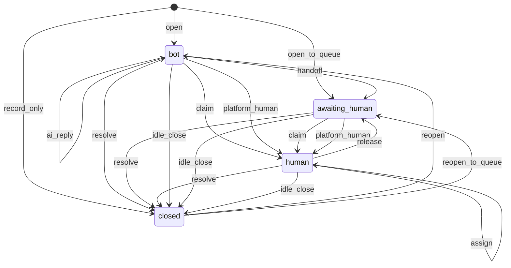

迁移表：

| 源 → 目标 | 事件 | 守卫（纯布尔） | 动作（副作用） | 谁触发 | 接口/事件 |
| --- | --- | --- | --- | --- | --- |
| [*] → bot | open | 首条买家消息 且 `buyer_kind = buyer` 且 当前模式 ∈ {assist, auto} 且 店铺 `status = connected` | 建会话与会话段，判定阶段，排 `draft.generate` | 内部任务 `inbound.process` | `API-HOOK-001`（推送; code=10）/ `API-HOOK-002`（webhook; type=14） |
| [*] → awaiting_human | open_to_queue | 首条买家消息 且 `buyer_kind = buyer` 且 当前模式 ∈ {off, shadow} | 建会话与会话段；`handoff_reason = shop_off` 或 `shadow`；shadow 时排 `draft.generate(mode=shadow)`；推飞书待认领卡（12.9） | 内部任务 `inbound.process` | `API-HOOK-001`（推送; code=10）/ `API-HOOK-002`（webhook; type=14） |
| [*] → closed | record_only | `buyer_kind = affiliate` 或 来源 = 历史回补 | 只建会话与消息，段标 `backfilled` 或达人会话；不判阶段、不出稿、不进队列、不计统计 | 内部任务 `inbound.process` / `shop.backfill` | `API-HOOK-001`（推送; code=10）/ 内部任务 `shop.backfill` |
| bot → bot | ai_reply | 当前模式 = auto 且 草稿 `status = generated` 且 `handoff = false` 且 `confidence ≥ 阈值` | 发送草稿（11.2 `send`），更新 `last_agent_at` | 内部任务 `draft.generate` | 内部任务 `draft.generate` |
| bot → awaiting_human | handoff | `handoff_reason ∈ {keyword, low_confidence, non_text, model_error, timeout, send_failed, human_request, policy, quota, shop_off, shadow}` | 写 `handoff_reason`、审计 `EVT:handoff`；auto 模式先发安抚句（不更新 `last_agent_at`，等待计时与待认领提醒照常）；通知负责该店的启用成员（规则 `handoff`）；推飞书待认领卡（12.9） | 内部任务 `inbound.process` / `draft.generate` | 内部任务 `draft.generate` |
| bot → human | claim | 操作人是启用成员 且 店铺在其范围内 且 请求带 `version` 时版本一致 | `claimed_by = 操作人`，段 `first_claimed_by` 为空时写入；未处置草稿保留可用；审计 `EVT:conversation_claimed` | 成员 | `API-CONV-004` / `API-CONV-007`（认领并发送） |
| bot → human | platform_human | 入站 `sender_role = platform_human`（卖家在平台后台直接回复）且 不是本方出站回声 | `claimed_by = null`，作废未处置草稿，写系统事件「平台侧已有人处理」 | 内部任务 `inbound.process` | `API-HOOK-001`（推送; code=10）/ `API-HOOK-002`（webhook; type=14） |
| awaiting_human → human | claim | 同 bot → human claim | 同上 | 成员 | `API-CONV-004` / `API-CONV-007`（认领并发送） |
| awaiting_human → human | platform_human | 同 bot → human platform_human | 同上 | 内部任务 `inbound.process` | `API-HOOK-001`（推送; code=10）/ `API-HOOK-002`（webhook; type=14） |
| human → human | assign | 目标是启用成员 且 负责该店（或为管理员）且 目标 ≠ 当前处理人 且 `version` 一致 | `claimed_by = 目标`；`withTickets` 时关联未结工单负责人改为目标并写工单时间线；通知目标（规则 `ticket_assigned` 只在带工单时） | 处理人（转交）/ 组长、管理员（改派） | `API-CONV-005` |
| human → awaiting_human | release | 处理人被停用 | `claimed_by = null`、`handoff_reason = manual`，写系统事件；停用提交后推飞书待认领卡（本段推过就不推） | 管理员停用成员时的系统动作 | `API-TEAM-008` |
| bot → closed | resolve | 操作人为组长或管理员且在范围内，或 店铺被断开 | 结束当前段（`end_reason = resolved` 或 `shop_disconnected`），作废未处置草稿 | 组长、管理员 / 系统 | `API-CONV-006` / `API-SHOP-012` |
| awaiting_human → closed | resolve | 同 bot → closed resolve | 同上 | 成员 / 系统 | `API-CONV-006` / `API-SHOP-012` |
| human → closed | resolve | 操作人 = `claimed_by`，或 组长、管理员在范围内，或 店铺被断开 | 结束当前段并算 `ai_resolved`；TikTok 店调 End Session，失败只写系统事件；关联工单不变；审计 `EVT:conversation_closed` | 处理人 / 组长、管理员 / 系统 | `API-CONV-006` / `API-SHOP-012` |
| bot → closed | idle_close | `now − last_message_at > 72h` | 结束当前段（`end_reason = idle`），作废未处置草稿 | 定时任务 `conversation.idle_close` | 内部任务 `conversation.idle_close` |
| awaiting_human → closed | idle_close | `now − last_message_at > 72h` | 同上；写系统事件「超时未处理」 | 定时任务 `conversation.idle_close` | 内部任务 `conversation.idle_close` |
| human → closed | idle_close | `now − last_message_at > 72h` | 同上；`claimed_by` 保留供统计 | 定时任务 `conversation.idle_close` | 内部任务 `conversation.idle_close` |
| closed → bot | reopen | 新买家消息 且 `buyer_kind = buyer` 且 当前模式 ∈ {assist, auto} | 开新段，重判阶段，清空 `handoff_reason`、`claimed_by`，置顶；排 `draft.generate` | 内部任务 `inbound.process` | `API-HOOK-001`（推送; code=10）/ `API-HOOK-002`（webhook; type=14） |
| closed → awaiting_human | reopen_to_queue | 新买家消息 且 `buyer_kind = buyer` 且 当前模式 ∈ {off, shadow} | 开新段，重判阶段，`handoff_reason = shop_off` 或 `shadow`，置顶；shadow 时排影子出稿；推飞书待认领卡（12.9） | 内部任务 `inbound.process` | `API-HOOK-001`（推送; code=10）/ `API-HOOK-002`（webhook; type=14） |

不改状态的事件：`awaiting_human` / `human` 下收到买家消息只更新 `last_buyer_at` 并置顶（`human` 状态不出稿）；`bot` 下收到新买家消息：作废未处置草稿（11.2 `supersede`）并重新出稿。处理人发消息（`API-CONV-007`）只写出站消息与审计 `EVT:agent_reply_sent`。内部任务 `unclaimed.remind` 对 `awaiting_human` 超过 `unclaimed_remind_minutes` 且本段未提醒过的会话，通知负责该店的组长一次（REQ-CONV-010），同时推飞书超时卡（REQ-FEISHU-004），不改状态；提醒时长为「不提醒」时两者都不做。

### 11.2 草稿 `ENT-Draft.status`

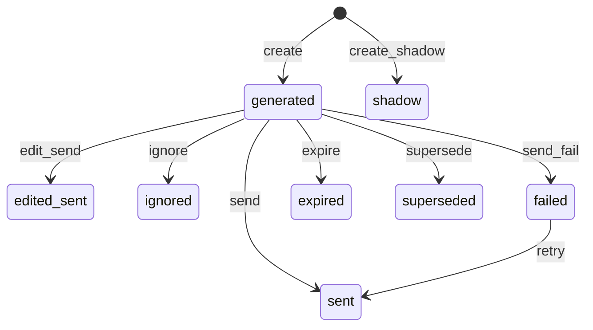

迁移表：

| 源 → 目标 | 事件 | 守卫（纯布尔） | 动作（副作用） | 谁触发 | 接口/事件 |
| --- | --- | --- | --- | --- | --- |
| [*] → generated | create | 模式 ∈ {assist, auto} 且 模型返回合法 JSON 且 `reply` 非空 且 `handoff = false` 且 `confidence ≥ 阈值` 且 额度允许 | 保存草稿，用量 +1（跨过提醒阈值时通知接收人并审计 `EVT:usage_threshold_crossed`），审计 `EVT:draft_generated`；auto 模式立即执行 `send` | 内部任务 `draft.generate` | 内部任务 `draft.generate` |
| [*] → shadow | create_shadow | 模式 = shadow 且 模型返回合法 JSON 且 额度允许 | 保存为影子草稿（不发送；只在会话里折叠显示给管理员、组长），用量 +1，审计 `EVT:draft_generated` | 内部任务 `draft.generate` | 内部任务 `draft.generate` |
| generated → sent | send | 平台返回出站消息 ID | 写出站消息（`sender_role = ai` 或 `agent`）、`sent_message_id`；会话为待认领 / AI 时先认领；审计 `EVT:draft_disposed`（`disposition = sent`） | 内部任务 `draft.generate`（auto）/ 成员（assist） | 内部任务 `draft.generate` / `API-CONV-007`（`disposition = sent`） |
| generated → edited_sent | edit_send | 编辑后文本非空 且 ≤ 2,000 字 且 平台返回出站消息 ID | 以编辑文本发送，记 `edit_distance`；审计 `EVT:draft_disposed`（`edited_sent`） | 成员 | `API-CONV-007`（`disposition = edited_sent`） |
| generated → ignored | ignore | 会话 `handling_state ∈ {bot, awaiting_human, human}` | 审计 `EVT:draft_disposed`（`ignored`）；会话为 `bot` 时转 11.1 `handoff`（`reason = manual`） | 成员 | `API-CONV-008` |
| generated → failed | send_fail | 平台返回错误 或 10 秒内无响应 | 会话 `handoff(send_failed)`；草稿保留供重试 | 内部任务 `draft.generate` / 成员 | 内部任务 `draft.generate` / `API-CONV-007` |
| generated → expired | expire | `now − created_at > 24h` | 不再显示 | 定时任务 `draft.expire` | 内部任务 `draft.expire` |
| generated → superseded | supersede | 同会话有更新的买家消息 或 处理人发出了不引用该草稿的回复（含开票图片发到聊天） | 不再显示；计入「被人工替代」 | 内部任务 `inbound.process` / 成员 | 内部任务 `inbound.process` / `API-CONV-007` / `API-INV-002` |
| failed → sent | retry | 平台返回出站消息 ID | 同 send | 成员 | `API-CONV-015` |

### 11.3 入站事件 `ENT-InboundEvent.status`

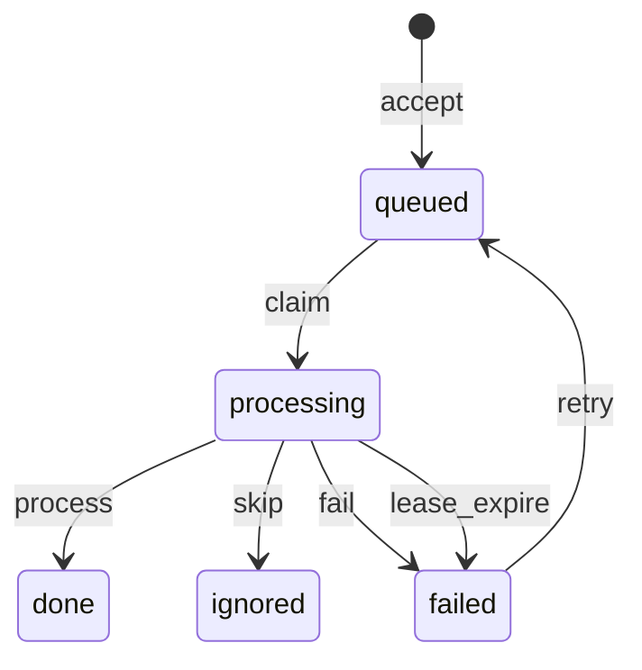

迁移表：

| 源 → 目标 | 事件 | 守卫（纯布尔） | 动作（副作用） | 谁触发 | 接口/事件 |
| --- | --- | --- | --- | --- | --- |
| [*] → queued | accept | 签名有效 且 `(platform_app_id, external_event_id)` 不存在 | 存原始载荷，排 `inbound.process`，立即 200 | 平台 | `API-HOOK-001` / `API-HOOK-002` |
| queued → processing | claim | `status = queued` 且 任务取得 | 写 `lease_until = now + 60s` | Worker | 内部任务 `inbound.process` |
| processing → done | process | 会话、消息、订单、售后、工单已按事件落库 | 记 `processed_at` | Worker | 内部任务 `inbound.process` |
| processing → ignored | skip | 事件类型不在处理清单 或 本方出站回声 或 店铺不属于该应用 或 店铺 `status = disconnected` | 记原因 | Worker | 内部任务 `inbound.process` |
| processing → failed | fail | 处理抛出异常 | 记错误摘要，`attempts + 1` | Worker | 内部任务 `inbound.process` |
| processing → failed | lease_expire | `lease_until < now` | 记「处理中断」 | 定时任务 `inbound.sweep` | 内部任务 `inbound.sweep` |
| failed → queued | retry | `attempts < 3` | 重新排队，退避 10 秒 × 2^attempts | 定时任务 `inbound.sweep` | 内部任务 `inbound.sweep` |

第 3 次失败后保持 `failed`，开发者可用 `pnpm inbound:replay <id>` 重放（本期无值守）。

### 11.4 工单 `ENT-Ticket.status`

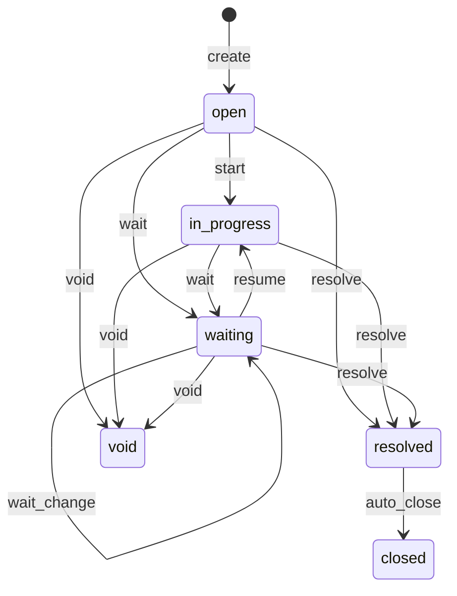

迁移表（手动类由人经 `API-TKT-004` 触发；平台驱动类只由平台事件触发，人工调 `API-TKT-004` 返回 409 `/errors/not-allowed`；平台事件到 Shopilot 状态的映射见下方「平台售后映射」）：

| 源 → 目标 | 事件 | 守卫（纯布尔） | 动作（副作用） | 谁触发 | 接口/事件 |
| --- | --- | --- | --- | --- | --- |
| [*] → open | create | 该类型 `auto_create = true`（自动建单时）且 未结工单中不存在同 `dedupe_key` | 编号、算 `due_at` 与 `due_source`、定负责人（类型默认负责人；无人时落店铺组长；仍无时落管理员）；写时间线、审计 `EVT:ticket_created`；通知负责人 | 成员 / 内部任务 `inbound.process` / 定时任务 `handover.scan` / 发件箱退信 | `API-TKT-003` / `API-HOOK-001`（推送; code=29 或 3 或 30）/ `API-HOOK-002`（webhook; type=12 或 11）/ 内部任务 `handover.scan` |
| open → in_progress | start | 手动类：操作人可改该工单；平台类：映射结果为 `in_progress` | 写时间线 | 成员 / 平台 | `API-TKT-004` / `API-HOOK-002`（webhook; type=12, BUYER_SHIPPED_ITEM） |
| open → waiting | wait | 手动类：`waitingOn` 非空；平台类：映射结果为 `waiting` | 写 `waiting_on`、时间线；平台类按新截止字段更新 `due_at` | 成员 / 平台 | `API-TKT-004` / `API-HOOK-002`（webhook; type=12, AWAITING_BUYER_SHIP）/ `API-HOOK-001`（推送; code=29, PROCESSING） |
| in_progress → waiting | wait | 同 open → waiting | 同上 | 成员 / 平台 | `API-TKT-004` / `API-HOOK-002`（webhook; type=12, REJECT_RECEIVE_PACKAGE 或 RETURN_OR_REFUND_REQUEST_SUCCESS） |
| waiting → waiting | wait_change | `waiting_on` 变化 | 写 `waiting_on`、时间线、更新 `due_at` | 成员 / 平台 | `API-TKT-004` / `API-HOOK-001`（推送; code=29, JUDGING） |
| waiting → in_progress | resume | 手动类：操作人可改；平台类：映射结果为 `in_progress` | 写时间线；平台类更新 `due_at` | 成员 / 平台 | `API-TKT-004` / `API-HOOK-002`（webhook; type=12, BUYER_SHIPPED_ITEM） |
| open → resolved | resolve | 手动类：操作人可改；平台类：映射结果为 `resolved` | 写 `resolved_at`、时间线、审计 `EVT:ticket_resolved`（带 `on_time = resolved_at ≤ due_at`） | 成员 / 平台 | `API-TKT-004` / `API-ORD-006` 成功回读 / `API-HOOK-001`（推送; code=3 或 29）/ `API-HOOK-002`（webhook; type=11 或 12） |
| in_progress → resolved | resolve | 同上 | 同上 | 成员 / 平台 | `API-TKT-004` / `API-ORD-007` 成功回读 / `API-HOOK-002`（webhook; type=12, RETURN_OR_REFUND_REQUEST_COMPLETE） |
| waiting → resolved | resolve | 同上 | 同上 | 成员 / 平台 | `API-TKT-004` / `API-HOOK-001`（推送; code=29, ACCEPTED）/ `API-HOOK-002`（webhook; type=12, RETURN_OR_REFUND_REQUEST_COMPLETE 等终态） |
| resolved → closed | auto_close | `autoCloseDays` 非空 且 `now − resolved_at > autoCloseDays` | 写时间线 | 定时任务 `ticket.auto_close` | 内部任务 `ticket.auto_close` |
| open → void | void | 操作人为范围内组长或管理员 | 写 `void_reason`、时间线、审计；平台售后单不受影响；之后同一售后单的平台事件不再重建工单 | 组长、管理员 | `API-TKT-007` |
| in_progress → void | void | 同上 | 同上 | 组长、管理员 | `API-TKT-007` |
| waiting → void | void | 同上 | 同上 | 组长、管理员 | `API-TKT-007` |

超时不是状态：`overdue` 派生（§9）。定时任务 `ticket.scan` 每 5 分钟扫描：到达提醒阈值且未提醒过 → 通知负责人（`EVT:ticket_due_soon`）；`now > due_at` 且未发过超时通知 → 通知负责人与店铺组长（`EVT:ticket_overdue`）。工单改派（`API-TKT-005`）、加备注（`API-TKT-006`）、改单张时限（`API-TKT-008`）不改状态，只写时间线与审计。停用成员时其名下未结工单负责人改为店铺组长（同店多个组长时取最早加入的一位；无组长时为所有者），写时间线。

平台售后映射（平台驱动类工单；平台原始状态记入 `platform_status`，人话阶段记入 `phase`）：

| 平台 | 平台事件与状态 | Shopilot 状态 | 等待对象 | 阶段 | 时限字段 |
| --- | --- | --- | --- | --- | --- |
| TikTok 退货（webhook 12 + Search Returns） | `RETURN_OR_REFUND_REQUEST_PENDING` | open | — | 待审核 | `seller_next_action_response[].deadline` |
| | `AWAITING_BUYER_SHIP` | waiting | buyer | 等买家寄回 | 无（等买家） |
| | `BUYER_SHIPPED_ITEM` | in_progress | — | 待验货 | `SELLER_RESPOND_RECEIVE_PACKAGE` 的 deadline |
| | `REJECT_RECEIVE_PACKAGE` 或 `arbitration_status = IN_PROGRESS` | waiting | platform | 平台仲裁中 | 无 |
| | `RETURN_OR_REFUND_REQUEST_SUCCESS`（退款已批准，平台尚未打款） | waiting | platform | 退款中 | 无 |
| | `RETURN_OR_REFUND_REQUEST_COMPLETE` / `_CANCEL` / `REFUND_OR_RETURN_REQUEST_REJECT` | resolved | — | 退款完成 / 已关闭 | — |
| TikTok 取消（webhook 11 + Search Cancellations） | `CANCELLATION_REQUEST_PENDING` | open | — | 待处理 | `seller_next_action_response[].deadline` |
| | `CANCELLATION_REQUEST_SUCCESS` / `_CANCEL`（部分接口写作 `_CANCELLED`，两种都认）/ `_COMPLETE` | resolved | — | 已取消 / 已撤回 | — |
| Shopee 退货（push 29 + get_return_detail） | `REQUESTED` | open | — | 待处理 | `due_date` |
| | `PROCESSING` | waiting | buyer | 等买家寄回 | 买家寄出后改为 `return_seller_due_date` |
| | `JUDGING` / `SELLER_DISPUTE` | waiting | platform | 平台判定中 | `seller_proof.seller_evidence_deadline`（`seller_proof_status = PENDING` 时） |
| | `ACCEPTED` / `CLOSED` / `CANCELLED` | resolved | — | 已退款 / 已关闭 | — |
| Shopee 取消申请（push 3） | 订单进入 `IN_CANCEL` | open | — | 待处理 | 商户时限 24 小时且不晚于 `ship_by_date`（Shopee 无截止字段） |
| | 订单离开 `IN_CANCEL`（CANCELLED 或回到原状态） | resolved | — | 已取消 / 已拒绝 | — |
| Shopee 物流异常（push 30 / push 3） | `LOGISTICS_PICKUP_FAILED` / `LOGISTICS_DELIVERY_FAILED` / `LOGISTICS_LOST` 或订单 `RETRY_SHIP` | open | — | 物流异常 | `ship_by_date`，无则商户 24 小时 |
| TikTok 物流异常 | 每小时扫描：超过 `delivery_sla_time` 仍未 DELIVERED，或 72 小时无新轨迹 | open | — | 物流异常 | `shipping_due_time` / `collection_due_time` / `delivery_due_time`，无则商户 24 小时 |

物流异常工单发现后由人处理（手动改状态），不由平台事件自动关闭。

### 11.5 邀请 `ENT-Invitation.status`

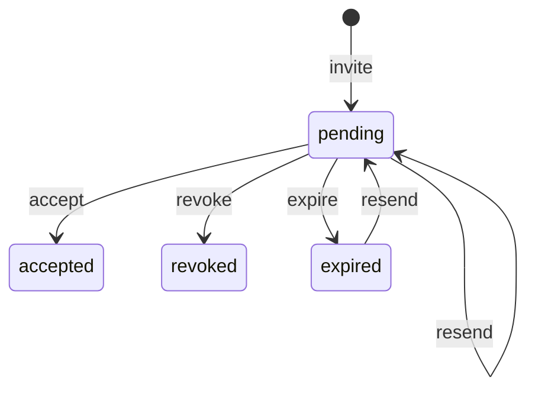

迁移表：

| 源 → 目标 | 事件 | 守卫（纯布尔） | 动作（副作用） | 谁触发 | 接口/事件 |
| --- | --- | --- | --- | --- | --- |
| [*] → pending | invite | 邮箱不是该商户启用或停用成员 且 无同邮箱 pending 邀请 且 席位未满 | 生成令牌（存哈希）、`expires_at = now + 7d`，写发件箱，审计 `EVT:member_invited` | 管理员 | `API-TEAM-002` |
| pending → pending | resend | — | 换新令牌、旧令牌作废、重置 `expires_at`，写发件箱 | 管理员 | `API-TEAM-003` |
| pending → accepted | accept | 令牌哈希匹配 且 `now ≤ expires_at` 且 （新账号 或 登录邮箱 = 邀请邮箱） | 建账号（如需）与成员、写负责店铺，审计 `EVT:invitation_accepted` | 受邀人 | `API-TEAM-006` |
| pending → revoked | revoke | — | 令牌作废 | 管理员 | `API-TEAM-004` |
| pending → expired | expire | `now > expires_at` | 令牌作废 | 定时任务 `invitation.expire` | 内部任务 `invitation.expire` |
| expired → pending | resend | 同 invite 的守卫 | 同 pending 下的 resend | 管理员 | `API-TEAM-003` |

### 11.6 店铺 `ENT-Shop.status`

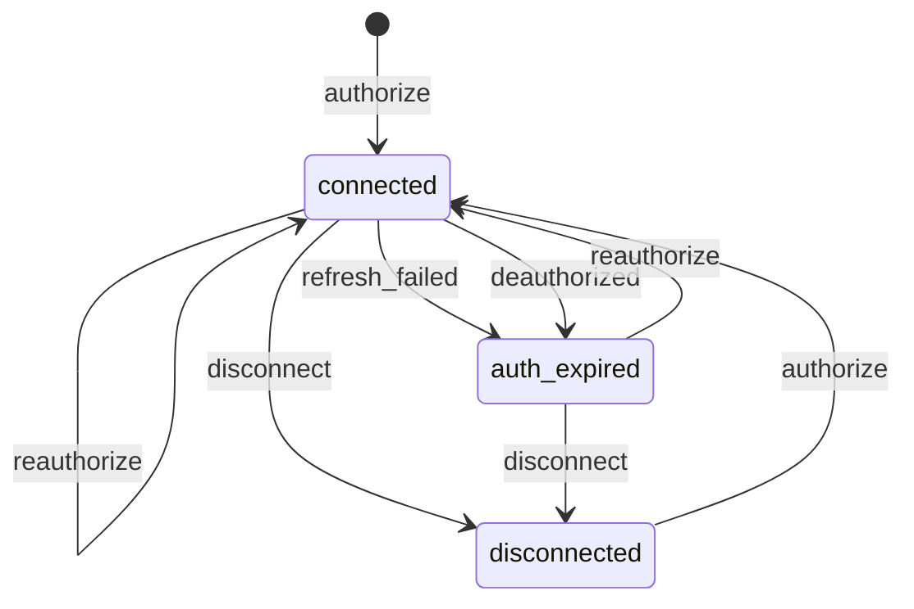

迁移表：

| 源 → 目标 | 事件 | 守卫（纯布尔） | 动作（副作用） | 谁触发 | 接口/事件 |
| --- | --- | --- | --- | --- | --- |
| [*] → connected | authorize | 回调 `state` 有效 且 平台换 token 成功 | 加密存 token、取店铺信息与能力表、建 `shop_reception`（模式取接入草稿的 AI 初始方式，未完成接入前为 off）；TikTok 注册店铺 webhook、设坐席接单；审计 `EVT:shop_connected` | 管理员（经平台授权页） | `API-SHOP-005` |
| connected → connected | reauthorize | 同 authorize | 覆盖 token 与授权到期 | 管理员 | `API-SHOP-005` |
| connected → auth_expired | refresh_failed | token 刷新返回鉴权失败 | 停止该店拉取与发送；通知管理员（规则 `shop_disconnected`） | 定时任务 `token.refresh` | 内部任务 `token.refresh` |
| connected → auth_expired | deauthorized | 收到取消授权事件 | 同上 | 平台 | `API-HOOK-001`（推送; code=2）/ `API-HOOK-002`（webhook; type=6） |
| auth_expired → connected | reauthorize | 同 authorize | 覆盖 token，恢复拉取 | 管理员 | `API-SHOP-005` |
| connected → disconnected | disconnect | 操作人为管理员 | 删 token 与定时任务；TikTok 先设坐席不接单；未结会话按 11.1 `resolve` 结束；`keepHistory = false` 时删除该店会话、消息、草稿、订单镜像；审计 | 管理员 | `API-SHOP-012` |
| auth_expired → disconnected | disconnect | 同上 | 同上（跳过平台调用） | 管理员 | `API-SHOP-012` |
| disconnected → connected | authorize | 同 [*] → connected | 同上，沿用原店铺记录 | 管理员 | `API-SHOP-005` |

授权到期提醒（30 天内、7 天内各一次）由内部任务 `token.refresh` 发站内通知与邮件（规则 `auth_expiring`），也处理 Shopee push 12、TikTok webhook 7，不改状态。

### 11.7 出站消息 `ENT-Message.send_status`

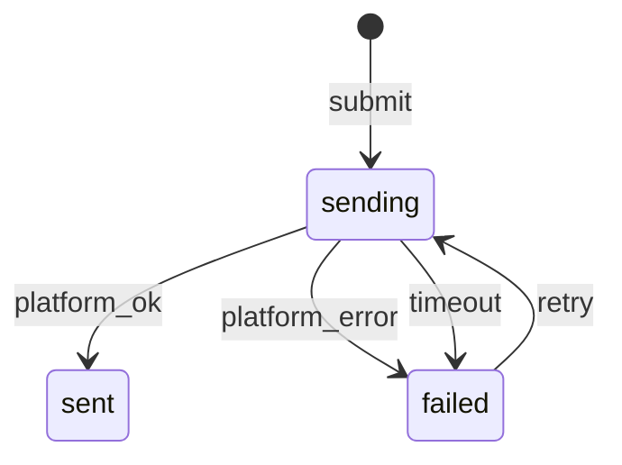

迁移表：

| 源 → 目标 | 事件 | 守卫（纯布尔） | 动作（副作用） | 谁触发 | 接口/事件 |
| --- | --- | --- | --- | --- | --- |
| [*] → sending | submit | `(conversation_id, client_request_id)` 不存在 且 操作人是处理人 且 能力表支持该类型 | 写出站消息（译文发送时同时存原文），调平台发送 | 成员 / 内部任务 `draft.generate` | `API-CONV-007` / 内部任务 `draft.generate` |
| sending → sent | platform_ok | 平台返回消息 ID | 写 `external_message_id`、`sent_at`；更新会话 `last_agent_at`；段 `first_human_reply_at` 为空且发送方为成员时写入；审计 `EVT:agent_reply_sent` | 成员 / Worker | `API-CONV-007` / 内部任务 `draft.generate` |
| sending → failed | platform_error | 平台返回错误 | 写 `send_error`；Shopee 返回聊天分配类错误时更新店铺能力表 `chat = false` | 成员 / Worker | `API-CONV-007` / 内部任务 `draft.generate` |
| sending → failed | timeout | 10 秒内无响应 | 写 `send_error = timeout`（可能已送达，提示先刷新再重试） | 成员 / Worker | `API-CONV-007` / 内部任务 `draft.generate` |
| failed → sending | retry | 操作人是处理人 | 以同一 `client_request_id` 重发 | 成员 | `API-CONV-015` |

### 11.8 发票聊天发送 `ENT-Invoice.chat_status`

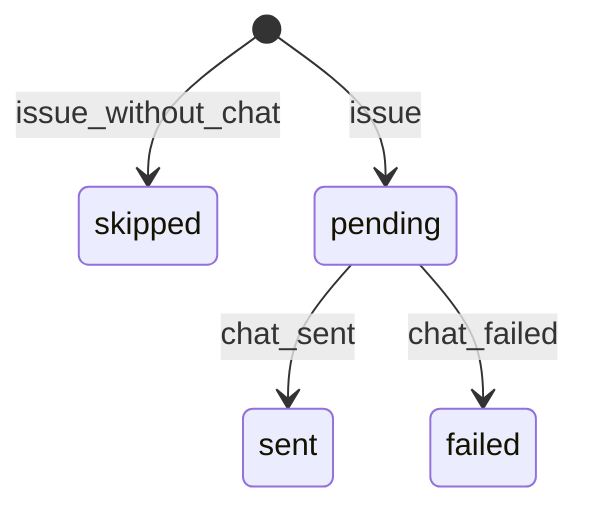

迁移表：

| 源 → 目标 | 事件 | 守卫（纯布尔） | 动作（副作用） | 谁触发 | 接口/事件 |
| --- | --- | --- | --- | --- | --- |
| [*] → skipped | issue_without_chat | `sendToChat = false` | — | 成员 | `API-INV-002` |
| [*] → pending | issue | `sendToChat = true` 且 关联会话的处理人 = 操作人 | 生成 PDF 与 PNG，上传图片并发送 | 成员 | `API-INV-002` |
| pending → sent | chat_sent | 平台返回消息 ID | 写出站图片消息；审计 `EVT:invoice_issued` | 成员 | `API-INV-002` |
| pending → failed | chat_failed | 平台返回错误或超时 | 记失败原因；发票照常存档 | 成员 | `API-INV-002` |

### 11.9 发票邮件发送 `ENT-Invoice.email_status`

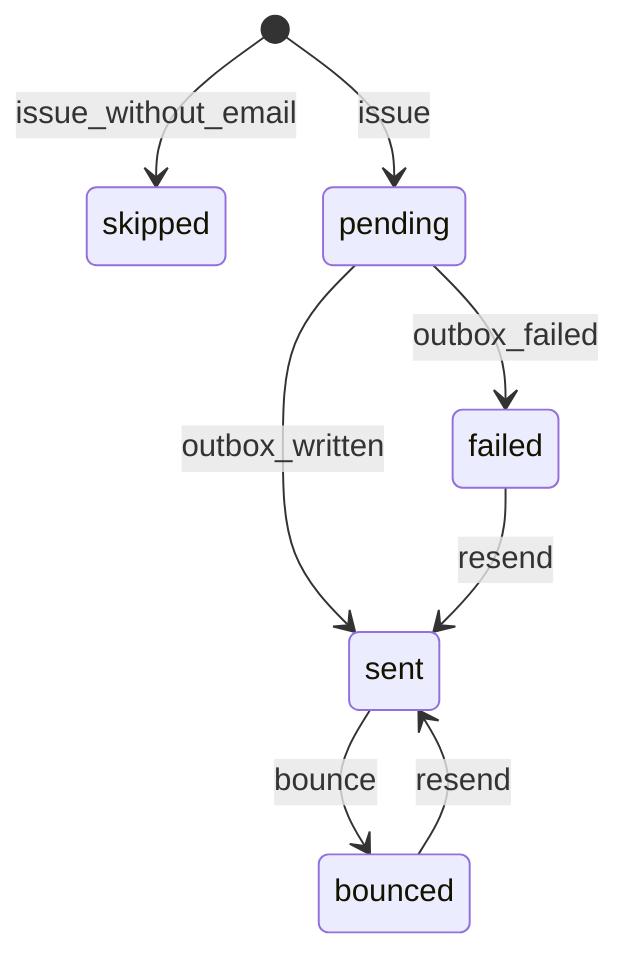

迁移表：

| 源 → 目标 | 事件 | 守卫（纯布尔） | 动作（副作用） | 谁触发 | 接口/事件 |
| --- | --- | --- | --- | --- | --- |
| [*] → skipped | issue_without_email | `sendEmail = false` 或 无邮箱 | — | 成员 | `API-INV-002` |
| [*] → pending | issue | `sendEmail = true` 且 邮箱格式有效 | 准备邮件（PDF 附件） | 成员 | `API-INV-002` |
| pending → sent | outbox_written | 发件箱写入成功 | — | 成员 | `API-INV-002` |
| pending → failed | outbox_failed | 发件箱写入失败 | 记原因 | 成员 | `API-INV-002` |
| sent → bounced | bounce | 发件箱条目被标退信 | 自动建「开票」工单（`origin = rule`，去重键 `invoice:<order_id>`），写时间线 | 开发者（发件箱页模拟退信） | `API-MOCK-006` |
| bounced → sent | resend | 邮箱有效 | 重新写发件箱；不自动重发 | 成员 | `API-INV-005` |
| failed → sent | resend | 邮箱有效 | 同上 | 成员 | `API-INV-005` |

### 11.10 商户 `ENT-Merchant.status`

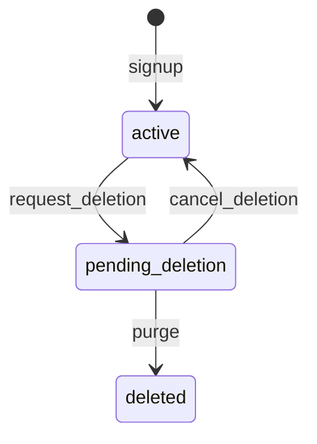

迁移表：

| 源 → 目标 | 事件 | 守卫（纯布尔） | 动作（副作用） | 谁触发 | 接口/事件 |
| --- | --- | --- | --- | --- | --- |
| [*] → active | signup | 邮箱未注册 | 建商户、所有者管理员成员、默认配置（接待、提示词、工单类型、通知规则、订阅 `basic` 月付、用量周期）；审计 `EVT:signup_completed` | 访客 | `API-AUTH-001` |
| active → pending_deletion | request_deletion | 操作人是所有者 且 确认名称 = 商户名 | `purge_at = now + 30d`；解绑全部店铺（同 11.6 disconnect，保留数据）；停用除所有者外全部成员；邮件通知全部管理员 | 所有者 | `API-SET-015` |
| pending_deletion → active | cancel_deletion | 操作人是所有者 且 `now < purge_at` | 清空 `purge_at`；成员保持停用，需管理员逐个重新启用，店铺需重新授权 | 所有者 | `API-SET-016` |
| pending_deletion → deleted | purge | `now ≥ purge_at` | 删除商户全部业务数据与文件，并经 `knowledge.purge` 删除该商户的检索服务实例；保留商户行与审计摘要 | 定时任务 `merchant.purge` | 内部任务 `merchant.purge` |

`pending_deletion` 期间只有所有者能登录该商户，且只能访问商户设置页。

### 11.11 所有权转让 `ENT-OwnershipTransfer.status`

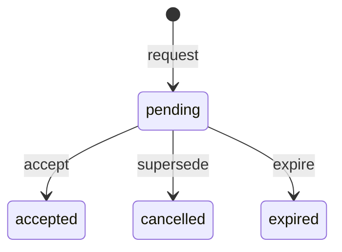

迁移表：

| 源 → 目标 | 事件 | 守卫（纯布尔） | 动作（副作用） | 谁触发 | 接口/事件 |
| --- | --- | --- | --- | --- | --- |
| [*] → pending | request | 操作人是所有者 且 目标是启用管理员 且 目标 `two_factor_enabled = true` | 令牌存哈希、7 天有效，写发件箱给目标；同商户已有 pending 时先 supersede | 所有者 | `API-SET-013` |
| pending → accepted | accept | 登录账号 = 目标 且 令牌匹配 且 未过期 且 目标仍是启用管理员 | `merchant.owner_user_id = 目标`，原所有者保留管理员；审计 | 受让人 | `API-SET-014` |
| pending → cancelled | supersede | 所有者发起了新的转让 | 旧令牌作废 | 所有者 | `API-SET-013` |
| pending → expired | expire | `now > expires_at` | 令牌作废 | 定时任务 `invitation.expire`（同一任务一并处理） | 内部任务 `invitation.expire` |

### 11.12 数据导出 `ENT-ExportJob.status`

```mermaid
stateDiagram-v2
  [*] --> queued : request
  queued --> running : start
  running --> done : finish
  running --> failed : fail
  done --> expired : expire
```

迁移表：

| 源 → 目标 | 事件 | 守卫（纯布尔） | 动作（副作用） | 谁触发 | 接口/事件 |
| --- | --- | --- | --- | --- | --- |
| [*] → queued | request | 无 queued / running 的导出 | 排 `data.export` | 管理员 | `API-SET-010` |
| queued → running | start | 任务取得 | — | Worker | 内部任务 `data.export` |
| running → done | finish | 打包完成 | 存 ZIP（会话、消息、订单、工单、发票 CSV），`expires_at = now + 24h`，写发件箱 | Worker | 内部任务 `data.export` |
| running → failed | fail | 打包出错或超过 10 分钟 | 记原因 | Worker | 内部任务 `data.export` |
| done → expired | expire | `now > expires_at` | 删文件 | 定时任务 `data.retention_purge` | 内部任务 `data.retention_purge` |

### 11.13 阶段判定（REQ-CONV-007）

会话段开段时自动判定一次，之后订单或售后事件不回改已有段（人工改判除外）。规则按优先级取第一个命中的：

| 顺序 | 条件 | 结果 | `stage_basis` 示例 |
| --- | --- | --- | --- |
| 1 | 本段消息指向某张订单（TikTok 订单卡 / BUYER_ENTER_FROM_ORDER 的 `order_id`；Shopee order 消息或 `source_content.order_sn`）时只看这一单；否则看买家在本店近 180 天全部订单 | 决定下面 2–5 用哪些订单 | — |
| 2 | 有未终结售后：TikTok `return_status` 不在终态集合 {REFUND_OR_RETURN_REQUEST_REJECT, RETURN_OR_REFUND_REQUEST_CANCEL, RETURN_OR_REFUND_REQUEST_COMPLETE, REPLACEMENT_REQUEST_REJECT, REPLACEMENT_REQUEST_REFUND_SUCCESS, REPLACEMENT_REQUEST_CANCEL, REPLACEMENT_REQUEST_COMPLETE, EXCHANGE_REQUEST_REFUND_SUCCESS, EXCHANGE_REQUEST_CANCEL, EXCHANGE_REQUEST_COMPLETE}；Shopee 订单 TO_RETURN 或退货单 ∈ {REQUESTED, ACCEPTED, PROCESSING, JUDGING, SELLER_DISPUTE} | aftersale | 「退货 2510… REQUESTED」 |
| 3 | 有未完结订单或取消处理中：Shopee ∈ {UNPAID, READY_TO_SHIP, PROCESSED, RETRY_SHIP, SHIPPED, IN_CANCEL}；TikTok ∈ {UNPAID, ON_HOLD, AWAITING_SHIPMENT, PARTIALLY_SHIPPING, AWAITING_COLLECTION, IN_TRANSIT} 或 `cancel_status = CANCELLATION_REQUEST_PENDING` | insale | 「订单 2510086T3QK1NB SHIPPED」 |
| 4 | 60 天内有 COMPLETED、TikTok DELIVERED 或 Shopee TO_CONFIRM_RECEIVE | aftersale | 「订单 … COMPLETED 08-19」 |
| 5 | 没有订单，或只有已取消订单、60 天前完成的订单 | presale | 「本店无订单」/「近 60 天无进行中订单」 |
| 6 | 该店订单镜像还没完成首次同步（`shop.backfill` 未完成且镜像里没有该买家订单）：买家消息命中售后关键词（退款、退货、坏了、refund、return、broken…）→ aftersale；命中物流关键词（发货、物流、到哪了、shipping、tracking…）→ insale；都不中 | 对应阶段，`stage_source = keyword`；都不中为 unknown | 「订单尚未同步，关键词：refund」 |

人工改判（`API-CONV-009`）只改当前段的 `stage`，`stage_source = manual`，写审计；本段之后的出稿按新阶段取提示词；下一段重新自动判定。

### 11.14 资料 `ENT-KnowledgeDocument.status`

只有 `ready` 且 AI 可用开着、站点相符的资料会被检索引用（RULE-KB-001）。AI 可用开关不改本状态。

```mermaid
stateDiagram-v2
  [*] --> queued : upload
  queued --> processing : start
  processing --> ready : indexed
  processing --> failed : fail
  ready --> queued : reparse
  failed --> queued : reparse
  queued --> deleting : delete
  processing --> deleting : delete
  ready --> deleting : delete
  failed --> deleting : delete
  deleting --> [*] : purge
```

迁移表：

| 源 → 目标 | 事件 | 守卫（纯布尔） | 动作（副作用） | 谁触发 | 接口/事件 |
| --- | --- | --- | --- | --- | --- |
| [*] → queued | upload | 类型在白名单 且 大小合规 且 未删除的资料 < 500 份 且 `(merchant_id, sha256)` 不存在 | 存原文件（`file.kind = knowledge_source`）、建资料，排 `knowledge.ingest`；审计 `EVT:knowledge_uploaded` | 管理员、组长 | `API-KB-002` |
| queued → processing | start | `status = queued` 且 任务取得 | 没有检索实例时先建实例 | Worker | 内部任务 `knowledge.ingest` |
| processing → ready | indexed | 全部条目 `status = indexed` 且 分块已读回 | 写分块与 `ready_at`；审计 `EVT:knowledge_ready` | Worker | 内部任务 `knowledge.ingest` |
| processing → failed | fail | 有条目重传 2 次后仍 `failed` 或 PDF 单页 > 10 MB 或 实例创建失败 或 任务运行 > 20 分钟 或 `processing` 超过 25 分钟没有更新（任务中断） | 写 `failure_reason`（任务中断时为「入库任务中断，请重新解析」），删掉已上传的条目；审计 `EVT:knowledge_failed` | Worker | 内部任务 `knowledge.ingest`；任务中断由 `knowledge.purge` 的每小时补扫判定 |
| ready → queued | reparse | `status = ready` | 清空分块，排 `knowledge.ingest`（任务先删旧条目再重传）；审计 `EVT:knowledge_reparsed` | 管理员、组长 | `API-KB-006` |
| failed → queued | reparse | `status = failed` | 同上，清空 `failure_reason` | 管理员、组长 | `API-KB-006` |
| queued → deleting | delete | — | 从所有接口隐藏，排 `knowledge.purge`；审计 `EVT:knowledge_deleted` | 管理员、组长 | `API-KB-007` |
| processing → deleting | delete | — | 同上；入库任务每步之前重读状态，发现 `deleting` 即停 | 管理员、组长 | `API-KB-007` |
| ready → deleting | delete | — | 同 queued → deleting | 管理员、组长 | `API-KB-007` |
| failed → deleting | delete | — | 同 queued → deleting | 管理员、组长 | `API-KB-007` |
| deleting → [*] | purge | 检索服务里该资料的条目全部删除成功 | 删分块、条目、原文件与资料记录 | Worker | 内部任务 `knowledge.purge` |

### 11.15 飞书投递 `ENT-FeishuDelivery.status`

一张飞书卡片的发送状态。同一会话段同一种卡只有一行（INV-FEISHU-001）；测试卡片在同一个请求里写入并发出，不经队列。

```mermaid
stateDiagram-v2
  [*] --> queued : queue
  queued --> queued : retry
  queued --> sent : send
  queued --> failed : fail
  queued --> skipped : skip
```

迁移表：

| 源 → 目标 | 事件 | 守卫（纯布尔） | 动作（副作用） | 谁触发 | 接口/事件 |
| --- | --- | --- | --- | --- | --- |
| [*] → queued | queue | 商户已连飞书 且 这类推送开着 且 店铺有群 且 本段没有同种卡（测试卡片不看后三条） | 写投递记录与目标群名，排 `feishu.send`；测试卡片当场构卡发出 | 系统 / 管理员 | 11.1 open_to_queue、handoff、release、reopen_to_queue；内部任务 `unclaimed.remind`；`API-SET-024` |
| queued → queued | retry | 可重试的失败（连不上、超时、限流、飞书其他错误）且 尝试次数 < 6 | 记失败原因，保留已构好的卡片，交给队列退避重试 | Worker | 内部任务 `feishu.send` |
| queued → sent | send | 会话仍是本段待认领 且 飞书接受 | 记 `message_id` 与发出时间；接入状态为失效时改回已校验 | Worker / 管理员 | 内部任务 `feishu.send`；`API-SET-024` |
| queued → failed | fail | 不可重试的失败（凭证、权限、机器人不在群里、签名、请求被拒）或 第 6 次仍失败 | 记失败原因；凭证失效时把接入标为失效 | Worker / 管理员 | 内部任务 `feishu.send`；`API-SET-024` |
| queued → skipped | skip | 会话已被认领、已结束、回到 AI 或开了新段，或 商户已断开飞书，或 店铺已没有群 | 记跳过原因，不发 | Worker | 内部任务 `feishu.send` |

## 12. 关键流程时序

本系统的异步处理是「数据库队列 + Worker」流水线（pg-boss），用时序图表达，不另画事件建模图。图中 `MP` 是本期的模拟平台；上线后换成真实平台，消息不变。

### 12.1 注册商户并接入 Shopee 店铺（REQ-AUTH-001、REQ-SHOP-001 至 REQ-SHOP-005）

```mermaid
sequenceDiagram
  autonumber
  participant FE as 浏览器
  participant API as Shopilot API
  participant DB as PostgreSQL
  participant MP as 平台（模拟）
  participant W as Worker
  FE->>API: 注册 (API-AUTH-001)
  API->>DB: 建账号、商户、所有者成员、默认配置
  API-->>FE: 201 + 会话 cookie，跳 /shops/connect
  FE->>API: 保存清单进度 (API-SHOP-002)
  FE->>API: 提交 Partner ID / Key (API-SHOP-003)
  loop 依次尝试各区域主机
    API->>MP: v2.public.get_shops_by_partner（签名）
  end
  API->>MP: v2.push.get_app_push_config
  alt 回调为空或已是 Shopilot
    API->>MP: v2.push.set_app_push_config（回调 + 订阅 code）
    API-->>FE: 200 verified, callbackState=set
  else 回调指向别处且未确认
    API-->>FE: 409 /errors/callback-occupied，页面请商户勾选确认后重提
  end
  FE->>API: 取授权链接 (API-SHOP-004)
  API-->>FE: url（5 分钟有效，带一次性 state）
  FE->>MP: 打开授权页 (API-MOCK-003)，主账号勾选店铺并授权
  MP-->>FE: 302 回调 ?code&main_account_id&state
  FE->>API: 回调 (API-SHOP-005)
  API->>MP: v2.auth.token.get，再按店 access_token/get
  API->>DB: 店铺 connected（11.6 authorize），token 加密存储
  API-->>FE: 302 /shops/connect/shopee/probe
  FE->>API: 检查 (API-SHOP-006)
  API->>MP: 按店 get_shop_info、sellerchat 未读数、get_order_list、取一单看收件人
  API-->>FE: 每店能力表
  FE->>API: 完成接入 initialMode=shadow (API-SHOP-007)
  API->>DB: 写接待模式，排 shop.backfill
  W-->>MP: 异步回补会话与订单（REQ-SHOP-013）
```

驱动的状态迁移：11.10 `signup`、11.6 `authorize`。TikTok 接入同构：`API-SHOP-003` 只存 App Key / Secret 不调平台；`API-SHOP-005` 用 `auth_code` 调 token/get（Secret 错误或 Redirect URL 不一致时 302 带 `reason=secret_or_redirect_mismatch`），再调 Get Authorized Shops 取 cipher、Update Shop Webhook 按店注册、Update Agent Settings 设 `can_accept_chat=true`。

### 12.2 买家消息 → assist 草稿 → 员工认领并发送（REQ-CONV-001、REQ-AI-001 至 REQ-AI-005、REQ-CONV-004、REQ-CONV-005）

```mermaid
sequenceDiagram
  autonumber
  participant MP as 平台（模拟器扮演买家）
  participant API as Shopilot API
  participant DB as PostgreSQL
  participant W as Worker
  participant DS as DeepSeek
  participant FE as 员工浏览器
  MP->>API: 推送 code 10 买家消息 (API-HOOK-001)
  API->>DB: 验签，按事件 ID 幂等写 inbound_event queued
  API-->>MP: 200（2 秒内）
  W->>DB: inbound.process 认领事件
  W->>MP: 必要时拉会话信息与最近消息
  W->>DB: 建或更新会话与段（11.1 open / reopen），判定阶段（11.13）
  W->>DB: 检查额度与超量策略（REQ-AI-005）
  alt 额度允许且模式 assist
    W->>DB: 读订单镜像、提示词、关键词、最近 20 条消息
    Note over W: 有可用资料时先改写问题并检索知识库（见 12.8）
    W->>DS: chat/completions（JSON 输出，25 秒超时）
    alt 合法 JSON、置信度达标、未要求转人工
      W->>DB: 草稿 generated，用量 +1（11.2 create）
    else 关键词、低置信、模型错误或超时
      W->>DB: 11.1 handoff，记原因，通知负责成员
    end
  else 额度用尽且策略为 stop
    W->>DB: 11.1 handoff(reason=quota)
  end
  loop 每 10 秒
    FE->>API: 会话列表 (API-CONV-001)
  end
  FE->>API: 打开会话 (API-CONV-002)、买家与订单 (API-CONV-003)
  FE->>API: 认领并发送草稿 (API-CONV-007, disposition=sent, clientRequestId)
  API->>DB: 条件更新认领（11.1 claim），写出站消息 sending
  API->>MP: v2.sellerchat.send_message
  alt 平台返回消息 ID
    API->>DB: 消息 sent，草稿 sent（11.2 send），审计
    API-->>FE: 201
  else 平台错误或 10 秒超时
    API->>DB: 消息 failed，草稿 failed，11.1 不变（已是 human）
    API-->>FE: 502 /errors/platform 或 504，页面给「重试」(API-CONV-015)
  end
  MP-->>MP: 模拟器界面显示卖家回复
```

### 12.3 auto 模式回复与转人工（REQ-AI-001、REQ-AI-004、REQ-RCP-001）

```mermaid
sequenceDiagram
  autonumber
  participant MP as 平台（TikTok 模拟）
  participant API as Shopilot API
  participant W as Worker
  participant DS as DeepSeek
  participant DB as PostgreSQL
  MP->>API: webhook type 14 新消息 (API-HOOK-002)
  API->>DB: 验签，幂等写 inbound_event
  API-->>MP: 200
  W->>DB: inbound.process：会话在 bot，当前模式 auto
  alt 消息命中转人工关键词或不是文本
    W->>MP: 发安抚句（Send Message TEXT）
    W->>DB: 11.1 handoff(keyword / non_text)
  else 正常文本
    W->>DS: 出稿
    alt confidence ≥ 阈值 且 handoff=false
      W->>MP: Send Message（202606）
      W->>DB: 草稿 sent，11.1 ai_reply
    else handoff=true 或低置信
      W->>MP: 发模型给出的安抚句；没有则发固定安抚句
      W->>DB: 11.1 handoff，通知负责成员
    else 模型失败或超过 25 秒
      W->>MP: 发固定安抚句
      W->>DB: 11.1 handoff(model_error / timeout)
    end
  end
```

Shopee 店不进入本流程：`API-RCP-002` 拒绝 Shopee 店设 auto（REQ-RCP-001）。

### 12.4 TikTok 退货：自动建单 → 同意退货 → 推进（REQ-TKT-001、REQ-ORD-005、REQ-TKT-004）

```mermaid
sequenceDiagram
  autonumber
  participant MP as 平台（TikTok 模拟）
  participant API as Shopilot API
  participant W as Worker
  participant DB as PostgreSQL
  participant FE as 员工浏览器
  MP->>API: webhook type 12 RETURN_OR_REFUND_REQUEST_PENDING (API-HOOK-002)
  API-->>MP: 200
  W->>MP: Search Returns 取 seller_next_action_response.deadline
  W->>DB: 售后单镜像；工单 open（11.4 create，due_source=platform），通知负责人
  FE->>API: 工单详情 (API-TKT-002)
  FE->>API: 拒绝原因 (API-ORD-008)
  FE->>API: 同意退货 (API-ORD-007, decision=approve_return, Idempotency-Key)
  API->>MP: Approve Return（decision=APPROVE_RETURN, idempotency_key）
  MP-->>API: 成功
  API->>DB: 回读售后单，工单 waiting·buyer（11.4 wait），写时间线与审计
  API-->>FE: 200
  MP->>API: webhook type 12 BUYER_SHIPPED_ITEM (API-HOOK-002)
  W->>DB: 工单 in_progress「待验货」（11.4 resume），due 换成收货处理截止
  loop 每 5 分钟
    W->>DB: ticket.scan：到阈值提醒、过期标超时
  end
  FE->>API: 收货后同意退款 (API-ORD-007, decision=approve_received)
  API->>MP: Approve Return（decision=APPROVE_RECEIVED_PACKAGE）
  MP->>API: webhook type 12 RETURN_OR_REFUND_REQUEST_SUCCESS
  W->>DB: 工单 waiting(platform)「退款中」（11.4 wait）
  MP->>API: webhook type 12 RETURN_OR_REFUND_REQUEST_COMPLETE（平台打款后）
  W->>DB: 工单 resolved「退款完成」（11.4 resolve），EVT:ticket_resolved
```

### 12.5 开票（REQ-ORD-006、REQ-AI-006）

```mermaid
sequenceDiagram
  autonumber
  participant FE as 员工浏览器
  participant API as Shopilot API
  participant DS as DeepSeek
  participant DB as PostgreSQL
  participant MP as 平台（模拟）
  FE->>API: 从对话提取 (API-INV-001)
  API->>DS: 抽取抬头、地址、邮箱、税号（15 秒超时）
  API-->>FE: 预填字段
  FE->>API: 生成并发送 (API-INV-002, Idempotency-Key)
  API->>DB: 取发票号（商户 × 类型 × 年份序列，行锁）
  API->>API: 渲染 PDF，栅格化第 1 页为 PNG，存 DATA_DIR
  opt sendToChat
    API->>MP: 上传图片并发送（Shopee upload_image + send_message / TikTok images/upload + Send Message）
  end
  opt sendEmail
    API->>DB: 写发件箱（PDF 附件），11.9 outbox_written
  end
  API->>DB: 发票记录与两路状态，审计 EVT:invoice_issued
  API-->>FE: 201 发票（两路状态如实返回）
```

### 12.6 邀请成员与接受（REQ-TEAM-001、REQ-TEAM-002）

```mermaid
sequenceDiagram
  autonumber
  participant A as 管理员浏览器
  participant API as Shopilot API
  participant DB as PostgreSQL
  participant B as 受邀人浏览器
  A->>API: 邀请 emails、role、shopIds (API-TEAM-002)
  API->>DB: 邀请 pending（11.5 invite），写发件箱
  API-->>A: 每人一条链接（可复制）
  B->>API: 打开链接 (API-TEAM-005)
  alt 链接有效
    API-->>B: 商户名、角色、负责店铺、账号是否已存在
    B->>API: 接受，新账号填姓名与密码 (API-TEAM-006)
    API->>DB: 建账号与成员，11.5 accept，设会话
    API-->>B: 200，跳 /wb
  else 过期、撤销或已用
    API-->>B: 410 /errors/expired，提示联系管理员重发
  end
```

### 12.7 上传资料与入库（REQ-KB-001、REQ-KB-002）

```mermaid
sequenceDiagram
  autonumber
  participant FE as 管理员浏览器
  participant API as Shopilot API
  participant DB as PostgreSQL
  participant FS as DATA_DIR
  participant W as Worker
  participant CF as Cloudflare AI Search
  FE->>API: 逐个上传文件，带分类与站点 (API-KB-002)
  alt 格式、大小、资料数或内容重复不合规
    API-->>FE: 413 / 415 / 409 / 422（§14）
  else 通过
    API->>FS: 存原文件
    API->>DB: 资料 queued（11.14 upload），排 knowledge.ingest
    API-->>FE: 201
  end
  W->>DB: knowledge.ingest 取得任务，资料 processing（11.14 start）
  opt 商户还没有检索实例
    W->>CF: 建实例（配置见 §17）
    W->>DB: 记 knowledge_index
  end
  W->>W: PDF 超过 10 MB 时按页拆成多个条目
  loop 每个条目
    W->>CF: 上传条目，元数据带资料 ID、分类 ID、站点
    loop 每 15 秒查一次，最长 15 分钟，完成或分块数大于 0 且连续两次不变即停
      W->>CF: 查条目索引状态与分块数
    end
    opt 索引报错或超时，且已重传不到 2 次
      W->>CF: 删除条目，以同名重传
    end
  end
  alt 全部条目已索引
    W->>CF: 按条目读回分块
    W->>DB: 存分块，资料 ready（11.14 indexed）
  else 有条目重传 2 次仍失败，或 PDF 单页超过 10 MB
    W->>CF: 删除已上传的条目
    W->>DB: 资料 failed，写原因（11.14 fail）
  end
  loop 有排队或解析中的资料时每 5 秒
    FE->>API: 资料列表 (API-KB-001)
  end
```

删除资料（`API-KB-007`）：资料转 `deleting` 后立即从列表消失，`knowledge.purge` 先删检索服务里的条目，全部成功后再删原文件与记录（11.14 `purge`）。检索服务的删除是异步的，以删除接口返回成功为准（§17 已知问题）。

补扫：`knowledge.purge` 每小时运行一次，重新排删除停在 `deleting` 超过 10 分钟的资料，同时补扫入库：排队中且 10 分钟没有任何更新的重新排入库，`processing` 超过 25 分钟没有更新的视为任务中断，标失败（11.14 `fail`）。改分类、站点、AI 可用都会刷新资料的更新时间，补扫从最近一次更新重新计时。

### 12.8 出稿检索知识库（REQ-AI-002、REQ-KB-006、REQ-KB-005）

```mermaid
sequenceDiagram
  autonumber
  participant W as Worker（draft.generate）
  participant DB as PostgreSQL
  participant DS as DeepSeek
  participant CF as Cloudflare AI Search
  participant API as Shopilot API
  participant FE as 员工浏览器
  W->>DB: 查对该店站点可用的资料（RULE-KB-001）
  alt 没有可用资料
    W->>DS: 出稿，不带资料段（同 12.2）
  else 有可用资料
    W->>DB: 读最近 10 条消息与订单事实
    W->>DS: 改写成一个中文完整问题（6 秒超时）
    par 改写路
      W->>CF: 混合检索 20 条，门槛 0（8 秒超时）
    and 原话路
      W->>CF: 混合检索 20 条，门槛 0（8 秒超时）
    end
    opt 某路结果没有向量分、超时或返回错误
      W->>CF: 这一路改用纯向量检索重试一次（5 秒超时）
    end
    W->>DB: 按资料当前状态与站点过滤，每路留前 10 条
    W->>W: 两路交替合并、按分块去重，取前 8 段编号
    alt 两路都失败
      W->>DS: 出稿，不带资料段，记检索降级
    else 至少一路有结果
      W->>DS: 出稿，带编号资料片段（25 秒超时）
    end
  end
  W->>DB: 存草稿、检索快照与依据（11.2 create），资料不足时转人工（RULE-KB-003）
  FE->>API: 打开会话 (API-CONV-002)
  API-->>FE: 草稿与依据，页面显示「依据：《文件名》」
```

出稿检索规则：

- 何时检索：商户有 `ready`、AI 可用开着、站点含「全部」或该店站点的资料时才改写与检索（RULE-KB-001）
- 没有这样的资料时不改写、不检索，出稿请求里没有资料段
- 改写输入：最近 10 条消息（含商品卡、订单卡）与订单事实
- 改写调用：DeepSeek 输出 `{ "query": "…" }`，6 秒超时、不重试
- 改写输出：一个中文完整问题，概括买家最近几条消息在问什么
- 改写规则：政策类问题（退换货、保修、运费、发票）不加品牌名与型号，产品类问题带上对话里出现的型号
- 改写失败时只用买家原话检索一路
- 两路检索：改写后的问题与买家最近一条文字消息原文并行检索，每路要 20 条
- 每次检索请求都传 `reranking.match_threshold: 0` 与向量门槛 0：默认门槛 0.4 会让约 70% 的原话查询返回空
- 纯向量重试：某一路结果里没有任何向量分、8 秒内没返回或返回 HTTP 错误，这一路改用纯向量检索重试一次，5 秒超时
- 重试仍失败的那一路记失败；只有一路失败时用另一路的结果
- 过滤：按 Shopilot 库里资料的当前状态、AI 可用与站点过滤，每路留前 10 条
- 检索服务里的元数据是上传时的快照，只用来把结果对回资料，不用来过滤
- 合并：两路按名次交替取，改写路在前，按分块去重，取前 8 段，编号 1–8 放进出稿请求
- 降级：两路都失败时不带资料出稿、不转人工，检索快照记 `degraded = true` 与原因（RULE-KB-002）
- 出稿请求的 user 载荷新增 `knowledge: [{ n, title, text }]`
- 护栏改为：产品参数、兼容性、保修与政策只能依据 `knowledge` 与 `order_facts`，回复里不写片段编号
- 输出 JSON：`{ reply, confidence, handoff, reason, insufficient, used_sources }`，`used_sources` 是用到的片段编号
- 资料够不够由模型判断，不按检索分数设门槛：实测无答案题与可答题的分数重叠
- `insufficient = true` 时不论阈值一律转人工，原因记「置信度低于阈值」（RULE-KB-003）
- 依据：`used_sources` 里在合并结果中的编号按资料去重，存进 `draft.citations`，不在结果里的编号忽略
- 买家只收到 `reply`，依据与片段编号不随消息发出
- 耗时预算：改写 ≤ 6 秒，检索每路 ≤ 8 秒、重试 ≤ 5 秒，出稿 ≤ 25 秒，出稿任务超时 60 秒（§17 内部后台任务）
- 测试问答（`API-KB-012`）在 API 进程里同步走同一条链路，问题本身既是改写输入也是原话
- 测试问答选了店铺时按该店站点过滤、用该店的提示词变量，没选时不按站点过滤
- 测试问答选的店铺不是本人可见、未断开的店铺时返回 404，不计入限流
- 测试问答没选店铺时，提示词里的店名、平台、站点用占位文字「（测试问答，未选店铺）」「电商平台」「全部站点」
- 测试问答的提示词取售前阶段，不存草稿、不计出稿用量
- 测试问答限流每商户每分钟 20 次，计数存在 Web 进程内存里：重启清零，多实例部署时上限按实例数放大（§28 已知限制）

### 12.9 飞书待认领卡与点卡认领（REQ-FEISHU-003 至 REQ-FEISHU-006）

```mermaid
sequenceDiagram
  autonumber
  participant T as Worker（inbound.process、draft.generate、unclaimed.remind）
  participant DB as PostgreSQL
  participant W as Worker（feishu.send）
  participant DS as DeepSeek
  participant FS as 飞书
  participant U as 成员浏览器
  participant API as Shopilot API
  T->>DB: 会话进入待认领（11.1）或待认领超时
  T->>DB: 写投递记录，本段已有同种卡则不写（INV-FEISHU-001）
  T-->>W: 排 feishu.send（async）
  W->>DB: 重读会话，已不是本段待认领就记跳过
  W->>DB: 读本段最近消息、订单状态与商品名
  par 总结
    W->>DS: 一两句中文总结（6 秒超时）
  and 译文与图片
    W->>DS: 外语消息补中文译文（各 6 秒）
    W->>FS: 应用接法上传买家图片，取 image_key（最多 3 张）
  end
  W->>FS: 应用接法发群消息，或按签名调群自定义机器人
  alt 飞书接受
    W->>DB: 记已发出与 message_id
  else 可重试的失败
    W->>DB: 记原因，队列退避重试（共 6 次）
  else 不可重试的失败
    W->>DB: 记失败与原因
  end
  U->>API: 点「认领」打开 /wb/<会话>?claim=1&m=<商户>
  opt 当前商户不是 m
    U->>API: 切换商户 (API-AUTH-007)
  end
  U->>API: 读会话 (API-CONV-002)
  U->>API: 认领 (API-CONV-004，带 version；看不到会话时不带)
  API-->>U: 200 已认领；409 附处理人
```

构卡规则：

- 卡片格式：飞书卡片 JSON 2.0，开启共享卡片；待认领卡标题「待认领 · 店铺名」橙色，超时卡「待认领超时 · 店铺名」红色
- 最上面是 AI 总结：DeepSeek 按本段最近 20 条有意义的消息写 1–2 句中文，6 秒超时，失败就不显示
- 总结不计出稿用量；AI 替身模式下是固定文案
- 字段行：平台与站点用中文，如「Shopee · 越南」；站点不在已知列表时只写平台
- 字段行还有买家名、已等时长（从最早一条未回复的买家消息算）、转人工原因
- 店铺未开 AI、影子模式直接进待认领的，不写转人工原因；没有值的字段一律不显示
- 超时卡另写「待认领超过 N 分钟」，N 取接待设置的提醒时长
- 最近对话：本段最近 5 条有意义的消息，每条标买家、客服或 AI 与时间（商户时区）
- 有意义 = 买家、客服、AI 发的、没发送失败、不是空文字；系统事件与平台自动消息不进卡片
- 译文：原文是中文时不放译文，平台推送带的机翻也不放；其余客服消息用发送前的中文原文，买家消息用库里的译文；都没有时构卡时现译，6 秒没译完只放原文
- 图片：应用接法把前 3 张买家图片上传到飞书，卡里显示缩略图；上传失败或自定义机器人接法显示占位与「在 Shopilot 查看」
- 其他占位：视频「视频 0:12」带链接；表情；商品卡带商品名；订单、物流、退货卡带订单号与中文状态
- 买家与客服写的内容按卡片 markdown 规则转义特殊字符；每条正文与译文各截到 200 字，总结 120 字
- 按钮：「认领」打开 `<站点>/wb/<会话>?claim=1&m=<商户>`，「打开会话」打开 `<站点>/wb/<会话>?m=<商户>`
- 卡尾一行灰字说明这是哪种卡、同一段只推一次
- 测试卡片标题「测试卡片 · 商户名」蓝色，说明之后会收到什么；应用接法附一张上传的测试图片

## 13. 页面与跳转地图

视觉来源：品牌目录 `brand/`（`brand/DESIGN.md`；配色、字体、标志「叠信」都取自 Quilt 项目「Shopilot」设计系统 v5「奶油 / 可可 / 芒果 / 焦糖」，与原型一致）；页面结构与交互以 Quilt 原型 73 屏为准（ACRU 仪表盘结构：白侧栏可收起、顶栏搜索 + 图标按钮 + 账号卡、白色圆角面板网格；图表一律 Chart.js）。原型里知识库模块的屏（经验卡、更新审核、AI 核验、产品目录）与助手的屏不实现；知识库一期是接待设置里的「知识库」标签页，侧栏不单列「知识库」，顶栏不显示「助手」。

原型里的弹层屏（如 `/wb/transfer`）在实现中是所在页面上的对话框，用查询参数 `?dialog=<名>` 记录打开状态，便于刷新与分享链接；原型里的演示会话路由（如 `/wb/siti`）实现为 `/wb/<会话 ID>`，工单详情 `/tickets/siti` 实现为 `/tickets/<工单 ID>`。

| PAGE | 路径 | 可见角色 | 进出调用 | 关键页态 |
| --- | --- | --- | --- | --- |
| `PAGE-LOGIN` | `/login`（`?next=` 登录后回到的站内地址） | 公开 | `API-AUTH-002`、`API-AUTH-004`、`API-AUTH-008` | 错误（密码错、锁定附倒计时、IP 不允许）；两步验证输入，可改用备用码，可返回重新输入密码；商户要求两步验证而未开时带着 `next` 去账号安全页 |
| `PAGE-SIGNUP` | `/signup` | 公开 | `API-AUTH-001` | 邮箱已注册提示去登录 |
| `PAGE-RESET` | `/reset-password?token=` | 公开 | `API-AUTH-005` | 令牌过期 |
| `PAGE-INVITE` | `/invite/<token>` | 公开 | `API-TEAM-005`、`API-TEAM-006` | 过期 / 撤销 / 已用；已有账号需先登录 |
| `PAGE-OWNERSHIP` | `/ownership/<token>` | 受让管理员 | `API-SET-014` | 过期；登录账号不是受让人 |
| `PAGE-ACCOUNT-SECURITY` | `/account/security` | 全部成员（本人） | `API-AUTH-008`、`API-AUTH-009`、`API-AUTH-010`、`API-AUTH-011` | 两步验证开启（二维码，扫不了时手动输入密钥）/ 关闭、本人登录设备与退出、个人偏好（桌面通知、提示音）；商户策略要求两步验证而未开启时登录后强制进入，开启前其他页面不可用；带 `?next=` 进来时开启后回到 `next` |
| `PAGE-WB` | `/wb`、`/wb/<id>` | 管理员、组长、员工 | `API-CONV-001`、`API-CONV-002`、`API-CONV-003`、`API-CONV-004`、`API-CONV-006`、`API-CONV-007`、`API-CONV-008`、`API-CONV-009`、`API-CONV-010`、`API-CONV-012`、`API-CONV-015`、`API-NAV-001` | 分组与侧栏子项的计数为 0 时不显示数字；空队列；会话已被他人认领（409 后刷新：组长以上只读，员工显示「X 已认领这个会话」与回列表）；看不到的会话（404）说明原因并给回列表（本人的会话被改派走时说明「已不在你名下」），没发出的回复留在页面上；轮询失败时保留已加载内容与输入框并提示重连；平台不可用；只读（已结束、达人会话）；工作台放不下三栏时右栏为抽屉；草稿与影子回复下方显示「依据：《文件名》」：有 `knowledge.manage` 的管理员与组长点文件名在新标签打开知识库页的资料抽屉，员工只看到文件名，资料已删除时所有人只看到文件名；影子回复不显示「资料不足」标记；从飞书卡片带 `?claim=1&m=` 或 `?m=` 进来时按下方「卡片落地」处理 |
| `PAGE-WB-TRANSFER` | `/wb/<id>?dialog=transfer` | 同上（员工只对自己的会话） | `API-TEAM-012`、`API-CONV-005` | 无可选同事 |
| `PAGE-WB-END` | `?dialog=end` | 同上 | `API-CONV-006` | 有未结工单时提示工单不受影响 |
| `PAGE-WB-CANCEL` | `?dialog=cancel` | 同上 | `API-ORD-004` | 已发货不可取消 |
| `PAGE-WB-INVOICE` | `?dialog=invoice` | 同上 | `API-INV-001`、`API-INV-002` | 只列本买家的订单（没有时说明）；订单没有关联会话时「发送到聊天」置灰并写原因；提取失败；两路发送部分失败 |
| `PAGE-WB-CARDS` | `?dialog=cards`（仅 TikTok） | 同上 | `API-CONV-007` | 商品卡本期一律置灰附原因（`API-CONV-007` 不含商品卡类型；没授商品权限的店写「未授予商品读取权限」） |
| `PAGE-WB-COUPONS` | `?dialog=coupons`（仅 TikTok） | 同上 | `API-CONV-013`、`API-CONV-007` | 无可发券 |
| `PAGE-WB-REPLIES` | `?dialog=replies` | 同上 | `API-CONV-014` | 空（管理员可去设置页添加） |
| `PAGE-WB-RETURN` | `?dialog=return-review` | 同上 | `API-ORD-005`、`API-ORD-008`、`API-ORD-007` | 平台截止倒计时；Shopee 只给同意退款 / 发起争议 |
| `PAGE-WB-TICKET` | `?dialog=ticket` | 同上 | `API-TEAM-012`、`API-TKT-003` | 同去重键已有工单时链到它 |
| `PAGE-TICKETS` | `/tickets` | 管理员、组长、员工 | `API-TKT-001` | 空；员工默认「我的」且不可切「全部」 |
| `PAGE-TICKETS-BOARD` | `/tickets/board` | 管理员、组长、员工 | `API-TKT-001`、`API-TKT-004` | 平台驱动卡片显示锁图标，无改状态菜单 |
| `PAGE-TICKET` | `/tickets/<id>` | 管理员、组长、员工（员工只看自己的） | `API-TKT-002`、`API-TKT-004`、`API-TKT-005`、`API-TKT-006`、`API-TKT-007`、`API-TKT-008`、`API-ORD-005`、`API-ORD-006`、`API-ORD-007` | 平台类「关闭工单」置灰附原因；平台类工单有「处理申请」，打开与订单页相同的售后处理弹层；时间线的平台事件来源一律标「平台」（成员处理后回读到的平台状态也算平台事件，成员动作另记一条） |
| `PAGE-ORDERS` | `/orders` | 管理员、组长、员工 | `API-ORD-001`、`API-ORD-002`、`API-ORD-003` | 推送未订阅提示；同步中 |
| `PAGE-ORDERS-CANCEL` | `/orders?dialog=cancel-request` | 同上 | `API-ORD-005`、`API-ORD-006` | 订单已不在 IN_CANCEL |
| `PAGE-INVOICES` | `/orders/invoices` | 管理员、组长、员工 | `API-INV-003`、`API-INV-004`、`API-INV-005` | 退信已建工单 |
| `PAGE-DASHBOARD` | `/dashboard` | 管理员、组长 | `API-DASH-001` | 数据不足（比率的分母小于 10 时不显示比率，写出样本数） |
| `PAGE-RECEPTION` | `/reception` | 管理员 | `API-RCP-001`、`API-RCP-002` | Shopee 店 auto 置灰附原因 |
| `PAGE-RECEPTION-HOURS` | `/reception/hours` | 管理员 | `API-RCP-001`、`API-RCP-003` | 关键词满 30 个 |
| `PAGE-RECEPTION-PROMPTS` | `/reception/prompts` | 管理员 | `API-RCP-001`、`API-RCP-004`、`API-RCP-005`、`API-RCP-008`、`API-RCP-009`、`API-RCP-010` | 护栏只读 |
| `PAGE-RECEPTION-TICKETS` | `/reception/tickets` | 管理员 | `API-RCP-006`、`API-RCP-007` | 平台类时限只读 |
| `PAGE-RECEPTION-KB` | `/reception/knowledge`（含 `?doc=<id>` 资料抽屉、`?docTab=parsed` 抽屉停在「解析内容」标签、`?dialog=upload \| categories`，筛选 `?category=&market=&state=&q=`） | 管理员、组长 | `API-KB-001`、`API-KB-002`、`API-KB-003`、`API-KB-004`、`API-KB-005`、`API-KB-006`、`API-KB-007`、`API-KB-008`、`API-KB-009`、`API-KB-010`、`API-KB-011`、`API-KB-012`、`API-CONV-011`、`API-RCP-001` | 空态；排队与解析中；失败附原因与「重新解析」；资料满 500 份；测试问答的资料不足、检索降级、AI 不可用；布局见表下 |
| `PAGE-SHOPS` | `/shops`（含详情抽屉、`?dialog=rotate-key \| reauth \| disconnect`） | 管理员 | `API-SHOP-008`、`API-SHOP-009`、`API-SHOP-010`、`API-SHOP-011`、`API-SHOP-004`、`API-SHOP-012`、`API-SHOP-013` | 无店铺时引导去接入；授权失效 |
| `PAGE-CONNECT` | `/shops/connect`（含 `?dialog=assist`） | 管理员 | `API-SHOP-001`、`API-SHOP-002`、`API-SHOP-014` | — |
| `PAGE-CONNECT-GUIDE` | `/shops/connect/<platform>/guide` | 管理员 | `API-SHOP-001`、`API-SHOP-002` | — |
| `PAGE-CONNECT-CREDS` | `/shops/connect/<platform>` | 管理员 | `API-SHOP-003`、`API-SHOP-002` | 校验失败逐区域原因；沙箱提示；回调占用确认 |
| `PAGE-CONNECT-AUTH` | `/shops/connect/<platform>/auth` | 管理员 | `API-SHOP-004`、`API-SHOP-002` | 授权失败原因（`reason`） |
| `PAGE-CONNECT-PROBE` | `/shops/connect/<platform>/probe` | 管理员 | `API-SHOP-006`、`API-SHOP-007` | 某店聊天不可用附原因与处理方法；回补进度 |
| `PAGE-TEAM` | `/team`（含 `?dialog=invite \| assign \| permissions \| logins`） | 管理员 | `API-TEAM-001`、`API-TEAM-002`、`API-TEAM-003`、`API-TEAM-004`、`API-TEAM-007`、`API-TEAM-008`、`API-TEAM-009`、`API-TEAM-010`、`API-TEAM-011` | 所有者行操作置灰附原因 |
| `PAGE-BILLING` | `/billing`（含 `?dialog=topup \| overage \| alerts \| payment \| invoice-info`） | 管理员（付款方式仅所有者可改） | `API-BILL-001`、`API-BILL-004`、`API-BILL-005`、`API-BILL-006`、`API-BILL-007`、`API-BILL-008` | 模拟支付失败 |
| `PAGE-BILLING-PLANS` | `/billing/plans` | 管理员（改套餐仅所有者） | `API-BILL-002`、`API-BILL-003`、`API-BILL-009` | 降级受店铺数限制时置灰附原因 |
| `PAGE-SETTINGS` | `/settings` | 管理员（转让、删除仅所有者） | `API-SET-001`、`API-SET-002`、`API-SET-013`、`API-SET-015`、`API-SET-016` | 待删除横幅 + 撤销 |
| `PAGE-SETTINGS-NOTIFY` | `/settings/notify` | 管理员 | `API-SET-003`、`API-SET-004`、`API-SET-017`、`API-SET-018`、`API-SET-019`、`API-SET-020`、`API-SET-021`、`API-SET-022`、`API-SET-023`、`API-SET-024` | 个人偏好在 `PAGE-ACCOUNT-SECURITY`；飞书一节的页态见下方「飞书群推送」 |
| `PAGE-SETTINGS-SECURITY` | `/settings/security` | 管理员 | `API-SET-005`、`API-SET-006` | 白名单不含当前 IP 时拒绝保存；本人设备在 `PAGE-ACCOUNT-SECURITY` |
| `PAGE-SETTINGS-DATA` | `/settings/data` | 管理员 | `API-SET-007`、`API-SET-008`、`API-SET-009`、`API-SET-010`、`API-SET-011` | 删除前二次确认 |
| `PAGE-SETTINGS-AUDIT` | `/settings/audit` | 管理员 | `API-SET-012` | 空 |
| `PAGE-NOTIFICATIONS` | 任一页 `?dialog=notifications` | 全部成员 | `API-NOTIF-001`、`API-NOTIF-002` | 空 |
| `PAGE-HELP` | 任一页 `?dialog=help` | 全部成员 | — | 静态内容 |
| `PAGE-ACCOUNT` | 任一页 `?dialog=account` | 全部成员 | `API-AUTH-006`、`API-AUTH-007`、`API-AUTH-004`、`API-AUTH-003` | 只属一个商户时不显示切换 |
| `PAGE-SEARCH` | `/search?q=` | 全部成员 | `API-SEARCH-001` | 少于 2 字；无结果 |
| `PAGE-FORBIDDEN` | 受限页原位渲染 | — | — | 「这个页面只对 X 开放」+ 返回工作台 |
| `PAGE-MOCK-AUTHORIZE` | `/mock/<platform>/authorize` | 开发者 | `API-MOCK-003` | 应用未登记、签名错误 |
| `PAGE-MOCK-SIM` | `/mock/simulator` | 开发者 | `API-MOCK-004`、`API-MOCK-005` | 回调未配置时提示 |
| `PAGE-DEV-OUTBOX` | `/dev/outbox`（`?tab=feishu` 飞书卡片，`?id=` 选中的一封或一张） | 开发者 | `API-MOCK-006`、`API-MOCK-011` | 空；飞书卡片按标题、颜色、正文、图片、按钮链接粗略还原，附卡片 JSON |
| `PAGE-NOT-FOUND` | 任何未匹配的地址 | 公开 | — | 说明找不到页面并给「回到工作台」（未登录时由工作台带去登录页） |

知识库页（`PAGE-RECEPTION-KB`）：

- 位置：接待设置子导航在「工单类型与时限」之后加「知识库」标签，进入后页面左右两栏，左侧资料列表，右侧测试问答面板。组长进接待设置只看到「知识库」这一个标签，打开 `/reception` 直接进知识库页。
- 资料列表：顶部「上传资料」「分类管理」按钮与资料数（如 32 / 500）；按分类、站点、状态筛选，按文件名搜索；每行文件名、分类、站点、状态、AI 可用开关、上传时间。
- 状态标签：排队中、解析中、可用、已停用、失败；失败行直接显示失败原因与「重新解析」。有排队或解析中的资料时每 5 秒刷新列表。
- 上传弹窗：拖入或选择多个文件，为这批文件选一个分类与适用站点（默认「全部站点」）；逐个显示上传结果，被拒的文件写明原因（大小、格式、重复、资料已满）；弹窗写明支持的格式与大小上限，PPT 提示先导出为 PDF。上传进行中弹窗不能关闭（关闭按钮隐藏，Esc 与点遮罩无效）。
- 上传预检：选文件时前端先按契约常量（支持的扩展名、20 MB、PDF 以外 4 MB）挡一遍，被挡的文件直接显示原因、不发请求，最终以服务端结果为准；文件选择框也允许选 PPT，选了显示「请先把 PPT 导出为 PDF 再上传」。
- 筛选与地址：分类、站点、状态筛选与文件名搜索写进地址参数 `category`（分类 ID）、`market`（`MY` 等站点或 `ALL`）、`state`（`queued`、`processing`、`available`、`disabled`、`failed`）、`q`；地址里不认识的值丢掉，不发给接口。
- 资料抽屉：顶部文件名、状态、失败原因与操作（改分类、改站点、AI 可用开关、重新解析、删除）；下方两个标签「原文件」（PDF 内嵌预览、图片大图、其他格式给下载）与「解析内容」（按序号列出分块文字，拆分的 PDF 标出页码范围）；切到「解析内容」时地址带 `?docTab=parsed`，刷新后仍停在该标签。删除前二次确认，写明会同时删掉检索服务里的副本。
- 分类管理弹窗：列出分类与资料数，新增、改名、删除；「未分类」不能改名或删除；删除时提示其中资料会归入「未分类」。
- 测试问答：问题输入框（任意语言）、店铺下拉（可不选，只列本人可见的店铺，来自 `API-AUTH-006`）、「提问」按钮；结果区依次是回答、置信度与「按当前阈值会出草稿 / 会转人工」、「资料不足」标记、引用列表（文件名 + 片段，点开打开资料抽屉）、可展开的「检索明细」（改写后的问题、两路各自返回的分块与分数、是否纯向量重试、合并后的 8 段）。
- 页态：没有资料时列表区是空态，引导拖入文件，测试问答仍可用并会标「资料不足」；提问中显示加载并禁用按钮；检索降级时结果区顶部提示「这次没查到资料，回答没有引用」；DeepSeek 失败时提示「AI 暂时不可用」并保留问题可重试。

飞书群推送（`PAGE-SETTINGS-NOTIFY` 里通知规则下方的一节，本节改动即时保存，不经页面右上角「保存」）：

- 未连接：选接法（飞书应用（推荐）/ 群自定义机器人）；应用接法填 App ID 与 App Secret，点「校验并保存」；可展开「应用要开哪些权限」
- 凭证不对：App Secret 字段标红，下方写飞书给的原因与请求编号，焦点回到出错字段
- 已连接：显示接法与 App ID、校验时间；凭证失效时写「凭证已失效，卡片发不出去」；「更换」「断开」两个按钮
- 换接法或换应用而已有群设置：先确认「会清除已设置的群」；断开同样先确认
- 两个开关：待认领时推送、待认领超时推送，切换即保存并提示
- 推送到哪个群：默认群一行加每家没断开的店一行；应用接法每行一个下拉框，店铺行多一项「跟随默认群」，可「刷新群列表」
- 自定义机器人每行「设置」或「修改」打开弹窗填群名、Webhook 地址、签名密钥，店铺行可改回「跟随默认群」
- 有自己群的行有「发测试卡片」；成功提示发出，替身模式注明「替身，已记进开发发件箱」；失败提示飞书给的原因
- 最近一次推送失败：近 7 天、本次接入之后有失败时，在本节底部显示时间、群名与原因
- 替身模式（`FEISHU_MODE=stub`）：本节顶部注明卡片不会发到飞书，并链到开发发件箱

卡片落地（`PAGE-WB`，`/wb/<会话>?claim=1&m=<商户>` 来自「认领」，`/wb/<会话>?m=<商户>` 来自「打开会话」）：

- 未登录：照常去 `/login?next=<原地址>`，登录后回来；要两步验证的按 `PAGE-LOGIN`、`PAGE-ACCOUNT-SECURITY` 带着 `next` 回来
- 当前商户不是 `m`、本人是 `m` 的启用成员：先切过去（`API-AUTH-007`），提示「已切换到「商户名」」，会话等切换后再读
- 本人不是 `m` 的启用成员：对话栏显示「看不到这个会话」与「回到会话列表」
- 带 `claim=1` 且会话待认领：带读到的 `version` 认领，提示「已认领」，焦点交给输入框
- 本人已认领：直接打开，不提示；同事已认领：提示「已由 X 认领」，管理员与组长照常看到会话
- 员工看不到同事处理中的会话：不带 `version` 认领，按 409 带回的处理人显示「X 已认领这个会话」
- 会话已结束：提示「会话已经结束」；会话不在本人范围内：沿用「找不到或已删除」
- 处理完立即用替换方式去掉地址里的 `claim` 与 `m`，刷新不会再认领

侧栏（按 [roles.md](roles.md)）：工作台（子项：待认领、AI 草稿、我处理中、已结束，组长以上加「同事处理中」）、工单（徽标 = 6 小时内到期 + 已超时）、订单与开票对全部角色显示；看板对管理员、组长显示；接待设置对管理员、组长显示（组长只有知识库标签）；店铺与连接、团队与权限、用量与套餐、商户设置只对管理员显示。登录后默认进 `/wb`；新注册商户进 `/shops/connect`。

```mermaid
flowchart LR
  PAGE_LOGIN[登录 /login] -->|登录成功 API-AUTH-002| PAGE_WB
  PAGE_LOGIN -->|开了两步验证| PAGE_LOGIN
  PAGE_LOGIN -->|商户要求两步验证且未开| PAGE_ACCSEC[账号安全]
  PAGE_ACCSEC -->|开启完成 回到 next 或工作台| PAGE_WB
  FEISHU((飞书卡片)) -->|认领 打开会话| PAGE_WB
  FEISHU -->|未登录| PAGE_LOGIN
  PAGE_LOGIN -->|没有账号| PAGE_SIGNUP[注册商户 /signup]
  PAGE_SIGNUP -->|创建 API-AUTH-001| PAGE_CONNECT
  PAGE_LOGIN -->|忘记密码| OUTBOX((发件箱邮件))
  OUTBOX -->|重置链接| PAGE_RESET[重置密码]
  PAGE_RESET -->|成功| PAGE_LOGIN
  OUTBOX -->|邀请链接| PAGE_INVITE[接受邀请]
  PAGE_INVITE -->|接受 API-TEAM-006| PAGE_WB
  PAGE_INVITE -->|已有账号未登录| PAGE_LOGIN
  OUTBOX -->|转让确认链接| PAGE_OWNERSHIP[接受所有权]
  PAGE_OWNERSHIP -->|确认 API-SET-014| PAGE_SETTINGS

  subgraph ALL[全部成员可见]
    PAGE_WB[工作台 /wb] -->|对话框| WBD[转交 结束 取消订单 开票 卡片 优惠券 快捷回复 处理退货 建工单]
    PAGE_WB -->|会话工单徽标| PAGE_TICKET
    PAGE_TICKETS[工单 /tickets] --> PAGE_TICKETS_BOARD[工单看板]
    PAGE_TICKETS -->|点行| PAGE_TICKET[工单详情]
    PAGE_TICKETS_BOARD -->|点卡片| PAGE_TICKET
    PAGE_TICKET -->|打开会话| PAGE_WB
    PAGE_TICKET -->|处理申请| WBD
    PAGE_ORDERS[订单与开票 /orders] --> PAGE_INVOICES[发票记录]
    PAGE_ORDERS -->|处理取消申请| PAGE_ORDERS_CANCEL[处理取消申请]
    PAGE_ORDERS -->|开票| WBD
    PAGE_INVOICES -->|退信工单| PAGE_TICKETS
    PAGE_SEARCH[搜索结果] -->|会话| PAGE_WB
    PAGE_SEARCH -->|工单| PAGE_TICKET
    PAGE_SEARCH -->|订单| PAGE_ORDERS
    GLOBAL[通知 帮助 账号 对话框] -->|通知链接| PAGE_TICKET
    GLOBAL -->|切换商户 API-AUTH-007| PAGE_WB
    GLOBAL -->|退出 API-AUTH-003| PAGE_LOGIN
  end
  subgraph LEADUP[管理员与组长]
    PAGE_DASHBOARD[看板 /dashboard]
  end
  subgraph ADMIN[仅管理员]
    PAGE_SHOPS[店铺与连接 /shops] -->|接入店铺| PAGE_CONNECT[选择平台]
    PAGE_CONNECT -->|预约协助| PAGE_CONNECT
    PAGE_CONNECT --> PAGE_CONNECT_GUIDE[准备清单]
    PAGE_CONNECT_GUIDE --> PAGE_CONNECT_CREDS[应用凭证]
    PAGE_CONNECT_CREDS -->|校验通过 API-SHOP-003| PAGE_CONNECT_AUTH[授权店铺]
    PAGE_CONNECT_AUTH -->|打开授权页| PAGE_MOCK_AUTHORIZE[平台授权页 模拟]
    PAGE_MOCK_AUTHORIZE -->|回调 API-SHOP-005| PAGE_CONNECT_PROBE[检查并完成]
    PAGE_CONNECT_PROBE -->|完成接入 API-SHOP-007| PAGE_SHOPS
    PAGE_RECEPTION[接待设置 店铺模式] --> PAGE_RECEPTION_HOURS[工作时间与转人工]
    PAGE_RECEPTION --> PAGE_RECEPTION_PROMPTS[语气与提示词]
    PAGE_RECEPTION --> PAGE_RECEPTION_TICKETS[工单类型与时限]
    PAGE_RECEPTION --> PAGE_RECEPTION_KB[知识库]
    PAGE_TEAM[团队与权限 /team]
    PAGE_BILLING[用量与套餐 /billing] --> PAGE_BILLING_PLANS[全部套餐]
    PAGE_SETTINGS[商户设置 /settings] --> PAGE_SETTINGS_NOTIFY[通知]
    PAGE_SETTINGS --> PAGE_SETTINGS_SECURITY[安全与登录]
    PAGE_SETTINGS --> PAGE_SETTINGS_DATA[数据与隐私]
    PAGE_SETTINGS --> PAGE_SETTINGS_AUDIT[审计日志]
  end
  subgraph DEV[开发页 MOCK_PLATFORM=1]
    PAGE_MOCK_SIM[模拟器] -->|推送| PAGE_WB
    PAGE_DEV_OUTBOX[发件箱] --> OUTBOX
    PAGE_DEV_OUTBOX -->|飞书卡片按钮| PAGE_WB
  end
  ALL -->|未登录 重定向| PAGE_LOGIN
  LEADUP -->|未登录 重定向| PAGE_LOGIN
  ADMIN -->|未登录 重定向| PAGE_LOGIN
  LEADUP -->|员工访问| PAGE_FORBIDDEN[这个页面只对 X 开放]
  ADMIN -->|组长或员工访问| PAGE_FORBIDDEN
  PAGE_FORBIDDEN -->|返回| PAGE_WB
  PAGE_WB -->|侧栏| PAGE_TICKETS
  PAGE_WB -->|侧栏| PAGE_ORDERS
  PAGE_WB -->|侧栏 管理员组长| PAGE_DASHBOARD
  PAGE_WB -->|侧栏 管理员| PAGE_SHOPS
  PAGE_WB -->|侧栏 管理员| PAGE_RECEPTION
  PAGE_WB -->|侧栏 管理员| PAGE_TEAM
  PAGE_WB -->|侧栏 管理员| PAGE_BILLING
  PAGE_WB -->|侧栏 管理员| PAGE_SETTINGS
  PAGE_WB -->|顶栏搜索| PAGE_SEARCH
  PAGE_WB -->|顶栏| GLOBAL
```

## 14. 错误处理与错误码

全部 `/api/v1` 错误用 RFC 9457 `application/problem+json`：

```json
{ "type": "/errors/conflict", "title": "会话已被同事认领", "status": 409, "detail": "Arif Rahman 在 10:42 认领了这个会话。", "instance": "/api/v1/conversations/0192…/claim", "requestId": "req_01J…", "code": "conversation_claimed", "extra": { "claimedBy": { "membershipId": "…", "name": "Arif Rahman" } } }
```

- `title` 与 `detail` 是给用户看的中文，前端直接展示；`code` 是机器可读的细分原因；`extra` 放该错误需要的结构化数据。
- Better Auth 端点（`/api/auth/*`）的错误由适配层转成同一信封。
- 平台回调端点只返回状态码（平台不读 body）。

请求关联：中间件读取请求头 `X-Request-Id`（前端每次请求用 `crypto.randomUUID()` 生成），没有时由服务端生成 `req_<ulid>`；写进响应头、错误体 `requestId`、所有日志行、审计日志 `request_id`，入队的后台任务在载荷里带上它，任务日志沿用。前端错误提示里显示「请求编号 req_…」，可一键复制，用户报障时提供它。

| 错误码(type) | HTTP | 语义 | FE 处理 |
| --- | --- | --- | --- |
| `/errors/validation` | 422 | 参数不合法；`extra.fields` 给出逐字段原因 | 表单逐字段标红，不自动重试 |
| `/errors/unauthenticated` | 401 | 未登录或会话已失效（含被停用、被吊销、超过商户会话时长） | 清本地状态，跳 `/login?next=` |
| `/errors/invalid-login` | 401 | 邮箱或密码错误、两步验证码错误 | 表单提示，不区分邮箱是否存在 |
| `/errors/forbidden` | 403 | 角色或负责店铺不允许 | 页面级：显示 `PAGE-FORBIDDEN`；操作级：toast 并刷新权限 |
| `/errors/owner-only` | 403 | 只有账号所有者能做 | 提示「只有账号所有者 X 能操作」 |
| `/errors/two-factor-required` | 403 | 商户要求两步验证而本人未开 | 跳 `/account/security?next=<当前地址>`，开启后回到原页面 |
| `/errors/ip-blocked` | 403 | 来源 IP 不在商户白名单 | 登录页提示联系管理员 |
| `/errors/not-found` | 404 | 资源不存在或不属于当前商户 | 显示「找不到或已删除」，返回上级 |
| `/errors/conflict` | 409 | 状态已被他人改变（认领冲突、版本不一致、草稿已处置、资料正在解析时重新解析） | 提示 `detail` 并刷新该对象，不自动重试 |
| `/errors/duplicate` | 409 | 已存在同一对象（邮箱已注册、已是成员、同去重键工单、同名资料分类、内容相同的资料） | 提示并给出已存在对象的链接（`extra.existingId`；工单另带 `existingTicketId`、`number`） |
| `/errors/not-allowed` | 409 | 业务规则不允许（Shopee 店选 auto、已发货不能取消、平台类工单改状态、所有者不能停用、降级受店铺数限制、资料满 500 份、分类满 50 个、改动「未分类」、还没连飞书、群自定义机器人接法不列群） | 提示 `detail`；对应按钮本应置灰，出现即记 `EVT:permission_denied` 供核对前后端口径 |
| `/errors/callback-occupied` | 409 | Shopee 应用回调已指向其他系统，需商户确认覆盖 | 凭证页展开确认勾选 |
| `/errors/expired` | 410 | 邀请、重置、转让令牌过期或已用；`code` 区分 `expired` / `revoked` / `used` / `invalid`（令牌不存在，含重发后作废的旧链接） | 提示原因与下一步 |
| `/errors/locked` | 423 | 同一邮箱连续输错 10 次，锁 15 分钟 | 显示剩余分钟（`extra.retryAfter`） |
| `/errors/payment-failed` | 402 | 模拟支付失败 | 提示换卡 |
| `/errors/too-large` | 413 | 上传超过大小上限：聊天图片 10 MB；资料 20 MB，PDF 以外的资料 4 MB（`code` 区分 `file_limit` / `retrieval_limit`） | 提示 `detail` 里的大小上限 |
| `/errors/unsupported-type` | 415 | 上传类型不支持；PPT 资料带 `code: ppt_export_pdf` | 提示 `detail` 里列出的支持类型；PPT 提示先导出为 PDF |
| `/errors/platform-credentials` | 422 | 平台或飞书凭证校验不通过；平台的 `extra.attempts[]` 列出每个区域主机的结果，飞书的 `extra.feishuCode` 是飞书错误码 | 凭证页逐区域显示原因；飞书一节在 App Secret 下标红 |
| `/errors/rate-limited` | 429 | 超过限流（§15）；带 `Retry-After` | 提示稍后再试；轮询按 `Retry-After` 退避 |
| `/errors/internal` | 500 | 未预期错误 | 通用提示 + 请求编号 |
| `/errors/platform` | 502 | 平台或飞书返回错误；平台的 `extra.platformCode`、`extra.platformMessage` 与飞书的 `extra.feishuCode` 原样带出，`detail` 给中文解释 | 提示中文解释；写操作给「重试」（复用幂等键） |
| `/errors/ai-unavailable` | 502 | DeepSeek 返回错误、空结果或超时（翻译、开票字段抽取、测试问答） | 提示「AI 暂时不可用」，可手动重试 |
| `/errors/platform-timeout` | 504 | 平台或飞书 10 秒未响应；写操作可能已生效 | 提示「结果未知，先刷新确认」，刷新后再决定是否重试 |
| `/errors/signature` | 401 | 平台回调签名不通过（只用于 `/api/webhooks/*`） | 不适用（平台调用方） |

## 15. 非功能需求

数字依据 §2 规模画像（≤ 300 名在线客服、日入站 ≤ 2 万条、峰值 10 条/秒）。

| 维度 | 场景 | 目标 |
| --- | --- | --- |
| 延迟 | 回调应答（`API-HOOK-001`、`API-HOOK-002`） | P99 < 1 秒（Shopee 聊天推送超时 2 秒） |
| 延迟 | 会话列表、会话详情、工单列表、订单列表 | 服务端 P95 < 300 ms（120 次/秒读负载下） |
| 延迟 | 发送消息（不含平台耗时） | 服务端 P95 < 300 ms；含平台调用的总超时 10 秒 |
| 延迟 | 买家消息到草稿出现在工作台 | P95 < 20 秒，含知识检索（实测检索 P50 3–4 秒、P95 7–10 秒）；每跳超时：改写 6 秒、检索每路 8 秒加纯向量重试 5 秒、出稿 25 秒，入队与轮询 ≤ 5 秒；出稿超时转人工，检索超时只降级 |
| 延迟 | 测试问答（`API-KB-012`） | P95 < 25 秒，同出稿链路但同步返回；前端超时 60 秒 |
| 延迟 | 飞书卡片（`feishu.send`） | 会话进入待认领到卡片发出 P95 < 30 秒：AI 总结与补译文并行，各 ≤ 6 秒，每张图片上传 ≤ 12 秒，发送 ≤ 10 秒 |
| 容错 | 飞书卡片发送 | 连不上、超时、限流时退避重试 5 次，起步 30 秒；凭证、权限、机器人不在群里、签名错误直接记失败 |
| 刷新 | 工作台列表 / 会话详情 / 导航摘要轮询 | 10 秒 / 4 秒 / 30 秒；标签页不可见时暂停 |
| 刷新 | 知识库资料列表 | 有排队或解析中的资料时 5 秒轮询，没有时不轮询 |
| 容量 | 入站峰值 | 10 条/秒持续 5 分钟不积压：`inbound.process` 并发 10，单条处理 P95 < 500 ms（不含出稿） |
| 容量 | 出稿并发 | `draft.generate` 全局并发 20，单商户并发 5（防一家商户占满） |
| 容量 | 知识库 | 每商户 ≤ 500 份资料、≤ 50 个分类；单文件 ≤ 20 MB；`knowledge.ingest` 全局并发 4、单商户 2，单份资料入库 ≤ 20 分钟 |
| 限流 | 登录 | 同一邮箱 15 分钟内失败 10 次锁 15 分钟（423）；同一 IP 每分钟 30 次（429） |
| 限流 | `/api/v1` 一般请求 | 每个登录会话每分钟 600 次（约为轮询负载的 30 倍），超出 429 |
| 限流 | 发邀请、找回密码、重置成员密码 | 每商户每天 100 封邀请；同一邮箱 60 秒 1 封 |
| 限流 | 测试问答 | 每商户每分钟 20 次，超出 429；计数在 Web 进程内存里，多实例部署时上限按实例数放大（§28 已知限制） |
| 限流 | 飞书 | 群自定义机器人每个每分钟 100 次、每秒 5 次（飞书的限制）；被限流时按「容错」行重试 |
| 容量 | 飞书卡片 | 每会话段最多 2 张；按 §2 日均约 2,000 个会话段，每天 ≤ 4,000 张 |
| 限流 | 平台调用 | TikTok 客服接口每店每天 10,000 次，回补最多占 30%；Shopee 按平台返回的限流错误退避 |
| 数据增长 | 消息、草稿、会话、订单镜像 | 12 个月增长见 §2；`data.retention_purge` 每天按商户保存期限删除早于期限的会话段、消息、草稿、订单镜像与聊天图片 |
| 数据增长 | 审计日志、登录记录 | 审计日志保留 2 年、登录记录保留 1 年，与商户保存期限无关（安全追溯） |
| 数据增长 | 文件 | 聊天图片 ≤ 10 MB/张；发票 PDF + PNG ≈ 300 KB/张；导出包 24 小时后删除 |
| 数据增长 | 知识库原文件与分块 | 按 §2 假设全站原文件约 10 GB、分块约 50 万行；不随数据保存期限清理，删除资料或商户时删除；原文件全站 > 50 GB 时重估存放方式 |
| 安全 | 平台密钥、token | AES-256-GCM 加密存储；日志、审计、API 响应零明文 |
| 安全 | 飞书凭证 | App Secret、机器人地址与签名密钥 AES-256-GCM 加密存储，接口只给地址末 4 位 |
| 安全 | 飞书机器人地址 | 服务端只请求飞书与 Lark 的 `/open-apis/bot/v2/hook/` 地址，不跟随重定向 |
| 安全 | 会话 cookie | `HttpOnly`、`SameSite=Lax`、生产 `Secure`；写端点校验 `Origin` 与站点一致（Better Auth 内置 CSRF 校验） |
| 兼容 | 浏览器 | Edge / Chrome / Safari 最近两个大版本；最小视口 1024 px；工作台三栏需 ≥ 1280 px，窄于此右栏收成抽屉，对话栏最小 400 px |
| 可访问性 | 全部页面 | 键盘可达、可见焦点、对话框焦点圈定与 Esc 关闭、图标按钮有 `aria-label`（按 ui-constraints） |

## 16. 并发与一致性

| 竞态场景 | 参与方 | 期望结果 | 依据（约束 / 守卫） |
| --- | --- | --- | --- |
| 两人同时认领同一会话 | `API-CONV-004` × 2 或 `API-CONV-007`（认领并发送）× 2 | 先到者 200；后到者 409 `/errors/conflict`，附处理人 | `UPDATE conversation SET claimed_by=… WHERE id=? AND handling_state IN ('bot','awaiting_human') AND version=?`，影响行数 0 即冲突 |
| 双击发送 | `API-CONV-007` × 2 同 `clientRequestId` | 只发一次；第二次返回首次结果 | 唯一索引 `(conversation_id, client_request_id)` |
| 两人同时处置同一草稿 | `API-CONV-007`（带 `draftId`）× 2 | 一人成功；另一人 409 | `UPDATE draft … WHERE status='generated'` |
| 草稿生成期间买家又发消息 | `draft.generate` 与 `inbound.process` | 旧触发消息生成的草稿落库即标 `superseded`，再按最新消息出稿 | 保存草稿前比对 `trigger_message_id` 是否仍为会话最新买家消息；同会话出稿任务 `singletonKey = conversation_id` |
| 同一会话的入站事件并发 | `inbound.process` × n | 按平台时间顺序落库，状态迁移不交错 | 处理时取 `pg_advisory_xact_lock(hash(conversation 外部 ID))` |
| 平台重放推送 | `API-HOOK-001` / `API-HOOK-002` 重复 | 200，不重复处理 | 唯一索引 `(platform_app_id, external_event_id)`，`ON CONFLICT DO NOTHING` |
| 平台事件与人工售后操作交错 | `API-ORD-007` 与 `API-HOOK-002`（type=12） | 以平台状态为准；旧事件不覆盖新状态 | `after_sale.platform_updated_at` 单调，较旧事件只记时间线不改状态；人工操作持 `after_sale` 行锁，成功后回读平台 |
| 同去重键建两张工单 | `API-TKT-003` 与自动建单 | 只有一张；后到的手动请求 409 `/errors/duplicate` 附已有工单 | 部分唯一索引 `(merchant_id, dedupe_key) WHERE status NOT IN ('resolved','closed','void')`；自动建单 `ON CONFLICT DO NOTHING` |
| 两人同时改同一工单状态 | `API-TKT-004` × 2 | 先到成功；后到 409 | `version` 条件更新 |
| 发票号并发 | `API-INV-002` × n | 号码连续不重复 | `invoice_sequence` 行 `SELECT … FOR UPDATE`，与发票插入同事务 |
| 额度临界时并发出稿 | `draft.generate` × n | 不超过额度（策略为 stop 时） | `UPDATE usage_period SET drafts_used = drafts_used + 1 WHERE id=? AND (policy='continue' OR drafts_used < quota + topup_quota) RETURNING`，0 行即额度用尽 |
| 停用成员时他正在操作 | `API-TEAM-008` 与该成员任意请求 | 停用事务提交后该成员下一请求 401；其会话退回待认领、工单退回组长，在同一事务内完成 | 停用事务内：吊销会话行、更新会话与工单；鉴权每次请求查成员状态，不缓存 |
| 改角色或负责店铺 | `API-TEAM-007` 与该成员请求 | 下一请求即按新权限 | 权限每次请求从数据库计算，不缓存 |
| 邀请被接受两次 | `API-TEAM-006` × 2 | 一次成功；另一次 410 `used` | `UPDATE invitation … WHERE status='pending'` |
| 手动同步与定时同步同店 | `API-ORD-003` 与 `order.sync` | 只跑一个 | pg-boss `singletonKey = shop_id` |
| 并发上传越过资料上限 | `API-KB-002` × n | 不超过 500 份；越限的 409 `/errors/not-allowed` | 计数与插入在同一事务，先取 `pg_advisory_xact_lock(hash(merchant_id))` |
| 同一内容同时上传两次 | `API-KB-002` × 2 | 一份成功；另一份 409 `/errors/duplicate` | 部分唯一索引 `(merchant_id, sha256) WHERE status <> deleting` |
| 同商户并发创建检索实例 | `knowledge.ingest` × 2 | 只建一个实例 | 建实例前取同一把商户咨询锁；`knowledge_index.merchant_id` 为主键，`ON CONFLICT DO NOTHING` 后重读 |
| 资料解析中再点重新解析 | `API-KB-006` 与 `knowledge.ingest` | 409 `/errors/conflict` | `UPDATE … SET status=queued WHERE status IN (ready,failed)`，0 行即冲突 |
| 删除与入库交错 | `API-KB-007` 与 `knowledge.ingest` | 入库停下，已上传的条目由 `knowledge.purge` 删除；资料不会再变回 ready | 入库任务每步前重读状态；写 `ready` 用 `WHERE status = processing`，0 行即放弃 |
| 两人同时删除同一份资料 | `API-KB-007` × 2 | 都返回 204，只排一次 `knowledge.purge` | `UPDATE … SET status=deleting WHERE status <> deleting`，0 行时直接 204 |
| 停用与出稿检索交错 | `API-KB-005` 与 `draft.generate` | 已过了过滤那一步的出稿可能仍引用它；之后的出稿与测试问答不再引用；已生成草稿的依据保留 | 过滤时读资料当前值，不加锁、不缓存 |
| 同一段两次触发同种卡 | 11.1 的迁移、`unclaimed.remind`、停用成员 | 只写一行投递记录，只发一张卡 | 部分唯一索引 `(segment_id, kind) WHERE segment_id IS NOT NULL`，插入 `ON CONFLICT DO NOTHING`，没插进去就不入队 |
| 卡片排队时会话被认领 | `feishu.send` 与 `API-CONV-004` | 发卡前会话已不是本段待认领就记跳过；已发出的卡片不撤回 | 发送前重读会话的接待状态与当前段 |
| 断开飞书时有卡片在排队 | `API-SET-020` 与 `feishu.send` | 排队的卡片记跳过 | 发送前重读接入与目标群，没有就跳过 |
| 从卡片认领时同事刚认领 | 卡片落地页与 `API-CONV-004` | 同「两人同时认领同一会话」；员工看不到会话时不带版本认领，靠 409 拿到处理人 | 同「两人同时认领同一会话」的条件更新 |
| 删除分类时有资料正上传到它 | `API-KB-011` 与 `API-KB-002` | 上传先到则资料随后归入「未分类」；删除先到则上传 422 `/errors/validation` | 分类删除与改归属在同一事务；上传在插入事务内校验分类存在 |

一致性承诺：

- read-after-write：单主库，写成功后同一用户立即读可见；工作台写操作成功后前端立即失效并重拉对应查询（列表、详情、导航摘要）。
- 列表与看板：别人的写入在下一次轮询（≤ 10 秒）可见；看板聚合直接查询，无缓存。
- 异步：平台推送与 webhook 至少一次（平台重试），pg-boss 任务至少一次；消费端按上表的唯一键与条件更新保证幂等。站内通知按 `dedupe_key` 10 分钟内去重。
- 飞书：投递记录先写库再入队，`feishu.send` 至少一次；已发出（`sent`）的记录不再发，重试沿用已构好的卡片。
- 知识库：改分类、站点与 AI 可用后，下一次出稿与测试问答立即按新值过滤；入库进度在资料列表下一次轮询（≤ 5 秒）可见。`knowledge.ingest` 重复执行时按条目键覆盖重传，`knowledge.purge` 删除不存在的条目视为成功。

## 17. 依赖与外部系统 / SLA

| 依赖 | 用途 | SLA | 超时/重试 | 失败影响 | 降级 |
| --- | --- | --- | --- | --- | --- |
| DeepSeek `chat/completions`（模型由 `DEEPSEEK_MODEL` 指定，默认 `deepseek-flash`，关闭思考） | 出稿、检索前改写问题、测试问答、开票字段抽取、翻译、飞书卡片的总结 | 未公布 SLA，按 99% 假设 | 出稿 25 秒、不重试；改写 6 秒、不重试；抽取 15 秒、不重试；翻译 10 秒、5xx 重试 1 次（退避 1 秒）；卡片总结 6 秒、不重试 | 不出稿、不翻译 | 出稿失败转人工（`model_error` / `timeout`），auto 模式发固定安抚句；改写失败时只用买家原话检索；翻译失败显示原文与「译文暂不可用」 |
| Cloudflare AI Search（2026-10-01 GA；每商户一个实例，内置存储，不用 R2） | 资料入库、读回分块、出稿与测试问答检索 | 未公布 SLA，按 99% 假设；实测约 2.6% 的混合检索静默降级为只有关键词结果或空，HTTP 200 不报错 | 检索每路 8 秒，无向量分、超时或返回 HTTP 错误时改纯向量重试 1 次（5 秒）；上传与删除条目 30 秒，网络错误重试 2 次（1 秒、2 秒）；索引状态每 15 秒查一次，最长 15 分钟 | 出稿与测试问答查不到资料；资料入库失败 | 检索失败不带资料出稿、不转人工（RULE-KB-002）；条目索引失败删除后同名重传，最多 2 次，仍失败标资料失败并写原因 |
| 飞书开放平台（应用接法）与群自定义机器人 | 发待认领卡与超时卡；校验应用凭证、列机器人所在的群、上传图片、发测试卡片 | 未公布 SLA；自定义机器人每个每分钟 100 次、每秒 5 次 | 10 秒、图片上传 15 秒；token 按 App ID 缓存约 2 小时，鉴权失败换一次；`feishu.send` 重试 5 次指数退避 | 卡片晚到或发不出 | 失败写原因，设置页显示最近一次失败；会话照常在工作台待认领里 |
| 平台开放接口（本期为模拟平台；上线后 Shopee Open Platform v2、TikTok Shop Open API） | 授权、收发消息、订单、售后、店铺指标 | 未公布 SLA | 10 秒；只读调用 5xx / 网络错误重试 2 次（0.5 秒、1 秒）；写调用不自动重试，TikTok 售后写带 `idempotency_key` | 发送失败、订单读不到 | 发送失败转人工并给重试；订单读不到时用镜像并标「数据可能过期」；阶段判定走关键词兜底 |
| PostgreSQL 17（含 pgvector 扩展，本期不用向量） | 全部业务数据、任务队列 | 单实例，本机 | 连接池 20；查询超时 5 秒（报表 30 秒） | 全站不可用 | 无降级，返回 503 |
| 本地磁盘 `DATA_DIR` | 聊天图片、发票、导出包、知识库原文件 | 本机 | — | 图片与发票不可用；资料无法预览与重新解析 | 发送图片失败提示；发票生成失败返回 500 不建记录；资料原文件读不到时抽屉提示「文件已不存在」 |
| 发件箱（`email_outbox` 表） | 代替真实发信 | 同数据库 | — | 同数据库 | — |

内部后台任务（pg-boss；Worker 进程单独运行，`pnpm worker`）。Web 与 Worker 启动时按下表同步已有队列的超时与重试参数；队列的投递策略建好后不能改，不在同步之列。

| 任务 | 触发 | 批量/互斥 | 超时 | 失败策略 | 对应告警 |
| --- | --- | --- | --- | --- | --- |
| `inbound.process` | 回调落库后入队 | 单事件；并发 10；同会话咨询锁 | 30 秒 | 记 `failed`，由 `inbound.sweep` 重试至第 3 次 | 本期无告警（§21 N/A），Worker 日志 error |
| `inbound.sweep` | 每分钟 | 单实例 | 1 分钟 | 下轮补扫 | 同上 |
| `draft.generate` | 入站处理后入队 | `singletonKey = conversation_id`；全局并发 20、单商户 5 | 60 秒（改写 6 + 检索 13 + 出稿 25 + 余量） | 不重试；转人工 | 同上 |
| `knowledge.ingest` | `API-KB-002`、`API-KB-006` | `singletonKey = document_id`；全局并发 4、单商户 2 | 20 分钟 | 条目级删除后同名重传最多 2 次；任务异常或超时把资料标 `failed`，管理员可重新解析 | 同上 |
| `knowledge.purge` | `API-KB-007`；每小时补扫停在 `deleting` 超过 10 分钟的资料，同时补扫入库：排队中且 10 分钟没有任何更新的重新排入库（改分类、站点、AI 可用都会重新计时），`processing` 超过 25 分钟没有更新的标失败，原因「入库任务中断，请重新解析」；`merchant.purge` 删整个实例 | 单资料一次；单实例互斥 | 5 分钟 | 重试 5 次指数退避（起步 30 秒），仍失败留 `deleting` 等补扫 | 同上 |
| `message.translate` | TikTok 买家消息落库后入队 | 并发 10 | 15 秒 | 重试 1 次，仍失败保留原文 | 同上 |
| `order.sync` | 每小时每店；`API-ORD-003` 手动 | `singletonKey = shop_id`；每批 50 单；时间窗 ≤ 15 天（平台上限） | 5 分钟 | 重试 2 次，下轮补 | 同上 |
| `logistics.scan` | 每小时 | 每店一次 | 5 分钟 | 下轮补 | 同上 |
| `token.refresh` | 每 10 分钟 | 批 100 店；单实例 | 2 分钟 | 鉴权失败即 11.6 `refresh_failed`；网络错误下轮重试 | 同上 |
| `shop.backfill` | `API-SHOP-007` 完成接入后 | `singletonKey = shop_id`，同商户串行 | 30 分钟（可分段续跑） | 分段续跑，3 次失败标 `failed` 并在店铺页显示 | 同上 |
| `shop.metrics` | 每小时 | 每店一次 | 1 分钟 | 下轮补；显示上次成功时间 | 同上 |
| `conversation.idle_close` | 每 10 分钟 | 批 500 | 2 分钟 | 下轮补（幂等） | 同上 |
| `draft.expire` | 每小时 | 批 1,000 | 2 分钟 | 下轮补 | 同上 |
| `unclaimed.remind` | 每分钟 | 批 500；段内只提醒一次，同时排飞书超时卡 | 1 分钟 | 下轮补 | 同上 |
| `feishu.send` | 会话进入待认领（11.1）、`unclaimed.remind` | 单张卡片；全局并发 2 | 90 秒（总结 6 + 图片上传 + 发送 10 + 余量） | 可重试的失败重试 5 次指数退避（起步 30 秒），不可重试的直接记失败（11.15） | 同上 |
| `ticket.scan` | 每 5 分钟 | 批 1,000；同阈值只提醒一次 | 2 分钟 | 下轮补 | 同上 |
| `ticket.auto_close` | 每小时 | 批 1,000 | 2 分钟 | 下轮补 | 同上 |
| `handover.scan` | 每 15 分钟（命中刚结束工作时段的商户） | 每商户一次 | 2 分钟 | 下轮补；去重键防重复建单 | 同上 |
| `invitation.expire` | 每小时 | 批 1,000 | 1 分钟 | 下轮补 | 同上 |
| `usage.rollover` | 每小时 | 到期的订阅逐个处理 | 2 分钟 | 下轮补 | 同上 |
| `data.retention_purge` | 每小时（只处理当地时间 03:00 的商户）；也清理过期导出 | 每商户分批 5,000 行 | 10 分钟 | 下轮续删 | 同上 |
| `data.export` | `API-SET-010` | 每商户串行 | 10 分钟 | 11.12 `fail` | 同上 |
| `merchant.purge` | 每天 | 单实例 | 30 分钟 | 下轮续删 | 同上 |

Cloudflare AI Search 的实例配置与限制（ADR-014）：

- 接口：REST 路径 `https://api.cloudflare.com/client/v4/accounts/{账号 ID}/ai-search/namespaces/default/instances/...`，实例、条目、分块、检索都在 `default` 命名空间下。
- 实例：每商户一个，首次入库时创建，名字见 §9 `knowledge_index.instance_name`；账号上限免费档 100 个、付费档 5,000 个，到上限时新商户的资料入库失败并写原因。
- 配置：向量模型 `@cf/qwen/qwen3-embedding-0.6b`；混合检索（向量 + BM25，RRF 融合）；重排 `@cf/baai/bge-reranker-base`；PDF 开 OCR；分块 512 token、重叠 15%。
- 自定义元数据：资料 ID、分类 ID、站点三个字段（每实例最多 5 个）；只在上传时写入，改分类、站点不重传。
- 文件上限：开 OCR 的 PDF 10 MiB，其他格式 4 MiB。超限的 PDF 按页拆成多个条目，单页仍超限判失败；其他格式超限在上传时拒收。
- 索引完成的判定：条目状态为完成，或分块数大于 0 且连续两次查询（间隔 15 秒）不变。实测条目常在「处理中」停 3–10 分钟以上，而分块约 20 秒后就可读、可检索。
- 已知问题：入库偶发 `workers_ai_timeout_error`；「重新同步」接口返回成功但实际没有重建，所以重试一律用「删除后同名重传」；删除条目是异步的，删除接口返回成功后约 30 秒内仍可能查到该条目，以删除接口返回成功为准，不等它查不到。
- 计费（2026-11-01 起）：语义检索每千次 0.75 美元（每月含 1,000 次）；入库每百万 token 0.75 美元（每月含 500 万）；存储每 GB 每月 2 美元（含 10 GB）。每份草稿检索 2 次，纯向量重试另计。
- 本机与测试：`KNOWLEDGE_MODE=stub` 时检索层换成进程内替身（`API-MOCK-010`），不调用 Cloudflare；只有服务器为 `cloudflare`。本机临时用 `cloudflare` 模式联调时，Web 与 Worker 都要带 `NODE_USE_ENV_PROXY=1`，让 Node 的 fetch 走本机代理；服务器直连 Cloudflare，不需要。

飞书接口与卡片（ADR-015）：

- 应用接法：`POST https://open.feishu.cn/open-apis/auth/v3/tenant_access_token/internal` 换 token（企业自建应用），按 App ID 缓存，剩 5 分钟内换新
- 应用接法列群：`GET /open-apis/im/v1/chats`（翻页取全）；发卡：`POST /open-apis/im/v1/messages?receive_id_type=chat_id`，`msg_type = interactive`
- 应用接法上传图片：`POST /open-apis/im/v1/images`（`image_type = message`，≤ 10 MB），卡片里用 `image_key`
- 应用要开的权限：以应用身份发消息、获取群组信息、获取与上传图片或文件资源；机器人要先被拉进群
- 群自定义机器人：请求体带秒级 `timestamp` 与 `sign`；`sign` = 以「timestamp + 换行 + 签名密钥」为 key 对空串做 HMAC-SHA256，再 base64
- 错误归类：鉴权失败换一次 token 仍失败、权限不足、机器人不在群里（230002）、签名不对（19021）不重试；连不上、超时、限流与其他错误重试
- 本机与测试：`FEISHU_MODE=stub` 时用发送替身，不出网，卡片记进投递记录（`API-MOCK-011`）
- 替身约定：App Secret 含 bad 时校验失败；机器人地址末段含 bad 时签名失败；群 `oc_stub_gone` 报机器人不在群里；图片地址含 bad 时上传失败
- 替身的群：「Shopilot 客服群（替身）」「售后处理群（替身）」「泰国站客服（替身）」

新增运行时配置（键名登记在 `.env.example`，值不写进文档与仓库）：

| 键 | 用途 | 获取 | 部署层 |
| --- | --- | --- | --- |
| `CLOUDFLARE_ACCOUNT_ID` | Cloudflare 账号 ID（配置，非密钥） | Cloudflare 控制台账号首页 | 服务器 .env.production |
| `CLOUDFLARE_API_TOKEN` | 只含 AI Search 编辑与运行权限的专用 token | Bitwarden 条目 `SHOPILOT_AI_SEARCH_TOKEN`（不是同名条目 `CLOUDFLARE_API_TOKEN`） | 服务器 .env.production |
| `KNOWLEDGE_MODE` | `stub` 用检索替身，`cloudflare` 调真实检索服务（配置，非密钥） | 本机与测试固定 `stub`，服务器 `cloudflare` | 服务器 .env.production |
| `FEISHU_MODE` | `stub` 用飞书发送替身，`live` 调飞书（配置，非密钥）；商户的飞书凭证存在库里，服务器不配飞书密钥 | 本机与测试固定 `stub`，服务器 `live` | 服务器 .env.production |

## 18. ADR 决策记录

- **`ADR-001` Next.js 全栈新写，Worker 独立进程** — Status: Accepted（用户 10-11 选定「Next.js 全栈新写」）
  - Context：用户要求用 Next.js 做闭环；现网 Obsbot v2 是单租户 Python 系统，11 家店在跑。
  - Decision：新仓库在 `VAULT/Shopilot`，Next.js 16（App Router）+ TypeScript 承载页面、API、回调；后台任务在同仓的 Worker 进程（`src/worker`），共用 `src/server` 领域代码。Obsbot v2 只作逻辑参考。
  - Alternatives：Next.js 前端 + 在 Obsbot v2 上改多租户——改动落在生产系统、每次发布影响 11 家店，用户未选。
  - Consequences：平台签名、状态机、开票要用 TS 重写；现网不受影响；OBSBOT 迁入方式另定（§28）。

- **`ADR-002` 契约用共享 zod schema** — Status: Accepted（用户 10-11 确认设计文档）
  - Context：前后端同仓同语言。
  - Decision：`src/contracts/*.ts` 定义每个端点的请求、响应 zod schema；Route Handler 用它校验入参与出参（开发环境校验出参），前端用 `z.infer` 类型与同一 schema 解析响应。
  - Alternatives：手写 OpenAPI + 代码生成——多一层生成链路，同仓场景收益小；tRPC——与 §8 的 REST 契约、curl 验证与平台回调风格不一致。
  - Consequences：类型漂移在编译期暴露；没有现成的 OpenAPI 文档，上线前如需对外再由 zod 生成。

- **`ADR-003` 租户隔离在应用层强制** — Status: Accepted（用户 10-11 确认设计文档）
  - Context：≤ 50 商户共用一个库（§2）。
  - Decision：所有业务查询经 `src/server/db/scoped.ts` 的上下文函数，强制带 `merchant_id`，并按 §10 行级规则追加负责店铺过滤；直接引用表对象的查询由 lint 规则禁止（仅仓储层豁免）；每个 API 都有跨商户访问测试。
  - Alternatives：PostgreSQL 行级安全（RLS）——更强的兜底，但需要每个事务 `SET LOCAL app.merchant_id`，与连接池、pg-boss、Better Auth 的连接管理耦合，排错成本高。
  - Consequences：隔离依赖代码纪律与测试；商户数超过 100 或出现第一次跨租户缺陷时重新评估 RLS。

- **`ADR-004` 先接模拟平台，模拟平台实现真实接口子集** — Status: Accepted（「先模拟」为用户 10-11 选定；「实现真实接口子集」随设计文档确认）
  - Context：真实平台接入会碰现网 Obsbot v2 的回调配置；用户要先用模拟适配器跑通闭环，且接口按 platform-api 的真实字段定义。
  - Decision：`src/mock` 按官方文档实现 §8.11 所列接口（同路径、参数、响应外层、签名算法），推送也按平台格式签名发到 Shopilot 回调。Shopilot 只有一套真实适配器（`src/server/platforms/shopee`、`tiktok`），本期主机指向模拟平台。模拟平台与 Shopilot 只经 HTTP 交互，代码互不引用。
  - Alternatives：在适配器接口层做内存假实现——实现快，但签名、分页、错误码、推送格式都没被验证，接真实平台时要重写适配器。
  - Consequences：模拟平台多写约 50 个接口；接真实平台时主要工作变成换主机与凭证、逐接口核对差异。Shopee Chat 文档不公开，模拟以 Obsbot v2 现网代码为准。

- **`ADR-005` 认证用 Better Auth，租户模型自建** — Status: Accepted（用户 10-11 确认设计文档）
  - Context：需要邮箱 + 密码、可吊销会话、找回密码、两步验证（用户 10-11 选定邮箱 + 密码）。
  - Decision：Better Auth 1.7（Drizzle 适配器）管理账号、密码哈希、会话、两步验证插件；商户、成员、角色、负责店铺、邀请由本系统表实现，不用其 organization 插件。登录锁定、登录记录、商户会话时长、IP 白名单用其 hooks 与本系统中间件实现。
  - Alternatives：手写认证——要自己做密码哈希、会话轮换、CSRF、TOTP；Better Auth organization 插件——其角色模型没有「负责店铺」，且所有者是独立角色，与 roles.md 冲突。
  - Consequences：认证主体由成熟库维护；会话表加 `active_merchant_id` 扩展字段。

- **`ADR-006` 后台任务用 pg-boss** — Status: Accepted（用户 10-11 确认设计文档）
  - Context：入站处理、出稿、同步、定时扫描都要可靠排队与定时；规模 ≤ 2 万条/天。
  - Decision：pg-boss 12，队列存 PostgreSQL；Worker 进程订阅；定时用其 schedule。
  - Alternatives：BullMQ + Redis——多一个基础设施；Next.js 进程内定时器——多实例重复执行、进程退出丢任务。
  - Consequences：单库承载队列，任务量增长 10 倍前无需拆分。

- **`ADR-007` 工作台用轮询刷新** — Status: Accepted（用户 10-11 确认设计文档）
  - Context：在线客服峰值 ≤ 300（§2）。
  - Decision：TanStack Query 轮询：列表 10 秒、详情 4 秒、导航摘要 30 秒，标签页隐藏时暂停；写操作后立即失效重拉。
  - Alternatives：SSE + PostgreSQL LISTEN/NOTIFY——延迟更低、请求更少，但要维护长连接与多实例广播。
  - Consequences：峰值约 120 次/秒读请求；在线客服 > 300 或用户反馈消息延迟时改 SSE 推送失效通知。

- **`ADR-008` 订单与售后统一走镜像** — Status: Accepted（用户 10-11 确认设计文档）
  - Context：Shopee 没有「按买家查订单」接口，Obsbot v2 用镜像；TikTok 可按买家实时查。
  - Decision：两个平台都按店同步订单与售后单到镜像（推送触发增量 + 每小时补漏），会话右栏、订单页、阶段判定都读镜像；打开会话时对该买家的订单做一次后台刷新。
  - Alternatives：TikTok 实时查——数据最新，但两平台两套读路径，订单页筛选、导出、看板要分别实现。
  - Consequences：数据最多滞后一个同步周期；通过推送触发增量把滞后压到秒级。

- **`ADR-009` 发票用 React PDF 生成，PNG 由同一 PDF 栅格化** — Status: Accepted（用户 10-11 确认设计文档）
  - Context：发票要同时有 PDF（邮件附件、下载）和图片（经聊天发送），两者必须一致。
  - Decision：`@react-pdf/renderer` 按模板生成 PDF；用 PDFium（WASM）把第 1 页渲染成 PNG。实现第一步先做 1 小时 spike 验证中文字体与栅格化；不通过时改用 Playwright 渲染同一份 HTML 模板出 PDF 与截图。
  - Alternatives：分别画 PDF 与图片两套模板——两份会漂移。
  - Consequences：只有一套模板；运行时多一个 WASM 依赖。

- **`ADR-010` 平台密钥与 token 应用层加密** — Status: Accepted（用户 10-11 确认设计文档）
  - Context：商户把平台应用密钥交给 Shopilot。
  - Decision：AES-256-GCM，主密钥 `APP_ENCRYPTION_KEY`（32 字节，项目自生成，不入 Bitwarden，见密钥纪律）；密文带密钥版本号以便轮换。
  - Alternatives：数据库透明加密——防不住数据库导出泄露；外部 KMS——本期无云环境。
  - Consequences：主密钥丢失则全部平台凭证需商户重填。

- **`ADR-011` 出稿用 DeepSeek，不检索知识** — Status: Superseded（被 `ADR-014` 取代）
  - Context：知识库不做（用户 10-11 定「先用 DeepSeek，知识库先不用实现」）。
  - Decision：出稿输入为阶段提示词 + 品牌语气 + 最近 20 条消息 + 订单事实 + 锁定护栏（沿用 Obsbot v2 `prompts.py` 的护栏与 JSON 输出格式，去掉 `retrieved_sources`）；护栏要求没有依据就不编，说明会有同事跟进。
  - Alternatives：等知识库做好再上 AI——闭环里就没有 AI 环节。
  - Consequences：AI 只能回答订单、物流类有事实依据的问题，产品参数类问题会被护栏导向转人工；知识库上线后在出稿输入里加检索结果，不改接口。
  - 后续（2026-10-15）：知识库一期接入检索。出稿仍用 DeepSeek，输入加检索到的资料片段，输出加 `insufficient` 与 `used_sources`，见 `ADR-014` 与 12.8；`API-CONV-002` 只新增字段。

- **`ADR-012` 埋点事件写审计日志表** — Status: Accepted（用户 10-11 确认设计文档）
  - Context：§3 指标要由事件计算；审计页也要同一批动作。
  - Decision：`EVT:*` 事件即 `audit_log.action`，同一张表同时服务审计页、看板与指标计算。
  - Alternatives：单独的分析事件表或第三方埋点——两处记录会不一致。
  - Consequences：审计日志行数较多（§2 估 12 个月 ≤ 1,500 万行），按 `(merchant_id, created_at)`、`(merchant_id, action, created_at)` 建索引。

- **`ADR-013` 界面用 shadcn/ui + Tailwind v4，图表用 Chart.js** — Status: Accepted（图表库为用户 10-09 定「图表一律 Chart.js」）
  - Context：原型基于 Quilt 设计系统 v5 与 ACRU 布局；用户指定 Chart.js。
  - Decision：组件用 shadcn/ui（Radix）并按 `brand/` tokens 定制；图表用 Chart.js 4（`react-chartjs-2`）。
  - Alternatives：Recharts（Obsbot v2 在用）——与用户指定不符。
  - Consequences：图表配色从 brand tokens 读取，深浅色一致。

- **`ADR-014` 出稿先检索知识库，检索层用 Cloudflare AI Search** — Status: Accepted（用户 10-15 同意知识库一期方案）
  - Context：知识库一期要在出稿前检索商户资料。资料多是 PDF（含扫描件）、表格与图片，买家用马来语、泰语、越南语、英语等提问。2026-10 用 OBSBOT 32 份真实资料与 85 道真实买家问题实测：77 道可答题里，买家原话单路检索前 5 含答案 79%，中文改写单路 82%（找对产品资料 100%），两路合并 10 段 96%；延迟 P50 3–4 秒、P95 7–10 秒（本机经代理）。
  - Decision：出稿仍用 DeepSeek（沿用 `ADR-011` 的模型与护栏）。检索层用 Cloudflare AI Search，每商户一个实例，配置见 §17 实例配置与限制；出稿前改写问题、两路并行检索、合并取前 8 段，规则见 12.8；资料够不够由模型判断，不靠分数门槛。原文件存在 Shopilot 自己的 `DATA_DIR`。检索层做成接口，本机与测试用替身（`KNOWLEDGE_MODE=stub`）。
  - Alternatives：自建 pgvector + 百炼向量与重排——PostgreSQL 已带 pgvector，模型可按语种换，但 PDF、Office、图片的解析与 OCR、分块、混合检索、入库队列都要自己写和维护，一期工作量最大；百炼知识库——托管解析与检索，但要另开阿里云账号与计费，每商户隔离的方式与配额要另行核实；Amazon Bedrock 知识库——服务器已在 AWS，但要另配向量存储与 S3 数据源，每商户隔离要建多个知识库或靠元数据过滤，配置项最多；Ragie——接入快，但多一家处理商户资料的第三方与计费。选 AI Search 是因为项目已有 Cloudflare 账号，解析（含 PDF OCR）、混合检索与重排都托管，实测命中率达标，每商户一个实例天然隔离。
  - Consequences：依赖一个 2026-10-01 才 GA、11-01 才开始计费的产品；重排对泰语、马来语打分接近 0，越南语扫描件 OCR 丢声调，靠中文改写那一路补；约 2.6% 的混合检索静默降级，靠纯向量重试兜底。适合「AI 起草、人工确认」，auto 模式同样走护栏与阈值。原文件在 Shopilot 手里，换回自建时可以从 `DATA_DIR` 全量重新入库。
  - 换回自建（pgvector + 百炼）的触发条件，任一条成立即评估：每月抽检 50 道真实问题，合并后的 8 段含答案低于 90%；检索 P95 连续 7 天超过 10 秒，或月可用率低于 99%；检索、入库与存储月费超过 200 美元；需要它给不了的能力（改元数据不重传、超过 5 个元数据字段、按资料 ID 精确过滤）。

- **`ADR-015` 飞书一期只发 open_url 卡片，不接卡片回调；支持应用与群自定义机器人两种接法** — Status: Accepted（用户 10-15 确认飞书推送一期方案）
  - Context：客服不常盯着 Shopilot 页面，待认领会话要有人尽快接手；商户团队日常在飞书群里沟通。现网 Obsbot v2 已在飞书群里发转人工卡、催办卡并接卡片回调，用户决定停用 Obsbot v2。
  - Decision：一期只往群里发卡片，按钮全部是打开链接（open_url），点「认领」进 Shopilot 工作台完成认领，不接飞书的卡片回调、不更新已发卡片。
  - Decision：商户可选两种接法：企业自建应用（App ID 与 App Secret，列机器人所在的群来选），或群自定义机器人（每个群填地址与签名密钥）。
  - Decision：发送走投递记录加队列，同一会话段同一种卡只推一次；本机与测试用发送替身。OBSBOT 可以直接复用 Obsbot v2 的企业自建应用与「Obsbot 客服群」。
  - Alternatives：接卡片回调，在飞书里直接认领、转交、发送草稿（Obsbot v2 的做法）——要公网回调地址、按商户验回调签名、把飞书用户对上 Shopilot 成员，还要更新卡片状态，一期工作量大且要飞书登录，用户没选。
  - Alternatives：只做群自定义机器人——配置最简单，但拿不到群列表、不能上传图片，卡片里的买家图片只能是链接。
  - Alternatives：只做应用接法——要商户在开放平台建应用、开权限、发版本，门槛高。
  - Consequences：成员点卡片后在浏览器里认领，飞书内置浏览器没有 Shopilot 登录态时要先登录一次；卡片发出后不随会话状态变化，别人已认领时卡片仍显示「认领」，点进来会提示「已由 X 认领」。
  - Consequences：两种接法都只存在商户自己的库里，服务器不配飞书密钥；凭证与机器人地址加密存储。

## 19. 验收 / 测试

测试策略：

| 层 | 工具 | 范围 | 环境 |
| --- | --- | --- | --- |
| 单元 | Vitest | 阶段判定、状态机守卫、权限表、签名算法、时限计算、额度扣减、去重键、资料格式与大小判断、PDF 拆分、两路检索的过滤与合并、资料不足转人工 | 无数据库 |
| 集成 | Vitest + 真实 PostgreSQL（测试库，每个测试文件事务回滚） | 每个 `API-*` 的成功路径、权限（三角色 × 范围内外）、跨商户 404、§16 竞态 | `docker compose` 起的本机 PostgreSQL |
| 端到端 | Playwright（本机 Edge） | 下列 Gherkin 场景的主路径：注册接入、邀请、模拟器发消息 → 草稿 → 发送、退货工单、开票、三角色侧栏与 403 | `pnpm dev` + Worker + 模拟平台 |
| 人工 | [TEST.md](TEST.md) | 视觉与交互对照 Quilt 原型、窄屏抽屉、键盘焦点 | 同上 |

DeepSeek 在单元与集成测试里用录制的响应替身；端到端主路径至少一轮调用真实 DeepSeek。Cloudflare AI Search 在单元、集成、端到端测试里一律用检索替身（`KNOWLEDGE_MODE=stub`，`API-MOCK-010`）；真实检索只在服务器上由人工按 TEST.md 验收。

```gherkin
功能: 注册与登录

场景: 注册商户后成为所有者并进入接入向导 (REQ-AUTH-001)
  Given 邮箱 owner@demo.test 未注册
  When 访客在 /signup 填写邮箱、10 位以上密码、姓名、商户名「Demo Store」、时区 Asia/Kuala_Lumpur 并提交
  Then 返回 201，浏览器停在 /shops/connect
  And 该账号在 Demo Store 的角色是管理员且是账号所有者
  And 发件箱有一封 verify_email

场景: 重复邮箱注册被拒 (REQ-AUTH-001)
  Given owner@demo.test 已注册
  When 再次用该邮箱注册
  Then 返回 409 /errors/duplicate，页面提示去登录，不建新商户

场景: 连续输错 10 次被锁 (REQ-AUTH-002)
  Given 账号 agent@demo.test 存在
  When 15 分钟内用错误密码登录 10 次
  Then 第 11 次即使密码正确也返回 423 /errors/locked，附剩余等待时间
  And 登录记录里有 10 条 failure(bad_password) 与 1 条 failure(locked)

场景: 退出后会话失效 (REQ-AUTH-002)
  Given 员工已登录
  When 调用退出
  Then 再请求 /api/v1/me 返回 401

场景: 找回密码 (REQ-AUTH-003)
  Given 账号存在
  When 在登录页点「忘记密码」并提交邮箱
  Then 返回 202，发件箱有 password_reset 邮件
  When 打开链接设新密码
  Then 能用新密码登录，旧会话全部失效
  And 同一链接再次使用返回 410 /errors/expired(used)

场景: 一个账号属于两个商户并切换 (REQ-AUTH-004)
  Given 账号是商户 A 的管理员、商户 B 的员工
  When 在账号弹层切换到商户 B
  Then 侧栏只显示工作台、工单、订单与开票
  And 请求商户 A 的会话 ID 返回 404

场景: 商户要求两步验证 (REQ-AUTH-005)
  Given 商户开启「管理员两步验证」且管理员 X 未开启
  When X 登录
  Then 只能进入 /account/security，访问其他 API 返回 403 /errors/two-factor-required
  When X 绑定验证器并输入正确验证码
  Then 可以正常使用；下次登录需要输入验证码
  Given X 是从一个站内链接被带去登录的
  When X 开启两步验证
  Then 回到那个链接，而不是工作台

场景: 退出其他设备与 IP 白名单 (REQ-AUTH-006)
  Given 员工在两个浏览器登录
  When 在其中一个点「退出其他设备」
  Then 另一个浏览器下一次请求返回 401
  Given 管理员开启 IP 限制且白名单不含 203.0.113.9
  When 来自 203.0.113.9 的成员登录
  Then 返回 403 /errors/ip-blocked
  When 管理员保存的新白名单不含自己当前 IP
  Then 返回 422，策略不保存

功能: 团队与权限

场景: 邀请员工并接受 (REQ-TEAM-001, REQ-TEAM-002)
  Given 管理员已接入店铺 Shopee MY
  When 邀请 nur@demo.test 为员工、负责 Shopee MY
  Then 返回邀请链接，发件箱有 invitation 邮件
  When 受邀人打开链接、填姓名与密码接受
  Then 受邀人登录后侧栏没有「看板」「店铺与连接」，工作台只显示 Shopee MY 的会话

场景: 过期与撤销的邀请 (REQ-TEAM-001, REQ-TEAM-002)
  Given 一条邀请已撤销
  When 打开其链接
  Then 页面显示「邀请已撤销，请联系管理员重发」，返回 410 /errors/expired(revoked)
  Given 一条邀请已过 7 天
  When 管理员点「重发」
  Then 生成新链接，旧链接失效

场景: 改角色立即生效 (REQ-TEAM-003)
  Given 成员 Arif 是员工
  When 管理员把他改为组长、负责 MY 站 2 家店
  Then Arif 的下一次请求就能看到「看板」与「同事处理中」，看板只含这 2 家店

场景: 所有者不能被降级或停用 (REQ-TEAM-003, REQ-TEAM-004)
  When 另一位管理员把所有者改为员工或停用
  Then 返回 409 /errors/not-allowed，操作按钮本应置灰并附原因

场景: 停用成员释放会话与工单 (REQ-TEAM-004)
  Given 员工 Nur 有 2 个处理中的会话和 1 张未结工单
  When 管理员停用 Nur
  Then Nur 的下一次请求返回 401
  And 2 个会话回到待认领，工单负责人改为该店组长并写时间线
  When 管理员重新启用 Nur
  Then Nur 能登录，负责店铺与之前相同

场景: 成员列表与权限表 (REQ-TEAM-005)
  When 管理员打开 /team
  Then 看到每个成员的角色、负责店铺、状态、本周处理会话段数
  And 「权限表」弹层的内容与 roles.md 权限表逐行一致

场景: 登录记录与重置成员密码 (REQ-TEAM-006)
  When 管理员筛选失败的登录记录并导出 CSV
  Then 下载的 CSV 只含 failure 行
  When 管理员给成员点「重置密码」
  Then 发件箱有该成员的 password_reset 邮件

场景: 员工直接调管理员接口被拒 (REQ-PERM-001)
  Given 员工已登录
  When 直接请求 PUT /api/v1/reception/modes、GET /api/v1/members、GET /api/v1/dashboard
  Then 都返回 403 /errors/forbidden
  And 打开 /reception 页面显示「这个页面只对管理员开放」

场景: 员工看不到非负责店铺与别人的会话 (REQ-PERM-001)
  Given 员工负责 Shopee MY，同事 Mei 处理中的会话属于 Shopee MY
  When 员工请求 Mei 的会话详情
  Then 返回 404
  When 员工请求 TikTok TH（非负责店铺）的待认领会话
  Then 返回 404

场景: 跨商户访问一律 404 (REQ-PERM-002)
  Given 商户 A 的管理员已登录
  When 用商户 B 的会话、工单、订单、发票、店铺 ID 调对应 GET 与写接口
  Then 全部返回 404，商户 B 的数据不变

功能: 店铺接入（模拟平台）

场景: 接入向导保存草稿 (REQ-SHOP-001)
  Given 新商户管理员在 Shopee 准备清单勾选了第 1、2 项
  When 点「保存草稿」后退出并重新登录
  Then 回到准备清单，第 1、2 项仍为已勾选

场景: Shopee 凭证校验与区域识别 (REQ-SHOP-002)
  Given 模拟平台登记了 Live 应用（区域 sg）
  When 填入该应用 Partner ID 与 Key 并「验证并保存」
  Then 返回 verified、region=sg、callbackState=set
  And 模拟平台该应用的回调地址是 Shopilot，订阅了 code 10、3、4、29、30、1、2、12、28
  When 填入错误的 Key
  Then 返回 422 /errors/platform-credentials，逐区域列出失败原因
  When 填入只在沙箱登记的应用
  Then 提示「这是沙箱凭证，请换成 Live」

场景: 回调已指向其他系统 (REQ-SHOP-002)
  Given 模拟平台该应用回调指向 https://erp.example.com
  When 保存凭证且未勾选确认
  Then 返回 409 /errors/callback-occupied，回调不变
  When 勾选「改发到 Shopilot」后重新保存
  Then 回调改为 Shopilot

场景: TikTok 凭证与按站点授权 (REQ-SHOP-003, REQ-SHOP-004)
  When 管理员保存 App Key 与 App Secret 并选择站点 MY 去授权
  Then 跳到模拟授权页，授权后回到检查页，MY 店出现在列表
  When App Secret 填错并授权
  Then 回到授权页，提示「Secret 错误或 Redirect URL 不一致」

场景: Shopee 主账号一次授权多店与子账号提示 (REQ-SHOP-004)
  When 在模拟授权页用主账号勾选 3 家店授权
  Then 检查页出现 3 家店
  When 用「模拟子账号授权」
  Then 授权页提示商户用了子账号或单店授权

场景: 授权链接过期 (REQ-SHOP-004)
  Given 授权链接生成于 6 分钟前
  When 用它完成授权回调
  Then 回到授权页并提示「授权链接已过期，请重新打开」，不建店铺

场景: 检查并完成 (REQ-SHOP-005)
  Given 3 家店已授权，其中 1 家模拟为没有聊天权限
  When 打开检查页
  Then 该店「收发聊天」显示不可用与原因，其他两店全部可用，收件人打码状态如实显示
  When 选择「AI 只起草、不发送」并完成接入
  Then 3 家店的接待模式都是 shadow / shadow，店铺页能看到它们，回补任务已排队

场景: 店铺列表与详情 (REQ-SHOP-006)
  When 管理员打开 /shops
  Then 每店显示平台、站点、授权到期、平台口径回复率（Shopee 与 TikTok 分开写口径）、接待模式、最近入站
  And 7 天没有入站的店标「需处理」

场景: 检查连接 (REQ-SHOP-007)
  Given 模拟平台把某店回调改到别处
  When 管理员点「检查连接」
  Then 该店「推送配置」一项不通过并给出处理入口

场景: 更新应用密钥 (REQ-SHOP-008)
  When 管理员用错误的新 Key「验证并替换」
  Then 返回 422，旧 Key 仍然可用（发送消息正常）
  When 用正确的新 Key
  Then 替换成功，审计日志有一条记录且不含密钥

场景: 续期授权与授权失效 (REQ-SHOP-009, REQ-SHOP-012)
  Given 模拟器对某店执行「取消授权」
  Then 该店变为「授权失效」，管理员收到站内通知，该店会话无法发送
  When 管理员在 /shops 点「续期授权」并在模拟授权页确认
  Then 该店恢复 connected，可以发送
  Given 某店授权 20 天后到期
  When token.refresh 运行
  Then 管理员收到一次「授权即将到期」通知，再次运行不重复

场景: 断开店铺 (REQ-SHOP-010)
  When 管理员断开 TikTok MY 并选择保留历史
  Then 该店变为 disconnected，模拟平台该店坐席接单为 false，其未结会话变为已结束，历史会话仍可查看
  When 模拟器再给该店推送买家消息
  Then 入站事件记为 ignored

场景: 预约远程协助 (REQ-SHOP-011)
  When 管理员提交协助单（Shopee、第 4 项、明天 10:00–12:00、邮箱）
  Then 返回 201，页面提示已提交，审计日志有记录

场景: 历史回补 (REQ-SHOP-013)
  Given 模拟平台该店有 30 天前的 5 个会话与 20 张订单
  When 完成接入并等待回补完成
  Then 工作台「已结束」能看到这 5 个会话（无处理人），订单页有 20 张订单
  And 看板的会话段数不包含它们

功能: 会话与工作台

场景: 入站验签与幂等 (REQ-CONV-001)
  When 用错误签名推送 code 10
  Then 返回 401，不落库
  When 同一条消息推送两次
  Then 两次都返回 200，只生成一条消息

场景: 会话列表分组、置顶与等待时长 (REQ-CONV-002)
  Given 员工处理中的会话里买家在他回复后又发了消息
  When 打开 /wb 的「我处理中」
  Then 该会话置顶并显示已等时长；超过接待时限 15 分钟时标警示色
  And 有未结工单的会话行显示工单号与剩余时限

场景: 会话详情与窄屏 (REQ-CONV-003)
  Given TikTok 会话里有文字、图片、订单卡、退货卡
  When 打开会话
  Then 时间线按时间显示每种消息，Shopee 消息显示「译 · Shopee」，TikTok 买家消息显示「译 · Shopilot」
  When 浏览器宽度为 1200 px（侧栏展开）
  Then 右栏收成抽屉，对话栏宽度不小于 400 px 且没有横向滚动

场景: 并发认领 (REQ-CONV-004)
  Given 一个待认领会话
  When 两名员工同时点「认领」
  Then 一人成功；另一人看到「X 已认领」：组长以上的败方会话刷新为只读，员工的败方看不到同事处理中的会话，对话栏改为「X 已认领这个会话」与「回到会话列表」

场景: 转交并带工单 (REQ-CONV-004)
  Given 员工处理中的会话关联未结工单 T-1001
  When 员工转交给同事 Mei 并勾选「关联工单一并转交」
  Then 会话处理人与 T-1001 负责人都变为 Mei，T-1001 时间线有转交记录，Mei 收到通知

场景: 员工不能改派别人的会话 (REQ-CONV-004)
  When 员工调用 assign 改派同事处理中的会话
  Then 返回 404（不可见）或 403

场景: 结束 TikTok 会话 (REQ-CONV-004)
  When 处理人结束 TikTok 会话
  Then 会话变为已结束，模拟平台该会话 session 被结束；关联工单状态不变

场景: 发送文字与图片且幂等 (REQ-CONV-005)
  When 处理人发送一条文字，网络重试导致同一 clientRequestId 提交两次
  Then 模拟器买家端只收到一条
  When 发送一张 2 MB PNG
  Then 买家端收到图片
  When 文字超过 2,000 字
  Then 发送按钮不可用；直接调接口返回 422

场景: TikTok 卡片与优惠券，Shopee 不显示 (REQ-CONV-005)
  Given TikTok 店能力表缺商品 scope
  When 在 TikTok 会话打开「发送卡片」
  Then 订单卡、物流卡、退货退款卡可选，商品卡置灰并说明原因
  When 发送一张优惠券卡
  Then 模拟器买家端收到优惠券卡
  When 打开 Shopee 会话
  Then 输入栏没有卡片与优惠券按钮；直接调接口发卡片返回 409 /errors/not-allowed

场景: 已结束会话收到买家消息自动重开 (REQ-CONV-006)
  Given 会话已结束，店铺模式为 assist
  When 模拟器买家再发消息
  Then 会话开新段、置顶，AI 生成新草稿

场景: 阶段判定与人工改判 (REQ-CONV-007)
  Given 买家在本店有一张 SHIPPED 订单
  When 买家发来新消息
  Then 本段阶段为「售中」，依据显示该订单号与状态
  When 处理人改判为「售后」
  Then 本段阶段变为售后、来源为人工，审计有记录；下一段重新自动判定
  Given 该店订单镜像尚未完成首次同步且买家消息含 refund
  Then 阶段为「售后」、来源为关键词

场景: 翻译 (REQ-CONV-008)
  Given TikTok 买家用泰语发消息
  Then 消息下方显示中文译文，标「译 · Shopilot」
  When 处理人写中文回复并选择「译成泰语」发送
  Then 买家端收到泰语，Shopilot 时间线同时显示原文与译文

场景: 快捷回复 (REQ-CONV-009)
  Given 管理员在「语气与提示词」添加了售中快捷回复「发货时间」
  When 处理人在售中会话打开快捷回复
  Then 默认选中「售中」，点「发货时间」后内容插入输入框而不是直接发送

场景: 待认领提醒组长 (REQ-CONV-010)
  Given 提醒设为 10 分钟，组长负责该店
  When 会话待认领 11 分钟
  Then 组长收到一次站内通知；再过 10 分钟不重复

场景: 72 小时空闲自动结束 (REQ-CONV-011)
  Given 处理中的会话最后一条消息在 73 小时前
  When conversation.idle_close 运行
  Then 会话变为已结束，段结束原因为 idle

功能: AI 出稿

场景: assist 模式出草稿 (REQ-AI-001, REQ-AI-002)
  Given 店铺工作时间内模式为 assist，买家有一张 SHIPPED 订单
  When 买家问「我的包裹到哪了」
  Then 20 秒内会话出现在「AI 草稿」，草稿引用了订单号与物流状态，显示置信度
  And 商户没有可用资料时不改写、不检索，DeepSeek 请求里含售中阶段提示词、订单事实、锁定护栏，没有资料段

场景: shadow 模式只给管理员和组长看影子回复 (REQ-AI-001)
  Given 店铺模式为 shadow
  When 买家发消息
  Then 会话进入待认领，员工看不到草稿；用量页「影子生成」+1
  And 管理员、组长打开该会话时，在触发消息下方看到折叠的「AI 影子回复（未发送）」，没有发送按钮

场景: off 模式不出稿 (REQ-AI-001)
  Given 店铺模式为 off
  When 买家发消息
  Then 会话进入待认领，用量不变，DeepSeek 未被调用

场景: auto 模式直接回复 (REQ-AI-001)
  Given TikTok 店工作时间外模式为 auto
  When 买家在工作时间外问物流
  Then 模拟器买家端收到 AI 回复，会话仍在 AI 接待，草稿状态为 sent

场景: 模型输出不合法时转人工 (REQ-AI-002)
  Given DeepSeek 替身返回非 JSON 文本
  When 买家发消息
  Then 不生成草稿，会话进入待认领，转人工原因为 model_error

场景: 草稿处置 (REQ-AI-003)
  Given 会话有一份草稿
  When 员工点「改后发送」，修改文字后发送
  Then 草稿状态为 edited_sent，记录编辑距离，买家收到修改后的文字
  Given 另一份草稿
  When 员工点「忽略」
  Then 草稿状态为 ignored，会话转为待认领
  Given 草稿生成后买家又发了一条消息
  Then 旧草稿标 superseded，按新消息重新出稿
  Given 一份草稿 25 小时未处置
  When draft.expire 运行
  Then 草稿状态为 expired

场景: 转人工条件 (REQ-AI-004)
  Given 店铺模式为 auto，关键词包含「投诉」
  When 买家发「我要投诉」
  Then 买家先收到一句安抚，会话进入待认领，原因为 keyword，负责成员收到通知
  Given 置信度阈值 0.6，替身返回 confidence 0.4
  Then 不发送，转人工原因为 low_confidence
  When 买家发一张图片
  Then 转人工原因为 non_text

场景: 额度用尽 (REQ-AI-005)
  Given 当期额度 100、已用 100、超量策略为 stop
  When 买家在 assist 店发消息
  Then 不调用 DeepSeek，会话进入待认领，原因为 quota
  Given 提醒阈值 80%，接收人为所有者
  When 用量从 79 次增长到 80 次
  Then 所有者收到一次用量提醒；继续增长不重复

场景: 从对话提取开票字段 (REQ-AI-006)
  Given 买家在会话里发了公司名、地址与邮箱
  When 员工在开票弹层点「从对话提取」
  Then 抬头、地址、邮箱被填入，可修改；用量不变

功能: 知识库

场景: 批量上传资料并解析为可用 (REQ-KB-001, REQ-KB-002)
  Given 管理员在 /reception/knowledge，商户还没有资料
  When 拖入「保修政策.pdf」（3 MB）与「型号对照.xlsx」（1 MB），分类选「售后政策」，站点保持「全部站点」，点「上传」
  Then 两份资料出现在列表，状态从「排队中」「解析中」变为「可用」
  And 打开「保修政策.pdf」的抽屉，「原文件」内嵌预览 PDF，「解析内容」按序号列出分块文字
  And 打开「型号对照.xlsx」的抽屉，「原文件」只给下载

场景: 上传不支持或超限的文件被拒 (REQ-KB-001)
  When 管理员上传「产品介绍.pptx」
  Then 返回 415 /errors/unsupported-type，提示先导出为 PDF，不建资料
  When 上传 25 MB 的 PDF
  Then 返回 413 /errors/too-large，提示单个文件不能超过 20 MB
  When 上传 5 MB 的 Word 文件
  Then 返回 413 /errors/too-large，提示 PDF 以外的文件不能超过 4 MB
  When 上传与已有资料内容相同的文件
  Then 返回 409 /errors/duplicate，提示已有同样的文件并给出它的名字
  Given 商户已有 500 份资料
  When 再上传一份
  Then 返回 409 /errors/not-allowed，提示先删除不用的资料

场景: 大 PDF 按页拆分入库 (REQ-KB-001)
  Given 一份 18 MB、30 页的扫描 PDF，每页约 0.6 MB（单文件上限 20 MB 以内）
  When 管理员上传它
  Then 资料拆成 2 个检索条目，每个不超过 10 MB，全部索引完成后资料为「可用」，抽屉的解析内容标出页码范围
  Given 一份 PDF 的第 12 页单页 11 MB
  When 管理员上传它
  Then 资料「失败」，原因写明第 12 页超过 10 MB，检索服务里不留它的条目

场景: 索引失败时删除后同名重传 (REQ-KB-001)
  Given 检索替身设为入库报错一次
  When 管理员上传一份资料
  Then 该条目被删除后以同名重传，资料最终「可用」
  Given 检索替身设为入库一直报错
  When 管理员上传一份资料
  Then 重传 2 次后资料「失败」，原因含检索服务给的错误，点「重新解析」可以再来一次

场景: 分类管理与改适用站点 (REQ-KB-003)
  When 管理员新增分类「售后政策」，再改名为「保修与退换」
  Then 资料列表的分类筛选跟着变化
  When 新增一个与已有分类同名的分类
  Then 返回 409 /errors/duplicate
  When 删除含 3 份资料的分类「保修与退换」
  Then 3 份资料归入「未分类」，不重新解析
  When 删除或改名「未分类」
  Then 返回 409 /errors/not-allowed
  When 把一份资料的站点从「全部站点」改为 MY
  Then 立即生效、不重新解析；TH 店之后的出稿不再引用它，MY 店照常引用

场景: 停用、重新解析与删除资料 (REQ-KB-004)
  Given 资料「旧版保修政策.pdf」可用
  When 管理员关掉它的 AI 可用开关
  Then 列表显示「已停用」，之后的出稿与测试问答都不再引用它
  When 管理员删除它并确认
  Then 列表里立即消失，检索服务里它的条目被删除，原文件被删除
  Given 一份资料正在解析
  When 管理员点「重新解析」
  Then 返回 409 /errors/conflict，提示完成后再试

场景: 测试问答显示引用与检索明细 (REQ-KB-005)
  Given 资料「保修政策.pdf」可用，写明保修 12 个月
  When 管理员在测试问答输入马来语「Berapa lama waranti?」，选店铺 Shopee MY，点「提问」
  Then 显示 AI 回答提到 12 个月，引用列出「保修政策.pdf」与片段，点开打开资料抽屉
  And 展开「检索明细」看到改写后的中文问题，以及两路检索各自返回的分块与分数
  And 用量页的出稿次数不变
  When 提问资料里没有的问题
  Then 回答标「资料不足」，并显示按当前阈值会转人工
  Given 测试问答一分钟内已提问 20 次
  When 再提问一次
  Then 返回 429 /errors/rate-limited
  When 组长提问时带上不在自己负责范围内的店铺
  Then 返回 404 /errors/not-found，不计入限流

场景: 出稿检索资料并给客服显示依据 (REQ-AI-002, REQ-KB-006)
  Given 店铺工作时间内模式为 assist，商户有可用资料「保修政策.pdf」
  When 买家问「保修多久」
  Then 草稿回答保修 12 个月，草稿下方显示「依据：《保修政策.pdf》」
  And 管理员、组长点文件名在新标签打开知识库页的资料抽屉，员工只看到文件名、不能点开
  And 模拟器买家端只收到回复正文，看不到依据与片段编号
  And AI 替身「最近一次请求」里含编号的资料片段，检索替身「最近一次检索请求」里有改写问题与买家原话两路

场景: 资料不足时转人工 (REQ-KB-006)
  Given 置信度阈值 0.50，AI 替身返回 insufficient = true、confidence 0.9
  When 买家发消息
  Then 不生成草稿，转人工原因为 low_confidence，审计里这次转人工带「资料不足」标记

场景: 混合检索降级时改用纯向量重试 (REQ-KB-006)
  Given 检索替身设为返回没有向量分的结果
  When 买家发消息
  Then 该路检索改用纯向量重试一次，草稿照常生成，检索快照记录了这次重试

场景: 检索失败时不带资料出稿 (REQ-KB-006)
  Given 检索替身设为超时并保持
  When 买家发消息
  Then 草稿照常生成且没有依据，会话不转人工，检索快照标记降级与原因

功能: 订单、售后、开票

场景: 订单镜像与会话右栏 (REQ-ORD-001)
  Given 模拟器为买家下单并推进到 SHIPPED
  Then 推送到达后 10 秒内会话右栏显示该订单、金额、最晚发货与物流轨迹
  When 员工在订单页点「立即同步」
  Then 同步任务排队，60 秒内重复点击返回 429

场景: 取消订单 (REQ-ORD-002)
  Given 订单状态 READY_TO_SHIP
  When 处理人在会话里取消订单（买家要求）
  Then 模拟平台订单变为 CANCELLED，会话时间线有系统事件
  Given 订单已 SHIPPED
  Then 「取消订单」按钮置灰；直接调接口返回 409 /errors/not-allowed

场景: 订单页筛选与导出 (REQ-ORD-003)
  When 组长按「待发货」筛选并导出 CSV
  Then 列表与 CSV 只含其负责店铺的待发货订单
  And 「售后待处理」列出未结的退货与取消申请工单

场景: Shopee 买家取消申请 (REQ-ORD-004)
  Given 模拟器让买家对 Shopee 订单申请取消
  Then 自动建「取消申请」工单，时限为 24 小时且不晚于最晚发货时间，标「商户时限」
  When 员工在订单页「处理取消申请」选择同意
  Then 模拟平台订单变为 CANCELLED，工单变为已解决
  Given 订单已不在 IN_CANCEL
  When 再次提交
  Then 返回 409 /errors/not-allowed

场景: TikTok 拒绝退货与 Shopee 发起争议 (REQ-ORD-005)
  Given TikTok 退货单待审核
  When 员工选择拒绝并选平台返回的原因「买家凭证不足」
  Then 模拟平台退货单变为拒绝，工单按映射推进
  Given Shopee 退货单 REQUESTED
  When 员工发起争议
  Then 模拟平台退货单变为 JUDGING，工单为「等待中 · 等平台」
  Given Shopee 退货单 ACCEPTED
  Then 「发起争议」不可用

场景: 开票并两路发送 (REQ-ORD-006)
  Given 处理人在会话里选择订单开 Invoice
  When 生成并发送
  Then 买家端收到发票图片，发件箱有带 PDF 附件的邮件，发票号形如 INV-2026-000001
  And 发票记录显示聊天「已发送」、邮件「已发送」，可下载 PDF
  When 在发件箱把这封邮件标为退信
  Then 发票邮件状态为 bounced，自动建「开票」工单
  When 员工点「重发」
  Then 发件箱新增一封，邮件状态回到 sent

功能: 工单

场景: TikTok 退货全流程工单 (REQ-TKT-001)
  Given 模拟器让买家申请退货
  Then 自动建「退货退款」工单，状态待处理，时限来源平台，负责人为会话认领人（无会话时为店铺组长）
  When 员工同意退货
  Then 工单变为「等待中 · 等买家」
  When 模拟器让买家寄回
  Then 工单变为「处理中 · 待验货」，时限更新
  When 员工收货后同意退款，平台随后打款
  Then 工单经「等待中 · 退款中」变为已解决，时间线依次有平台事件与人工操作

场景: 手动建单与去重 (REQ-TKT-002)
  Given 订单 O1 已有未结的「退货退款」工单 T-1001
  When 员工从会话对同一退货单再建「退货退款」
  Then 返回 409 /errors/duplicate，弹层链到 T-1001
  When 员工建「内部确认」工单
  Then 负责人固定为本人，时限为商户设置的 1 个工作日

场景: 工单列表、看板与操作权限 (REQ-TKT-003)
  Given 员工 Nur 有 2 张工单，同店另有 3 张别人的
  When Nur 打开 /tickets
  Then 只看到自己的 2 张，看不到「全部」切换
  When Nur 在看板把手动类工单改为「等待中 · 等内部」
  Then 成功并写时间线
  When Nur 对平台类工单调改状态接口
  Then 返回 409 /errors/not-allowed
  When 组长作废一张手动工单并改另一张的时限
  Then 成功并写审计；员工调作废接口返回 403

场景: 到期提醒、超时与自动关闭 (REQ-TKT-004)
  Given 平台类工单 5 小时后到期，提醒阈值为截止前 6 小时
  When ticket.scan 运行
  Then 负责人收到一次「即将到期」通知，侧栏工单徽标 +1
  Given 工单已过截止时间仍未解决
  Then 工单标超时，负责人与组长各收到一次通知
  Given 工单 8 天前已解决，自动关闭为 7 天
  When ticket.auto_close 运行
  Then 工单变为已关闭

场景: 跨班交接自动建单 (REQ-TKT-005)
  Given 工作时间 18:00 结束，员工处理中的会话最后一条是 20 分钟前的买家消息
  When 18:00 后 handover.scan 运行
  Then 自动建「跨班交接」工单给店铺组长，时限为下个工作时段开始后 1 小时；再次扫描不重复建

功能: 接待设置

场景: 店铺模式与 Shopee auto 限制 (REQ-RCP-001)
  When 管理员把 TikTok MY 的工作时间外改为 auto 并保存
  Then 保存成功，审计有记录，下一条入站消息起生效
  When 管理员尝试把 Shopee 店设为 auto
  Then 选项置灰并说明「Shopee 平台规则禁止 chatbot 回复，评审前不开放」；直接调接口返回 409
  When 管理员把 TikTok 店设为 off
  Then 模拟平台该店坐席接单变为 false

场景: 工作时间与转人工设置 (REQ-RCP-002)
  When 管理员加第 31 个转人工关键词
  Then 不允许添加，提示最多 30 个
  Given 周六不工作，周六工作时间外模式为 auto
  When 周六买家发消息
  Then 按工作时间外的模式处理

场景: 提示词版本与护栏 (REQ-RCP-003)
  When 管理员修改售前提示词并保存两次，再点「恢复默认」
  Then 售前回到内置默认，版本列表保留之前的 2 个版本
  And 护栏段只读，出稿请求里护栏总在提示词末尾

场景: 工单类型配置只影响新工单 (REQ-RCP-004)
  Given 一张「开票」工单的时限是 2 个工作日
  When 管理员把开票时限改为 1 个工作日
  Then 已有工单时限不变，之后新建的开票工单为 1 个工作日
  When 管理员尝试修改退货退款的时限
  Then 只能改提醒阈值，直接调接口改时限返回 409

功能: 看板、用量、设置、通知、搜索

场景: 看板按角色收窄 (REQ-DASH-001)
  Given 组长负责 2 家店
  When 组长打开看板选「近 7 天」
  Then 会话段、首响中位、草稿处置、按人统计、工单区只含这 2 家店
  And Shopee 与 TikTok 平台指标分两张表，各自写明口径
  When 员工访问 /dashboard
  Then 显示「这个页面只对管理员、组长开放」

场景: 用量页 (REQ-BILL-001)
  Given 本期 assist 出稿 30 次、shadow 12 次、auto 8 次
  When 管理员打开 /billing
  Then 已用 50 次，按模式堆叠图与按店表格合计为 50

场景: 改套餐只限所有者 (REQ-BILL-002)
  When 非所有者管理员点「改为年付」
  Then 返回 403 /errors/owner-only
  Given 商户接入了 8 家店，基础版上限 5 家
  Then 基础版「降级」置灰并说明需先断开 3 家店
  When 所有者点「联系销售」并提交
  Then 销售线索已记录

场景: 加购出稿包 (REQ-BILL-003)
  When 管理员加购 1,000 次出稿包
  Then 当期额度立即增加 1,000，账单列表新增一条 topup
  Given 模拟卡设为失败卡
  Then 返回 402 /errors/payment-failed，额度不变

场景: 超量策略与提醒设置 (REQ-BILL-004)
  When 管理员把超量策略改为「继续」并设预算
  Then 额度用尽后仍出稿，用量页显示超量部分
  When 管理员设置提醒阈值 50%、接收人两位管理员、站内与邮件
  Then 跨过 50% 时两人各收到一条站内通知，发件箱各一封

场景: 付款方式与开票资料 (REQ-BILL-005)
  When 所有者更换模拟卡并关闭自动续费
  Then 页面显示新卡后 4 位与「本期结束后不再扣款」
  When 管理员保存开票资料
  Then 之后的账单使用新资料

场景: 商户资料 (REQ-SET-001)
  When 管理员把账单邮箱改成不合法的格式
  Then 不能保存
  When 管理员把时区改为 Asia/Bangkok
  Then 保存成功，提示次日 00:00 起影响看板与接待时间

场景: 通知规则与个人偏好 (REQ-SET-002)
  When 管理员关闭「工单已超时 · 邮件」
  Then 之后工单超时只有站内通知，发件箱没有新邮件
  When 员工关闭提示音
  Then 只影响该员工

场景: 安全策略页 (REQ-SET-003)
  When 管理员打开「安全与登录」
  Then 看到两步验证要求、会话时长、IP 限制（本人设备在账号安全页）
  When 把会话时长改为 8 小时
  Then 成员登录超过 8 小时后下一次请求返回 401

场景: 数据保存期限、删除与导出 (REQ-SET-004)
  Given 保存期限 180 天，有一个 200 天前结束的会话段
  When data.retention_purge 在商户当地 03:00 运行
  Then 该会话段的消息与草稿被删除，审计日志保留
  When 管理员按平台 + 买家 ID 删除某买家数据并确认
  Then 返回删除计数，该买家会话、消息、草稿、发票不再可查，按买家名搜不到他的订单，审计有记录
  When 管理员发起导出
  Then 完成后发件箱有下载链接，24 小时内可下载，过期后链接失效

场景: 审计日志 (REQ-SET-005)
  When 管理员按模块「工单」、操作人「Arif」筛选近 30 天
  Then 只列出 Arif 的工单操作；导出 CSV 内容一致
  And 审计数据里没有任何密钥、令牌、完整卡号

场景: 转让所有权与删除商户 (REQ-SET-006)
  Given 管理员 B 未开两步验证
  When 所有者发起转让给 B
  Then 返回 409 /errors/not-allowed
  Given B 已开两步验证
  When 所有者发起转让，B 打开发件箱里的链接并确认
  Then B 成为所有者，原所有者仍是管理员
  When 所有者输入正确商户名删除商户
  Then 商户进入待删除，店铺全部断开，其他成员不能登录该商户
  When 所有者在 30 天内撤销
  Then 商户恢复 active

场景: 站内通知 (REQ-NOTIF-001)
  Given 员工有 3 条未读通知
  When 打开通知弹层并点「全部标为已读」
  Then 未读数变为 0
  Given 同一工单 10 分钟内两次触发「即将到期」
  Then 只生成一条通知

场景: 全局搜索按可见范围 (REQ-SEARCH-001)
  Given 员工负责 Shopee MY
  When 搜索订单号（属于 TikTok TH）
  Then 无结果
  When 搜索自己工单的工单号
  Then 「工单」分组有 1 条，点击进入工单详情

功能: 飞书群推送

场景: 用飞书应用连接并设群 (REQ-FEISHU-001、REQ-FEISHU-002)
  Given 管理员打开商户设置的通知页，飞书还没连接
  When 填 App ID 与错误的 App Secret，点「校验并保存」
  Then 返回 422 /errors/platform-credentials，App Secret 下写出飞书给的原因，不保存
  When 改填正确的 App Secret 再保存
  Then 显示已连接与校验时间，接口不返回 App Secret
  And 群列表是机器人所在的群；默认群选一个、某家店另选一个都立即保存

场景: 用群自定义机器人连接并发测试卡片 (REQ-FEISHU-001、REQ-FEISHU-002)
  Given 已用飞书应用连接并设了默认群
  When 改用群自定义机器人并确认清除原有群设置
  Then 默认群与店铺群都变为未设置
  When 为默认群填一个不是飞书机器人的地址
  Then 返回 422 /errors/validation，地址字段写出要求，不保存
  When 填正确的地址与签名密钥后点「发测试卡片」
  Then 群里收到一张蓝色的测试卡片
  When 签名密钥不对时再发测试卡片
  Then 返回 502 /errors/platform，提示签名校验没有通过，本节底部显示最近一次推送失败

场景: 设置只对管理员开放 (REQ-FEISHU-001)
  When 组长或员工请求飞书设置的任一接口
  Then 返回 403 /errors/forbidden

场景: 新会话段直接进待认领时推待认领卡 (REQ-FEISHU-003、REQ-FEISHU-005)
  Given 商户已连飞书并设了默认群，某店接待模式为 off
  When 该店新买家发来一条消息
  Then 默认群收到一张橙色卡片，标题「待认领 · 店铺名」
  And 卡片最上面是 AI 总结，下面是中文的平台与站点、买家名、已等时长、最近对话与「认领」「打开会话」两个按钮
  And 卡片不写转人工原因

场景: 同一段只推一次 (REQ-FEISHU-003)
  Given 一个会话段已推过待认领卡
  When 买家在同一段里又发消息
  Then 不再推卡
  When 会话结束后买家再发消息、开了新段并进入待认领
  Then 新段再推一张待认领卡

场景: AI 转人工时推卡并写原因 (REQ-FEISHU-003、REQ-FEISHU-005)
  Given 某店接待模式为 assist，买家消息命中转人工关键词
  When 出稿任务把会话转人工
  Then 群里收到待认领卡，卡上写「转人工原因 命中转人工关键词」

场景: 推到哪个群 (REQ-FEISHU-002、REQ-FEISHU-003)
  Given 默认群是 G1，店铺 S 另指定了 G2
  When S 的会话进入待认领
  Then 卡片发到 G2，不发 G1
  When 清除默认群后，没指定群的店有会话进入待认领
  Then 不推卡
  When 关掉「待认领时推送」
  Then 任何店的会话进入待认领都不推卡

场景: 待认领超时推超时卡 (REQ-FEISHU-004)
  Given 待认领提醒为 10 分钟，一个会话待认领已超过 10 分钟，本段没提醒过
  When 待认领提醒任务运行
  Then 群里收到一张红色卡片，标题「待认领超时 · 店铺名」，写明待认领超过 10 分钟
  When 任务再次运行
  Then 不再推第二张

场景: 卡片只放有意义的消息 (REQ-FEISHU-005)
  Given 会话段里有系统事件、买家的文字、商品卡、订单卡与表情
  When 推待认领卡
  Then 最近对话只列买家、客服与 AI 的最近 5 条，没有系统事件
  And 商品卡写商品名，订单卡写订单号与中文状态，表情写占位
  And 外语消息下方有中文译文

场景: 卡片里的图片 (REQ-FEISHU-005)
  Given 买家在会话段里发了一张图片
  When 用飞书应用接法推卡
  Then 图片上传到飞书，卡片里直接显示缩略图
  When 用群自定义机器人接法推卡
  Then 卡片里显示图片占位与「在 Shopilot 查看」链接

场景: 已登录成员点卡片认领 (REQ-FEISHU-006)
  Given 成员已登录，当前商户就是卡片所属商户，会话待认领
  When 点卡片上的「认领」
  Then 工作台打开这个会话并提示「已认领」，会话变为本人处理中
  And 地址里的认领参数已去掉，刷新页面不会再次认领
  When 再点同一张卡的「认领」
  Then 直接打开会话，不再认领

场景: 点卡片时会话已被同事认领 (REQ-FEISHU-006)
  Given 会话已被员工 Mei Lin 认领
  When 管理员点卡片上的「认领」
  Then 提示「已由 Mei Lin 认领」，会话照常显示
  When 员工 Nur 点同一张卡的「认领」
  Then 返回 409 /errors/conflict，对话栏显示「Mei Lin 已认领这个会话」

场景: 未登录时先登录再认领 (REQ-FEISHU-006)
  Given 浏览器没登录
  When 点卡片上的「认领」
  Then 先到登录页，登录后回到卡片链接并认领
  And 商户要求两步验证而本人没开时，先开启两步验证，开好回到卡片链接并认领

场景: 卡片属于另一个商户 (REQ-FEISHU-006)
  Given 账号同时是商户 A 与商户 B 的成员，当前商户是 A
  When 点商户 B 的卡片上的「认领」
  Then 先切到商户 B 并提示已切换，再认领
  Given 账号不是商户 B 的成员
  When 点商户 B 的卡片
  Then 对话栏显示「看不到这个会话」

功能: 模拟平台

场景: 模拟平台接口签名与字段 (REQ-MOCK-001)
  When 用错误签名调模拟 Shopee get_order_list
  Then 返回与官方一致的错误外层（error=error_sign）
  When 用正确签名调用
  Then 响应外层为 { request_id, error, message, response }，字段名与 docs/platform-api 一致
  When MOCK_PLATFORM 未开启
  Then /mock/* 与 /api/mock/* 返回 404

场景: 模拟器扮演买家与平台 (REQ-MOCK-002)
  When 在模拟器选择 TikTok MY 的买家发一条文字
  Then Shopilot 收到带正确签名的 webhook type 14，工作台出现该消息
  When 客服在 Shopilot 回复
  Then 模拟器买家视图出现该回复
  When 在模拟器推进订单到 DELIVERED
  Then Shopilot 订单镜像同步为 DELIVERED

场景: 发件箱 (REQ-MOCK-003)
  When 管理员发出一封邀请
  Then /dev/outbox 出现该邮件，点开可见邀请链接并能直接打开

场景: 飞书发送替身 (REQ-MOCK-004)
  Given FEISHU_MODE=stub，商户已连飞书并设了默认群
  When 一个会话进入待认领
  Then 不连飞书，/dev/outbox 的「飞书卡片」页出现这张卡，标为替身
  And 点开可见标题、颜色、正文、按钮链接与卡片 JSON，按钮链接能直接打开
```

## 20. 埋点 / 分析事件

全部事件写入 `audit_log`（ADR-012），`action` 即事件名，公共属性为 `merchant_id`、`actor_membership_id`、`actor_source`、`request_id`、`created_at`；下表只列事件特有属性（存 `data`）。

| 事件(ID=事件名) | 触发时机 | 关键属性 | 对应指标 |
| --- | --- | --- | --- |
| `EVT:signup_completed` | 注册成功（11.10 signup） | timezone | 接入完成率（分母来源之一） |
| `EVT:connect_started` | 商户第一次保存接入草稿 | platform | 接入完成率 |
| `EVT:shop_connected` | 店铺授权成功（11.6 authorize） | platform, market, shop_id | 接入完成率 |
| `EVT:member_invited` | 发出邀请 | role, shop_count | 团队运营（诊断） |
| `EVT:invitation_accepted` | 接受邀请 | role, hours_to_accept | 团队运营（诊断） |
| `EVT:conversation_opened` | 会话开段（11.1 open / open_to_queue / reopen / reopen_to_queue） | shop_id, platform, stage, mode | 人工首响中位时长 |
| `EVT:conversation_claimed` | 认领（11.1 claim） | wait_sec | 人工首响中位时长（诊断） |
| `EVT:agent_reply_sent` | 成员发出消息成功 | segment_id, is_first_human_reply, seconds_since_segment_start, in_hours | 人工首响中位时长 |
| `EVT:draft_generated` | 草稿生成（11.2 create / create_shadow） | mode, confidence, latency_ms, stage, insufficient, retrieval_ms, retrieval_degraded, vector_retry, sources_used | 草稿采纳率（分母诊断）、用量、检索耗时与降级、资料不足率 |
| `EVT:draft_disposed` | 草稿被发送、改后发送、忽略 | disposition, edit_distance, mode | 草稿采纳率 |
| `EVT:handoff` | 转人工（11.1 handoff） | reason, mode, insufficient, retrieval_degraded（后两项只在模型出稿后转人工时有） | 看板转人工原因、资料不足率 |
| `EVT:conversation_closed` | 会话段结束 | end_reason, ai_resolved | 看板 AI 独立解决 |
| `EVT:order_cancelled` | 取消订单成功 | platform | 售后处理（诊断） |
| `EVT:aftersale_decided` | 处理售后申请成功 | kind, decision | 售后处理（诊断） |
| `EVT:invoice_issued` | 发票生成 | kind, chat_status, email_status | 开票（诊断） |
| `EVT:ticket_created` | 建工单 | type, origin, due_source | 工单按时完成率（分母诊断） |
| `EVT:ticket_resolved` | 工单解决 | type, on_time, resolve_sec, due_source | 工单按时完成率 |
| `EVT:ticket_due_soon` | 到期提醒发出 | type | 工单按时完成率（诊断） |
| `EVT:ticket_overdue` | 超时通知发出 | type, due_source | 工单按时完成率（诊断） |
| `EVT:knowledge_uploaded` | 资料上传成功（11.14 upload） | document_id, mime, size, markets | 知识库运营（诊断） |
| `EVT:knowledge_ready` | 资料解析完成（11.14 indexed） | document_id, parts, chunks, ingest_sec, retries | 知识库运营（诊断） |
| `EVT:knowledge_failed` | 资料入库失败（11.14 fail） | document_id, reason | 知识库运营（诊断） |
| `EVT:knowledge_deleted` | 管理员或组长删除资料（11.14 delete） | document_id | 知识库运营（诊断） |
| `EVT:knowledge_updated` | 改资料的分类、站点或 AI 可用（`API-KB-005`） | fields, ai_enabled, markets | 知识库运营（诊断） |
| `EVT:knowledge_reparsed` | 重新解析资料（11.14 reparse） | —（资料 ID 记在审计的目标字段） | 知识库运营（诊断） |
| `EVT:knowledge_category_created` | 新增资料分类（`API-KB-009`） | —（分类 ID 记在审计的目标字段） | 知识库运营（诊断） |
| `EVT:knowledge_category_renamed` | 资料分类改名（`API-KB-010`） | —（同上） | 知识库运营（诊断） |
| `EVT:knowledge_category_deleted` | 删除资料分类（`API-KB-011`） | moved_documents | 知识库运营（诊断） |
| `EVT:feishu_connected` | 连接飞书或换接法、换应用（`API-SET-018`） | method, appId | 飞书推送（诊断） |
| `EVT:feishu_toggles_updated` | 改两个推送开关（`API-SET-019`） | notifyUnclaimed, notifyOverdue（只记改了的） | 飞书推送（诊断） |
| `EVT:feishu_target_saved` | 设默认群或店铺群（`API-SET-022`） | shopId, kind, name | 飞书推送（诊断） |
| `EVT:feishu_target_removed` | 清除默认群或店铺改回跟随默认群（`API-SET-023`） | shopId, name | 飞书推送（诊断） |
| `EVT:feishu_test_sent` | 发测试卡片（`API-SET-024`），成功与失败都记 | targetId, ok, image, error | 飞书推送（诊断） |
| `EVT:feishu_disconnected` | 断开飞书（`API-SET-020`） | method | 飞书推送（诊断） |
| `EVT:usage_threshold_crossed` | 用量跨过提醒阈值 | threshold, used, quota | 用量（诊断） |
| `EVT:permission_denied` | 服务端返回 403 或业务规则 409 `not-allowed` | api_id, role, reason | 角色分权有效 |

## 21. 可观测性 (SLI/SLO/告警)

N/A — 场景级原因：本期只在本机运行，没有生产环境与值守（§1 项目画像）。本期只做日志：API 与 Worker 输出单行 JSON 日志（`level`、`msg`、`requestId`、`merchantId`、`route` 或 `job`、`durationMs`、`err`），不打印任何密钥、token、cookie、完整卡号与买家聊天正文。上线前由 deploy-pipeline 补齐 SLI（回调应答 P99、出稿成功率、发送成功率、`inbound_event` 失败率、Worker 任务积压）与告警，并在 §22 建对应 Runbook。

知识库另记三项（日志字段 `job=draft.generate` 的 `retrievalMs`、`retrievalDegraded`、`vectorRetry`、`insufficient`，与 `EVT:draft_generated`、`EVT:handoff` 同口径）：检索耗时 P50 与 P95；检索降级次数占有检索出稿的比例；资料不足率 = 模型判定资料不足的出稿 / 有检索的出稿。入库另记 `job=knowledge.ingest` 的条目重传次数与失败原因。补 SLI 时这三项一并纳入，降级比例超过 5% 或检索 P95 超过 10 秒时告警。

## 22. 运维 Runbook

N/A — 场景级原因：本期无生产环境、无告警（§21）。本机排障手段：`pnpm inbound:replay <id>` 重放失败的入站事件；`pnpm db:studio` 查看数据；模拟器页的推送日志查看每次回调的 HTTP 状态。

## 23. 发布: Feature Flag / 灰度 / 回滚

N/A — 场景级原因：本期不部署（用户 10-11 定「这期只本地跑」）。本期唯一的开关是环境变量 `MOCK_PLATFORM`（`1` 挂载模拟平台与开发页，生产必须为 `0`）；知识库的检索方式由 `KNOWLEDGE_MODE` 决定（本机与测试 `stub`，服务器 `cloudflare`，见 §17 运行时配置）；飞书卡片由 `FEISHU_MODE` 决定发不发（本机与测试 `stub`，服务器 `live`）。上线时由 deploy-pipeline 补齐：灰度按商户放量、Shopee 店 auto 模式评审结论、回滚两层（应用层开关与数据层迁移回滚）、上线前检查单与用户文档。

## 24. 契约同步与防漂移机制

- 契约：`src/contracts/<领域>.ts` 是 §8 的机器可读版本（zod）；每个 Route Handler 用 `defineRoute({ contract, handler })` 包装，入参校验失败返回 422，开发与测试环境同时校验出参。
- 前端：所有请求经 `src/lib/api.ts` 的类型化客户端，按同一个 contract 推导类型并解析响应；禁止在组件里手写响应类型。
- CI 关卡（本期在本机 `pnpm check` 跑，接入 GitHub 后同样执行）：`tsc --noEmit`、ESLint（含「业务查询必须经 scoped 仓储」规则）、Vitest 单元与集成、契约测试（遍历 `src/contracts` 中每个端点，断言 §10 权限矩阵三角色的期望状态码）。
- 变更流程：改接口先改本文档 §8 与 `src/contracts`，再改实现；破坏性变更按 §8「演进与弃用」。

## 25. 迁移 / 数据回填

N/A — 新库，无存量数据；数据库结构由 drizzle-kit 迁移文件从零建立（`drizzle/`）。知识库的新表与草稿的新字段（可空或带默认值）同样由迁移建立，旧草稿不回填；迁移为每个已有商户补建「未分类」。飞书推送的三张表由迁移 0008 新建，没有存量数据要回填。OBSBOT 从 Obsbot v2 迁入是后续独立工作（§28）。

## 26. 里程碑

交付方式为整个闭环做完一次交付（用户 10-11 定），内部按以下顺序推进，每一步完成都跑对应测试：

1. 地基：项目骨架、数据库、Better Auth、商户与成员、权限表、侧栏外壳与 `brand/` 主题、审计日志、发件箱。
2. 模拟平台与接入：模拟平台接口子集与授权页、模拟器、平台适配器、接入向导、店铺页、回调入站。
3. 工作台与出稿：会话状态机、列表与详情、发送、DeepSeek 出稿、接待设置、通知。
4. 订单、售后、开票、工单。
5. 看板、用量与套餐、商户设置、搜索；P1 项。
6. 按 [TEST.md](TEST.md) 执行全量一轮并登记，关键路径截图交付。
7. 知识库一期：检索层接口与替身、资料上传与入库、分类、测试问答、出稿检索与依据显示；先用替身跑通，再在服务器上用真实 Cloudflare AI Search 与 OBSBOT 资料验收。
8. 飞书群推送一期：两种接法的设置、待认领卡与超时卡、点卡认领；本机用发送替身跑通，上线后由管理员在通知设置里「发测试卡片」验证真实飞书。

## 27. 上线后度量与复盘

N/A — 本期不上线。

## 28. 风险与开放问题

| 类型 | 描述 | 负责人 | 何时需拍板 |
| --- | --- | --- | --- |
| 已决 | shadow 模式的影子回复：原型里的查看位置「AI 核验」本期不做；用户 10-11 定本期在会话里折叠只读显示给管理员、组长 | 用户 | 已定 |
| Open Question | Shopee 店的 auto 模式：Shopee Platform Partner Rules 第 5 条禁止 chatbot replies，需评审 | 用户 | 上线前 |
| Open Question | OBSBOT 11 店从 Obsbot v2 迁入 Shopilot 的方式（回调切换、历史数据迁移、并行期） | 用户 | 接真实平台前 |
| Open Question | 部署位置、真实发信服务、支付服务商 | 用户 | 上线前 |
| 风险 | 2026-10-13 用 OBSBOT 现网 token 只读实测（Shopee 6 店、TikTok 5 店）：店铺信息、平台指标、会话与消息、订单列表与详情、物流轨迹、退货与取消、拒绝原因、聊天券、坐席接单状态都能由 Shopilot 适配器读通并正确归一。写接口（发消息、改推送、登记 webhook、换 token、售后同意或拒绝、取消订单、结束会话、改坐席接单）没有实测：现网 Obsbot v2 在用同一套应用，写操作会影响真实买家或现网回调；TikTok 售后写接口与 Send Message（202606）仍是「推断可调」 | 实现 | 接入第一家试点店时，用测试买家账号逐个实测写接口 |
| 风险 | Shopee Chat 接口文档不公开，模拟平台按 Obsbot v2 现网代码实现，字段可能不全 | 实现 | 接真实平台时 |
| 风险 | 商户没上传资料、或资料没覆盖买家问的内容时，AI 对产品参数类问题仍会因资料不足转人工，草稿采纳率随资料覆盖面变化 | 用户 | 知识库上线后看两周数据 |
| 风险 | Cloudflare AI Search 是 2026-10-01 才 GA 的新产品，2026-11-01 起计费；实测混合检索约 2.6% 静默降级、入库偶发超时、「重新同步」返回成功却没重建，接口与价格可能再变 | 实现 | 每月核对一次产品变更；命中 ADR-014 换回条件时 |
| 风险 | 重排模型对泰语、马来语打分接近 0，越南语扫描件 OCR 丢声调；这几种语言的检索主要靠中文改写那一路 | 实现 | 上线后按语种抽检命中率 |
| 风险 | 已知限制：测试问答的限流计数存在 Web 进程内存里，重启清零；多实例部署时每商户每分钟的实际上限是 20 × 实例数 | 实现 | Web 扩到多实例时改存数据库或 Redis |
| 风险 | 资料自相矛盾时 AI 会照着答错：OBSBOT 话术库 PRE-015 写「所有相机都有内置麦克风」，而 Tail 2 只有 3.5mm 麦克风接口，曾导致真实投诉 | 用户 | OBSBOT 资料入库前清理一遍 |
| 假设 | 检索费用：按 §2 草稿上限每月约 33 万次检索、约 250 美元；OBSBOT 规模（每天约 300 份草稿）每月约 1.8 万次、约 13 美元；入库与存储在免费额度内。费用由 Shopilot 承担，不计商户出稿用量 | 用户 | 定价时 |
| 风险 | 应用层租户隔离依赖代码纪律（ADR-003） | 实现 | 每次新增接口都补跨商户测试 |
| 假设 | 套餐价格、额度、店铺与席位上限沿用原型演示值（`src/server/billing/plans.ts`），不是业务规则 | 用户 | 定价时 |
| 技术债 | 英文界面未做；商户语言设置只有简体中文 | 用户 | 有非中文客服时 |
| 风险 | 真实飞书只做过只读校验：用 Obsbot v2 的企业自建应用换 token、列群成功，找到「Obsbot 客服群」；发卡与图片上传没有真实调用过，开发期间不往真实群发消息 | 用户 | 上线后在通知设置里点「发测试卡片」 |
| 风险 | 卡片按钮在飞书内置浏览器里打开，那里通常没有 Shopilot 的登录态，成员第一次点要先登录 | 用户 | 上线后看成员反馈 |
| 已决 | 飞书卡片的现状：处理人被停用退回待认领也推待认领卡；店铺未开 AI、影子模式的新会话段不写转人工原因；提醒时长为「不提醒」时不推超时卡；「最近一次推送失败」只看近 7 天且本次接入之后的 | 用户 | 已定（v1.13） |
| 已决 | 出稿：模型出错、超时、低置信、要求转人工而没生成草稿时退回预占的 1 次用量（REQ-AI-005「每份草稿计 1 次」）；替身「超时」立即按超时处理，不真等 25 秒 | 实现 | 已定（v1.4） |
| 已决 | 会话里的系统事件（转人工、转交、结束、平台侧已有人处理）存为 `sender_role = system` 的消息，随时间线返回 | 实现 | 已定（v1.4） |
| 已决 | 从 `/shops` 续期授权成功后回到 `/shops?shop=<id>&renewed=1`，不进检查页，不覆盖现有接待模式；主账号授权顺带带回的未接入店不自动接入 | 实现 | 已定（v1.4） |
| 已决 | 「7 天零入站」= 最近入站时间（没有入站时取接入时间）早于 7 天前；侧栏徽标与店铺页同一口径 | 实现 | 已定（v1.4） |
| 已决 | 应用回调已指向任意 Shopilot 回调地址时视为「已是 Shopilot」直接覆盖；本机多个测试商户共用模拟应用时会把对方回调改走 | 实现 | 接真实平台前复核 |
| 已决 | 跨班交接按「20 分钟前在工作时间内、现在不在」判定刚下班（扫描每 15 分钟一次）；Worker 停机跨过下班点会漏扫 | 实现 | 已定（v1.4） |
| 已决 | 审计日志、登录记录不随数据保留期清理（§15 的 2 年 / 1 年保留本期不做清理任务）；`merchant.purge` 保留商户行与审计日志 | 实现 | 上线前 |
| 假设 | 超量单价（基础 0.04 / 成长 0.03 / 专业 0.02 美元每次）；超量预算是上限，超量费将超过预算时停止出稿；年付周期额度 = 月额度 × 12；用量提醒接收人限启用管理员 | 用户 | 定价时 |
| 已决 | 时区修改立即生效（原定次日 00:00 生效需要「待生效时区」字段，本期不做） | 用户 | 交付时确认 |
| Open Question | 2026-10-13 全面评审留下 26 条要改需求、接口或数据模型的设计提案（其中 3 条 P1：发票合计含运费与优惠 DP-01、Shopee 售后各状态可执行动作 DP-07、会话晚于工单时回填关联 DP-08），逐条与默认方案见 [review-2026-10-13.md](review-2026-10-13.md)；另有 25 条暂缓 | 用户 | 下一轮迭代前 |
| 已决 | 删除买家数据时订单镜像不删、只去掉买家身份（订单与售后是交易记录，工单与看板还在用）；平台上该订单之后再变化时同步会带回平台给的买家信息 | 用户 | 交付时确认（v1.5） |
| 已决 | TikTok 退货到 `RETURN_OR_REFUND_REQUEST_SUCCESS` 时工单「等待中 · 退款中」，`_COMPLETE` 才解决（平台文档：SUCCESS 是退款批准，打款后转 COMPLETE） | 实现 | 已定（v1.5） |
| 已决 | 看板人工首响只算从工作时间内开始等待的段（`segment.first_reply_in_hours`，首次人工回复时按首条买家消息时刻判定）；平台口径指标存 7 天、30 天、本月、上月四个窗口，「近 90 天」显示近 30 天并注明 | 实现 | 已定（v1.4） |
